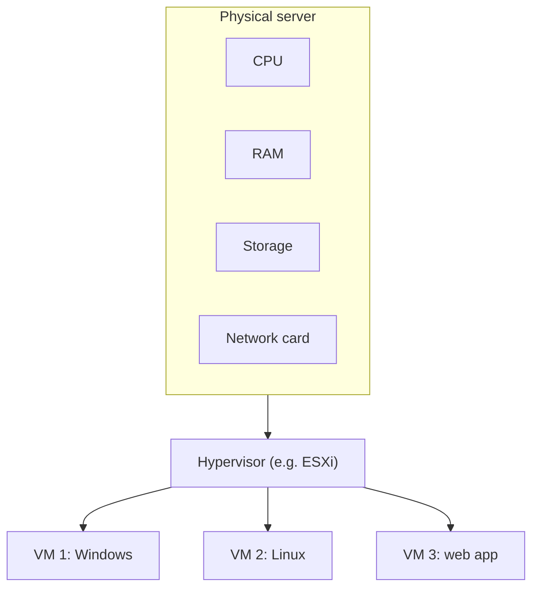
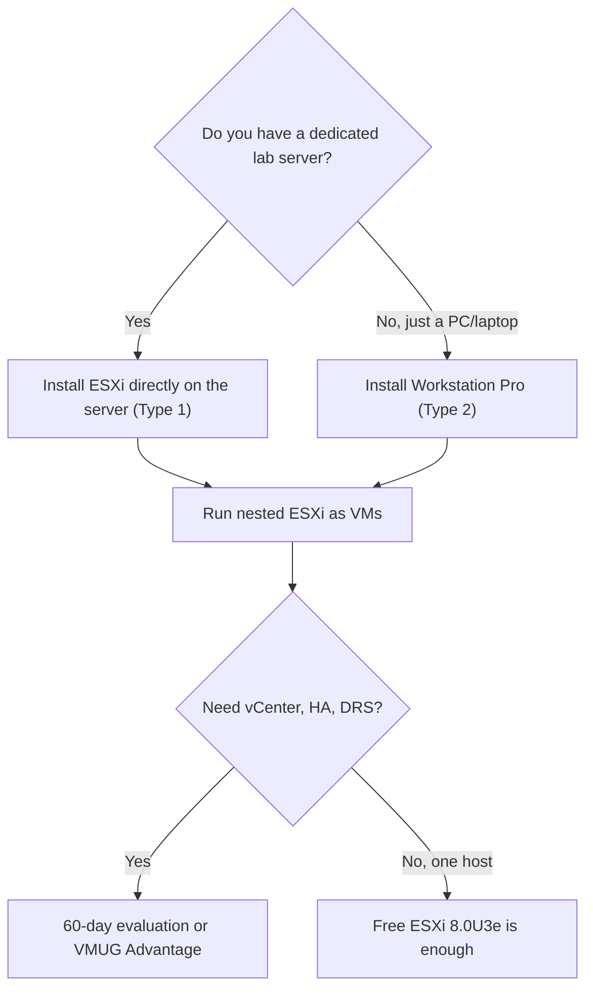

> This is the **LMS skeleton test lesson** (Stage 1). It has all 6 sections so we can check rendering, but it does not yet reach the 10-source threshold. The full version comes in Stage 3.

:::analogy
**The data center pain.** Before virtualization the rule was "one application, one server". Each physical server used power, rack space and licenses, yet sat mostly idle. A new application meant ordering hardware and waiting.

**Analogy: the apartment building.** A physical server is a building. Without virtualization one family lives in the whole building. With virtualization the building is split into isolated apartments: each family (a **virtual machine**, VM) has its own door, key and meter, but all share the same foundation, water and power. The **building manager** is the **hypervisor**: it decides how much power each apartment gets and keeps families from walking into each other's homes.
:::

:::architecture
### What a hypervisor does

A **hypervisor** sits between the hardware and the virtual machines. Each VM believes it has its own processor (**vCPU**), memory, disk and network card. In reality the hypervisor shares the physical resources and schedules them in turn.

### Type 1 vs Type 2

| | Type 1 (bare-metal) | Type 2 (hosted) |
|---|---|---|
| Runs on | Directly on hardware | As an app on Windows/Linux |
| VMware example | ESXi | VMware Workstation Pro |
| Used for | Production, data center | Laptop, study, lab |
| Cost (verified 2026-11-10) | ESXi 8.0U3e has a free edition with limits | Free for everyone since 2024-11-11 |

### Choosing a lab platform

**Nested virtualization** means running ESXi as a VM. It is the standard home lab method, but Broadcom **does not support it in production**: the only supported case is the vSAN Witness Appliance on physical ESXi.

`[IMAGE SEARCH / PROMPT]` Screenshot of VMware Host Client "Host → Manage → Licensing" on a free ESXi 8.0U3e. Screenshot of Workstation Pro "Processors" settings for an ESXi VM with hardware virtualization enabled.
:::

:::exam-alert
### Memorize

| What | Value | Source |
|---|---|---|
| Free ESXi 8.0U3e: max vCPU per VM | 8 | KB 399823 [S15] |
| Free ESXi 8.0U3e: physical CPUs per host | 2 | KB 399823 [S15] |
| Free ESXi: add to vCenter | Not possible | KB 399823 [S15] |
| vCenter 8.0 "Tiny" | 2 vCPU, 14 GB RAM, up to 10 hosts / 100 VMs | TechDocs [S19] |
| Workstation Pro free | Since 2024-11-11, including commercial use | VMware blog [S14] |

### 3 exam traps

1. **"ESXi is an operating system with a hypervisor installed on top."** False: ESXi *is* the hypervisor (Type 1), installed directly on hardware.
2. **"Nested ESXi is supported if it runs on Compatibility Guide hardware."** False: nested is unsupported in production regardless of hardware; the only exception is the vSAN Witness Appliance.
3. **"A free-licensed host can join an HA cluster so I can test failover."** False: a free host cannot be managed by vCenter, so no cluster and no HA.
:::

:::trenches
**Mistake 1: VMs inside nested ESXi have no network.** The nested host boots and has an IP, but VMs created inside it get no traffic. Cause: the physical host's virtual switch drops frames with MAC addresses it does not know. **Fix:** on a **VSS** enable Promiscuous mode and Forged Transmits on the lab port group; on a **VDS** use **MAC Learning**, which performs better. [S27]

**Mistake 2: "License not available" when adding the host to vCenter.** Someone installs ESXi from the Free ISO (build 24677879), then tries to add it to vCenter. It fails because the free license does not allow vCenter management. **Fix:** for vCenter labs use the standard ISO, which starts with a 60-day evaluation. A host installed from the Free ISO cannot enter trial mode. [S15] [S16]
:::

:::interview
**Junior/Mid: "What is the difference between a Type 1 and a Type 2 hypervisor? Give a VMware example of each."**

*Ideal answer:* Type 1 runs directly on hardware and controls physical resources, so overhead is low and it is used in production (ESXi). Type 2 runs as an application on a host OS and depends on it; it suits workstations and labs (Workstation Pro). A strong candidate adds that you can combine them, nested ESXi in Workstation for study, noting it is not supported in production.

**Troubleshooting scenario: "You built a lab with 3 nested ESXi hosts. The hosts answer ping, but VMs inside them can't reach the network. What do you check?"**

*Answer a Team Lead expects:* (1) Confirm only the inner VMs are affected, not the hosts. (2) Check the physical host's port group security: on a VSS, Promiscuous mode and Forged Transmits set to "Accept"; on a VDS, MAC Learning enabled. (3) Check VLAN consistency between the physical and nested layers. (4) Explain *why*: the nested host sends frames with the inner VMs' MACs, which the outer switch doesn't know and drops by default.
:::

:::lab
**Scenario:** build a single nested ESXi host on your laptop as the base for all future labs.

**You need:** a PC with hardware virtualization enabled in BIOS, VMware Workstation Pro and the ESXi ISO. Steps below are checkable; progress is saved in your browser.

**Failure/validation test:** after install, disconnect the ESXi VM's network adapter in Workstation. Host Client stops responding. Reconnect it: ESXi comes back without a reboot. This shows management traffic flows through the VM's vNIC, i.e. through Workstation's virtual network.
:::

:::quiz
Five original VCP-style questions. You get the explanation for every option right after answering.
:::

:::references
- VCP-VVF Administrator 2V0-16.25 exam guide, section 2.1 "Virtualization Fundamentals" [S02]
- KB 399823: free ESXi 8.0 Update 3e [S15]
- KB 313547: support for nested ESXi [S18]
- William Lam: nested ESXi networking requirements [S27]
:::
