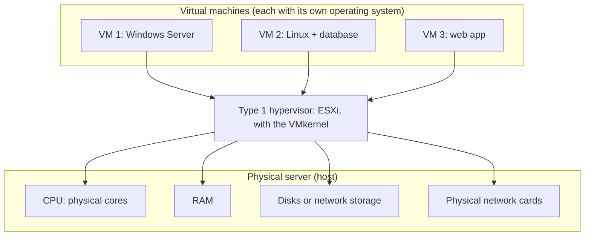
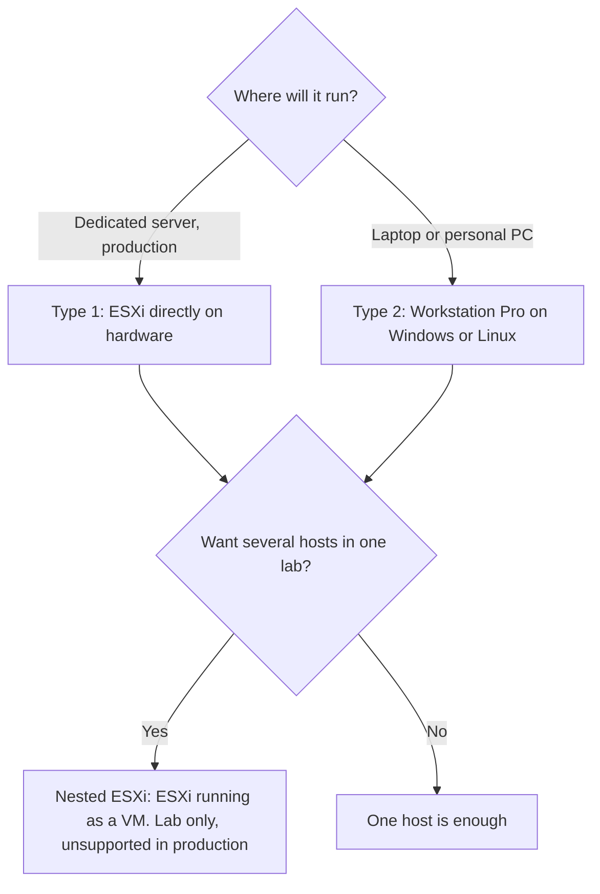
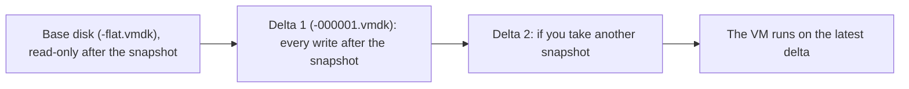

:::analogy
**The data center pain.** Until the early 2000s the rule in companies was "one application, one server". Email had its own machine, the database its own, accounting its own. The reason was simple: if two applications shared one operating system and one broke, it could drag the other down. The result was rooms full of servers that sat mostly idle yet consumed power, cooling, rack space and licenses. A new application meant ordering hardware and waiting weeks.

Virtualization solves exactly that. One physical server runs several "simulated" computers, isolated from each other. Today's exam guides still start here: objectives 2.1.1–2.1.3 of VVF (VMware vSphere Foundation, exam 2V0-16.25) ask you to describe the principles, use cases and value of virtualization. [S02] [S03]

**Analogy: the apartment building.** Think of a physical server as a building.

- **Without virtualization**, one family lives in the whole building. It uses two rooms out of twenty but pays upkeep for all of them.
- **With virtualization**, the building is split into apartments. Each family has its own door, key and meter. If one family floods its bathroom, the neighbors are fine. Each apartment is a **VM** (Virtual Machine).
- **The building manager** is the **hypervisor**. It shares water, power and heat among apartments, decides who gets how much, and keeps everyone out of each other's homes.

Keep this in mind: everything you learn from now on (clusters, migration, virtual networking, distributed storage) is really about the building manager getting smarter.
:::

:::architecture
### 1. What a hypervisor does

A **hypervisor** is the software layer between the hardware and the virtual machines. Each VM "believes" it has its own computer:

- its own processor: a **vCPU** (virtual CPU), scheduled by the hypervisor onto the cores of the physical **CPU** (Central Processing Unit);
- its own memory: **RAM** (Random Access Memory) allocated from the host's memory;
- its own disk: a file on a **datastore** (the storage container holding VM files);
- its own network card: a virtual **NIC** (Network Interface Card) connected to a virtual switch.

In ESXi, the kernel that does this sharing is the **VMkernel**. It schedules CPU, memory, storage and network for every VM on the host.

### 2. Why it is fast: hardware-assisted virtualization

Modern processors have extensions dedicated to virtualization. The official vSphere 9.0 performance guide describes two levels: [S40]

| Feature | Intel / AMD name | What it does |
|---|---|---|
| Hardware-assisted CPU virtualization | VT-x / AMD-V | The CPU traps a VM's sensitive instructions and hands them to the hypervisor cheaply. |
| Hardware-assisted MMU virtualization | EPT / RVI | The CPU keeps a second level of page tables (guest → host), so the hypervisor no longer maintains shadow page tables. Memory use drops, but TLB misses cost more; 2 MB large pages offset that. |

That is why VT-x or AMD-V must be enabled in the BIOS (Basic Input/Output System, the boot firmware) of any server used for virtualization.

### 3. Type 1 vs Type 2

| | Type 1 (bare-metal) | Type 2 (hosted) |
|---|---|---|
| Runs on | Directly on hardware | As an app on a host OS (Operating System) |
| Examples | ESXi, KVM, Hyper-V | VMware Workstation Pro, VirtualBox |
| Strengths | Performance and stability, small attack surface, moving VMs between servers | Easy to install on a laptop, good for testing |
| Weaknesses | Needs another machine to manage it | Extra overhead from the host OS, inherits its security risks |
| Where you find it | Data center, production | Workstation, study lab |

Comparison source: [S37]. Workstation Pro has been free for all users since November 11, 2024. [S14]

### 4. What a virtual machine is made of

A VM isn't magic: it is a set of files on a datastore. The vSphere 8 documentation lists them: [S38]

| File | Role |
|---|---|
| `.vmx` | The VM configuration (how many vCPUs, how much RAM, which disks) |
| `.vmdk` | Virtual disk descriptor |
| `-flat.vmdk` | The actual disk data |
| `.nvram` | The VM's BIOS or EFI settings |
| `.vswp` | The VM's swap file |
| `.vmsd` / `.vmsn` | Snapshot metadata and memory state |
| `.vmss` | State of a suspended VM |
| `.log` | VM logs |

A rule to remember: **a VM cannot have more vCPUs than the host has logical cores.** With hyperthreading on, the logical core count is double the physical core count. [S39]

### 5. Snapshots: useful, but dangerous

A **snapshot** saves a VM's state at a point in time. Afterwards the original disk becomes read-only and all new writes go to a delta file that **keeps growing**. The snapshot depends on the original disk, so it **is not a backup**. [S41]

### 6. Overcommit

The hypervisor lets you give VMs more vCPUs and RAM than the host physically has, because VMs rarely use everything at once. This is called **overcommit**. ESX has several memory reclamation techniques (page sharing, ballooning, compression, swap), but the performance guide recommends not pushing so far that the host swaps out active pages. [S40]

`[IMAGE SEARCH / PROMPT]` VMware Host Client screenshot: host page showing the logical processor count. Datastore Browser screenshot with a VM's files (`.vmx`, `.vmdk`, `.nvram`). Snapshot Manager screenshot with a two-snapshot chain.
:::

:::exam-alert
### Memorize

| What | Value / rule | Source |
|---|---|---|
| vCPU limit per VM | At most the host's logical core count | vSphere docs [S39] |
| VM configuration file | `.vmx` | vSphere 8 docs [S38] |
| Disk data | `-flat.vmdk` (the descriptor is `.vmdk`) | vSphere 8 docs [S38] |
| Snapshots: supported maximum in a chain | 32 | KB (Knowledge Base article) 318825 [S41] |
| Snapshots: recommended | 2–3 per chain, no longer than 72 hours | KB 318825 [S41] |
| Snapshot = backup? | **No** | KB 318825 [S41] |
| Nested ESXi in production | Unsupported; only exception is the vSAN Witness Appliance on physical ESXi | KB 313547 [S18] |
| Free ESXi 8.0U3e | Max 8 vCPU per VM, 2 physical CPUs, cannot be added to vCenter | KB 399823 [S15] |

### 3 exam traps

1. **"ESXi is an operating system you install a hypervisor on."** False. ESXi *is* the hypervisor (Type 1) and runs directly on hardware. The VMkernel is its core.
2. **"A snapshot is a quick backup."** False. A snapshot depends on the base disk; lose the base disk and the snapshot alone cannot rebuild the VM. [S41]
3. **"I can give a VM 32 vCPUs on a host with 16 logical cores, since overcommit exists."** False. Overcommit happens *across* VMs; a single VM can't exceed the host's logical cores. [S39]
:::

:::trenches
**Mistake 1: a forgotten snapshot stops every VM on a datastore.**
On the Broadcom community forum, an admin describes a 2 TB datastore with four thick-provisioned VMs. A backup job created snapshots, the delta file grew until it filled the datastore, and **all four** VMs froze, not just the one with the snapshot. Thick disks don't help: they reserve space for the disk, not for snapshot deltas. [S42] A recent r/vmware case shows the worse outcome: a snapshot started with too little free space left the VM unable to boot. [S43]
**Fix:** follow KB 318825 (2–3 snapshots, 72 hours max, a snapshot is not a backup), monitor datastore free space, and check which tools (backup, updates) create snapshots automatically. [S41]

**Mistake 2: oversized VMs that get slower, not faster.**
A beginner's reflex is to give a slow VM more vCPUs. The vSphere 9.0 performance guide says vCPUs beyond real need add overhead and can hurt performance on a busy host; even idle vCPUs consume resources, and a single-threaded app loses cache locality. [S40]
**Fix:** size the VM to its real load, measure before adding resources, and watch host load (the guide treats 80% CPU use as a reasonable ceiling and 90% as a warning sign). [S40]
:::

:::interview
**Junior/Mid question: "Explain the difference between a Type 1 and a Type 2 hypervisor. Where would you use each?"**

*Ideal answer:* Type 1 runs directly on hardware, like ESXi, so it controls CPU, memory and I/O directly, with low overhead and a small attack surface. It is used in the data center. Type 2 runs as an app on a host OS, like Workstation Pro, so it depends on that OS and loses some performance, but it is ideal on a workstation. A strong candidate adds that you can combine them for a lab (nested ESXi in Workstation) and notes that this is unsupported in production. [S37] [S18]

**Troubleshooting scenario: "Monday morning, every VM on one datastore is frozen. Other datastores are fine. What do you do?"**

*Answer a Team Lead expects:*
1. **Scope the problem.** Only VMs on that datastore are affected, so I suspect the datastore, not the hosts.
2. **Check free space.** A full datastore blocks writes for every VM on it.
3. **Look for snapshots.** I check Snapshot Manager and the VM folders for large delta files, and whether a backup job left snapshots behind. [S42]
4. **Free space safely.** Move a VM to another datastore or grow the datastore. I do **not** delete delta files by hand, which can leave the VM unable to boot. [S43]
5. **Prevent it.** Alarms on datastore free space and a team rule: snapshots live no longer than 72 hours. [S41]
:::

:::lab
**Scenario.** Your lab is already running and you can reach an ESXi host through VMware Host Client (the host's web UI). You create your first VM, look at its files on the datastore, and check two rules from this lesson: the vCPU limit and how a snapshot behaves.

**What we skip:** installing an operating system in the VM. An empty VM is enough for what we observe and saves time.

The steps below are checkable and progress is saved in your browser. Where it says `⚠ to verify`, the exact button name may differ between Host Client 8 and 9.

**Failure / validation test.** In step 5 you deliberately try to give the VM more vCPUs than the host's logical cores. Host Client should not accept the value. If it does, write down the ESXi version and logical core count: you probably misread the logical cores in step 2.
:::

:::quiz
Five original questions in the style of VCP (VMware Certified Professional) exams. You get the explanation for every option right after answering.
:::

:::references
- VCP-VVF Administrator 2V0-16.25 exam guide, objectives 2.1.1–2.1.3 [S02]
- VCP-VCF Administrator 2V0-17.25 exam guide (VCF = VMware Cloud Foundation), objective 2.1 [S03]
- VCP-DCV 2V0-21.23 exam guide (DCV = Data Center Virtualization, Legacy certification), objective 1.1 [S47]
- Performance Best Practices for vSphere 9.0: hardware-assisted virtualization, overcommit, VM sizing [S40]
- vSphere docs: VM files [S38] and the vCPU limit [S39]
- KB 318825: snapshot best practices [S41]
- KB 313547: nested ESXi support [S18]
- Community cases: datastore filled by snapshots [S42], [S43]
:::
