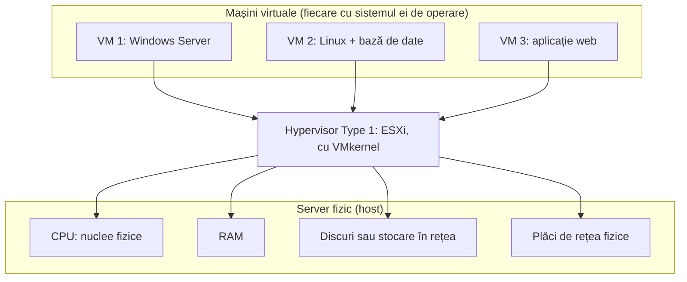
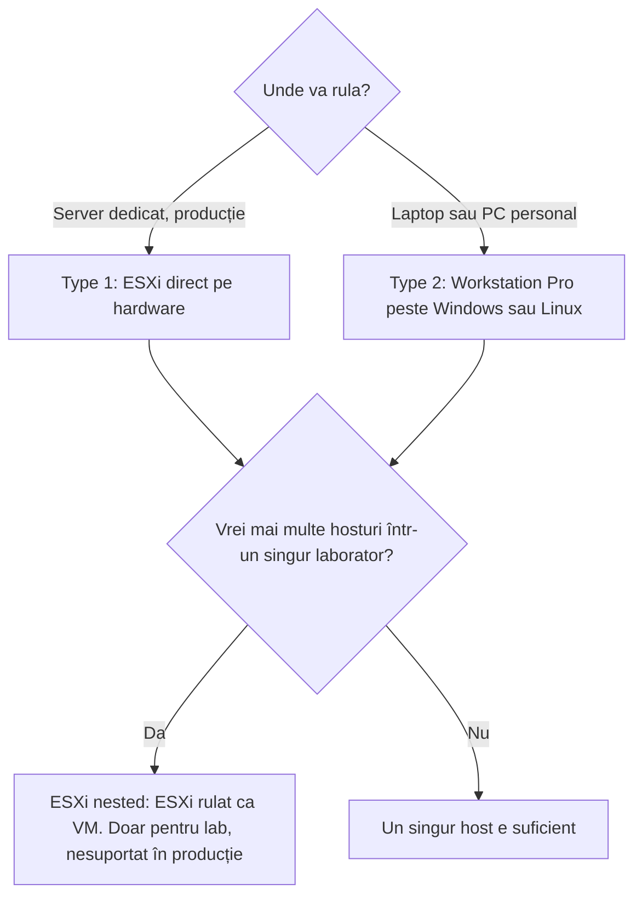
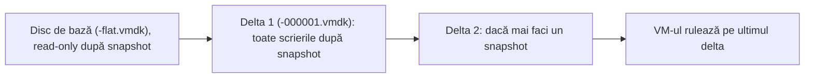

:::analogy
**Durerea din data center.** Până la începutul anilor 2000, regula în companii era „o aplicație, un server”. Serverul de e-mail avea mașina lui, baza de date pe a ei, aplicația de contabilitate pe a ei. Motivul era simplu: dacă două aplicații stăteau pe același sistem de operare și una se strica, o trăgea după ea și pe cealaltă. Rezultatul: săli pline de servere care stăteau mare parte din timp aproape nefolosite, dar consumau curent, răcire, spațiu în rack și licențe. O aplicație nouă însemna să comanzi hardware și să aștepți săptămâni.

Virtualizarea rezolvă exact asta. Pe un singur server fizic rulezi mai multe calculatoare „simulate”, izolate unul de altul. Exam guide-urile actuale încep tot de aici: obiectivele 2.1.1–2.1.3 din VVF (VMware vSphere Foundation, examenul 2V0-16.25) cer să descrii principiile, cazurile de utilizare și valoarea virtualizării. [S02] [S03]

**Analogia: blocul de apartamente.** Gândește-te la un server fizic ca la o clădire.

- **Fără virtualizare**, o singură familie locuiește în toată clădirea. Folosește două camere din douăzeci, dar plătește întreținerea pentru toate.
- **Cu virtualizare**, clădirea e împărțită în apartamente. Fiecare familie are ușa ei, cheia ei, contorul ei. Dacă o familie își inundă baia, vecinii nu pățesc nimic. Fiecare apartament este o **VM** (Virtual Machine, mașină virtuală).
- **Administratorul blocului** este **hypervisorul**. El împarte apa, curentul și căldura între apartamente, decide cine primește cât și se asigură că nimeni nu intră peste altcineva.

Țin-o minte: tot ce vei învăța de acum (clustere, migrare, rețea virtuală, stocare distribuită) este, în fond, despre cum administratorul blocului devine mai inteligent.
:::

:::architecture
### 1. Ce face un hypervisor

Un **hypervisor** este stratul de software care stă între hardware și mașinile virtuale. Fiecare VM „crede” că are propriul ei calculator:

- propriul procesor: **vCPU** (virtual CPU, procesor virtual), programat de hypervisor pe nucleele **CPU**-ului fizic (Central Processing Unit, procesorul);
- propria memorie: **RAM** (Random Access Memory, memoria de lucru) alocată din memoria hostului;
- propriul disc: un fișier pe un **datastore** (spațiul de stocare unde stau fișierele VM-urilor);
- propria placă de rețea: un **NIC** (Network Interface Card, placa de rețea) virtual, conectat la un switch virtual.

În ESXi, nucleul care face această împărțire se numește **VMkernel**. El programează CPU-ul, memoria, stocarea și rețeaua pentru toate VM-urile de pe host.

### 2. De ce merge repede: virtualizarea asistată de hardware

Procesoarele moderne au extensii dedicate virtualizării. Ghidul oficial de performanță pentru vSphere 9.0 descrie două niveluri: [S40]

| Funcție | Nume la Intel / AMD | Ce face, pe scurt |
|---|---|---|
| Virtualizarea CPU asistată de hardware | VT-x / AMD-V | Procesorul „prinde” instrucțiunile sensibile ale unei VM și le predă hypervisorului, cu cost mic. |
| Virtualizarea memoriei asistată de hardware | EPT / RVI | Procesorul ține un al doilea nivel de tabele de pagini (guest → host), deci hypervisorul nu mai întreține tabele „umbră”. Consumul de memorie scade, dar ratările de TLB costă mai mult; paginile mari de 2 MB compensează. |

De asta, în BIOS-ul (Basic Input/Output System, firmware-ul de pornire) unui server folosit pentru virtualizare, extensiile VT-x sau AMD-V trebuie să fie activate.

### 3. Type 1 vs Type 2

| | Type 1 (bare-metal) | Type 2 (hosted) |
|---|---|---|
| Unde rulează | Direct pe hardware, fără alt software dedesubt | Ca aplicație, pe un OS (Operating System, sistem de operare) gazdă |
| Exemple | ESXi, KVM, Hyper-V | VMware Workstation Pro, VirtualBox |
| Puncte forte | Performanță și stabilitate, suprafață de atac mică, migrare de VM-uri între servere | Ușor de instalat pe un laptop, bun pentru teste |
| Puncte slabe | Ai nevoie de altă mașină ca să-l administrezi | Overhead în plus din cauza OS-ului gazdă, moștenește riscurile lui de securitate |
| Unde îl găsești | Data center, producție | Stația de lucru, laboratorul de studiu |

Sursa comparației: [S37]. Workstation Pro este gratuit pentru toți utilizatorii din 11 noiembrie 2024. [S14]

### 4. Din ce e făcută o mașină virtuală

O VM nu e „magie”: este un set de fișiere pe un datastore. Documentația vSphere 8 le enumeră astfel: [S38]

| Fișier | Rol |
|---|---|
| `.vmx` | Configurația VM-ului (câte vCPU, cât RAM, ce discuri) |
| `.vmdk` | Descriptorul discului virtual |
| `-flat.vmdk` | Datele propriu-zise ale discului |
| `.nvram` | Setările de BIOS sau EFI ale VM-ului |
| `.vswp` | Fișierul de swap al VM-ului |
| `.vmsd` / `.vmsn` | Metadatele și starea memoriei pentru snapshot-uri |
| `.vmss` | Starea unei VM suspendate |
| `.log` | Jurnalele VM-ului |

O regulă de reținut: **o VM nu poate avea mai multe vCPU decât are hostul nuclee logice.** Cu hyperthreading activat, numărul de nuclee logice este dublu față de cel al nucleelor fizice. [S39]

### 5. Snapshot-ul: util, dar periculos

Un **snapshot** salvează starea unei VM la un moment dat. După snapshot, discul original devine read-only, iar toate scrierile noi merg într-un fișier delta care **crește continuu**. Snapshot-ul depinde de discul original, deci **nu este backup**. [S41]

### 6. Overcommit

Hypervisorul îți permite să aloci VM-urilor mai multe vCPU și mai mult RAM decât are fizic hostul, pentru că rareori toate VM-urile folosesc totul simultan. Asta se numește **overcommit**. ESX are mai multe tehnici prin care recuperează memorie (partajarea paginilor, ballooning, compresie, swap), dar ghidul de performanță recomandă să nu exagerezi până când hostul începe să facă swap la paginile active. [S40]

`[IMAGE SEARCH / PROMPT]` Captură din VMware Host Client: pagina hostului cu numărul de procesoare logice. Captură din Datastore Browser cu fișierele unei VM (`.vmx`, `.vmdk`, `.nvram`). Captură din Snapshot Manager cu un lanț de două snapshot-uri.
:::

:::exam-alert
### De memorat

| Ce | Valoare / regulă | Sursă |
|---|---|---|
| Limita de vCPU per VM | Cel mult numărul de nuclee logice ale hostului | Docs vSphere [S39] |
| Fișierul de configurare al VM | `.vmx` | Docs vSphere 8 [S38] |
| Datele discului | `-flat.vmdk` (descriptorul e `.vmdk`) | Docs vSphere 8 [S38] |
| Snapshot-uri: maxim suportat într-un lanț | 32 | KB (Knowledge Base article, articol oficial de suport) 318825 [S41] |
| Snapshot-uri: recomandat | 2–3 într-un lanț, cel mult 72 de ore | KB 318825 [S41] |
| Snapshot = backup? | **Nu** | KB 318825 [S41] |
| ESXi nested în producție | Nesuportat; excepție doar vSAN Witness Appliance pe ESXi fizic | KB 313547 [S18] |
| ESXi Free 8.0U3e | Maxim 8 vCPU per VM, 2 CPU fizice, nu se poate adăuga în vCenter | KB 399823 [S15] |

### 3 capcane de examen

1. **„ESXi este un sistem de operare peste care instalezi un hypervisor.”** Fals. ESXi *este* hypervisorul (Type 1) și rulează direct pe hardware. VMkernel-ul este nucleul lui.
2. **„Snapshot-ul e o formă rapidă de backup.”** Fals. Snapshot-ul depinde de discul de bază; dacă discul de bază se pierde, snapshot-ul singur nu reface VM-ul. [S41]
3. **„Pot da unei VM 32 de vCPU pe un host cu 16 nuclee logice, pentru că oricum se face overcommit.”** Fals. Overcommit-ul se face *între* VM-uri; o singură VM nu poate depăși numărul de nuclee logice ale hostului. [S39]
:::

:::trenches
**Greșeala 1: un snapshot uitat oprește toate VM-urile de pe un datastore.**
Pe forumul comunității Broadcom, un administrator descrie un datastore de 2 TB cu patru VM-uri cu discuri thick. Un job de backup a creat snapshot-uri, fișierul delta a crescut până a umplut datastore-ul și **toate** cele patru VM-uri au înghețat, nu doar cea cu snapshot. Discurile thick nu ajută: ele rezervă spațiu pentru disc, nu și pentru delta snapshot-ului. [S42] Un caz recent de pe r/vmware arată și varianta mai rea: un snapshot pornit cu prea puțin spațiu liber a lăsat VM-ul fără să mai poată porni. [S43]
**Remediere:** urmezi regulile din KB 318825 (2–3 snapshot-uri, maxim 72 de ore, snapshot-ul nu e backup), monitorizezi spațiul liber al datastore-urilor și verifici ce instrumente (backup, update-uri) creează snapshot-uri automat. [S41]

**Greșeala 2: VM-uri „supradimensionate” care merg mai încet, nu mai repede.**
Reflexul de începător e să dai unei VM lente mai multe vCPU. Ghidul de performanță vSphere 9.0 spune că un vCPU în plus față de nevoia reală adaugă overhead și poate strica performanța pe un host aglomerat; chiar și vCPU-urile inactive consumă resurse, iar o aplicație single-threaded își pierde localitatea în cache. [S40]
**Remediere:** dimensionezi VM-ul după încărcarea reală, măsori înainte să adaugi resurse și urmărești încărcarea hostului (ghidul consideră 80% utilizare CPU un plafon rezonabil și 90% un semnal de alarmă). [S40]
:::

:::interview
**Întrebare Junior/Mid: „Explică-mi diferența dintre un hypervisor Type 1 și unul Type 2. Unde ai folosi fiecare?”**

*Răspunsul ideal:* Type 1 rulează direct pe hardware, cum e ESXi, deci controlează direct CPU-ul, memoria și I/O-ul, are overhead mic și o suprafață de atac redusă. Se folosește în data center. Type 2 rulează ca aplicație peste un OS gazdă, cum e Workstation Pro, deci depinde de acel OS și pierde ceva performanță, dar e ideal pe o stație de lucru. Un candidat bun adaugă că poți combina cele două pentru un laborator (ESXi nested în Workstation) și precizează că asta nu e suportat în producție. [S37] [S18]

**Scenariu de troubleshooting: „Luni dimineață, toate VM-urile de pe un datastore sunt înghețate. Pe celelalte datastore-uri totul merge. Ce faci?”**

*Răspunsul pe care îl așteaptă un Team Lead:*
1. **Delimitez problema.** Sunt afectate doar VM-urile de pe acel datastore, deci suspectez datastore-ul, nu hosturile.
2. **Verific spațiul liber.** Un datastore plin oprește scrierile pentru toate VM-urile de pe el.
3. **Caut snapshot-uri.** Mă uit în Snapshot Manager și în folderele VM-urilor după fișiere delta mari; verific dacă un job de backup a lăsat snapshot-uri în urmă. [S42]
4. **Eliberez spațiu în siguranță.** Mut o VM pe alt datastore sau măresc datastore-ul. **Nu** șterg fișiere delta de mână, pentru că asta poate lăsa VM-ul fără să mai pornească. [S43]
5. **Previn.** Pun alarme pe spațiul liber al datastore-urilor și o regulă de echipă: snapshot-urile nu stau mai mult de 72 de ore. [S41]
:::

:::lab
**Scenariu.** Ai deja laboratorul pornit și acces la un host ESXi prin VMware Host Client (interfața web a hostului). Creezi prima VM, te uiți la fișierele ei pe datastore și verifici două reguli din lecție: limita de vCPU și felul în care se comportă un snapshot.

**Ce nu facem aici:** nu instalăm un sistem de operare în VM. Pentru ce urmărim, o VM goală e suficientă și economisește timp.

Pașii de mai jos sunt bifabili, iar progresul se salvează în browser. Unde scrie `⚠ de verificat`, numele exact al butonului poate diferi între versiunile Host Client 8 și 9.

**Test de avarie / validare.** La pasul 5 încerci intenționat să dai VM-ului mai multe vCPU decât nuclee logice are hostul. Host Client nu trebuie să-ți permită valoarea. Dacă ți-o permite, notează versiunea ESXi și numărul de nuclee logice: e un semn că ai citit greșit numărul de nuclee logice de la pasul 2.
:::

:::quiz
Cinci întrebări originale, în stilul examenelor VCP (VMware Certified Professional). Primești explicația pentru fiecare variantă imediat după ce răspunzi.
:::

:::references
- Exam guide VCP-VVF Administrator 2V0-16.25, obiectivele 2.1.1–2.1.3 [S02]
- Exam guide VCP-VCF Administrator 2V0-17.25 (VCF = VMware Cloud Foundation), obiectivul 2.1 [S03]
- Exam guide VCP-DCV 2V0-21.23 (DCV = Data Center Virtualization, certificare Legacy), obiectivul 1.1 [S47]
- Performance Best Practices for vSphere 9.0: virtualizarea asistată de hardware, overcommit, dimensionarea VM-urilor [S40]
- Documentația vSphere: fișierele unei VM [S38] și limita de vCPU [S39]
- KB 318825: bune practici pentru snapshot-uri [S41]
- KB 313547: suportul pentru ESXi nested [S18]
- Cazuri din comunitate: datastore plin din cauza snapshot-urilor [S42], [S43]
:::
