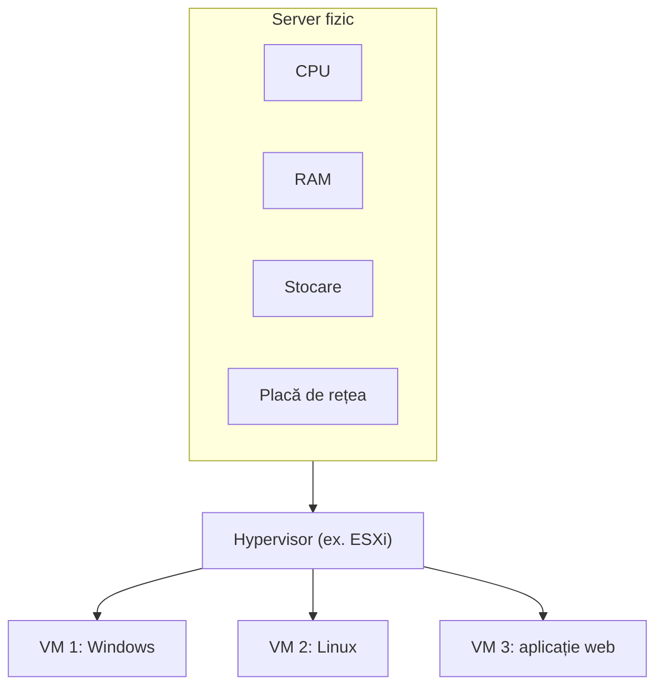
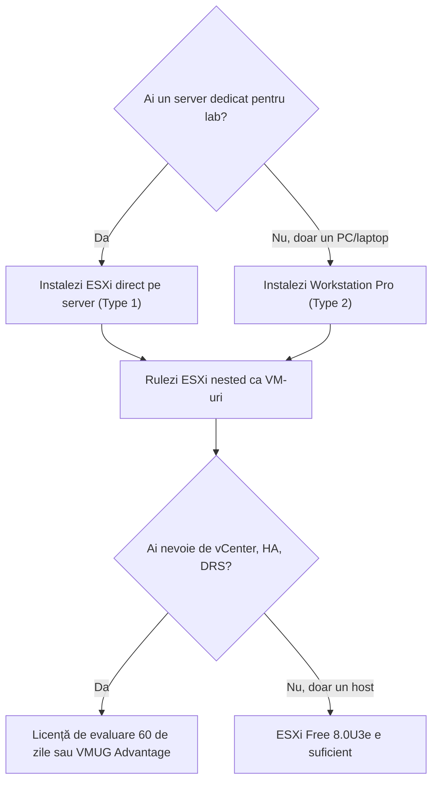

> Aceasta este **lecția de test a scheletului LMS** (Etapa 1). Are toate cele 6 secțiuni ca să verificăm randarea, dar nu atinge încă pragul de 10 surse citite. Varianta completă vine în Etapa 3.

:::analogy
**Durerea din data center.** Înainte de virtualizare, regula era „o aplicație, un server”. Fiecare server fizic consuma curent, spațiu în rack și licențe, dar stătea mare parte din timp aproape nefolosit. Adăugarea unei aplicații noi însemna să comanzi hardware și să aștepți.

**Analogia: blocul de apartamente.** Un server fizic e ca o clădire. Fără virtualizare, o singură familie locuiește în toată clădirea. Cu virtualizare, clădirea e împărțită în apartamente izolate: fiecare familie (o **mașină virtuală**, VM) are ușa ei, cheia ei și contorul ei, dar toate folosesc aceeași fundație, aceeași apă și același curent. **Administratorul blocului** este **hypervisorul**: el decide cât curent primește fiecare apartament și se asigură că o familie nu intră peste alta.
:::

:::architecture
### Ce face un hypervisor

Un **hypervisor** stă între hardware și mașinile virtuale. Fiecare VM crede că are propriul procesor (**vCPU** — virtual CPU), propria memorie, propriul disc și propria placă de rețea. În realitate, hypervisorul împarte resursele fizice și le programează pe rând.

### Type 1 vs Type 2

| | Type 1 (bare-metal) | Type 2 (hosted) |
|---|---|---|
| Unde rulează | Direct pe hardware | Ca aplicație pe Windows/Linux |
| Exemplu VMware | ESXi | VMware Workstation Pro |
| Folosit pentru | Producție, data center | Laptop, studiu, laborator |
| Cost (verificat 10.11.2026) | ESXi 8.0U3e are ediție gratuită cu limitări | Gratuit pentru toți din 11.11.2024 |

### Cum alegi platforma pentru laborator

**Nested virtualization** înseamnă să rulezi ESXi ca VM. E metoda standard pentru home lab, dar Broadcom **nu o suportă în producție**: singurul caz suportat este vSAN Witness Appliance pe un ESXi fizic.

`[IMAGE SEARCH / PROMPT]` Captură din VMware Host Client: pagina „Host → Manage → Licensing” pe un ESXi Free 8.0U3e. Captură din Workstation Pro: setările „Processors” ale unei VM ESXi, cu opțiunea de virtualizare hardware bifată.
:::

:::exam-alert
### De memorat

| Ce | Valoare | Sursă |
|---|---|---|
| ESXi Free 8.0U3e: vCPU maxim per VM | 8 | KB 399823 [S15] |
| ESXi Free 8.0U3e: CPU fizice per host | 2 | KB 399823 [S15] |
| ESXi Free: adăugare în vCenter | Nu este posibilă | KB 399823 [S15] |
| vCenter 8.0 „Tiny” | 2 vCPU, 14 GB RAM, până la 10 hosturi / 100 VM | TechDocs [S19] |
| Workstation Pro gratuit | Din 11.11.2024, inclusiv uz comercial | Blog VMware [S14] |

### 3 capcane de examen

1. **„ESXi e un sistem de operare cu un hypervisor instalat peste.”** Fals: ESXi *este* hypervisorul (Type 1), instalat direct pe hardware.
2. **„Nested ESXi e suportat dacă îl rulezi pe hardware din Compatibility Guide.”** Fals: nested e nesuportat în producție indiferent de hardware; excepția e doar vSAN Witness Appliance.
3. **„Un host cu licența gratuită poate fi pus într-un cluster HA ca să testez failover.”** Fals: hostul gratuit nu poate fi gestionat de vCenter, deci nici cluster, nici HA.
:::

:::trenches
**Greșeala 1: VM-urile din ESXi nested nu au rețea.** Hostul nested pornește, are IP, dar VM-urile create în el nu primesc trafic. Cauza: switch-ul virtual al hostului fizic aruncă cadrele cu adrese MAC pe care nu le cunoaște. **Remediere:** pe un **VSS** activezi Promiscuous mode și Forged Transmits pe port group-ul labului; pe un **VDS** folosești **MAC Learning**, care e mai performant. [S27]

**Greșeala 2: „License not available” la adăugarea hostului în vCenter.** Cineva instalează ESXi din ISO-ul Free (build 24677879) și apoi încearcă să-l adauge în vCenter. Operația eșuează, pentru că licența gratuită nu permite management din vCenter. **Remediere:** pentru laboratoarele cu vCenter folosești ISO-ul standard, care pornește cu evaluare de 60 de zile. Un host instalat din ISO-ul Free nu poate intra în trial. [S15] [S16]
:::

:::interview
**Junior/Mid: „Care e diferența dintre un hypervisor Type 1 și Type 2? Dă câte un exemplu VMware.”**

*Răspunsul ideal:* Type 1 rulează direct pe hardware și controlează resursele fizice, deci are overhead mic și e folosit în producție (ESXi). Type 2 rulează ca aplicație pe un sistem de operare gazdă, deci depinde de acel OS; e potrivit pentru stații de lucru și laboratoare (Workstation Pro). Un candidat bun adaugă că poți combina cele două: ESXi nested în Workstation pentru studiu, cu mențiunea că nu e suportat în producție.

**Scenariu de troubleshooting: „Ai făcut un lab cu 3 ESXi nested. Hosturile răspund la ping, dar VM-urile din ele nu ajung în rețea. Ce verifici?”**

*Răspunsul ideal pe care îl așteaptă un Team Lead:* (1) Confirm că problema e doar la VM-urile din hosturile nested, nu la hosturi. (2) Verific setările de securitate ale port group-ului de pe hostul fizic: pe VSS, Promiscuous mode și Forged Transmits trebuie să fie „Accept”; pe VDS, MAC Learning activat. (3) Verific VLAN-ul de pe port group (consistent între nivelul fizic și cel nested). (4) Explic *de ce*: hostul nested trimite cadre cu MAC-urile VM-urilor interioare, pe care switch-ul exterior nu le cunoaște și le aruncă implicit.
:::

:::lab
**Scenariu:** creezi un singur host ESXi nested pe laptop, ca bază pentru toate laboratoarele viitoare.

**Ce ai nevoie:** un PC cu virtualizare hardware activată în BIOS, VMware Workstation Pro și ISO-ul ESXi. Pașii de mai jos sunt bifabili; progresul se salvează în browser.

**Test de avarie/validare:** după instalare, deconectează placa de rețea a VM-ului ESXi din Workstation. Host Client nu mai răspunde. Reconectează-o: ESXi revine fără restart. Asta arată că managementul trece prin vNIC-ul VM-ului, adică prin rețeaua virtuală a Workstation.
:::

:::quiz
Cinci întrebări în stil VCP, originale. Primești explicația pentru fiecare variantă imediat după răspuns.
:::

:::references
- Exam guide VCP-VVF Administrator 2V0-16.25, secțiunea 2.1 „Virtualization Fundamentals” [S02]
- KB 399823: ESXi 8.0 Update 3e gratuit [S15]
- KB 313547: suportul pentru ESXi nested [S18]
- William Lam: cerințele de rețea pentru ESXi nested [S27]
:::
