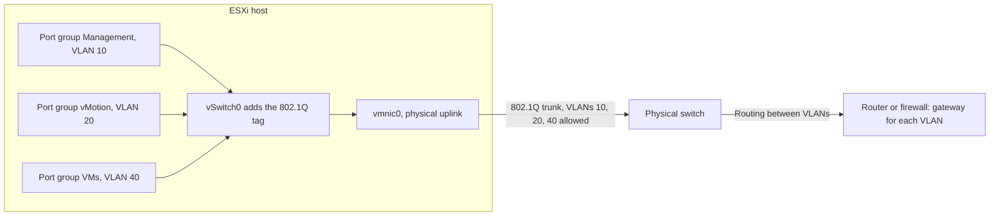
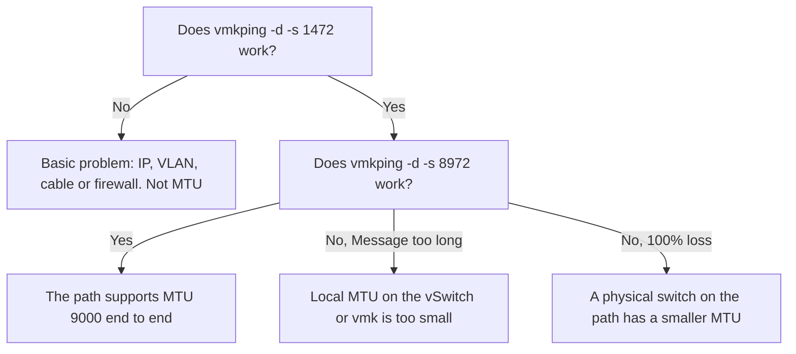
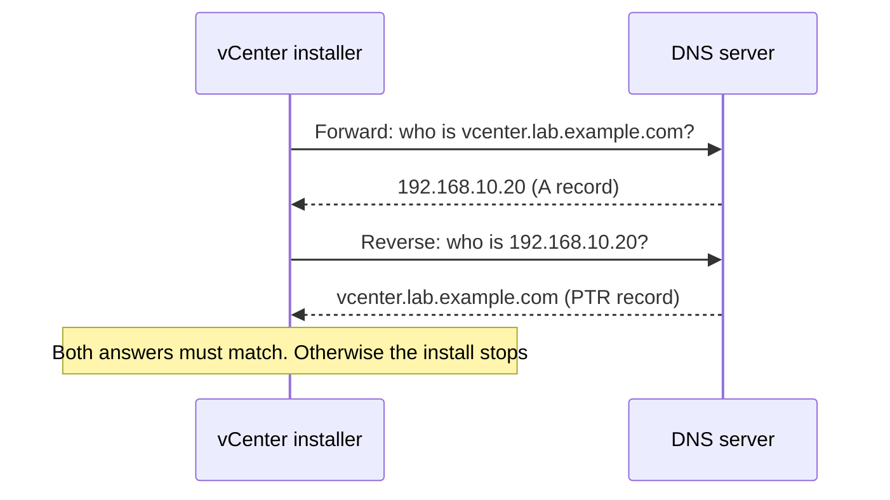
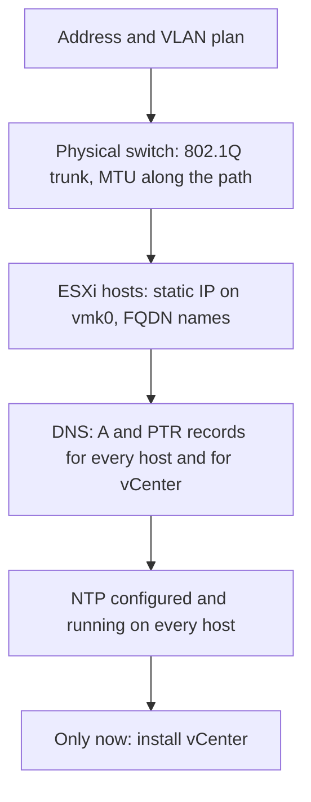

:::analogy
**The data center pain.** Most failed vCenter installs you read about on forums have nothing to do with vCenter. They fail because a DNS (Domain Name System, the service that turns names into addresses) record is missing, because a host's clock has drifted, or because someone set MTU (Maximum Transmission Unit, the largest packet size) 9000 on the virtual switch but not on the physical switch. A good VMware engineer does not have to be a network engineer, but must understand these five topics well enough to check them alone. The VCF (VMware Cloud Foundation, exam 2V0-17.25) candidate profile assumes you already know DNS and NTP (Network Time Protocol), and the older VCP-DCV (VMware Certified Professional - Data Center Virtualization) guide listed them under host configuration. [S03] [S47]

**The analogy: a town with a post office.**

- The **IP address** (Internet Protocol) is the house address. The **subnet mask** tells you which street you are on: neighbours on the same street can knock on your door directly. The **gateway** is the post office: everything going to another district passes through it.
- A **VLAN** (Virtual Local Area Network) is a floor in an office building with badge access. Same building (same physical switch), but someone on floor 10 cannot reach floor 20 without going past reception (a router).
- The **MTU** is the largest parcel that fits through the door. If one door along the route is small, a large parcel never arrives.
- **DNS** is the phone book: from a name you get the address, and with the reverse lookup you get the name from the address. vCenter needs both directions.
- **NTP** is the clock on the town hall tower that everyone sets their watch by. Tickets (certificates and authentication tokens) have an expiry time; if the clocks differ, valid tickets look expired.
:::

:::architecture
### 1. IP addresses, subnets and the gateway

Every network interface has an IPv4 address such as `192.168.10.11`. The subnet mask says which part of the address is the "street" (network) and which is the "house number" (host). Today the mask is usually written in **CIDR** (Classless Inter-Domain Routing) notation: `/24` means the first 24 bits are the network, so the mask is `255.255.255.0`. RFC 4632 itself uses the example `192.168.99.0/24`. [S65]

Labs and internal networks use private addresses that are not routed on the Internet. RFC 1918 reserves three blocks: [S64]

| Private block | Range |
|---|---|
| `10.0.0.0/8` | 10.0.0.0 – 10.255.255.255 |
| `172.16.0.0/12` | 172.16.0.0 – 172.31.255.255 |
| `192.168.0.0/16` | 192.168.0.0 – 192.168.255.255 |

On an ESXi host the IP address does not live on the physical NIC (Network Interface Card, named vmnic on ESXi) but on a **VMkernel adapter** (vmk0, vmk1…). vmk0 is usually the management interface: Host Client answers on it and the host talks to vCenter through it. Later you will create separate vmks for vMotion and storage.

Example address plan for a lab (illustrative only, pick your own ranges):

| Network | VLAN | Subnet | What lives here |
|---|---|---|---|
| Management | 10 | 192.168.10.0/24 | Host vmk0, vCenter, DNS, NTP |
| vMotion | 20 | 192.168.20.0/24 | vmk1, no gateway needed |
| Storage | 30 | 192.168.30.0/24 | vmk2 for iSCSI (Internet Small Computer Systems Interface) or NFS (Network File System) |
| VMs | 40 | 192.168.40.0/24 | Every test VM (Virtual Machine) you create |

### 2. VLANs: one NIC, several networks

A VLAN separates traffic logically on the same physical equipment. Ethernet frames get a standard 802.1Q tag carrying the VLAN number. On a vSphere Standard Switch, the VLAN ID set on the port group decides who adds the tag. KB (Knowledge Base article) 311540 describes the three modes: [S50]

| Port group VLAN ID | Mode | Who tags |
|---|---|---|
| 0 | **EST** (External Switch Tagging) | The physical switch; the physical port is an access port |
| 1–4094 | **VST** (Virtual Switch Tagging) | The virtual switch; the most common mode |
| 4095 | **VGT** (Virtual Guest Tagging) | The guest operating system; the port group becomes a trunk to the VM |

For VST the physical switch port facing the host must be an **802.1Q trunk** with the VLANs allowed. ESXi supports neither ISL (Cisco's proprietary trunking protocol) nor DTP (Cisco's automatic trunk negotiation), so negotiation is disabled. The same KB warns not to use the physical switch's native VLAN on a VST port group: native VLAN traffic leaves the switch untagged and the host does not deliver it to that port group. [S50]



### 3. MTU and jumbo frames

Standard Ethernet MTU is 1500 bytes. **Jumbo frames** usually means MTU 9000; they are used for vMotion, vSAN and IP storage because bigger packets mean less overhead. The golden rule from KB 419088: MTU must be configured **along the whole path**, and the physical switches are changed **before** the virtual switch. vMotion, vSAN and iSCSI send traffic with the "do not fragment" bit set; if a device on the path has a smaller MTU, large packets are dropped, not fragmented. [S52]

Where to set it in vSphere (KB 324494): on the **switch** (vSphere Standard Switch or Distributed Switch) and on each **VMkernel adapter** that should use jumbo frames. The switch can be at 9000 without every vmk being at 9000, but a vmk at 9000 needs a switch at 9000. Changing the switch MTU does not change existing vmks. On a Distributed Switch, changing MTU briefly restarts the uplinks, so it causes a short outage. [S53] [S52]

**How to test correctly** (KB 313061): use `vmkping` from the host with the "do not fragment" bit (`-d`) and a payload size (`-s`) equal to MTU minus 28 bytes of overhead: [S51]

```bash
vmkping -I vmk1 -d -s 8972 <other host IP>   # checks MTU 9000
vmkping -I vmk1 -d -s 1472 <other host IP>   # checks MTU 1500
vmkping -I vmk1 -d -s 1473 <other host IP>   # must FAIL if the path is 1500
```



### 4. DNS: forward and reverse lookup

DNS works in two directions:

- **Forward lookup** (A record): name `vcenter.lab.example.com` → address `192.168.10.20`.
- **Reverse lookup** (**PTR**, Pointer record): address `192.168.10.20` → name `vcenter.lab.example.com`.

vCenter checks both. KB 305807 describes a vCenter install that fails saying the **FQDN** (Fully Qualified Domain Name) cannot be resolved, even though the name resolves fine by hand. The cause was a missing or wrong PTR record. [S55] KB 405215 shows the same problem in vCenter upgrade pre-checks and gives the simple test: `nslookup <name>` must return the IP and `nslookup <IP>` must return the name. [S56]

VCF 9 goes further: the installer rejects ESXi hosts registered with a short name, with the error "Host name is not a FQDN". [S57] One more detail for later: `.local` domains are reserved for multicast DNS. vCenter and ESXi hosts accept them, but VCF services that run in containers (VCF Automation, VCF Identity Broker, Supervisor) cannot be deployed on a `.local` domain. In your lab, choose a subdomain of a domain you own from the start. [S58]



### 5. NTP: why the clock matters

The vSphere security documentation explains the problem: certificates and authentication tokens (SAML, the token format used by vCenter Single Sign-On) are only valid within a time window. If system clocks differ, a system may reject a perfectly valid certificate or token. The result: failed logins, failed installs, or the vCenter `vmware-vpxd` service not starting. The recommendation is to sync the host where vCenter will be deployed with NTP or PTP (Precision Time Protocol) **before** installing. [S59]

What you need to know in practice:

- ESXi uses an NTPv4 client, and the time source can be an Active Directory domain controller or an Internet time server. [S60]
- NTP uses **UDP** (User Datagram Protocol) port **123**. A firewall blocking that port stops synchronization. [S63]
- During VVF 9 (VMware vSphere Foundation) deployment, validation fails with "NTP should be configured on the hosts" if even one host lacks a configured and running NTP service. vCenter reaching the NTP server is not enough. [S62]
- Check on the host: `ntpq -pn`. A `reach` value of **377** means the last eight polls succeeded; a `refid` of `INIT` means no valid response arrived. [S63]

### 6. The right order before vCenter



`[IMAGE SEARCH / PROMPT]` Host Client screenshot: Networking → VMkernel NICs with vmk0 and its IPv4 settings. Port group edit dialog with the VLAN ID field. Diagram of an Ethernet frame with the 802.1Q tag highlighted.
:::

:::exam-alert
### Memorize

| What | Value / rule | Source |
|---|---|---|
| Port group VLAN ID (Standard Switch) | 0 = EST, 1–4094 = VST, 4095 = VGT | KB 311540 [S50] |
| Trunking supported by ESXi | 802.1Q only; no ISL, no DTP | KB 311540 [S50] |
| Standard / jumbo MTU | 1500 / usually 9000 | KB 419088 [S52] |
| MTU 9000 test | `vmkping -I vmkX -d -s 8972 <IP>` | KB 313061 [S51] |
| MTU 1500 test | `vmkping -I vmkX -d -s 1472 <IP>` (28 bytes overhead) | KB 313061 [S51] |
| Order when changing MTU | Physical switches first, then virtual switch and vmks | KB 419088 [S52] |
| DNS for vCenter | A **and** PTR records that match | KB 305807 [S55], KB 405215 [S56] |
| Host names in VCF 9 | FQDN, not short name | KB 425102 [S57] |
| NTP port | UDP 123 | KB 443781 [S63] |
| NTP for VVF 9 deployment | Required on **every** host | KB 425914 [S62] |
| `ntpq -pn`, `reach` column | 377 = last 8 polls succeeded | KB 443781 [S63] |
| Private addresses | 10.0.0.0/8, 172.16.0.0/12, 192.168.0.0/16 | RFC 1918 [S64] |

### 3 exam traps

1. **"I set MTU 9000 on the vSwitch, so jumbo frames are on."** False. MTU must be at least 9000 along the whole path (physical switches, vSwitch, the vmks involved) and is tested with `vmkping -d -s 8972`. [S52] [S51]
2. **"VLAN ID 4095 puts the port group in every VLAN, so the VM sees everything automatically."** Partly false. 4095 means VGT: the virtual switch passes tags through and the **guest OS** (Operating System) must handle them. A VM without VLAN configuration in its OS will not communicate correctly. [S50]
3. **"If the vCenter name resolves to an IP, DNS is fine."** False. Without a PTR (reverse) record, vCenter install and upgrade can fail. [S55] [S56]
:::

:::trenches
**Mistake 1: a different MTU on the management network.**
KB 449208 describes ESXi 8 hosts that keep disconnecting from and reconnecting to vCenter, plus failing VM migrations. Normal ping worked, but `vmkping` with large packets lost 100%. The cause: one host had MTU 1500 on vmk0 and its peer had 9000, on a physical network without end-to-end jumbo frames. Packets over 1500 bytes were dropped, and heartbeats with them. [S54]
**Fix:** the same MTU on all hosts and on the physical network; for management, usually 1500. Check with `vmkping -I vmk0 -d -s 1472` (must work) and `-s 8972` (fails if there is a mismatch). If you need 9000, enable it on the physical switches first. [S54] [S52]

**Mistake 2: a missing PTR record breaks the vCenter upgrade.**
In KB 405215 the upgrade pre-check reports a successful forward lookup but a failed reverse lookup (`NXDOMAIN`). The DNS team had created only the A record. [S56] On a new install the symptom is more confusing: the message says the FQDN does not resolve although `nslookup` on the name works. [S55]
**Fix:** create or correct the PTR record in the reverse lookup zone, wait for propagation, check with `nslookup <IP>` and rerun the check. In the deployment plan, list both records for every host and every appliance. [S56]
:::

:::interview
**Junior/Mid question: "Why does NTP matter in a vSphere environment? Where do you configure it?"**

*Ideal answer:* Certificates and authentication tokens have a validity window. If clocks differ, vCenter or the hosts can reject a valid certificate or token, causing login errors, failed installs or services that do not start. [S59] You configure NTP on **every** ESXi host, in Host Client (Manage → System → Time & date) or the vSphere Client (Configure → System → Time Configuration), with the `ntpd` service running and set to start with the host. You also configure NTP on vCenter. You verify with `ntpq -pn` and look at `reach`. [S61] [S63] A strong candidate adds that VVF 9 deployment refuses to continue if a host has no NTP. [S62]

**Troubleshooting scenario: "I enabled jumbo frames for vMotion. Migrations between host A and host B fail, but ping between them works. What do you do?"**

*The answer a Team Lead expects:*
1. **Separate basic problems from MTU.** Run `vmkping -I vmk1 -d -s 1472 <host B IP>`. If it fails, the problem is IP or VLAN, not MTU. [S51]
2. **Test the large MTU.** `vmkping -I vmk1 -d -s 8972 <host B IP>`. If vMotion uses its dedicated TCP/IP (Transmission Control Protocol / Internet Protocol) stack, add `-S vmotion`. [S51]
3. **Read the result.** "Message too long" means the local MTU (vSwitch or vmk) is too small. 100% loss means a physical device on the path does not support 9000. [S52]
4. **Fix in the right order.** Physical switches first, then the virtual switch, then the vmks, on **all** hosts in the cluster. [S52] [S53]
5. **Retest** from every host to every other host in the cluster, because the problem may sit on a single physical port. [S51]
:::

:::lab
**Scenario.** You already have a working ESXi host managed from VMware Host Client. You check the host's network setup like an engineer preparing a vCenter install: management address, MTU, VLANs, DNS and time.

**Preparation.** Steps 5 and 6 need a console on the host. Temporarily start the SSH (Secure Shell) service or the ESXi Shell and stop it at the end. For DNS you need a lab DNS server where you can create records.

The steps below can be ticked off and progress is saved in your browser. Exact menu names may differ slightly between Host Client 8 and 9 (`⚠ to verify`).

**Failure / validation test.** In step 6, on an MTU 1500 network, `vmkping -d -s 1472` must work and `vmkping -d -s 1473` must **fail**. If 1473 also passes, either the path already has a larger MTU or you forgot `-d` and the packet was fragmented.
:::

:::quiz
Five original questions in the style of the VCP (VMware Certified Professional) exams. You get an explanation for every option right after you answer.
:::

:::references
- VCP-VCF Administrator exam guide 2V0-17.25, candidate profile (DNS, NTP) [S03]
- VCP-DCV exam guide 2V0-21.23 (Legacy certification), objective 4.19.1 [S47]
- KB 311540: VLAN modes EST, VST, VGT and physical switch configuration [S50]
- KB 313061 and KB 419088: testing and changing MTU [S51] [S52]
- KB 449208: MTU mismatch on the management network [S54]
- KB 305807 and KB 405215: missing reverse DNS for vCenter install and upgrade [S55] [S56]
- KB 460245: `.local` domains in VCF and VVF [S58]
- vSphere Security: synchronizing clocks [S59]
- KB 425914 and KB 443781: NTP for VVF 9 deployment and NTP troubleshooting on ESXi [S62] [S63]
- RFC 1918 and RFC 4632: private addresses and CIDR notation [S64] [S65]
:::
