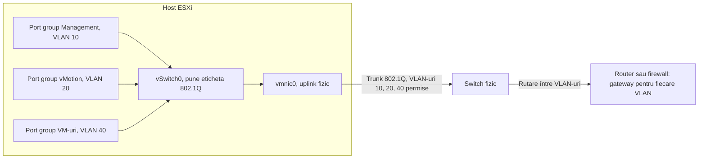
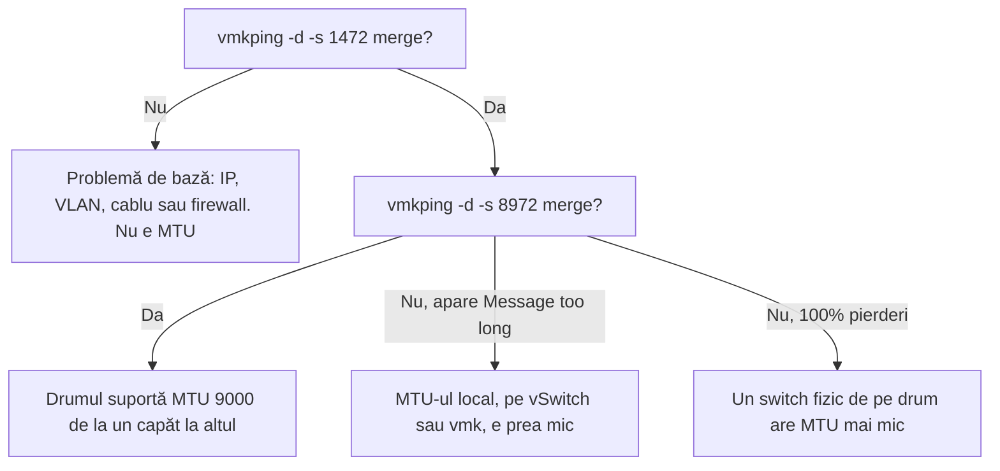
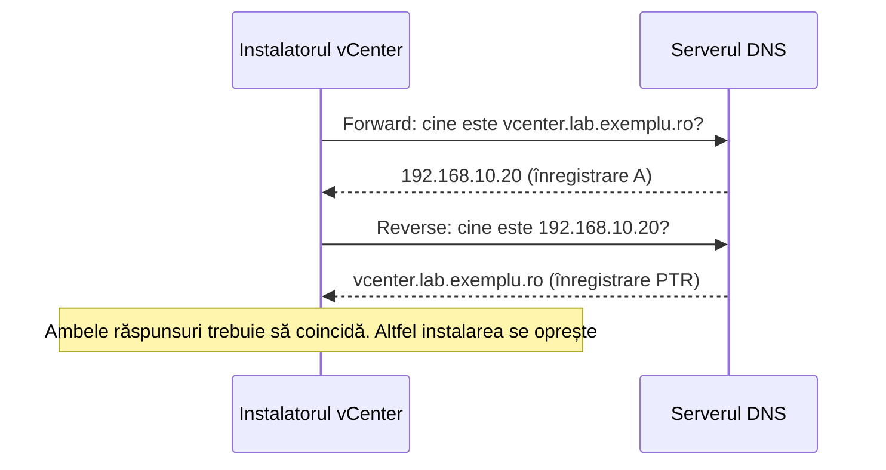
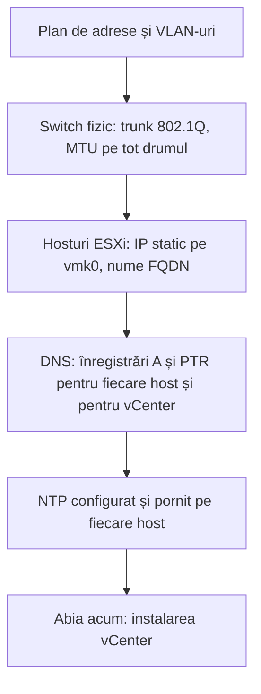

:::analogy
**Durerea din data center.** Cele mai multe instalări eșuate de vCenter pe care le vezi pe forumuri nu au nimic de-a face cu vCenter. Eșuează pentru că lipsește o înregistrare DNS (Domain Name System, sistemul care traduce nume în adrese), pentru că ceasul unui host e decalat, sau pentru că cineva a pus MTU (Maximum Transmission Unit, mărimea maximă a unui pachet) 9000 pe switch-ul virtual, dar nu și pe switch-ul fizic. Un inginer VMware bun nu e neapărat inginer de rețea, dar trebuie să înțeleagă aceste cinci lucruri suficient de bine încât să le verifice singur. Examenul VCF (VMware Cloud Foundation, 2V0-17.25) pornește de la ideea că știi deja DNS și NTP (Network Time Protocol, protocolul de sincronizare a timpului), iar vechiul ghid VCP-DCV (VMware Certified Professional - Data Center Virtualization) le avea la configurarea hosturilor. [S03] [S47]

**Analogia: un oraș cu poștă.**

- **Adresa IP** (Internet Protocol) este adresa casei. **Masca de subrețea** spune pe ce stradă ești: vecinii de pe aceeași stradă îți pot bate direct la ușă. **Gateway-ul** este oficiul poștal: tot ce pleacă în alt cartier trece pe acolo.
- Un **VLAN** (Virtual Local Area Network, rețea locală virtuală) este un etaj al unei clădiri cu acces pe bază de cartelă. Aceeași clădire (același switch fizic), dar cine e la etajul 10 nu ajunge la etajul 20 fără să treacă pe la recepție (un router).
- **MTU-ul** este mărimea maximă a coletului care încape prin ușă. Dacă trimiți un colet mare și o singură ușă de pe traseu e mică, coletul nu ajunge.
- **DNS-ul** este cartea de telefon: din nume afli adresa, iar prin căutarea inversă afli numele din adresă. vCenter cere ambele direcții.
- **NTP-ul** este ceasul din turnul primăriei după care își potrivește toată lumea ceasul. Biletele (certificatele și token-urile de autentificare) au oră de expirare; dacă ceasurile diferă, biletele valide par expirate.
:::

:::architecture
### 1. Adrese IP, subrețele și gateway

Fiecare interfață de rețea are o adresă IPv4 de forma `192.168.10.11`. Masca de subrețea spune ce parte din adresă e „strada” (rețeaua) și ce parte e „numărul casei” (hostul). Azi masca se scrie de obicei în notația **CIDR** (Classless Inter-Domain Routing): `/24` înseamnă că primii 24 de biți sunt rețeaua, deci masca e `255.255.255.0`. RFC 4632 dă chiar exemplul `192.168.99.0/24`. [S65]

În laborator și în rețelele interne se folosesc adrese private, care nu se rutează pe Internet. RFC 1918 rezervă trei blocuri: [S64]

| Bloc privat | Interval |
|---|---|
| `10.0.0.0/8` | 10.0.0.0 – 10.255.255.255 |
| `172.16.0.0/12` | 172.16.0.0 – 172.31.255.255 |
| `192.168.0.0/16` | 192.168.0.0 – 192.168.255.255 |

Pe un host ESXi, adresa IP nu stă pe placa fizică (vmnic), ci pe un **adaptor VMkernel** (vmk0, vmk1…). vmk0 este, de obicei, interfața de management: pe ea răspunde Host Client și prin ea vorbește hostul cu vCenter. Mai târziu vei crea vmk-uri separate pentru vMotion și stocare.

Exemplu de plan de adrese pentru un laborator (doar ilustrativ, alegi ce intervale vrei):

| Rețea | VLAN | Subrețea | Cine stă aici |
|---|---|---|---|
| Management | 10 | 192.168.10.0/24 | vmk0 al hosturilor, vCenter, DNS, NTP |
| vMotion | 20 | 192.168.20.0/24 | vmk1, fără gateway necesar |
| Stocare | 30 | 192.168.30.0/24 | vmk2 pentru iSCSI (Internet Small Computer Systems Interface) sau NFS (Network File System) |
| VM-uri | 40 | 192.168.40.0/24 | VM-urile (Virtual Machine, mașini virtuale) de test |

### 2. VLAN-uri: o singură placă, mai multe rețele

Un VLAN separă logic traficul pe același echipament fizic. Cadrele Ethernet primesc o etichetă (tag) standard 802.1Q cu numărul VLAN-ului. Pe un vSphere Standard Switch, VLAN ID-ul setat pe port group decide cine pune eticheta. KB (Knowledge Base article, articol oficial de suport) 311540 descrie cele trei moduri: [S50]

| VLAN ID pe port group | Mod | Cine pune eticheta |
|---|---|---|
| 0 | **EST** (External Switch Tagging) | Switch-ul fizic; portul fizic e de tip access |
| 1–4094 | **VST** (Virtual Switch Tagging) | Switch-ul virtual; cel mai folosit mod |
| 4095 | **VGT** (Virtual Guest Tagging) | Sistemul de operare din VM; port group-ul devine trunk către VM |

Pentru VST, portul switch-ului fizic către host trebuie să fie **trunk 802.1Q** cu VLAN-urile permise. ESXi nu suportă ISL (protocolul proprietar Cisco) și nici negocierea DTP (protocolul Cisco de negociere automată a trunk-ului), deci aceasta se dezactivează. Același KB avertizează că VLAN-ul nativ al switch-ului fizic nu se folosește pe un port group VST: traficul VLAN-ului nativ iese din switch fără etichetă și hostul nu-l pune în port group. [S50]



### 3. MTU și jumbo frames

MTU-ul standard Ethernet e 1500 de octeți. **Jumbo frames** înseamnă de obicei MTU 9000; se folosesc pentru vMotion, vSAN și stocare IP, pentru că pachetele mai mari înseamnă mai puțin overhead. Regula de aur din KB 419088: MTU-ul trebuie configurat **pe tot drumul**, iar switch-urile fizice se reconfigurează **înaintea** switch-ului virtual. vMotion, vSAN și iSCSI trimit trafic cu bitul „do not fragment”; dacă un echipament de pe drum are MTU mai mic, pachetele mari sunt aruncate, nu fragmentate. [S52]

Unde se setează în vSphere (KB 324494): pe **switch** (vSphere Standard Switch sau Distributed Switch) și pe fiecare **adaptor VMkernel** care trebuie să folosească jumbo frames. Switch-ul poate avea 9000 fără ca toate vmk-urile să aibă 9000, dar un vmk cu 9000 cere switch cu 9000. Schimbarea MTU-ului pe switch nu modifică automat vmk-urile existente. Pe un Distributed Switch, schimbarea MTU-ului repornește scurt uplink-urile, deci provoacă o întrerupere scurtă. [S53] [S52]

**Cum testezi corect** (KB 313061): cu `vmkping` de pe host, cu bitul „do not fragment” (`-d`) și cu dimensiunea payload-ului (`-s`) egală cu MTU minus 28 de octeți de overhead: [S51]

```bash
vmkping -I vmk1 -d -s 8972 <IP-ul celuilalt host>   # verifică MTU 9000
vmkping -I vmk1 -d -s 1472 <IP-ul celuilalt host>   # verifică MTU 1500
vmkping -I vmk1 -d -s 1473 <IP-ul celuilalt host>   # trebuie să EȘUEZE dacă drumul are 1500
```



### 4. DNS: căutare directă și inversă

DNS-ul are două direcții:

- **Forward lookup** (căutare directă, înregistrare de tip A): numele `vcenter.lab.exemplu.ro` → adresa `192.168.10.20`.
- **Reverse lookup** (căutare inversă, înregistrare **PTR**, Pointer record): adresa `192.168.10.20` → numele `vcenter.lab.exemplu.ro`.

vCenter verifică ambele. KB 305807 descrie o instalare de vCenter care eșuează cu mesajul că **FQDN**-ul (Fully Qualified Domain Name, numele complet cu domeniu) nu poate fi rezolvat, deși numele se rezolvă manual fără probleme. Cauza era lipsa sau greșeala înregistrării PTR. [S55] KB 405215 arată aceeași problemă la verificările dinaintea unui upgrade de vCenter și dă testul simplu: `nslookup <nume>` trebuie să întoarcă IP-ul, iar `nslookup <IP>` trebuie să întoarcă numele. [S56]

VCF 9 merge mai departe: instalatorul refuză hosturile ESXi înregistrate cu nume scurt, cu eroarea „Host name is not a FQDN”. [S57] Și încă un detaliu pentru viitor: domeniile `.local` sunt rezervate pentru multicast DNS. vCenter și hosturile ESXi le acceptă, dar serviciile VCF care rulează în containere (VCF Automation, VCF Identity Broker, Supervisor) nu pot fi instalate pe un domeniu `.local`. În laborator, alege de la început un subdomeniu al unui domeniu pe care îl deții. [S58]



### 5. NTP: de ce contează ceasul

Documentația de securitate vSphere explică problema: certificatele și token-urile de autentificare (SAML, formatul de token folosit de vCenter Single Sign-On) sunt valabile doar într-un interval de timp. Dacă ceasurile sistemelor diferă, un sistem poate respinge un certificat sau un token perfect valid. Rezultatul: autentificări eșuate, instalări eșuate sau serviciul `vmware-vpxd` din vCenter care nu pornește. Recomandarea este ca hostul pe care se instalează vCenter să fie sincronizat prin NTP sau PTP (Precision Time Protocol) **înainte** de instalare. [S59]

Ce trebuie să știi practic:

- ESXi folosește un client NTPv4, iar sursa de timp poate fi un controler de domeniu Active Directory sau un server de timp de pe Internet. [S60]
- NTP folosește **UDP** (User Datagram Protocol) portul **123**. Un firewall care blochează acest port oprește sincronizarea. [S63]
- La instalarea VVF 9 (VMware vSphere Foundation), validarea eșuează cu mesajul „NTP should be configured on the hosts” dacă un singur host nu are NTP configurat și pornit. Faptul că vCenter ajunge la serverul NTP nu e suficient. [S62]
- Verificarea de pe host: `ntpq -pn`. Coloana `reach` cu valoarea **377** înseamnă că ultimele opt interogări au reușit; `refid` cu `INIT` înseamnă că nu a venit niciun răspuns valid. [S63]

### 6. Ordinea corectă înainte de vCenter



`[IMAGE SEARCH / PROMPT]` Captură din Host Client: Networking → VMkernel NICs cu vmk0 și setările IPv4. Captură cu fereastra de editare a unui port group cu câmpul VLAN ID. Diagramă cu un cadru Ethernet cu eticheta 802.1Q evidențiată.
:::

:::exam-alert
### De memorat

| Ce | Valoare / regulă | Sursă |
|---|---|---|
| VLAN ID pe port group (Standard Switch) | 0 = EST, 1–4094 = VST, 4095 = VGT | KB 311540 [S50] |
| Tipul de trunk suportat de ESXi | Doar 802.1Q; fără ISL, fără DTP | KB 311540 [S50] |
| MTU standard / jumbo | 1500 / de obicei 9000 | KB 419088 [S52] |
| Test MTU 9000 | `vmkping -I vmkX -d -s 8972 <IP>` | KB 313061 [S51] |
| Test MTU 1500 | `vmkping -I vmkX -d -s 1472 <IP>` (28 de octeți overhead) | KB 313061 [S51] |
| Ordinea la schimbarea MTU | Întâi switch-urile fizice, apoi switch-ul virtual și vmk-urile | KB 419088 [S52] |
| DNS pentru vCenter | Înregistrare A **și** PTR, care coincid | KB 305807 [S55], KB 405215 [S56] |
| Nume de host în VCF 9 | FQDN, nu nume scurt | KB 425102 [S57] |
| Port NTP | UDP 123 | KB 443781 [S63] |
| NTP la instalarea VVF 9 | Obligatoriu pe **fiecare** host | KB 425914 [S62] |
| `ntpq -pn`, coloana `reach` | 377 = ultimele 8 interogări reușite | KB 443781 [S63] |
| Adrese private | 10.0.0.0/8, 172.16.0.0/12, 192.168.0.0/16 | RFC 1918 [S64] |

### 3 capcane de examen

1. **„Pun MTU 9000 pe vSwitch și am activat jumbo frames.”** Fals. MTU-ul trebuie să fie cel puțin 9000 pe tot drumul (switch-uri fizice, vSwitch, vmk-uri implicate) și se testează cu `vmkping -d -s 8972`. [S52] [S51]
2. **„VLAN ID 4095 înseamnă că port group-ul aparține tuturor VLAN-urilor, deci VM-ul vede tot automat.”** Parțial fals. 4095 înseamnă VGT: switch-ul virtual trece etichetele mai departe, iar **sistemul de operare din VM** trebuie să le gestioneze. Un VM fără configurare de VLAN în OS (Operating System, sistem de operare) nu va comunica corect. [S50]
3. **„Dacă numele vCenter se rezolvă în IP, DNS-ul e în regulă.”** Fals. Fără înregistrare PTR (căutarea inversă), instalarea și upgrade-ul de vCenter pot eșua. [S55] [S56]
:::

:::trenches
**Greșeala 1: MTU diferit pe rețeaua de management.**
KB 449208 descrie hosturi ESXi 8 care se deconectează și se reconectează la vCenter în buclă, plus migrări de VM-uri care eșuează. Ping-ul obișnuit mergea, dar `vmkping` cu pachete mari pierdea 100%. Cauza: un host avea MTU 1500 pe vmk0, iar celălalt avea 9000, pe o rețea fizică fără jumbo frames de la un capăt la altul. Pachetele mai mari de 1500 de octeți erau aruncate, iar odată cu ele și heartbeat-urile. [S54]
**Remediere:** același MTU pe toate hosturile și pe rețeaua fizică. Pentru management, de obicei 1500. Verifici cu `vmkping -I vmk0 -d -s 1472` (trebuie să meargă) și cu `-s 8972` (eșuează dacă există nepotrivire). Dacă ai nevoie de 9000, îl activezi întâi pe switch-urile fizice. [S54] [S52]

**Greșeala 2: lipsește înregistrarea PTR și pică upgrade-ul de vCenter.**
În KB 405215, verificarea dinaintea upgrade-ului raportează căutarea directă reușită, dar căutarea inversă eșuată (`NXDOMAIN`). Echipa de DNS crease doar înregistrarea A. [S56] La o instalare nouă, simptomul e și mai derutant: mesajul spune că FQDN-ul nu se rezolvă, deși `nslookup` pe nume merge. [S55]
**Remediere:** creezi sau corectezi înregistrarea PTR în zona de căutare inversă, aștepți propagarea, verifici cu `nslookup <IP>` și reiei verificarea. În planul de instalare treci ambele înregistrări pentru fiecare host și pentru fiecare appliance. [S56]
:::

:::interview
**Întrebare Junior/Mid: „De ce contează NTP-ul într-un mediu vSphere? Unde îl configurezi?”**

*Răspunsul ideal:* Certificatele și token-urile de autentificare au o fereastră de valabilitate. Dacă ceasurile diferă, vCenter sau hosturile pot respinge un certificat sau un token valid, deci apar erori de autentificare, instalări eșuate sau servicii care nu pornesc. [S59] Configurezi NTP pe **fiecare** host ESXi, din Host Client (Manage → System → Time & date) sau din vSphere Client (Configure → System → Time Configuration), cu serviciul `ntpd` pornit și setat să pornească odată cu hostul. Configurezi NTP și pe vCenter. Verifici cu `ntpq -pn` și te uiți la `reach`. [S61] [S63] Un candidat bun adaugă că instalarea VVF 9 refuză să continue dacă un host nu are NTP. [S62]

**Scenariu de troubleshooting: „Am activat jumbo frames pentru vMotion. Migrările între host A și host B eșuează, dar ping-ul între ele merge. Ce faci?”**

*Răspunsul pe care îl așteaptă un Team Lead:*
1. **Separ problemele de bază de MTU.** Rulez `vmkping -I vmk1 -d -s 1472 <IP host B>`. Dacă nu merge, problema e de IP sau VLAN, nu de MTU. [S51]
2. **Testez MTU-ul mare.** `vmkping -I vmk1 -d -s 8972 <IP host B>`. Dacă vMotion folosește stiva TCP/IP dedicată, adaug `-S vmotion`. [S51]
3. **Citesc rezultatul.** „Message too long” înseamnă că MTU-ul local (vSwitch sau vmk) e prea mic. Pierderile de 100% înseamnă că un echipament fizic de pe drum nu suportă 9000. [S52]
4. **Repar în ordinea corectă.** Întâi switch-urile fizice, apoi switch-ul virtual, apoi vmk-urile, pe **toate** hosturile din cluster. [S52] [S53]
5. **Retestez** de la fiecare host către fiecare alt host din cluster, pentru că problema poate fi doar pe un singur port fizic. [S51]
:::

:::lab
**Scenariu.** Ai deja un host ESXi funcțional, administrat din VMware Host Client. Verifici configurarea de rețea a hostului ca un inginer care pregătește instalarea vCenter: adresa de management, MTU-ul, VLAN-urile, DNS-ul și timpul.

**Pregătire.** Pașii 5 și 6 cer o consolă pe host. Pornești temporar serviciul SSH (Secure Shell, acces securizat la linia de comandă) sau ESXi Shell și îl oprești la final. Pentru DNS ai nevoie de un server DNS în laborator în care poți crea înregistrări.

Pașii de mai jos sunt bifabili, iar progresul se salvează în browser. Numele exacte ale meniurilor pot diferi puțin între Host Client 8 și 9 (`⚠ de verificat`).

**Test de avarie / validare.** La pasul 6, pe o rețea cu MTU 1500, `vmkping -d -s 1472` trebuie să meargă, iar `vmkping -d -s 1473` trebuie să **eșueze**. Dacă și 1473 trece, fie drumul are deja MTU mai mare, fie ai uitat `-d`, iar pachetul a fost fragmentat.
:::

:::quiz
Cinci întrebări originale, în stilul examenelor VCP (VMware Certified Professional). Primești explicația pentru fiecare variantă imediat după ce răspunzi.
:::

:::references
- Exam guide VCP-VCF Administrator 2V0-17.25, profilul candidatului (DNS, NTP) [S03]
- Exam guide VCP-DCV 2V0-21.23 (certificare Legacy), obiectivul 4.19.1 [S47]
- KB 311540: modurile VLAN EST, VST, VGT și configurarea switch-ului fizic [S50]
- KB 313061 și KB 419088: testarea și schimbarea MTU-ului [S51] [S52]
- KB 449208: MTU nepotrivit pe rețeaua de management [S54]
- KB 305807 și KB 405215: DNS invers lipsă la instalarea și upgrade-ul vCenter [S55] [S56]
- KB 460245: domenii `.local` în VCF și VVF [S58]
- vSphere Security: sincronizarea ceasurilor [S59]
- KB 425914 și KB 443781: NTP la instalarea VVF 9 și depanarea NTP pe ESXi [S62] [S63]
- RFC 1918 și RFC 4632: adrese private și notația CIDR [S64] [S65]
:::
