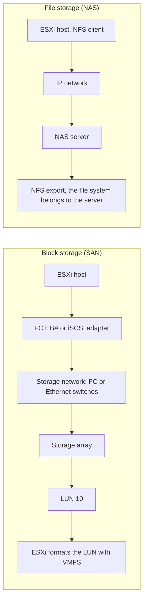
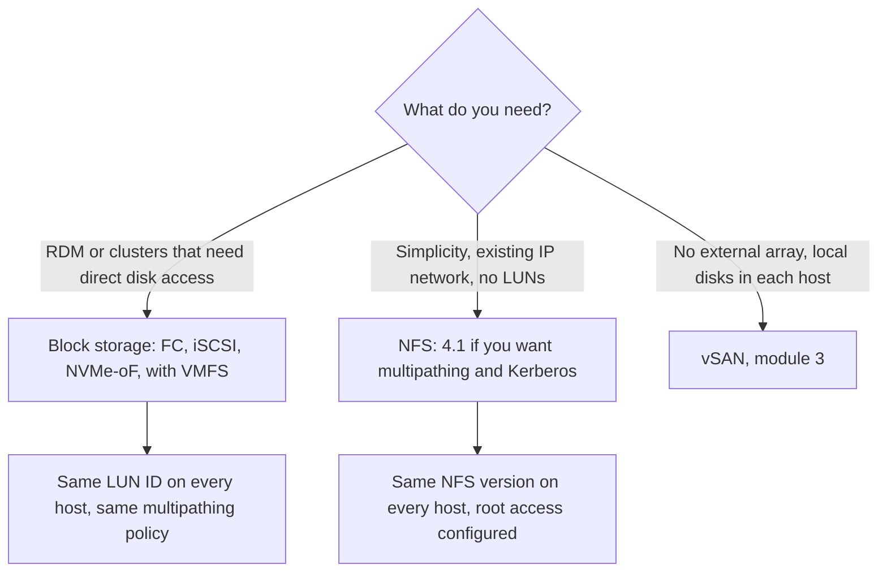

:::analogy
**The data center pain.** A VM (Virtual Machine) is, at heart, a set of files on a datastore. If storage is slow, every VM on it is slow. If storage disappears, the VMs stop, no matter how good the hosts are. The big vSphere features (vMotion, HA, meaning High Availability, and DRS, meaning Distributed Resource Scheduler) need storage that every host in the cluster can see. The older VCP-DCV (VMware Certified Professional - Data Center Virtualization) guide had dedicated objectives for identifying storage types and access protocols. [S47] [S66]

**The analogy: a self-storage warehouse and a library.**

- **Disks** are shelves. Some are old and roomy but slow to reach (HDD, Hard Disk Drive), others are small and very fast (SSD, Solid-State Drive, and NVMe, Non-Volatile Memory Express).
- **RAID** (Redundant Array of Independent Disks) is how you arrange boxes on the shelves: you can duplicate them so nothing is lost if a shelf breaks, or spread them across shelves so several people can work in parallel.
- A **SAN** (Storage Area Network) is a **self-storage warehouse**. You rent an empty numbered unit (a **LUN**, Logical Unit Number) and organize the inside yourself with your own labelling system (at VMware, **VMFS**, Virtual Machine File System). The warehouse does not know what you put inside; it only sees "blocks".
- A **NAS** (Network Attached Storage) is a **library**. You do not get an empty space; you ask for a folder by name, and the librarian (the NFS server, Network File System) knows where it is and who is using it. That is "file" storage.
:::

:::architecture
### 1. Disks: HDD, SSD, NVMe

| Type | What it is | Where you find it |
|---|---|---|
| **HDD** | Spinning platters; lots of cheap space but slow random access | Archives, backup, capacity storage |
| **SSD** on SATA or SAS | Flash memory, no moving parts | Servers, storage arrays |
| **NVMe** | Flash attached directly to the PCIe bus, with a protocol designed for flash | Modern servers, vSAN ESA (Express Storage Architecture), all-flash arrays |

The vSphere documentation lists SCSI, IDE, SATA, USB, SAS, flash and NVMe devices as supported local storage. Local storage needs no storage network, but it cannot be shared between hosts. [S66]

### 2. RAID: protection and performance from several disks

RAID combines several disks into one volume. The Red Hat storage guide describes the classic levels: [S70]

| Level | How it works | Usable capacity (N equal disks) | Disks it can lose |
|---|---|---|---|
| RAID 0 | Striping: data is split across all disks | N × disk | **None** |
| RAID 1 | Mirroring: every disk holds the same data | 1 × disk | All but one |
| RAID 5 | Parity distributed across all disks | (N − 1) × disk | 1 |
| RAID 6 | Double parity | (N − 2) × disk | 2 |
| RAID 10 | Mirrors with striping on top | With two copies, half the total | Depends on which disks fail (⚠ to verify per controller) |

Two important ideas:

- With RAID 5 and RAID 6 writes cost more than reads because parity must be recalculated. Red Hat notes that RAID 5 reads are much faster than writes, and RAID 6 has an even larger write overhead. [S70]
- A RAID 5 volume with a failed disk (**degraded**) keeps working, but much more slowly for both reads and writes. [S72]

RAID protects you from a disk failure. It does **not** protect you from accidental deletion or corrupted data, because it faithfully copies those to every disk. That is what backup is for (module 2).

### 3. Block vs file: LUN, SAN, NAS

A **LUN** is, in SNIA's definition, the SCSI identifier of a logical unit within a storage target. [S71] In practice the storage array presents a numbered "disk" to the host, and the host sees it as an empty disk.

The vSphere documentation splits networked storage like this: [S66]

| Technology | Protocol | What is transferred | Host interface |
|---|---|---|---|
| Fibre Channel | FC/SCSI, FC/NVMe | Blocks (LUN) | Fibre Channel **HBA** (Host Bus Adapter) |
| Fibre Channel over Ethernet | FCoE/SCSI | Blocks (LUN) | Converged network adapter |
| **iSCSI** (Internet Small Computer Systems Interface) | SCSI over IP (Internet Protocol) | Blocks (LUN) | Hardware adapter, or the ESXi software iSCSI adapter over a normal NIC (Network Interface Card) |
| NVMe over Fabrics | NVMe over RDMA, FC or TCP | Blocks | NVMe adapter |
| NAS | **NFS** over IP | Files, no direct LUN access | Network adapter |

Whatever storage sits underneath, the VM sees its disks as SCSI or NVMe devices. The guest operating system does not know whether it is on FC, iSCSI or NFS. [S66]

### 4. Datastore types

A **datastore** is the logical container that holds VM files, ISO images and templates. vSphere has four types: [S67]

| Datastore | What it sits on |
|---|---|
| **VMFS** 5 and 6 | Block devices: FC, iSCSI or NVMe LUNs, or local disks |
| **NFS** 3 and 4.1 | An export from a NAS server, mounted directly |
| **vSAN** | The hosts' local disks pooled into one shared datastore (module 3) |
| **vVols** (Virtual Volumes) | A storage container on the array, managed through vCenter |

Which features each storage type supports, per the documentation table: [S66]

| Storage | Boot VM | vMotion | Datastore | **RDM** (Raw Device Mapping) | HA and DRS |
|---|---|---|---|---|---|
| Local | Yes | No (no shared storage) | VMFS | No | No |
| Fibre Channel | Yes | Yes | VMFS | Yes | Yes |
| iSCSI | Yes | Yes | VMFS | Yes | Yes |
| NAS (NFS) | Yes | Yes | NFS 3 and 4.1 | **No** | Yes |

### 5. NFS 3 vs NFS 4.1

ESXi has a separate client for each version. [S69] The differences that matter for the exam and in production: [S68]

| | NFS 3 | NFS 4.1 |
|---|---|---|
| Multipathing | No (single TCP connection) | Yes, through session trunking |
| Locking | VMware's own protocol, with lock files | Native protocol locking |
| Security | AUTH_SYS only, unencrypted | AUTH_SYS or Kerberos |
| Root access | Required (usually `no_root_squash` on the server) | Required with AUTH_SYS; Kerberos allows non-root access |

The golden rule: **never mount the same export with different versions** on different hosts. ESXi does not stop you, and the two versions lock files differently, so you risk corrupted data. ESXi also does not convert an NFS 3 datastore to NFS 4.1 by itself: you move it with Storage vMotion to a new datastore, or unmount it from **all** hosts and remount it as 4.1. [S68] [S69]

### 6. Every host must see the same thing

A shared datastore must look identical from every host in the cluster: same LUNs, same multipathing policy, same iSCSI settings, same NFS version. [S75] Above all, **the same LUN must be presented with the same LUN ID to every host.** Otherwise the host that sees a different ID treats it as a possible snapshot or clone and refuses to mount it automatically. [S73] [S74]

**VCF 9 note.** In VCF (VMware Cloud Foundation) 9, vSAN remains the standard path. KB (Knowledge Base article) 416270 describes how to use iSCSI, NFS 4.1, FCoE or NVMe over Fabrics as principal storage: you prepare the cluster in vCenter and then convert it with the VCF Installer "Converge" workflow. [S77]

`[IMAGE SEARCH / PROMPT]` Host Client screenshot: Storage → Adapters with the host's vmhbas. Storage → Devices showing the local disk and its type (SSD or HDD). RAID 5 diagram with parity blocks spread across 4 disks.
:::

:::exam-alert
### Memorize

| What | Value / rule | Source |
|---|---|---|
| Datastore types | VMFS (5, 6), NFS (3, 4.1), vSAN, vVols | vSphere docs [S67] |
| Block protocols | Fibre Channel, FCoE, iSCSI, NVMe over Fabrics | vSphere docs [S66] |
| File protocol | NFS 3 and 4.1 | vSphere docs [S66] |
| RDM on NFS | **No** | vSphere docs [S66] |
| NFS 4.1 adds over NFS 3 | Kerberos, multipathing (session trunking), native locking | vSphere docs [S68] |
| Same export with NFS 3 and 4.1 | **Forbidden** (risk of corrupted data) | vSphere docs [S68] |
| NFS 3 without root access | Datastore mounts, but you cannot create VMs | vSphere docs [S68] |
| RAID 5 / RAID 6 | (N − 1) / (N − 2) usable disks; tolerate 1 / 2 failed disks | Red Hat [S70] |
| Shared LUN | Same LUN ID on every host | KB 428223 [S73] |

### 3 exam traps

1. **"NFS supports RDM because it is also shared storage."** False. RDM needs direct access to a LUN; NFS transfers files, not blocks. [S66]
2. **"I can move gradually from NFS 3 to NFS 4.1 by mounting the same export as 4.1 on the new hosts."** False. The same export is never mounted with two versions; they use incompatible locking. [S68]
3. **"RAID 6 with 6 × 4 TB disks gives me 20 TB usable."** False. RAID 6 reserves two disks' worth for parity: (6 − 2) × 4 TB = 16 TB. [S70]
:::

:::trenches
**Mistake 1: a LUN presented with different IDs.**
KB 428223 describes datastores that randomly disappear from some hosts. The LUN shows under Storage Devices as "Not Consumed" and manual mounting fails. `vmkernel.log` says the device looks like a snapshot. The cause: the array presented the same volume as LUN 10 to some hosts and LUN 11 to others. [S73]
**Fix:** on the array, unmap the LUN from the hosts with the wrong ID and remap it with the ID the rest of the cluster uses. Then rescan (`esxcli storage core adapter rescan --all`) and check with `esxcli storage filesystem list`. Do **not** force-mount it as a snapshot; that does not fix the mismatch. [S73]

**Mistake 2: slow local storage because of RAID.**
KB 326234 describes VMs with high latency, slow clones and `vmkernel.log` warnings that device performance has deteriorated. Typical causes are the RAID level, too few disks and, above all, a degraded RAID 5 after a disk failure. [S72] A newer case, KB 415355, shows that on ESXi 8 a local NVMe RAID volume with 4K sectors can double Storage vMotion time; the fix is ESXi 9 with the RAID volume rebuilt. [S76]
**Fix:** look at `esxtop`, screen `d`, column `DAVG/cmd` (latency from the storage), check RAID status in the controller utility or the server LEDs, and replace the failed disk. [S72]
:::

:::interview
**Junior/Mid question: "What is the difference between a SAN and a NAS? Which datastore does vSphere use on each?"**

*Ideal answer:* A SAN provides block storage: the array presents LUNs over Fibre Channel, iSCSI or NVMe over Fabrics, and ESXi formats them with VMFS. A NAS provides file storage: the server owns its file system and exports a directory over NFS, which ESXi mounts directly as an NFS datastore. [S66] [S67] A strong candidate adds the practical differences: RDM exists only on block storage, NFS 4.1 adds Kerberos and multipathing over NFS 3, and the same export is never mounted with both versions. [S68]

**Troubleshooting scenario: "The storage team created a new LUN. The datastore shows up on 3 of the 4 hosts in the cluster. What do you do?"**

*The answer a Team Lead expects:*
1. **Rescan** on the host that does not see the datastore. Sometimes the host simply has not discovered the device yet. [S74]
2. **Check whether the host sees the LUN.** `esxcli storage core device list`: if the LUN is missing, it is not presented correctly to that host (zoning or array mapping). [S74]
3. **Compare the LUN ID** with the other hosts. If it differs, the host treats it as a snapshot and shows "Not Consumed". [S73]
4. **Ask for a remap** with the same ID, rescan again and check with `esxcli storage filesystem list`. [S73]
5. **Check the rest of the configuration** (multipathing, iSCSI settings), which must be identical on all hosts. [S75]
:::

:::lab
**Scenario.** On your ESXi host you inventory the storage: adapters, disks and datastores. Then you mount an NFS datastore and deliberately trigger a classic permission error.

**What you need.** Steps 4–6 need an NFS server in your lab: a Linux VM running NFS, a NAS, or any server exporting a directory over NFS 3. If you have none, do steps 1–3 only and come back to the rest later.

The steps below can be ticked off and progress is saved in your browser. Exact menu names may differ slightly between Host Client 8 and 9 (`⚠ to verify`).

**Failure / validation test.** In step 5 you export the directory **without** root access for the host (with `root_squash`, usually the Linux default). The datastore mounts, but creating a folder or VM on it must fail. Only after you change the export (step 6) does writing work. This is the NFS 3 rule from the documentation, seen in practice. [S68]
:::

:::quiz
Five original questions in the style of the VCP (VMware Certified Professional) exams. You get an explanation for every option right after you answer.
:::

:::references
- VCP-DCV exam guide 2V0-21.23 (Legacy certification), objectives 1.3.1 and 1.3.2 [S47]
- vSphere Storage: physical storage types and supported features [S66]
- vSphere Storage: datastore types [S67]
- vSphere Storage: NFS 3 vs NFS 4.1 and NFS datastores [S68] [S69]
- Red Hat: RAID levels [S70]
- SNIA: LUN definition [S71]
- KB 428223 and KB 344351: inconsistently presented LUNs [S73] [S74]
- KB 317694: storage configuration must be consistent across the cluster [S75]
- KB 326234 and KB 415355: local storage performance and RAID [S72] [S76]
- KB 416270: principal storage options in VCF 9 [S77]
:::
