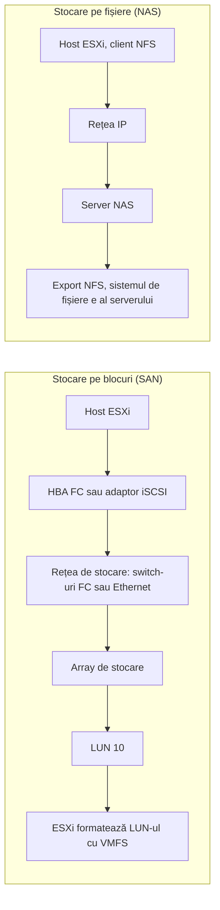
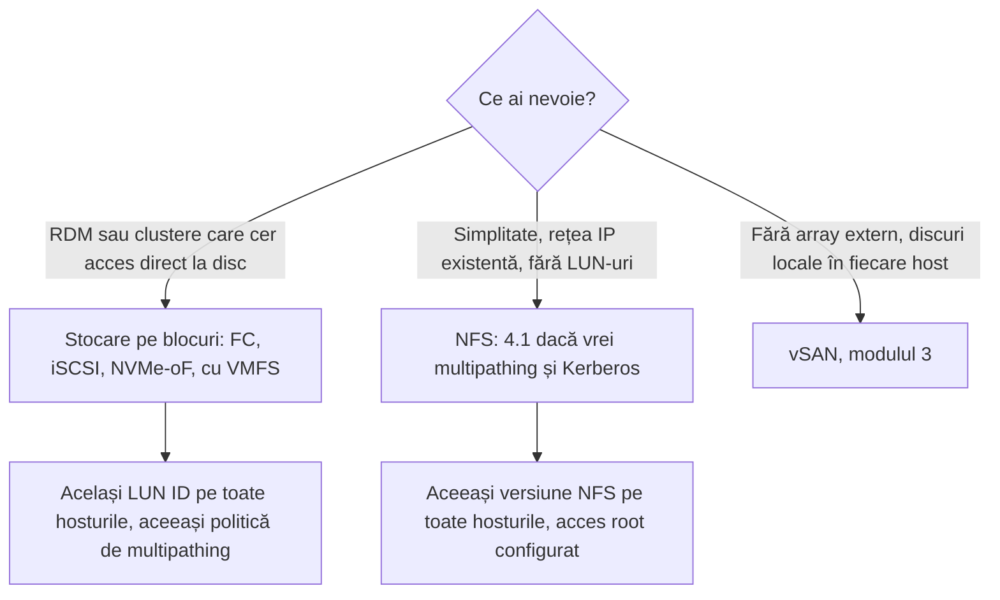

:::analogy
**Durerea din data center.** Un VM (Virtual Machine, mașină virtuală) e, în fond, un set de fișiere pe un datastore. Dacă stocarea e lentă, toate VM-urile de pe ea sunt lente. Dacă stocarea dispare, VM-urile se opresc, indiferent cât de bune sunt hosturile. Funcțiile mari din vSphere (vMotion, HA, adică High Availability, și DRS, adică Distributed Resource Scheduler) au nevoie de stocare pe care o văd toate hosturile din cluster. Vechiul ghid VCP-DCV (VMware Certified Professional - Data Center Virtualization) avea obiective dedicate: identificarea tipurilor de stocare și a protocoalelor de acces. [S47] [S66]

**Analogia: depozitul și biblioteca.**

- **Discurile** sunt rafturile. Unele sunt vechi și încăpătoare, dar ajungi greu la ele (HDD, Hard Disk Drive), altele sunt mici și foarte rapide (SSD, Solid-State Drive, și NVMe, Non-Volatile Memory Express).
- **RAID-ul** (Redundant Array of Independent Disks) este felul în care așezi cutiile pe rafturi: le poți dubla, ca să nu pierzi nimic dacă un raft se rupe, sau le poți împărți pe mai multe rafturi, ca să lucreze mai mulți oameni în paralel.
- Un **SAN** (Storage Area Network) este un **depozit cu boxe închiriate**. Primești o boxă goală cu un număr (**LUN**, Logical Unit Number), iar înăuntru te organizezi singur, cu propriul sistem de etichetare (la VMware, **VMFS**, Virtual Machine File System). Depozitul nu știe ce ai pus în ea; vede doar „blocuri”.
- Un **NAS** (Network Attached Storage) este o **bibliotecă**. Nu primești un spațiu gol, ci ceri un dosar după nume, iar bibliotecarul (serverul NFS, Network File System) știe unde stă și cine îl folosește. Stocare „pe fișiere”.
:::

:::architecture
### 1. Discuri: HDD, SSD, NVMe

| Tip | Ce este | Unde îl găsești |
|---|---|---|
| **HDD** | Platane care se rotesc; mult spațiu ieftin, dar acces aleator lent | Arhive, backup, stocare de capacitate |
| **SSD** pe SATA sau SAS | Memorie flash, fără piese în mișcare | Servere, array-uri de stocare |
| **NVMe** | Flash conectat direct pe magistrala PCIe, cu un protocol creat pentru flash | Servere moderne, vSAN ESA (Express Storage Architecture), array-uri all-flash |

Documentația vSphere enumeră ca stocare locală suportată dispozitive SCSI, IDE, SATA, USB, SAS, flash și NVMe. Stocarea locală nu are nevoie de rețea de stocare, dar nu poate fi partajată între hosturi. [S66]

### 2. RAID: protecție și performanță din mai multe discuri

**RAID** combină mai multe discuri într-un singur volum. Ghidul de stocare Red Hat descrie nivelurile clasice: [S70]

| Nivel | Cum funcționează | Capacitate utilă (N discuri egale) | Câte discuri poate pierde |
|---|---|---|---|
| RAID 0 | Striping: datele sunt împărțite pe toate discurile | N × disc | **Niciunul** |
| RAID 1 | Mirroring: fiecare disc are aceleași date | 1 × disc | Toate, mai puțin unul |
| RAID 5 | Paritate distribuită pe toate discurile | (N − 1) × disc | 1 |
| RAID 6 | Paritate dublă | (N − 2) × disc | 2 |
| RAID 10 | Oglinzi peste care se face striping | Cu două copii, jumătate din total | Depinde de ce discuri cad (⚠ de verificat pentru fiecare controler) |

Două idei importante:

- La RAID 5 și RAID 6, scrierile costă mai mult decât citirile, pentru că paritatea trebuie recalculată. Red Hat notează că citirile sunt mult mai rapide decât scrierile la RAID 5, iar RAID 6 are un overhead de scriere și mai mare. [S70]
- Un volum RAID 5 cu un disc defect (**degraded**) funcționează, dar mult mai încet, la citire și la scriere. [S72]

RAID-ul te protejează de defectarea unui disc. **Nu** te protejează de ștergeri accidentale sau de date corupte, pentru că le copiază fidel pe toate discurile. Pentru asta ai nevoie de backup (modulul 2).

### 3. Bloc vs fișier: LUN, SAN, NAS

Un **LUN** este, în definiția SNIA, identificatorul SCSI al unei unități logice dintr-o țintă de stocare. [S71] Practic, array-ul de stocare îi prezintă hostului un „disc” numerotat, iar hostul îl vede ca pe un disc gol.

Documentația vSphere împarte stocarea în rețea astfel: [S66]

| Tehnologie | Protocol | Ce se transferă | Interfața din host |
|---|---|---|---|
| Fibre Channel | FC/SCSI, FC/NVMe | Blocuri (LUN) | **HBA** (Host Bus Adapter) Fibre Channel |
| Fibre Channel over Ethernet | FCoE/SCSI | Blocuri (LUN) | Adaptor de rețea convergent |
| **iSCSI** (Internet Small Computer Systems Interface) | SCSI peste IP (Internet Protocol) | Blocuri (LUN) | Adaptor hardware sau adaptorul iSCSI software al ESXi, peste o placă de rețea obișnuită |
| NVMe over Fabrics | NVMe peste RDMA, FC sau TCP | Blocuri | Adaptor NVMe |
| NAS | **NFS** peste IP | Fișiere, fără acces direct la LUN | Placă de rețea |

Indiferent de stocarea de dedesubt, VM-ul își vede discurile ca dispozitive SCSI sau NVMe. Sistemul de operare din VM nu știe dacă stă pe FC, iSCSI sau NFS. [S66]

### 4. Tipurile de datastore

Un **datastore** este containerul logic în care stau fișierele VM-urilor, imaginile ISO și template-urile. vSphere are patru tipuri: [S67]

| Datastore | Pe ce stă |
|---|---|
| **VMFS** 5 și 6 | Dispozitive pe blocuri: LUN-uri FC, iSCSI, NVMe sau discuri locale |
| **NFS** 3 și 4.1 | Un export de pe un server NAS, montat direct |
| **vSAN** | Discurile locale ale hosturilor, unite într-un singur datastore partajat (modulul 3) |
| **vVols** (Virtual Volumes) | Un container de stocare din array, gestionat prin vCenter |

Ce funcții suportă fiecare tip de stocare, după tabelul din documentație: [S66]

| Stocare | Pornire VM | vMotion | Datastore | **RDM** (Raw Device Mapping) | HA și DRS |
|---|---|---|---|---|---|
| Locală | Da | Nu (fără stocare partajată) | VMFS | Nu | Nu |
| Fibre Channel | Da | Da | VMFS | Da | Da |
| iSCSI | Da | Da | VMFS | Da | Da |
| NAS (NFS) | Da | Da | NFS 3 și 4.1 | **Nu** | Da |

### 5. NFS 3 vs NFS 4.1

ESXi are câte un client separat pentru fiecare versiune. [S69] Diferențele care contează la examen și în producție: [S68]

| | NFS 3 | NFS 4.1 |
|---|---|---|
| Multipathing | Nu (o singură conexiune TCP) | Da, prin session trunking |
| Locking | Protocol propriu VMware, cu fișiere de blocare | Locking nativ al protocolului |
| Securitate | Doar AUTH_SYS, fără criptare | AUTH_SYS sau Kerberos |
| Acces root | Obligatoriu (de obicei `no_root_squash` pe server) | Obligatoriu la AUTH_SYS; Kerberos permite acces non-root |

Regula de aur: **nu monta niciodată același export cu versiuni diferite** pe hosturi diferite. ESXi nu te oprește, iar cele două versiuni blochează fișierele diferit, deci riști date corupte. ESXi nici nu transformă singur un datastore NFS 3 în NFS 4.1: îl muți cu Storage vMotion pe un datastore nou sau îl demontezi de pe **toate** hosturile și îl remontezi ca 4.1. [S68] [S69]

### 6. Toate hosturile trebuie să vadă la fel

Un datastore partajat trebuie să arate identic de pe fiecare host din cluster: aceleași LUN-uri, aceeași politică de multipathing, aceleași setări iSCSI, aceeași versiune NFS. [S75] Mai ales, **același LUN trebuie prezentat cu același LUN ID către toate hosturile.** Altfel, hostul care îl vede cu alt ID îl tratează ca pe un posibil snapshot sau o clonă și refuză să-l monteze automat. [S73] [S74]

**Notă VCF 9.** În VCF (VMware Cloud Foundation) 9, vSAN rămâne calea standard. KB (Knowledge Base article, articol oficial de suport) 416270 descrie cum se folosesc ca stocare principală și iSCSI, NFS 4.1, FCoE sau NVMe over Fabrics: pregătești clusterul în vCenter și îl convertești apoi cu fluxul „Converge” al instalatorului VCF. [S77]

`[IMAGE SEARCH / PROMPT]` Captură din Host Client: Storage → Adapters cu vmhba-urile hostului. Captură Storage → Devices cu discul local și tipul lui (SSD sau HDD). Diagramă RAID 5 cu blocurile de paritate distribuite pe 4 discuri.
:::

:::exam-alert
### De memorat

| Ce | Valoare / regulă | Sursă |
|---|---|---|
| Tipuri de datastore | VMFS (5, 6), NFS (3, 4.1), vSAN, vVols | Docs vSphere [S67] |
| Protocoale pe blocuri | Fibre Channel, FCoE, iSCSI, NVMe over Fabrics | Docs vSphere [S66] |
| Protocol pe fișiere | NFS 3 și 4.1 | Docs vSphere [S66] |
| RDM pe NFS | **Nu** | Docs vSphere [S66] |
| NFS 4.1 în plus față de NFS 3 | Kerberos, multipathing (session trunking), locking nativ | Docs vSphere [S68] |
| Același export cu NFS 3 și 4.1 | **Interzis** (risc de date corupte) | Docs vSphere [S68] |
| NFS 3 fără acces root | Datastore-ul se montează, dar nu poți crea VM-uri | Docs vSphere [S68] |
| RAID 5 / RAID 6 | (N − 1) / (N − 2) discuri utile; tolerează 1 / 2 discuri căzute | Red Hat [S70] |
| LUN partajat | Același LUN ID pe toate hosturile | KB 428223 [S73] |

### 3 capcane de examen

1. **„NFS suportă RDM, pentru că e tot stocare partajată.”** Fals. RDM cere acces direct la un LUN; NFS transferă fișiere, nu blocuri. [S66]
2. **„Pot trece treptat de la NFS 3 la NFS 4.1, montând același export ca 4.1 pe hosturile noi.”** Fals. Același export nu se montează cu două versiuni; cele două folosesc mecanisme de blocare incompatibile. [S68]
3. **„RAID 6 cu 6 discuri de 4 TB îmi dă 20 TB utili.”** Fals. RAID 6 rezervă două discuri pentru paritate: (6 − 2) × 4 TB = 16 TB. [S70]
:::

:::trenches
**Greșeala 1: un LUN prezentat cu ID-uri diferite.**
KB 428223 descrie datastore-uri care dispar aleator de pe anumite hosturi. LUN-ul apare la Storage Devices, dar cu mențiunea „Not Consumed”, iar montarea manuală nu merge. În `vmkernel.log` apare mesajul că dispozitivul pare a fi un snapshot. Cauza: array-ul prezenta același volum ca LUN 10 către unele hosturi și ca LUN 11 către altele. [S73]
**Remediere:** pe array, demapezi LUN-ul de pe hosturile cu ID greșit și îl remapezi cu ID-ul folosit de restul clusterului. Apoi faci rescan (`esxcli storage core adapter rescan --all`) și verifici cu `esxcli storage filesystem list`. **Nu** forțezi montarea ca snapshot, pentru că asta nu rezolvă nepotrivirea. [S73]

**Greșeala 2: stocare locală lentă din cauza RAID-ului.**
KB 326234 descrie VM-uri cu latență mare, clonări lente și avertismente în `vmkernel.log` că performanța dispozitivului s-a deteriorat. Cauzele tipice sunt nivelul RAID, numărul prea mic de discuri și, mai ales, un RAID 5 degradat după căderea unui disc. [S72] Un caz mai nou, KB 415355, arată că pe ESXi 8 un volum RAID local pe NVMe cu sectoare de 4K poate dubla durata unui Storage vMotion; soluția este ESXi 9 cu volumul RAID refăcut. [S76]
**Remediere:** te uiți în `esxtop`, ecranul `d`, la coloana `DAVG/cmd` (latența de la stocare), verifici starea RAID-ului în utilitarul controlerului sau la LED-urile serverului și înlocuiești discul defect. [S72]
:::

:::interview
**Întrebare Junior/Mid: „Care e diferența dintre un SAN și un NAS? Ce datastore folosește vSphere pe fiecare?”**

*Răspunsul ideal:* Un SAN oferă stocare pe blocuri: array-ul prezintă LUN-uri prin Fibre Channel, iSCSI sau NVMe over Fabrics, iar ESXi le formatează cu VMFS. Un NAS oferă stocare pe fișiere: serverul are propriul sistem de fișiere și exportă un director prin NFS, pe care ESXi îl montează direct ca datastore NFS. [S66] [S67] Un candidat bun adaugă diferențele practice: RDM există doar pe blocuri, NFS 4.1 aduce Kerberos și multipathing față de NFS 3, iar același export nu se montează cu ambele versiuni. [S68]

**Scenariu de troubleshooting: „Echipa de stocare a creat un LUN nou. Datastore-ul apare pe 3 din cele 4 hosturi ale clusterului. Ce faci?”**

*Răspunsul pe care îl așteaptă un Team Lead:*
1. **Fac rescan** pe hostul care nu vede datastore-ul. Uneori hostul doar n-a descoperit încă dispozitivul. [S74]
2. **Verific dacă hostul vede LUN-ul.** `esxcli storage core device list`: dacă LUN-ul lipsește, nu e prezentat corect către acel host (zoning sau mapare pe array). [S74]
3. **Compar LUN ID-ul** cu cel de pe celelalte hosturi. Dacă diferă, hostul îl tratează ca snapshot și apare „Not Consumed”. [S73]
4. **Cer remaparea** cu același ID, fac din nou rescan și verific cu `esxcli storage filesystem list`. [S73]
5. **Verific restul configurării** (multipathing, setări iSCSI), care trebuie să fie identică pe toate hosturile. [S75]
:::

:::lab
**Scenariu.** Pe hostul tău ESXi inventariezi stocarea: adaptoarele, discurile și datastore-urile. Apoi montezi un datastore NFS și provoci intenționat o eroare clasică de permisiuni.

**De ce ai nevoie.** Pentru pașii 4–6 îți trebuie un server NFS în laborator: o VM Linux cu serviciul NFS, un NAS sau orice alt server care exportă un director prin NFS 3. Dacă nu ai unul, faci doar pașii 1–3 și revii la restul mai târziu.

Pașii de mai jos sunt bifabili, iar progresul se salvează în browser. Numele exacte ale meniurilor pot diferi puțin între Host Client 8 și 9 (`⚠ de verificat`).

**Test de avarie / validare.** La pasul 5 exporți directorul **fără** acces root pentru host (cu `root_squash`, de obicei valoarea implicită pe Linux). Datastore-ul se montează, dar crearea unui folder sau a unui VM pe el trebuie să eșueze. Abia după ce schimbi exportul (pasul 6) scrierea merge. Așa vezi în practică regula din documentația NFS 3. [S68]
:::

:::quiz
Cinci întrebări originale, în stilul examenelor VCP (VMware Certified Professional). Primești explicația pentru fiecare variantă imediat după ce răspunzi.
:::

:::references
- Exam guide VCP-DCV 2V0-21.23 (certificare Legacy), obiectivele 1.3.1 și 1.3.2 [S47]
- vSphere Storage: tipurile de stocare fizică și funcțiile suportate [S66]
- vSphere Storage: tipurile de datastore [S67]
- vSphere Storage: NFS 3 vs NFS 4.1 și datastore-urile NFS [S68] [S69]
- Red Hat: nivelurile RAID [S70]
- SNIA: definiția LUN [S71]
- KB 428223 și KB 344351: LUN-uri prezentate inconsecvent [S73] [S74]
- KB 317694: configurarea stocării trebuie să fie aceeași în tot clusterul [S75]
- KB 326234 și KB 415355: performanța stocării locale și RAID-ul [S72] [S76]
- KB 416270: opțiunile de stocare principală în VCF 9 [S77]
:::
