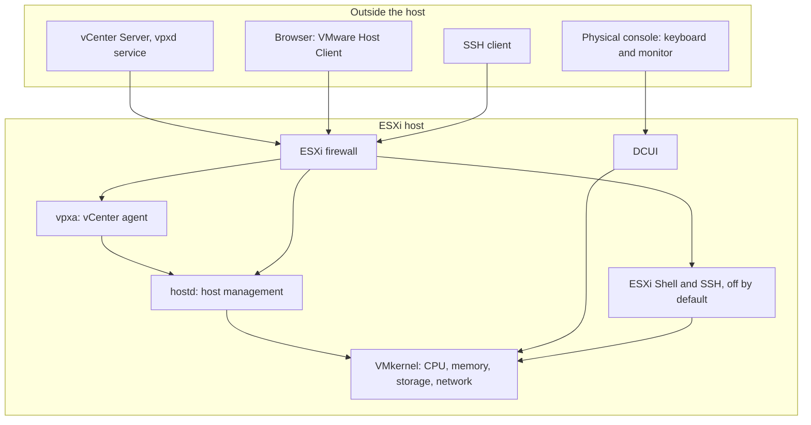
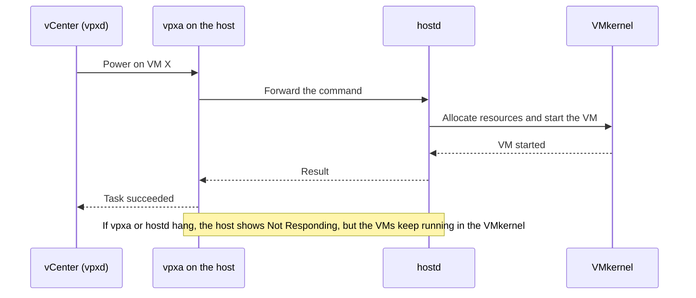
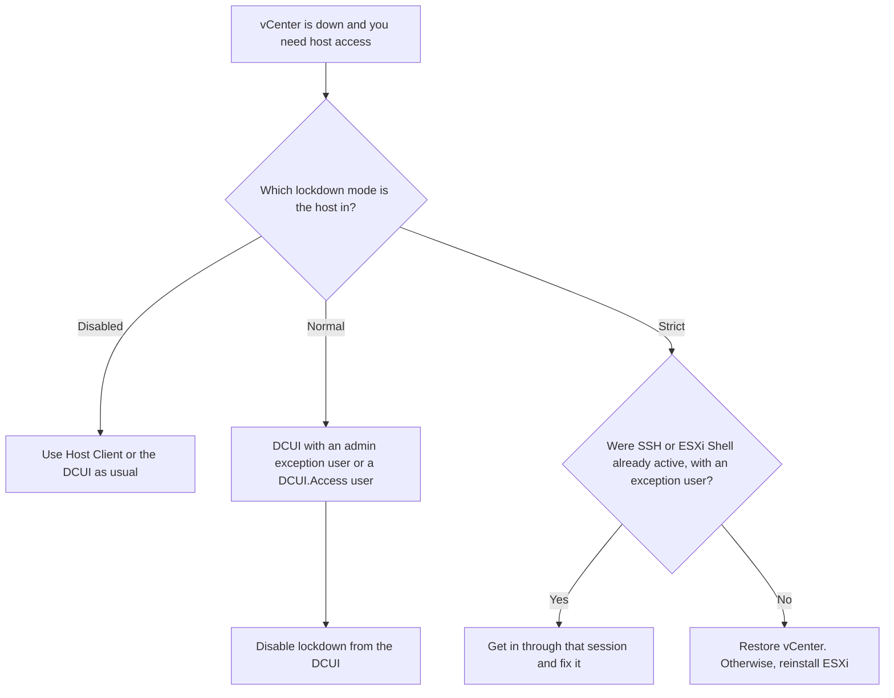

:::analogy
**The data center pain.** An ESXi host looks like a black box: you install it, give it an IP (Internet Protocol) address and then manage it from a browser. Trouble starts when the box stops answering. vCenter shows the host as "Not Responding" even though the virtual machines on it keep running. Or a colleague enables strict Lockdown Mode, vCenter fails, and nobody can get into the host any more. To fix these situations you need to know what runs inside the host and which paths lead in. The VVF (VMware vSphere Foundation, 2V0-16.25) exam guide asks for ESXi components in objective 2.2.1, and the older VCP-DCV (VMware Certified Professional - Data Center Virtualization) had a whole objective on securing hosts. [S02] [S47]

**The analogy: a ship.**

- The **engine room** is the **VMkernel**: the core that shares the CPU (Central Processing Unit), memory, storage and network among the VMs. Nobody works in there directly.
- The **bridge** is **hostd**: the ship receives orders there and passes them to the engine room.
- The **radio operator** is **vpxa**: it talks to headquarters (vCenter) and carries orders to the bridge.
- The **emergency panel in the engine room** is the **DCUI** (Direct Console User Interface): you only use it when you are physically next to the server.
- **Lockdown Mode** means orders come **only** by radio from headquarters. The strict version also unplugs the emergency panel. If the radio breaks, the ship can no longer be commanded.
:::

:::architecture
### 1. The layers of an ESXi host

ESXi is a Type 1 hypervisor: it runs directly on hardware. Its core, the **VMkernel**, schedules resources for every VM (Virtual Machine). Management services run on top of it, each with its own role:

- **hostd** is the "main communication channel" between the host and the VMkernel. It handles the VM lifecycle, resource allocation and the link to vCenter. If hostd fails, the host disconnects from vCenter and direct connections fail too. [S84]
- **vpxa** (vCenter Server Agent) is the agent vCenter uses to reach the host. KB (Knowledge Base article) 311805 describes it as the communication conduit to hostd. [S85]



### 2. Which disk ESXi lives on

Since ESXi 7 the boot disk has a new layout. The ESXi 8 documentation describes the partitions: [S86]

| Partition | Contents | Format |
|---|---|---|
| System Boot | Boot loader and EFI modules; always 100 MB | FAT16 |
| Boot-bank 0 and Boot-bank 1 | ESXi boot modules (two copies, for upgrade and rollback) | FAT16 |
| **ESX-OSData** | Additional modules, scratch, VMware Tools, core dumps. Not used for VMs | VMFS-L |
| VMFS (Virtual Machine File System) datastore | The remaining space, created automatically only on large boot disks | VMFS |

Partition sizes depend on the disk: from 500 MB boot banks on 8–10 GB disks up to 4 GB each and ESX-OSData of up to 128 GB on disks larger than 128 GB. [S86]

**SD cards and USB sticks.** For years servers booted ESXi from SD or USB. KB 317631 sets the direction: support continues through VCF (VMware Cloud Foundation) 9.0, but new hardware uses a persistent device: SSD (Solid-State Drive), NVMe (Non-Volatile Memory Express), SAS or SATA. For ESXi 9 the local persistent boot disk must be **at least 128 GB**. [S87]

**Before installing: hardware compatibility.** ESXi sometimes boots on uncertified hardware, but official support covers only what appears in the HCL (Hardware Compatibility List). Today the list is called the **Broadcom Compatibility Guide**, at `compatibilityguide.broadcom.com`. KB 381824 describes the pre-upgrade check: choose Systems / Servers, search for the server vendor and model, pick the target ESXi version and compare the required BIOS (Basic Input/Output System, the motherboard firmware) version with the installed one. An upgrade can fail only because of an old BIOS. [S553]

With ESXi 9.0 the CPU generation matters too. KB 428874 splits older servers into two groups. **Deprecated** means the server is still supported in 9.x but gets no further enhancements and goes away in the next major release. **EOL** (End of Life) means the server is no longer in the guide and a 9.x install may not recognise its CPU or devices. The article's examples: Intel Cascade Lake is deprecated in VCF 9, and Skylake-SP, first listed as EOL, was moved to deprecated for VCF 9.x only. [S554] In a lab you can run on unlisted hardware, but that is **home-lab only / not supported**.

### 3. Access paths

| Path | What it is | When to use it |
|---|---|---|
| **DCUI** | Text menu on the physical console (F2 key) | Configuring the management network, troubleshooting when the network is down |
| **VMware Host Client** | Web interface for a single host | A host without vCenter, or emergencies when vCenter is down [S88] |
| **vSphere Client** | vCenter's web interface | Day-to-day management of many hosts [S88] |
| **ESXi Shell** | Local command line (Alt+F1 on the console) | Troubleshooting only; **off by default** [S80] |
| **SSH** (Secure Shell) | Remote command line | Troubleshooting only; **off by default** [S80] |

The security documentation insists that ESXi Shell and SSH are started only when needed and stopped afterwards. Two advanced settings limit the risk: [S80]

- `UserVars.ESXiShellTimeOut`: how long the service stays enabled if nobody logs in;
- `UserVars.ESXiShellInteractiveTimeOut`: how long an idle open session lasts before it is closed.

One detail to remember: **the ESXi Shell works even when the host is in Lockdown Mode**, which is why it must stay off. [S80]

### 4. Restarting the management agents

When a host shows "Not Responding" in vCenter while its VMs keep running, hostd or vpxa have usually hung. KB 320280 gives the methods: from Host Client (Manage → Services, pick hostd or vpxa and Restart) or from the command line: [S83]

```bash
/etc/init.d/hostd restart
/etc/init.d/vpxa restart
```

The agents need 1–2 minutes to come back. Do **not** use `services.sh restart` (which restarts every service) on hosts with vSAN, NSX or LACP (Link Aggregation Control Protocol); there you restart services one at a time. [S83] If hostd will not start at all, KB 316598 suggests checking free space on `/` and `/var/log`, datastore access and failed NFS (Network File System) mounts. [S84]



### 5. The ESXi firewall

The ESXi firewall is **on by default** and blocks traffic except for services enabled in the host security profile, ping, and DHCP (Dynamic Host Configuration Protocol) and DNS (Domain Name System) client traffic. Each service has a rule set and by default accepts connections from any IP. The recommendation is to restrict each service to the management network. [S81] KB 418184 shows how to limit Host Client access (the "vSphere Web Client" rule) with one important warning: **the vCenter IP must be in the list**, or vCenter can no longer talk to the host. [S82]

### 6. Lockdown Mode

Lockdown Mode forces host changes to go through vCenter. It comes in two flavours: [S78]

| | Normal | Strict |
|---|---|---|
| Host access | Through vCenter | Through vCenter only |
| DCUI | Running, only for admin exception users and `DCUI.Access` users | **Stopped** |
| ESXi Shell and SSH | For admin exception users and `DCUI.Access` users | Only their already-open sessions remain |
| Local recovery if vCenter fails | Possible through the DCUI | Impossible unless SSH or Shell are active |

Terms to remember: [S78]

- **Exception users**: service accounts (for example a backup agent) that need direct host access. Do **not** add administrators here; that defeats the purpose of Lockdown Mode.
- **`DCUI.Access`**: an advanced setting listing local users who can take the host out of lockdown from the DCUI regardless of privileges. It contains `root` by default.

KB 336894 adds two practical details: the DCUI lockdown option is greyed out when the host is not connected to vCenter, and Strict Lockdown with vCenter down and no active SSH or Shell may require **reinstalling ESXi**. [S79]



`[IMAGE SEARCH / PROMPT]` DCUI screen (yellow and grey) with the "System Customization" menu. Host Client: Manage → Services with hostd, vpxa, TSM and TSM-SSH. vSphere Client: Configure → System → Security Profile → Lockdown Mode.
:::

:::exam-alert
### Memorize

| What | Value / rule | Source |
|---|---|---|
| Main management service | hostd | KB 316598 [S84] |
| vCenter agent on the host | vpxa (vCenter Server Agent) | KB 311805 [S85] |
| ESXi Shell and SSH | Off by default; ESXi Shell works even in lockdown | vSphere docs [S80] |
| Shell/SSH timeouts | `UserVars.ESXiShellTimeOut`, `UserVars.ESXiShellInteractiveTimeOut` | vSphere docs [S80] |
| Restarting agents | `/etc/init.d/hostd restart`, `/etc/init.d/vpxa restart` | KB 320280 [S83] |
| `services.sh restart` | Avoid on hosts with vSAN, NSX, LACP | KB 320280 [S83] |
| System partition for logs and scratch | ESX-OSData (VMFS-L) | vSphere docs [S86] |
| ESXi 9 boot disk | At least 128 GB, persistent | KB 317631 [S87] |
| Where to check hardware | Broadcom Compatibility Guide (Systems / Servers + BIOS) | KB 381824 [S553] |
| Deprecated vs EOL CPU in 9.0 | Deprecated: supported in 9.x; EOL: removed from the guide | KB 428874 [S554] |
| Normal vs Strict lockdown | Normal: DCUI up for exceptions; Strict: DCUI stopped | vSphere docs [S78] |
| Restricting Host Client by IP | The vCenter IP must be in the list | KB 418184 [S82] |

### 3 exam traps

1. **"In Strict Lockdown you can always get back in through the DCUI."** False. In Strict mode the DCUI service is stopped. From the DCUI you can only disable Normal Lockdown. [S78]
2. **"I add the administrator account to Exception Users so I don't get locked out."** Wrong. The documentation explicitly says not to add administrators, because that defeats Lockdown Mode. `DCUI.Access` exists for recovery. [S78]
3. **"Lockdown Mode also blocks the ESXi Shell, so it doesn't matter if I leave it on."** False. The ESXi Shell works even in lockdown, which is why it must stay off. [S80]
:::

:::trenches
**Mistake 1: Strict Lockdown without a recovery plan.**
An administrator enables Strict Lockdown on every host "for safety". Months later vCenter fails. The DCUI is stopped and SSH and Shell are off, so nobody can manage the hosts. KB 336894 describes exactly this risk: the host can become unreachable and ESXi may have to be reinstalled. [S79]
**Fix:** use Normal Lockdown with dedicated local users in `DCUI.Access` (not `root`), and test the recovery procedure before you need it. Use Strict only where security requirements demand it and a documented plan exists. [S78] [S79]

**Mistake 2: `services.sh restart` on a vSAN host.**
A host shows "Not Responding". The reflex is to restart everything with `services.sh restart`. KB 320280 says to avoid this on hosts with vSAN, NSX, LACP or shared GPUs: a mass restart can disrupt the host, affect running tasks and VM performance, and may even require a host reboot. [S83]
**Fix:** first check what runs on the host (`esxcli vsan cluster get` for vSAN), then restart only hostd and vpxa, one at a time, and wait 1–2 minutes for the host to return to "Connected". If hostd will not start, look for the cause in `/var/log/hostd.log` (memory, disk space). [S83] [S84]
:::

:::interview
**Junior/Mid question: "What are hostd and vpxa, and how do they work with vCenter?"**

*Ideal answer:* hostd is the host's main management service: Host Client, the API and commands to the VMkernel (powering on VMs, allocating resources) go through it. vpxa is the vCenter agent on the host: it receives commands from vCenter (the vpxd service) and passes them to hostd. [S84] [S85] If either hangs, the host shows "Not Responding" in vCenter but the VMs keep running because they run in the VMkernel. A strong candidate adds that they restart the agents individually, not with `services.sh restart` on vSAN or NSX hosts. [S83]

**Troubleshooting scenario: "A host shows Not Responding in vCenter. Users say its VMs work. What do you do?"**

*The answer a Team Lead expects:*
1. **Check the network:** ping the management IP. If it does not answer, the problem is the network, not the agents. [S84]
2. **Try Host Client directly on the host.** If it works, the vCenter–vpxa path is the problem; if not, suspect hostd. [S84]
3. **Check state and resources:** `/etc/init.d/hostd status`, free space on `/` and `/var/log`, datastore access (`ls /vmfs/volumes`). A full log disk or a dead NFS mount can block hostd. [S84]
4. **Restart only the agents:** vpxa first, then hostd if needed, and wait 1–2 minutes. Avoid `services.sh restart`, especially on vSAN or NSX hosts. [S83]
5. **Document and prevent:** if it recurs, read `hostd.log` and open a support case. [S84]
:::

:::lab
**Scenario.** You explore an ESXi host from the inside: the DCUI console, the services, the security settings and the firewall. Then you safely "crash" hostd and watch it come back.

**What you need.** Access to the host console (a physical monitor, or the VM console if ESXi is nested in Workstation) and to Host Client. Step 5 needs SSH, started temporarily.

The steps below can be ticked off and progress is saved in your browser. Exact menu names may differ slightly between Host Client 8 and 9 (`⚠ to verify`).

**Failure / validation test.** In step 5 you restart hostd. The Host Client session must drop and return within 1–2 minutes, and a VM powered on on the host must keep running the whole time. This shows in practice the difference between the management plane (hostd) and the VMkernel, which runs the VMs. In step 6 you check that the DCUI lockdown option is greyed out on a host not connected to vCenter.
:::

:::quiz
Five original questions in the style of the VCP (VMware Certified Professional) exams. You get an explanation for every option right after you answer.
:::

:::references
- VCP-VVF Administrator exam guide 2V0-16.25, objective 2.2.1 [S02]
- VCP-DCV exam guide 2V0-21.23 (Legacy certification), objectives 1.1 and 4.19 [S47]
- VMware Host Client: what it is and when to use it [S88]
- ESXi System Storage Overview and KB 317631 (SD/USB boot) [S86] [S87]
- vSphere Security: ESXi Shell, SSH and timeouts [S80]
- KB 320280, KB 316598, KB 311805: the hostd and vpxa management agents [S83] [S84] [S85]
- vSphere Security: the ESXi firewall, and KB 418184 [S81] [S82]
- vSphere Security: Lockdown Mode, and KB 336894 [S78] [S79]
:::
