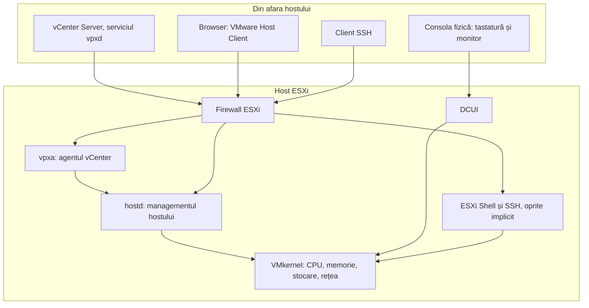
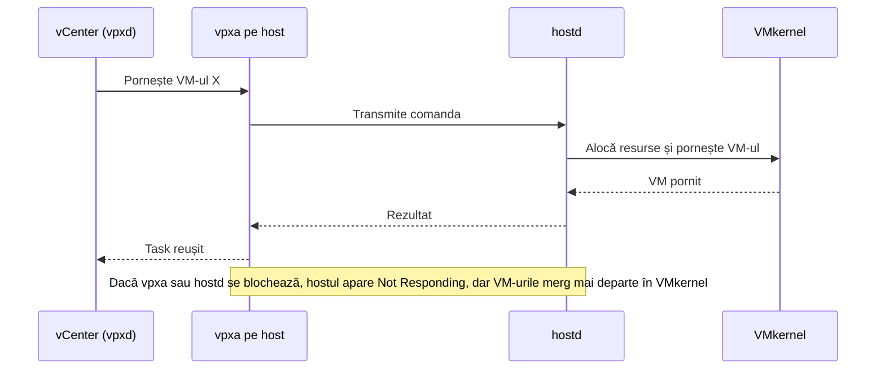
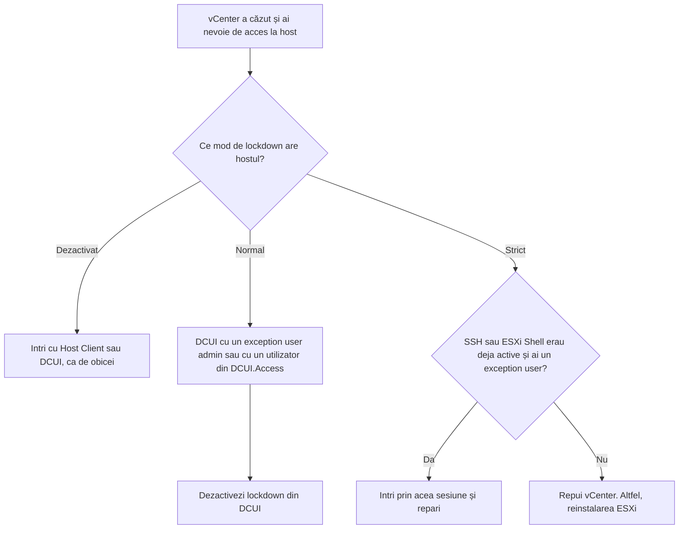

:::analogy
**Durerea din data center.** Un host ESXi pare o cutie neagră: îl instalezi, îi dai o adresă IP (Internet Protocol) și apoi îl administrezi din browser. Problemele încep când cutia nu mai răspunde. vCenter arată hostul „Not Responding”, deși VM-urile (Virtual Machine, mașini virtuale) de pe el merg mai departe. Sau un coleg activează Lockdown Mode în varianta strictă, vCenter cade, și nimeni nu mai poate intra pe host. Ca să repari asemenea situații trebuie să știi ce rulează în interiorul hostului și pe ce căi poți intra. Exam guide-ul VVF (VMware vSphere Foundation, 2V0-16.25) cere la obiectivul 2.2.1 să cunoști componentele ESXi, iar vechiul VCP-DCV (VMware Certified Professional - Data Center Virtualization) avea un obiectiv întreg despre securizarea hosturilor. [S02] [S47]

**Analogia: o navă.**

- **Sala mașinilor** este **VMkernel**: nucleul care împarte procesorul, memoria, stocarea și rețeaua între VM-uri. Nimeni nu umblă direct acolo.
- **Puntea de comandă** este **hostd**: de acolo primește nava ordine și le transmite sălii mașinilor.
- **Radiotelegrafistul** este **vpxa**: vorbește cu cartierul general (vCenter) și îi duce ordinele la punte.
- **Panoul de urgență din sala mașinilor** este **DCUI** (Direct Console User Interface): îl folosești doar dacă ești fizic lângă server.
- **Lockdown Mode** înseamnă că ordinele vin **numai** prin radio, de la cartierul general. Varianta strictă scoate și panoul de urgență din priză. Dacă radioul se strică, nava nu mai poate fi comandată.
:::

:::architecture
### 1. Straturile unui host ESXi

ESXi este un hypervisor Type 1: rulează direct pe hardware. Nucleul său, **VMkernel**, programează resursele pentru toate VM-urile. Peste el rulează servicii de management, fiecare cu rolul lui:

- **hostd** este „canalul principal de comunicare” dintre host și VMkernel. Se ocupă de ciclul de viață al VM-urilor, de alocarea resurselor și de legătura cu vCenter. Dacă hostd cade, hostul se deconectează din vCenter și nici conexiunile directe nu mai merg. [S84]
- **vpxa** (vCenter Server Agent) este agentul prin care vCenter ajunge la host. KB (Knowledge Base article, articol oficial de suport) 311805 îl descrie ca pe canalul de comunicare către hostd. [S85]



### 2. Pe ce disc stă ESXi

Din ESXi 7, discul de boot are o structură nouă. Documentația pentru ESXi 8 descrie partițiile: [S86]

| Partiție | Ce conține | Format |
|---|---|---|
| System Boot | Bootloader-ul și modulele EFI; mereu 100 MB | FAT16 |
| Boot-bank 0 și Boot-bank 1 | Modulele de boot ESXi (două copii, pentru upgrade și revenire) | FAT16 |
| **ESX-OSData** | Module suplimentare, scratch, VMware Tools, core dump-uri. Nu se folosește pentru VM-uri | VMFS-L |
| Datastore VMFS (Virtual Machine File System) | Restul spațiului, creat automat doar pe discuri de boot mari | VMFS |

Mărimea partițiilor depinde de disc: de la boot-bank-uri de 500 MB pe discuri de 8–10 GB până la 4 GB fiecare și ESX-OSData de până la 128 GB pe discuri de peste 128 GB. [S86]

**Cardurile SD și stick-urile USB.** Ani de zile serverele porneau ESXi de pe SD sau USB. KB 317631 spune clar direcția: suportul continuă până la VCF (VMware Cloud Foundation) 9.0, dar pe hardware nou se folosește un dispozitiv persistent: SSD (Solid-State Drive), NVMe (Non-Volatile Memory Express), SAS sau SATA. Pentru ESXi 9, discul local persistent de boot trebuie să aibă **minimum 128 GB**. [S87]

**Înainte de instalare: compatibilitatea hardware.** Un ESXi pornește uneori și pe hardware necertificat, dar suportul oficial există doar pentru ce apare în HCL (Hardware Compatibility List, lista de hardware certificat). Azi lista se numește **Broadcom Compatibility Guide** și stă la `compatibilityguide.broadcom.com`. Articolul KB 381824 descrie verificarea înainte de un upgrade: alegi Systems / Servers, cauți producătorul și modelul serverului, selectezi versiunea ESXi țintă și compari versiunea de BIOS (Basic Input/Output System, firmware-ul plăcii de bază) cerută cu cea instalată. Un upgrade poate eșua doar din cauza unui BIOS vechi. [S553]

Cu ESXi 9.0 contează și generația procesorului. KB 428874 împarte serverele vechi în două categorii. **Deprecated** înseamnă că serverul e încă suportat în 9.x, dar nu mai primește îmbunătățiri și va dispărea la următoarea versiune majoră. **EOL** (End of Life, sfârșitul suportului) înseamnă că serverul nu mai e în ghid, iar instalarea 9.x poate să nu recunoască procesorul sau dispozitivele. Exemplele din articol: Intel Cascade Lake e deprecated în VCF 9, iar Skylake-SP, trecut inițial ca EOL, a fost mutat în deprecated doar pentru VCF 9.x. [S554] În laborator poți rula pe hardware nelistat, dar asta e **home-lab only / not supported**.

### 3. Căile de acces

| Cale | Ce este | Când o folosești |
|---|---|---|
| **DCUI** | Meniul text de pe consola fizică (tasta F2) | Configurarea rețelei de management, depanare când rețeaua nu merge |
| **VMware Host Client** | Interfața web a unui singur host | Un host fără vCenter sau urgențe când vCenter nu merge [S88] |
| **vSphere Client** | Interfața web a lui vCenter | Administrarea zilnică a mai multor hosturi [S88] |
| **ESXi Shell** | Linia de comandă locală (Alt+F1 pe consolă) | Doar depanare; **oprită implicit** [S80] |
| **SSH** (Secure Shell) | Linia de comandă la distanță | Doar depanare; **oprit implicit** [S80] |

Documentația de securitate insistă: ESXi Shell și SSH se pornesc doar când ai nevoie și se opresc după. Două setări avansate limitează riscul: [S80]

- `UserVars.ESXiShellTimeOut`: cât timp rămâne serviciul pornit dacă nu se loghează nimeni;
- `UserVars.ESXiShellInteractiveTimeOut`: după cât timp de inactivitate este închisă o sesiune deschisă.

Atenție la un detaliu: **ESXi Shell funcționează și când hostul e în Lockdown Mode**, de aceea trebuie ținut oprit. [S80]

### 4. Repornirea agenților de management

Când hostul apare „Not Responding” în vCenter, dar VM-urile merg, de obicei hostd sau vpxa s-au blocat. KB 320280 dă metodele: din Host Client (Manage → Services, alegi hostd sau vpxa și Restart) sau din linia de comandă: [S83]

```bash
/etc/init.d/hostd restart
/etc/init.d/vpxa restart
```

Agenții au nevoie de 1–2 minute ca să pornească. **Nu** folosi `services.sh restart` (care repornește toate serviciile) pe hosturi cu vSAN, NSX sau LACP (Link Aggregation Control Protocol, agregarea legăturilor de rețea); acolo repornești serviciile unul câte unul. [S83] Dacă hostd nu pornește deloc, KB 316598 recomandă să verifici spațiul liber pe `/` și `/var/log`, accesul la datastore-uri și montările NFS (Network File System) căzute. [S84]



### 5. Firewall-ul ESXi

Firewall-ul ESXi este **pornit implicit** și blochează traficul, cu excepția serviciilor activate în profilul de securitate al hostului, a ping-ului și a traficului client DHCP (Dynamic Host Configuration Protocol) și DNS (Domain Name System). Fiecare serviciu are un set de reguli, iar implicit acceptă conexiuni de la orice IP. Recomandarea este să restrângi fiecare serviciu la rețeaua de management. [S81] KB 418184 arată cum limitezi accesul la Host Client (regula „vSphere Web Client”), cu un avertisment important: **IP-ul lui vCenter trebuie să fie în listă**, altfel vCenter nu mai poate vorbi cu hostul. [S82]

### 6. Lockdown Mode

Lockdown Mode obligă ca modificările pe host să treacă prin vCenter. Are două variante: [S78]

| | Normal | Strict |
|---|---|---|
| Acces la host | Prin vCenter | Doar prin vCenter |
| DCUI | Pornit, doar pentru exception users cu drepturi de admin și utilizatorii din `DCUI.Access` | **Oprit** |
| ESXi Shell și SSH | Pentru exception users admin și utilizatorii din `DCUI.Access` | Rămân doar sesiunile deja deschise ale acestora |
| Recuperare locală dacă vCenter cade | Posibilă prin DCUI | Imposibilă, dacă SSH sau Shell nu sunt active |

Termeni de reținut: [S78]

- **Exception users**: conturi de serviciu (de exemplu agentul de backup) care trebuie să acceseze direct hostul. **Nu** adaugi administratori aici, pentru că anulezi scopul Lockdown Mode.
- **`DCUI.Access`**: setare avansată cu utilizatori locali care pot scoate hostul din lockdown din DCUI, indiferent de drepturi. Implicit conține `root`.

KB 336894 adaugă două detalii practice: opțiunea de lockdown din DCUI e gri dacă hostul nu e conectat la vCenter, iar Strict Lockdown cu vCenter căzut și fără SSH sau Shell activ poate cere **reinstalarea ESXi**. [S79]



`[IMAGE SEARCH / PROMPT]` Captură cu ecranul DCUI (galben și gri) și meniul „System Customization”. Captură din Host Client: Manage → Services, cu hostd, vpxa, TSM și TSM-SSH. Captură din vSphere Client: Configure → System → Security Profile → Lockdown Mode.
:::

:::exam-alert
### De memorat

| Ce | Valoare / regulă | Sursă |
|---|---|---|
| Serviciul principal de management | hostd | KB 316598 [S84] |
| Agentul vCenter de pe host | vpxa (vCenter Server Agent) | KB 311805 [S85] |
| ESXi Shell și SSH | Oprite implicit; ESXi Shell merge și în lockdown | Docs vSphere [S80] |
| Timeout-uri pentru Shell/SSH | `UserVars.ESXiShellTimeOut`, `UserVars.ESXiShellInteractiveTimeOut` | Docs vSphere [S80] |
| Repornirea agenților | `/etc/init.d/hostd restart`, `/etc/init.d/vpxa restart` | KB 320280 [S83] |
| `services.sh restart` | De evitat pe hosturi cu vSAN, NSX, LACP | KB 320280 [S83] |
| Partiția de sistem pentru loguri și scratch | ESX-OSData (VMFS-L) | Docs vSphere [S86] |
| Disc de boot ESXi 9 | Minimum 128 GB, persistent | KB 317631 [S87] |
| Unde verifici hardware-ul | Broadcom Compatibility Guide (Systems / Servers + BIOS) | KB 381824 [S553] |
| Procesor deprecated vs EOL în 9.0 | Deprecated: suportat în 9.x; EOL: scos din ghid | KB 428874 [S554] |
| Lockdown Normal vs Strict | Normal: DCUI pornit pentru excepții; Strict: DCUI oprit | Docs vSphere [S78] |
| Restricționarea Host Client pe IP | IP-ul vCenter obligatoriu în listă | KB 418184 [S82] |

### 3 capcane de examen

1. **„În Strict Lockdown poți reveni oricând din DCUI.”** Fals. În Strict, serviciul DCUI este oprit. Din DCUI poți dezactiva doar Normal Lockdown. [S78]
2. **„Adaug contul de administrator la Exception Users ca să nu rămân pe dinafară.”** Greșit. Documentația spune explicit să nu adaugi administratori, pentru că anulezi Lockdown Mode. Pentru recuperare există `DCUI.Access`. [S78]
3. **„Lockdown Mode blochează și ESXi Shell, deci nu contează dacă îl las pornit.”** Fals. ESXi Shell funcționează și în lockdown, de aceea trebuie ținut oprit. [S80]
:::

:::trenches
**Greșeala 1: Strict Lockdown fără plan de recuperare.**
Un administrator activează Strict Lockdown pe toate hosturile, „pentru siguranță”. Luni mai târziu, vCenter cade. DCUI e oprit, SSH și Shell sunt dezactivate, deci nimeni nu mai poate administra hosturile. KB 336894 descrie exact acest risc: hostul poate deveni inaccesibil și poate fi nevoie de reinstalarea ESXi. [S79]
**Remediere:** folosești Normal Lockdown, cu utilizatori locali dedicați în `DCUI.Access` (nu `root`), și testezi procedura de recuperare înainte să ai nevoie de ea. Strict doar acolo unde cerințele de securitate o impun și ai un plan documentat. [S78] [S79]

**Greșeala 2: `services.sh restart` pe un host cu vSAN.**
Un host apare „Not Responding”. Reflexul e să repornești toate serviciile cu `services.sh restart`. KB 320280 spune să eviți asta pe hosturi cu vSAN, NSX, LACP sau GPU partajat: repornirea în masă poate perturba temporar hostul, poate afecta task-urile în curs și performanța VM-urilor și poate cere chiar repornirea hostului. [S83]
**Remediere:** verifici întâi ce rulează pe host (`esxcli vsan cluster get` pentru vSAN), apoi repornești doar hostd și vpxa, pe rând, și aștepți 1–2 minute până revine hostul „Connected”. Dacă hostd nu pornește, cauți cauza în `/var/log/hostd.log` (memorie, spațiu pe disc). [S83] [S84]
:::

:::interview
**Întrebare Junior/Mid: „Ce sunt hostd și vpxa și cum lucrează împreună cu vCenter?”**

*Răspunsul ideal:* hostd este serviciul principal de management de pe host: prin el trec Host Client, API-ul și comenzile către VMkernel (pornirea VM-urilor, alocarea resurselor). vpxa este agentul vCenter de pe host: primește comenzile de la vCenter (serviciul vpxd) și le transmite lui hostd. [S84] [S85] Dacă unul dintre ele se blochează, hostul apare „Not Responding” în vCenter, dar VM-urile merg mai departe, pentru că rulează în VMkernel. Un candidat bun menționează că îi repornește individual, nu cu `services.sh restart` pe hosturi cu vSAN sau NSX. [S83]

**Scenariu de troubleshooting: „Un host apare Not Responding în vCenter. Utilizatorii spun că VM-urile de pe el merg. Ce faci?”**

*Răspunsul pe care îl așteaptă un Team Lead:*
1. **Verific rețeaua:** ping către IP-ul de management. Dacă nu răspunde, problema e de rețea, nu de agenți. [S84]
2. **Încerc Host Client direct pe host.** Dacă merge, problema e pe drumul vCenter–vpxa; dacă nu, suspectez hostd. [S84]
3. **Verific starea și resursele:** `/etc/init.d/hostd status`, spațiul liber pe `/` și `/var/log`, accesul la datastore-uri (`ls /vmfs/volumes`). Un disc de loguri plin sau un NFS căzut pot bloca hostd. [S84]
4. **Repornesc doar agenții:** întâi vpxa, apoi hostd dacă e nevoie, și aștept 1–2 minute. Evit `services.sh restart`, mai ales pe hosturi cu vSAN sau NSX. [S83]
5. **Documentez și previn:** dacă problema se repetă, mă uit în `hostd.log` și deschid un caz la suport. [S84]
:::

:::lab
**Scenariu.** Explorezi un host ESXi din interior: consola DCUI, serviciile, setările de securitate și firewall-ul. Apoi provoci în siguranță o „cădere” a lui hostd și urmărești cum revine.

**Ce ai nevoie.** Acces la consola hostului (monitor fizic sau consola VM-ului, dacă ESXi e nested în Workstation) și acces la Host Client. Pasul 5 cere SSH, pornit temporar.

Pașii de mai jos sunt bifabili, iar progresul se salvează în browser. Numele exacte ale meniurilor pot diferi puțin între Host Client 8 și 9 (`⚠ de verificat`).

**Test de avarie / validare.** La pasul 5 repornești hostd. Sesiunea din Host Client trebuie să se întrerupă și să revină în 1–2 minute, iar un VM pornit pe host trebuie să meargă tot timpul. Așa vezi în practică diferența dintre planul de management (hostd) și VMkernel, care rulează VM-urile. La pasul 6 verifici că opțiunea de Lockdown din DCUI e gri pe un host neconectat la vCenter.
:::

:::quiz
Cinci întrebări originale, în stilul examenelor VCP (VMware Certified Professional). Primești explicația pentru fiecare variantă imediat după ce răspunzi.
:::

:::references
- Exam guide VCP-VVF Administrator 2V0-16.25, obiectivul 2.2.1 [S02]
- Exam guide VCP-DCV 2V0-21.23 (certificare Legacy), obiectivele 1.1 și 4.19 [S47]
- VMware Host Client: ce este și când îl folosești [S88]
- ESXi System Storage Overview și KB 317631 (boot de pe SD/USB) [S86] [S87]
- vSphere Security: ESXi Shell, SSH și timeout-uri [S80]
- KB 320280, KB 316598, KB 311805: agenții de management hostd și vpxa [S83] [S84] [S85]
- vSphere Security: firewall-ul ESXi și KB 418184 [S81] [S82]
- vSphere Security: Lockdown Mode și KB 336894 [S78] [S79]
:::
