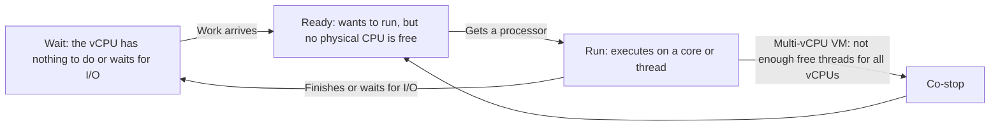
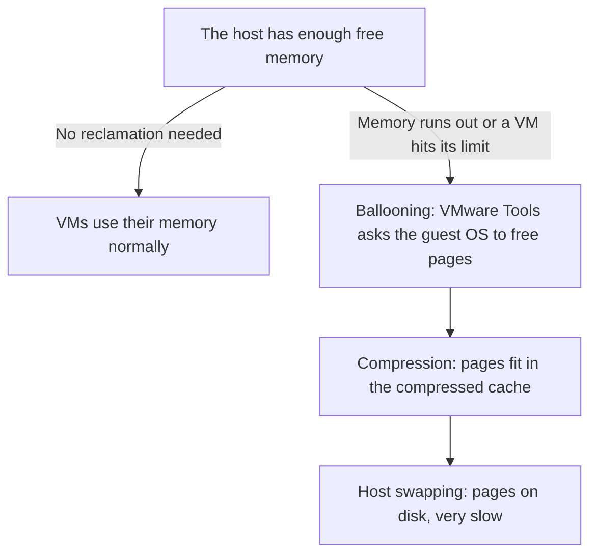

:::analogy
**The data center pain.** A VM (Virtual Machine) is slow. A beginner's first reflex is to give it more virtual processors and more memory. Often that makes things worse. The second reflex is to put a limit on the "noisy neighbour" VM, which can quietly hurt another VM for months. To avoid both mistakes you need to know how ESXi shares the CPU (Central Processing Unit) and memory. The VVF (VMware vSphere Foundation, 2V0-16.25) exam guide covers this in objective 2.2.3, and the older VCP-DCV (VMware Certified Professional - Data Center Virtualization) had separate objectives for resources and performance. [S02] [S47]

**The analogy: a restaurant kitchen.**

- The **cooks** are the physical cores of the **CPU**. The **orders** are the VMs' **vCPUs** (virtual CPUs). A waiter (the VMkernel) hands each order to the first free cook.
- **CPU ready** is the time an order sits on the pass, ready to cook, while every cook is busy.
- A table for four (a 4-vCPU VM) wants all its dishes out at roughly the same time. If only one cook is free, the table waits: that is **co-stop**.
- **Memory** is the tables. The restaurant takes more bookings than it has tables, because not everyone comes at once: that is **overcommit**. When everyone does come, the waiter asks some guests to squeeze up (ballooning), stacks plates tighter (compression) or moves some to the storeroom (swap).
- **Shares** are VIP cards: they only matter when the restaurant is full. A **reservation** is a guaranteed table. A **limit** is a "two dishes maximum" rule, even when the kitchen is empty.
:::

:::architecture
### 1. Physical cores, logical processors, vCPUs

A host has one or more physical processors (sockets), each with several cores. With **hyper-threading**, each core appears as two logical processors. Two basic rules:

- A VM cannot have more vCPUs than the host has logical processors. [S39]
- Hyper-threading does **not** double compute power. KB (Knowledge Base article) 421543 suggests counting "effective" cores as physical cores × 1.25 when calculating load. The article's example: 24 cores with hyper-threading are about 30 effective cores, not 48. [S96]

The ratio of total vCPUs to effective cores is the overcommit ratio. Field experience cited by the same article: from 400% upwards the risk of degradation under load grows, and around 1000% hosts become unstable. [S96]

### 2. What a vCPU does: run, ready, co-stop, wait

KB 387750 splits a powered-on VM's time into four states that add up to 100%: [S92]

**Reading CPU ready in the vSphere Client.** The chart shows a sum in milliseconds, not a percentage. KB 306576 gives the formula: [S91]

> CPU ready % = summation (ms) / (chart interval in seconds × 1000) × 100

The Real-time interval is 20 seconds, Past Day 300, Past Week 1800. Example: 1000 ms in Real-time is 1000 / 20,000 × 100 = 5%. Careful: the value is summed over **all** of the VM's vCPUs; for a per-vCPU value divide by the vCPU count. [S91] [S92]

Rough thresholds from KB 438023 (per vCPU): [S95]

| Metric | Normal | Investigate | Problem |
|---|---|---|---|
| CPU ready | under ~5% | 5–10% | over 10% |
| Co-stop (multi-vCPU VMs only) | under ~3% | | sustained over 3%: too many vCPUs |

KB 387750 warns that CPU ready alone does not prove a performance problem; use it alongside other metrics. [S92] The practical rule from KB 421543: **high ready with low co-stop** means an overloaded host; **high co-stop** means a VM with too many vCPUs. [S96]

### 3. NUMA: memory "next to" the processor

On a multi-socket server each processor has its own faster local memory. This architecture is called **NUMA** (Non-Uniform Memory Access). ESXi tries to keep a VM's vCPUs and memory in the same NUMA node when they fit. Larger VMs (wide VMs) get a vNUMA topology that the guest operating system can see. [S95]

What to remember (KB 438023): [S95]

- With virtual hardware version 20 or later, leave "Cores per Socket" at **"Assigned at power on"**. ESXi chooses the topology itself (Automatic vTopology).
- Set Cores per Socket manually only for licensing, very large VMs, or when the application vendor explicitly requires it.
- For a wide VM, split vCPUs evenly across as few NUMA nodes as possible and avoid odd counts that cross nodes.

### 4. Memory: overcommit and reclamation

A VM never receives more memory than it is configured with. When the host overcommits memory, each VM gets an amount between its reservation and its limit, based on its shares and its active memory. [S90] When physical memory runs short, ESXi uses several techniques: [S90] [S93]

| Technique | What it does | Remember |
|---|---|---|
| **TPS** (Transparent Page Sharing) | Keeps one copy of identical pages | By default only **within** the same VM; between VMs it is off for security reasons (`Mem.ShareForceSalting = 2`) [S93] |
| **Ballooning** | The `vmmemctl` driver in VMware Tools asks the guest OS (Operating System) to free pages | The guest OS chooses which pages to give up |
| Compression | Compresses pages and keeps them in a cache | On by default; cache is 10% of VM memory; tried before swapping |
| Host swapping | ESXi moves VM pages to the VM's swap file | Slowest; the guest OS does not even know |

The balloon → compression → swap order is the one KB 326270 describes for a VM hitting its memory limit. [S94] The vSphere 9.0 performance guide recommends not letting overcommit reach host swapping of active pages. [S40]

### 5. Shares, reservations, limits

Every VM (and every resource pool) has three settings for CPU and memory: [S89]

| Setting | Meaning | Default | When it matters |
|---|---|---|---|
| **Shares** | Relative priority among siblings under the same parent | Normal | **Only under contention** |
| **Reservation** | Guaranteed minimum (MHz or MB) | 0 | At power-on: the VM starts only if enough unreserved capacity exists (admission control) |
| **Limit** | Hard maximum (MHz or MB) | Unlimited | **Always**, even when the host is idle |

Default share values follow High : Normal : Low = 4 : 2 : 1: [S89]

| Level | CPU | Memory |
|---|---|---|
| High | 2000 per vCPU | 20 per configured MB |
| Normal | 1000 per vCPU | 10 per configured MB |
| Low | 500 per vCPU | 5 per configured MB |

The documentation recommends reserving the minimum acceptable amount, not the desired one; leaving roughly 10% of capacity unreserved; and using limits carefully, because they waste capacity and are mostly useful for simulating a smaller environment. [S89] KB 326270 says the same: if you only want to restrict a VM when the host is busy, use **shares**, not limits. [S94]

`[IMAGE SEARCH / PROMPT]` Host Client: Edit settings → CPU, with the Reservation, Limit and Shares fields. esxtop CPU screen with the %RDY, %CSTP and %MLMTD columns highlighted. Diagram of a two-socket server with two NUMA nodes.
:::

:::exam-alert
### Memorize

| What | Value / rule | Source |
|---|---|---|
| Maximum vCPUs per VM | At most the number of logical processors | vSphere docs [S39] |
| CPU ready conversion | sum ms / (interval s × 1000) × 100; Real-time = 20 s | KB 306576 [S91] |
| CPU ready per vCPU | <5% ok, 5–10% investigate, >10% problem | KB 438023 [S95] |
| Co-stop | Sustained >3%: too many vCPUs | KB 438023 [S95] |
| Shares High : Normal : Low | 4 : 2 : 1 (CPU 2000/1000/500 per vCPU) | vSphere docs [S89] |
| Reservation | Guaranteed minimum, checked at power-on | vSphere docs [S89] |
| Limit | Cap enforced even when the host is idle | vSphere docs [S89] |
| Inter-VM TPS | Off by default (`Mem.ShareForceSalting = 2`) | KB 323624 [S93] |
| Compression cache | 10% of VM memory, by default | vSphere docs [S90] |
| Memory limit reached | Ballooning → compression → swap | KB 326270 [S94] |
| CPU limit | Shows as %RDY and %MLMTD in esxtop | KB 326270 [S94] |

### 3 exam traps

1. **"High shares guarantee a VM its resources."** False. Shares only matter under contention and are relative. A guarantee comes from a reservation. [S89]
2. **"A memory limit below configured memory is invisible to the VM, so it is harmless."** False. The guest OS does not see the limit, and when the VM reaches it ESXi balloons, compresses and swaps, even if the host has free memory. [S94]
3. **"A slow VM with high co-stop needs more vCPUs."** False. High co-stop means the opposite: the VM has too many vCPUs and reducing them helps. [S95]
:::

:::trenches
**Mistake 1: a forgotten memory limit.**
KB 326270 describes a VM performing badly although the host is not loaded: ballooning and VMkernel swapping appear while the host has free memory. The cause: a memory limit below the configured memory. The guest OS believes it has all its memory, and ESXi reclaims it by force. [S94]
**Fix:** in esxtop's memory screen check `MCTLSZ` (balloon) and `SWCUR` (swap), then the VM's Limit setting. Set Limit to Unlimited. If you only want lower priority for that VM, use shares. [S94] [S89]

**Mistake 2: too many vCPUs across the whole cluster.**
KB 421543 describes a virtual desktop environment where the golden image had a fixed vCPU count cloned onto hundreds of desktops. At peak hours every host climbed towards 100% CPU and the usage alarms (75% warning, 90% critical) never stopped. The cause: total vCPUs far exceeded physical capacity, and VMs queued (high CPU ready). [S96]
**Fix:** calculate the vCPU / effective core ratio (physical × 1.25 with hyper-threading), reduce vCPUs on oversized VMs, rebalance VMs with vMotion and add hosts if needed. Measure again after every change. [S96] [S95]
:::

:::interview
**Junior/Mid question: "Explain the difference between shares, reservations and limits. When do you use each?"**

*Ideal answer:* Shares give relative priority and only matter when resources are not enough for everyone; the default is Normal and High : Normal : Low is 4 : 2 : 1. A reservation is a guaranteed minimum: the VM will not power on if the host cannot guarantee it. A limit is a cap applied always, even when the host is idle. [S89] I use shares for prioritisation, reservations only for critical applications and kept small, and limits almost never in production, because they waste capacity and can cause hard-to-explain ballooning or CPU ready. [S89] [S94]

**Troubleshooting scenario: "An 8-vCPU VM is slow. The host is at 40% CPU. What do you check?"**

*The answer a Team Lead expects:*
1. **Check the VM's limits.** A CPU limit shows in esxtop as high `%MLMTD` and `%RDY`, even on an idle host. [S94]
2. **Check co-stop (`%CSTP`).** Sustained above ~3% means the VM has too many vCPUs for its work. [S95]
3. **Calculate per-vCPU CPU ready** from the chart with the KB 306576 formula and compare it with the 5% and 10% thresholds. [S91] [S95]
4. **Check memory:** balloon or host swap on that VM points to a memory limit or host pressure. [S94]
5. **Measure inside the VM:** if guest CPU usage is low, the problem may be elsewhere (storage, network). Only then resize the VM, based on at least 24 hours of data. [S95]
:::

:::lab
**Scenario.** On your host you deliberately put a CPU limit on a busy VM and watch the effect in esxtop. Then you remove it and compare.

**What you need.** A VM with an operating system installed (any small Linux distribution will do), with 2 vCPUs, and SSH temporarily enabled on the host.

The steps below can be ticked off and progress is saved in your browser. Exact menu and column names may differ slightly between versions (`⚠ to verify`).

**Failure / validation test.** In step 4 you put a small CPU limit on the busy VM. In esxtop the VM's `%MLMTD` and `%RDY` must rise visibly although the host has free CPU. After removing the limit (step 5) they must drop. If you see no change, check that the VM is actually consuming CPU.
:::

:::quiz
Five original questions in the style of the VCP (VMware Certified Professional) exams. You get an explanation for every option right after you answer.
:::

:::references
- VCP-VVF Administrator exam guide 2V0-16.25, objective 2.2.3 [S02]
- VCP-DCV exam guide 2V0-21.23 (Legacy certification), objectives 5.1.1 and 7.3 [S47]
- vSphere Resource Management: shares, reservations, limits [S89]
- vSphere Resource Management: memory virtualization and reclamation [S90]
- KB 306576 and KB 387750: CPU ready [S91] [S92]
- KB 323624: Transparent Page Sharing and salting [S93]
- KB 326270: the effect of CPU and memory limits [S94]
- KB 438023: VM rightsizing, NUMA, Cores per Socket [S95]
- KB 421543: too many vCPUs across the cluster [S96]
- Performance Best Practices for vSphere 9.0 [S40]
:::
