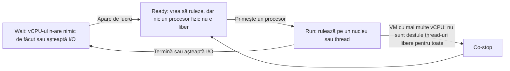
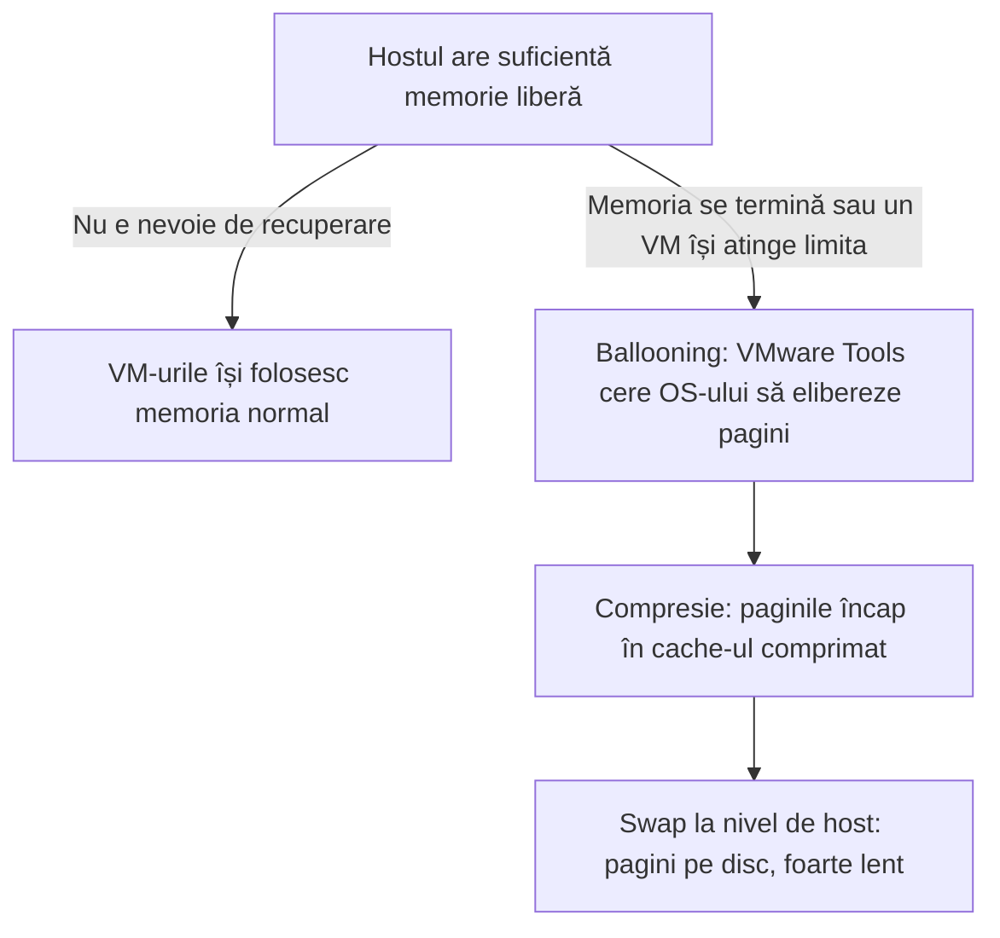

:::analogy
**Durerea din data center.** Un VM (Virtual Machine, mașină virtuală) e lent. Primul reflex al unui începător e să-i dea mai multe procesoare virtuale și mai multă memorie. De multe ori asta face lucrurile mai rău. Al doilea reflex e să pună o limită pe VM-ul „vecin gălăgios”, iar asta poate strica alt VM luni de zile fără ca cineva să observe. Ca să eviți ambele greșeli trebuie să știi cum împarte ESXi procesorul și memoria. Exam guide-ul VVF (VMware vSphere Foundation, 2V0-16.25) cere asta la obiectivul 2.2.3, iar vechiul VCP-DCV (VMware Certified Professional - Data Center Virtualization) avea obiective separate pentru resurse și performanță. [S02] [S47]

**Analogia: bucătăria unui restaurant.**

- **Bucătarii** sunt nucleele fizice ale **CPU**-ului (Central Processing Unit, procesorul). **Comenzile** sunt **vCPU**-urile (virtual CPU, procesoare virtuale) ale VM-urilor. Un ospătar (VMkernel) dă fiecare comandă primului bucătar liber.
- **CPU ready** este timpul în care o comandă stă pe pervaz, gata de gătit, dar toți bucătarii sunt ocupați.
- O masă de patru persoane (un VM cu 4 vCPU) vrea ca toate felurile să iasă cam în același timp. Dacă un singur bucătar e liber, masa așteaptă: asta e **co-stop**.
- **Memoria** sunt mesele. Restaurantul acceptă mai multe rezervări decât are mese, pentru că nu vin toți deodată: asta e **overcommit**. Când chiar vin toți, chelnerul îi roagă pe unii să se strângă (ballooning), le pune farfuriile mai înghesuit (compresie) sau mută o parte în depozit (swap).
- **Shares** sunt cardurile VIP: contează doar când restaurantul e plin. **Reservation** e masa garantată. **Limit** e regula „maxim două feluri”, chiar dacă bucătăria e goală.
:::

:::architecture
### 1. Nuclee fizice, procesoare logice, vCPU

Un host are unul sau mai multe procesoare fizice (socket-uri), fiecare cu mai multe nuclee. Cu **hyperthreading**, fiecare nucleu apare ca două procesoare logice. Două reguli de bază:

- Un VM nu poate avea mai multe vCPU decât procesoare logice are hostul. [S39]
- Hyperthreading-ul **nu dublează** puterea de calcul. KB (Knowledge Base article, articol oficial de suport) 421543 recomandă ca, la calculul gradului de încărcare, să socotești nucleele „efective” ca nuclee fizice × 1,25. Exemplu din articol: 24 de nuclee cu hyperthreading înseamnă aproximativ 30 de nuclee efective, nu 48. [S96]

Raportul dintre totalul de vCPU și nucleele efective se numește grad de overcommit. Experiența din teren, citată de același articol: de la 400% în sus crește riscul de degradare sub sarcină, iar în jur de 1000% hosturile devin instabile. [S96]

### 2. Ce face un vCPU: run, ready, co-stop, wait

KB 387750 împarte timpul unui VM pornit în patru stări care, adunate, dau 100%: [S92]

**Cum citești CPU ready în vSphere Client.** Graficul arată o sumă în milisecunde, nu un procent. KB 306576 dă formula: [S91]

> CPU ready % = suma (ms) / (intervalul graficului în secunde × 1000) × 100

Intervalul pentru Real-time este 20 de secunde, pentru Past Day 300, pentru Past Week 1800. Exemplu: 1000 ms în Real-time înseamnă 1000 / 20 000 × 100 = 5%. Atenție: valoarea e adunată pe **toate** vCPU-urile VM-ului; pentru o valoare per vCPU o împarți la numărul de vCPU. [S91] [S92]

Pragurile orientative din KB 438023 (per vCPU): [S95]

| Metrică | Normal | De investigat | Problemă |
|---|---|---|---|
| CPU ready | sub ~5% | 5–10% | peste 10% |
| Co-stop (doar VM-uri cu mai multe vCPU) | sub ~3% | | peste 3% susținut: prea multe vCPU |

KB 387750 avertizează că CPU ready singur nu dovedește o problemă de performanță; îl folosești alături de alte metrici. [S92] Regula practică din KB 421543: **ready mare cu co-stop mic** înseamnă un host prea încărcat; **co-stop mare** înseamnă un VM cu prea multe vCPU. [S96]

### 3. NUMA: memoria „de lângă” procesor

Pe un server cu mai multe socket-uri, fiecare procesor are memoria lui locală, mai rapidă. Arhitectura se numește **NUMA** (Non-Uniform Memory Access). ESXi încearcă să țină vCPU-urile și memoria unui VM în același nod NUMA, dacă încap. VM-urile mai mari (wide VMs) primesc o topologie vNUMA, vizibilă în sistemul de operare din VM. [S95]

Ce reții de aici (KB 438023): [S95]

- La hardware virtual versiunea 20 sau mai nouă, lași „Cores per Socket” pe **„Assigned at power on”**. ESXi alege singur topologia (Automatic vTopology).
- Setezi manual Cores per Socket doar pentru licențiere, la VM-uri foarte mari sau când furnizorul aplicației cere explicit.
- Pentru un VM wide: împarte vCPU-urile egal pe cât mai puține noduri NUMA și evită numerele impare care traversează noduri.

### 4. Memoria: overcommit și recuperare

Un VM nu primește niciodată mai multă memorie decât are configurată. Când hostul are overcommit de memorie, fiecare VM primește o cantitate între reservation și limit, în funcție de shares și de memoria lui activă. [S90] Când memoria fizică nu mai ajunge, ESXi folosește mai multe tehnici: [S90] [S93]

| Tehnică | Ce face | De reținut |
|---|---|---|
| **TPS** (Transparent Page Sharing) | Păstrează o singură copie a paginilor identice | Implicit doar **în interiorul** aceluiași VM; între VM-uri e oprit din motive de securitate (`Mem.ShareForceSalting = 2`) [S93] |
| **Ballooning** | Driverul `vmmemctl` din VMware Tools cere sistemului de operare din VM să elibereze pagini | Sistemul de operare alege ce pagini sacrifică |
| Compresie | Comprimă pagini și le ține într-un cache | Pornită implicit; cache-ul e 10% din memoria VM-ului; e încercată înainte de swap |
| Swap la nivel de host | ESXi mută pagini ale VM-ului în fișierul de swap al VM-ului | Cel mai lent; sistemul de operare din VM nici nu știe |

Ordinea balon → compresie → swap este cea descrisă de KB 326270 pentru un VM care își atinge limita de memorie. [S94] Ghidul de performanță vSphere 9.0 recomandă să nu lași overcommit-ul să ajungă până la swap la nivel de host pentru paginile active. [S40]

### 5. Shares, reservations, limits

Fiecare VM (și fiecare resource pool) are trei setări pentru CPU și memorie: [S89]

| Setare | Ce înseamnă | Implicit | Când contează |
|---|---|---|---|
| **Shares** | Prioritate relativă față de „frații” din același părinte | Normal | **Doar la contenție** |
| **Reservation** | Minim garantat (MHz sau MB) | 0 | La pornire: VM-ul pornește doar dacă există capacitate nerezervată (admission control) |
| **Limit** | Plafon maxim (MHz sau MB) | Unlimited | **Mereu**, chiar dacă hostul e liber |

Valorile implicite pentru shares au raportul High : Normal : Low = 4 : 2 : 1: [S89]

| Nivel | CPU | Memorie |
|---|---|---|
| High | 2000 pe vCPU | 20 pe MB configurat |
| Normal | 1000 pe vCPU | 10 pe MB configurat |
| Low | 500 pe vCPU | 5 pe MB configurat |

Recomandările documentației: rezervi minimul acceptabil, nu cât ți-ar plăcea; lași aproximativ 10% din capacitate nerezervată; folosești limitele cu grijă, pentru că irosesc capacitate și sunt utile mai ales ca să simulezi un mediu mai mic. [S89] KB 326270 spune același lucru: dacă vrei doar să restrângi un VM când hostul e aglomerat, folosești **shares**, nu limits. [S94]

`[IMAGE SEARCH / PROMPT]` Captură din Host Client: Edit settings → CPU, cu câmpurile Reservation, Limit, Shares. Captură esxtop, ecranul CPU, cu coloanele %RDY, %CSTP și %MLMTD evidențiate. Diagramă cu un server cu două socket-uri și două noduri NUMA.
:::

:::exam-alert
### De memorat

| Ce | Valoare / regulă | Sursă |
|---|---|---|
| vCPU maxim per VM | Cel mult numărul de procesoare logice | Docs vSphere [S39] |
| Conversie CPU ready | sumă ms / (interval s × 1000) × 100; Real-time = 20 s | KB 306576 [S91] |
| CPU ready per vCPU | <5% ok, 5–10% de investigat, >10% problemă | KB 438023 [S95] |
| Co-stop | >3% susținut: prea multe vCPU | KB 438023 [S95] |
| Shares High : Normal : Low | 4 : 2 : 1 (CPU 2000/1000/500 pe vCPU) | Docs vSphere [S89] |
| Reservation | Minim garantat, verificat la pornire | Docs vSphere [S89] |
| Limit | Plafon aplicat chiar și cu hostul liber | Docs vSphere [S89] |
| TPS între VM-uri | Oprit implicit (`Mem.ShareForceSalting = 2`) | KB 323624 [S93] |
| Cache-ul de compresie | 10% din memoria VM-ului, implicit | Docs vSphere [S90] |
| Limită de memorie atinsă | Ballooning → compresie → swap | KB 326270 [S94] |
| Limită de CPU | Apare ca %RDY și %MLMTD în esxtop | KB 326270 [S94] |

### 3 capcane de examen

1. **„Shares mari îi garantează unui VM resurse.”** Fals. Shares contează doar la contenție și sunt relative. Garanția o dă reservation. [S89]
2. **„O limită de memorie mai mică decât memoria configurată e invizibilă pentru VM, deci inofensivă.”** Fals. Sistemul de operare nu vede limita, iar când VM-ul ajunge la ea, ESXi face ballooning, compresie și swap, chiar dacă hostul are memorie liberă. [S94]
3. **„Un VM lent cu co-stop mare are nevoie de mai multe vCPU.”** Fals. Co-stop mare înseamnă exact opusul: VM-ul are prea multe vCPU și reducerea lor ajută. [S95]
:::

:::trenches
**Greșeala 1: o limită de memorie uitată.**
KB 326270 descrie un VM care merge prost deși hostul nu e încărcat: apar ballooning și swap la nivel de VMkernel, cu memorie liberă pe host. Cauza: o limită de memorie mai mică decât memoria configurată. Sistemul de operare din VM crede că are toată memoria, iar ESXi o recuperează forțat. [S94]
**Remediere:** verifici în esxtop, pe ecranul de memorie, coloanele `MCTLSZ` (balon) și `SWCUR` (swap), apoi în setările VM-ului câmpul Limit. Pui Limit pe Unlimited. Dacă vrei doar prioritate mai mică pentru acel VM, folosești shares. [S94] [S89]

**Greșeala 2: prea multe vCPU în tot clusterul.**
KB 421543 descrie un mediu de desktop-uri virtuale în care imaginea de bază avea un număr fix de vCPU, clonată pe sute de desktop-uri. La orele de vârf, toate hosturile urcau spre 100% CPU, iar alarmele de utilizare (75% avertisment, 90% critic) nu se mai opreau. Cauza: totalul de vCPU depășea mult capacitatea fizică, iar VM-urile stăteau la coadă (CPU ready mare). [S96]
**Remediere:** calculezi raportul vCPU / nuclee efective (fizice × 1,25 cu hyperthreading), reduci vCPU-urile VM-urilor supradimensionate, redistribui VM-urile cu vMotion și adaugi hosturi dacă e nevoie. Măsori din nou după fiecare schimbare. [S96] [S95]
:::

:::interview
**Întrebare Junior/Mid: „Explică diferența dintre shares, reservations și limits. Când folosești fiecare?”**

*Răspunsul ideal:* Shares dau prioritate relativă și contează doar când resursele nu ajung pentru toți; implicit sunt Normal, iar High : Normal : Low este 4 : 2 : 1. Reservation este un minim garantat: VM-ul nu pornește dacă hostul nu-l poate garanta. Limit este un plafon aplicat mereu, chiar și când hostul e liber. [S89] Folosesc shares pentru prioritizare, reservations doar pentru aplicațiile critice și cât mai mici, iar limits aproape niciodată în producție, pentru că irosesc capacitate și pot cauza ballooning sau CPU ready greu de explicat. [S89] [S94]

**Scenariu de troubleshooting: „Un VM cu 8 vCPU e lent. Hostul are 40% utilizare CPU. Ce verifici?”**

*Răspunsul pe care îl așteaptă un Team Lead:*
1. **Verific limitele VM-ului.** O limită de CPU apare în esxtop ca `%MLMTD` și `%RDY` mari, chiar cu hostul liber. [S94]
2. **Verific co-stop (`%CSTP`).** Peste ~3% susținut înseamnă că VM-ul are prea multe vCPU pentru ce face. [S95]
3. **Calculez CPU ready per vCPU** din grafic, cu formula din KB 306576, și compar cu pragurile de 5% și 10%. [S91] [S95]
4. **Verific memoria:** balon sau swap la nivel de host pe acel VM indică o limită de memorie sau presiune pe host. [S94]
5. **Măsor în interiorul VM-ului:** dacă utilizarea CPU în sistemul de operare e mică, problema poate fi în altă parte (stocare, rețea). Abia la final dimensionez din nou VM-ul, pe baza a cel puțin 24 de ore de date. [S95]
:::

:::lab
**Scenariu.** Pe hostul tău pui intenționat o limită de CPU pe un VM încărcat și vezi efectul în esxtop. Apoi o scoți și compari.

**Ce ai nevoie.** Un VM cu un sistem de operare instalat (orice distribuție Linux mică e suficientă), cu 2 vCPU, și SSH pornit temporar pe host.

Pașii de mai jos sunt bifabili, iar progresul se salvează în browser. Numele exacte ale meniurilor și coloanelor pot diferi puțin între versiuni (`⚠ de verificat`).

**Test de avarie / validare.** La pasul 4 pui o limită de CPU mică pe VM-ul încărcat. În esxtop, `%MLMTD` și `%RDY` ale VM-ului trebuie să crească vizibil, deși hostul are procesor liber. După ce scoți limita (pasul 5), valorile trebuie să coboare. Dacă nu vezi nicio schimbare, verifică faptul că VM-ul chiar consumă CPU.
:::

:::quiz
Cinci întrebări originale, în stilul examenelor VCP (VMware Certified Professional). Primești explicația pentru fiecare variantă imediat după ce răspunzi.
:::

:::references
- Exam guide VCP-VVF Administrator 2V0-16.25, obiectivul 2.2.3 [S02]
- Exam guide VCP-DCV 2V0-21.23 (certificare Legacy), obiectivele 5.1.1 și 7.3 [S47]
- vSphere Resource Management: shares, reservations, limits [S89]
- vSphere Resource Management: virtualizarea și recuperarea memoriei [S90]
- KB 306576 și KB 387750: CPU ready [S91] [S92]
- KB 323624: Transparent Page Sharing și salting [S93]
- KB 326270: efectul limitelor de CPU și memorie [S94]
- KB 438023: dimensionarea VM-urilor, NUMA, Cores per Socket [S95]
- KB 421543: prea multe vCPU în tot clusterul [S96]
- Performance Best Practices for vSphere 9.0 [S40]
:::
