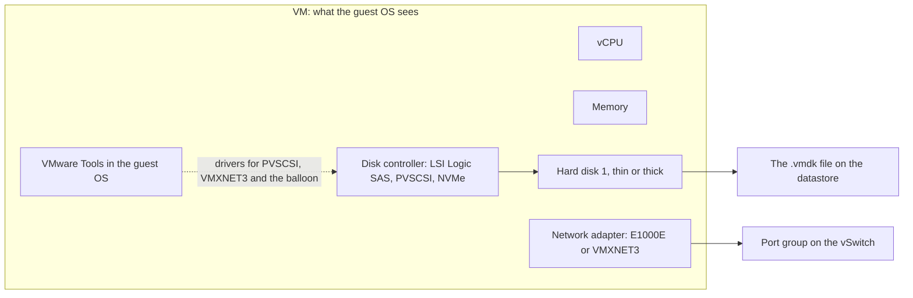
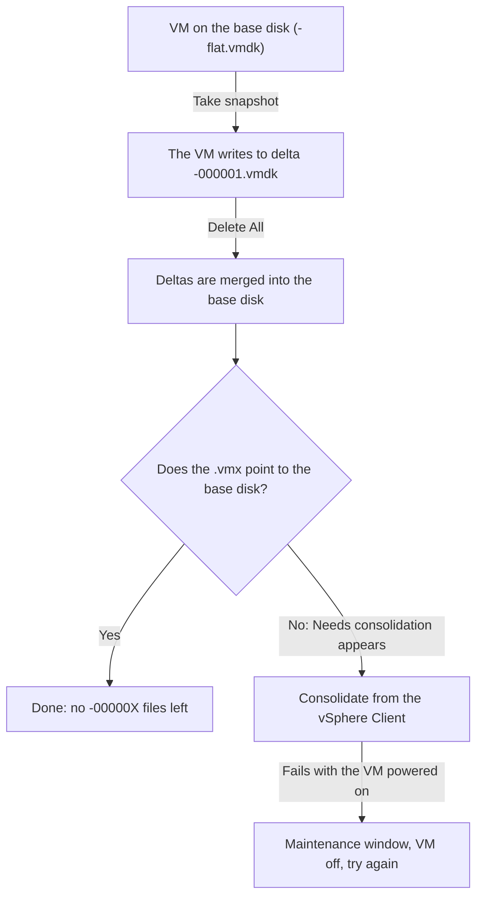

:::analogy
**The data center pain.** A VM (Virtual Machine) takes two minutes to create with default settings. The problems come later: a VM migrated to an older host refuses to start, a Windows server stops booting after a disk controller "optimisation", a datastore fills up because every disk is thin, and a VM runs for months on a snapshot a backup job forgot. All of them come from choices made at creation or from missing maintenance. The VVF (VMware vSphere Foundation, 2V0-16.25) exam guide covers VM administration in objective 2.2.3, and the older VCP-DCV (VMware Certified Professional - Data Center Virtualization) had separate objectives for creating, configuring and snapshotting VMs. [S02] [S47]

**The analogy: a PC built from parts, shipped in a suitcase.**

- The **virtual hardware version** is the motherboard generation. A new board does not fit an old case (an older ESXi host).
- A **thin disk** is an expandable suitcase: it takes only as much room as you pack, but can swell to its full size. A **thick disk** is a rigid suitcase: it takes all its room from day one.
- The **disk controller and network adapter** are the parts the PC uses to talk to its disk and network. Some are "universal" (emulated, work anywhere), others are made specifically for VMware (paravirtual): faster, but they need a driver.
- **VMware Tools** is the driver and utility kit that makes the PC feel "at home" in VMware.
- A **snapshot** is the bookmark from lesson 1.1. Forget the bookmark in the book and the book keeps getting thicker.
:::

:::architecture
### 1. What a VM is: files and virtual hardware

You saw in lesson 1.1 that a VM is a set of files on a datastore: `.vmx` (configuration), `.vmdk` and `-flat.vmdk` (disk), `.nvram`, `.vswp`, `.vmsd` and `.vmsn` (snapshots), `.log`. [S38] Besides the files, the VM has **virtual hardware** that the guest operating system sees as an ordinary computer.

### 2. The virtual hardware version

Every VM has a virtual hardware version (also called "compatibility" in the vSphere Client). It decides which features the VM has and **which hosts it can run on**. KB (Knowledge Base article) 312100: [S97]

| ESXi host | Highest virtual hardware version |
|---|---|
| ESXi 9.0 | 22 |
| ESXi 8.0 U2 / U3 | 21 |
| ESXi 8.0 / U1 | 20 |
| ESXi 7.0 U2 / U3 | 19 |

The rule: **a VM with a newer hardware version cannot be created, edited or powered on on an older host.** [S97] In a cluster with mixed host versions, raising a VM's hardware version ties it to the newer hosts. Before upgrading the hardware version, take a snapshot or a backup. [S95]

### 3. The virtual disk: thin or thick

The vSphere documentation describes three provisioning policies: [S100]

| Type | How space is allocated | How blocks are zeroed | Remember |
|---|---|---|---|
| **Thin** | Starts small and grows on demand up to its maximum size | On first access to each block | Fastest to create. **Not** for Fault Tolerance |
| **Thick lazy zeroed** | All space at creation | On first write to each block | The default thick format |
| **Thick eager zeroed** | All space at creation | The whole disk, at creation | Slowest to create; the type required by Fault Tolerance and clustering solutions |

Thin disks save space, but they let you promise more than the datastore holds. If all disks grow at once, the datastore fills and VMs stop, just like the snapshot case in lesson 1.1. With thin disks, monitoring free space becomes mandatory.

### 4. The disk controller

| Controller | What it is | Remember |
|---|---|---|
| LSI Logic SAS | Emulated controller with a driver built into most operating systems | The "safe" choice at install time |
| **PVSCSI** (Paravirtual SCSI) | VMware's paravirtual controller | Higher throughput and lower CPU (Central Processing Unit) use; needs virtual hardware 7+ [S104] |
| Virtual NVMe (Non-Volatile Memory Express) | Virtual NVMe controller | Available on newer hardware versions (⚠ minimum version to verify) |

KB 313507 explains the PVSCSI trap: on Linux the driver is in the kernel of modern distributions, but on Windows it comes from VMware Tools. **If you move a Windows boot disk to PVSCSI without the driver, the system blue-screens at boot.** The same happens if you uninstall VMware Tools from a VM that boots from PVSCSI. [S104]

### 5. The virtual network adapter

KB 321259 describes the virtual NIC (Network Interface Card) types: [S98]

| Adapter | What it is |
|---|---|
| E1000 | Emulates an Intel 82545EM gigabit NIC; driver built into almost every OS (Operating System) |
| E1000E | Emulates an Intel 82574 gigabit NIC; default for some Windows versions |
| **VMXNET3** | Paravirtual NIC built for performance: multiqueue (RSS, Receive Side Scaling, on Windows), IPv6 offloads, MSI/MSI-X interrupts |

In vSphere 9.1, E1000 and E1000e remain supported "for compatibility", but Broadcom recommends moving to VMXNET3 wherever the guest OS supports it, especially for performance problems on a Distributed Switch. [S99]

### 6. VMware Tools

VMware Tools is the set of services and drivers installed in the VM's operating system. KB 315382 lists what it brings: better display, mouse and copy/paste, guest clock sync with the host and **quiesced snapshots** for backup (the guest flushes its buffers before the snapshot). [S101] The balloon driver (`vmmemctl`) used for memory reclamation in lesson 1.5 also comes from VMware Tools. [S90]

On Linux the rule is simple: VMware recommends **open-vm-tools** shipped by the OS vendor, installed and updated with the distribution's package manager. You do not remove it to install something else. [S102]

### 7. Snapshots: create, delete, consolidate

Lesson 1.1 gave the KB 318825 rules: at most 32 in a chain, 2–3 recommended, no longer than 72 hours, and a snapshot is not a backup. [S41] The new part is what happens on deletion. **Deleting a snapshot does not lose changes.** The delta files (`-00000X.vmdk`) are merged back into the base disk: this is called commit or **consolidation**. [S103]

KB 316575 lists the typical causes of "Needs consolidation": snapshots left behind by backups, a backup application holding file locks, under 1 GB free on the datastore, lost connectivity between vCenter and the host, or more than 32 snapshots. The direct check: if the `.vmx` contains a line like `scsi0:0.fileName = "VM-000001.vmdk"`, the VM is running on a snapshot. [S103]

`[IMAGE SEARCH / PROMPT]` Host Client "New virtual machine" wizard at the Compatibility step. Edit settings with Hard disk 1 expanded (Disk Provisioning, Controller). vSphere Client showing the "Virtual machine disks consolidation is needed" warning.
:::

:::exam-alert
### Memorize

| What | Value / rule | Source |
|---|---|---|
| Highest virtual hardware on ESXi 9.0 / 8.0 U2-U3 / 8.0 | 22 / 21 / 20 | KB 312100 [S97] |
| VM with newer hardware on an older host | Cannot run | KB 312100 [S97] |
| Disk for Fault Tolerance | Thick eager zeroed, not thin | vSphere docs [S100] |
| Default thick format | Thick lazy zeroed | vSphere docs [S100] |
| PVSCSI | Virtual hardware 7+; on Windows the driver comes from VMware Tools | KB 313507 [S104] |
| Recommended network adapter | VMXNET3; E1000/E1000e for compatibility only (9.1) | KB 447191 [S99] |
| VMware Tools on Linux | The distribution's open-vm-tools | KB 313456 [S102] |
| Quiesced snapshot | Needs VMware Tools | KB 315382 [S101] |
| Deleting snapshots | Merges deltas into the base disk | KB 316575 [S103] |
| "Needs consolidation" causes | Backup leftovers, <1 GB free, >32 snapshots | KB 316575 [S103] |

### 3 exam traps

1. **"I can vMotion a hardware 22 VM to an ESXi 8.0 U3 host if it has resources."** False. ESXi 8.0 U3 supports at most version 21. [S97]
2. **"Thin is always the best choice because it saves space."** False. Thin is not suitable for Fault Tolerance and clustering solutions, which need thick eager zeroed. [S100]
3. **"Delete All in Snapshot Manager throws away every change made after the first snapshot."** False. Delete All merges changes into the base disk; the VM keeps its current state. To go back to a snapshot you use Revert. [S103]
:::

:::trenches
**Mistake 1: a Windows boot disk moved to PVSCSI without the driver.**
An administrator reads that PVSCSI is faster and changes the controller of a Windows server's system disk. On reboot: blue screen. KB 313507 describes exactly this: the PVSCSI driver is not native to some Windows versions and comes from VMware Tools. [S104]
**Fix:** switch the controller back so the server boots. Then follow the KB procedure: temporarily add a small 1 GB disk on a new PVSCSI controller, boot the VM so Windows loads the driver, power off, remove the temporary disk, and only then move the boot disk to PVSCSI. [S104]

**Mistake 2: VMs running for months on forgotten snapshots.**
After a night of backup problems, several VMs show "Needs consolidation". The `-00000X.vmdk` files have grown and the datastore has under 1 GB free. KB 316575 puts snapshots left by backups and lack of free space at the top of its list. [S103]
**Fix:** free up datastore space, make sure the backup application no longer holds file locks, then run Delete All or Consolidate. If it fails with the VM powered on, retry in a maintenance window with the VM off. **Never** delete `-00000X` files by hand. [S103] [S41]
:::

:::interview
**Junior/Mid question: "What is VMware Tools and what happens if it is missing?"**

*Ideal answer:* VMware Tools is the set of drivers and services in the VM's operating system. Without it you lose guest clock sync with the host, quiesced snapshots for backup, the balloon driver for memory reclamation and, on Windows, the paravirtual drivers (PVSCSI, VMXNET3). [S101] [S90] [S104] On Linux I use the distribution's open-vm-tools, updated together with the OS. [S102] A strong candidate adds that a Windows VM booting from PVSCSI will not start if you uninstall VMware Tools. [S104]

**Troubleshooting scenario: "A VM shows Needs consolidation, but Snapshot Manager lists no snapshots. What do you do?"**

*The answer a Team Lead expects:*
1. **Confirm the state:** in the VM settings or the `.vmx`, look for disks pointing to `-00000X.vmdk`. If there are any, the VM runs on a delta. [S103]
2. **Check datastore free space:** under 1 GB is a classic cause. [S103]
3. **Check the backup:** a stuck job can hold file locks; wait for it to finish or stop it. [S103]
4. **Run Consolidate** from the vSphere Client. If it does not work, take a new snapshot and then Delete All, as KB 316575 describes. [S103]
5. **If it still fails**, schedule a maintenance window and retry with the VM powered off. Never delete delta files by hand. [S103] [S41]
:::

:::lab
**Scenario.** You build a VM "by the book": you deliberately choose the hardware version, disk type, controller and network adapter. You install a small Linux, check VMware Tools, then go through a full snapshot lifecycle and confirm consolidation directly in the `.vmx` file.

**What you need.** An ISO of a small Linux distribution uploaded to the datastore, and SSH temporarily enabled for step 6.

The steps below can be ticked off and progress is saved in your browser. Exact menu names may differ slightly between Host Client 8 and 9 (`⚠ to verify`).

**Failure / validation test.** In step 5 you take a snapshot, and the `.vmx` must point the disk to a `-000001.vmdk` file. After Delete All (step 6), the `.vmx` must point to the base disk again and no `-00000X.vmdk` files may remain in the VM folder. If one remains, you have reproduced the "Needs consolidation" situation in your lab.
:::

:::quiz
Five original questions in the style of the VCP (VMware Certified Professional) exams. You get an explanation for every option right after you answer.
:::

:::references
- VCP-VVF Administrator exam guide 2V0-16.25, objective 2.2.3 [S02]
- VCP-DCV exam guide 2V0-21.23 (Legacy certification), objectives 1.12, 7.1 and 7.2 [S47]
- vSphere documentation: VM files [S38] and disk provisioning policies [S100]
- KB 312100: virtual hardware versions [S97]
- KB 313507: the PVSCSI controller [S104]
- KB 321259 and KB 447191: virtual network adapters [S98] [S99]
- KB 315382 and KB 313456: VMware Tools and open-vm-tools [S101] [S102]
- KB 318825 and KB 316575: snapshots and consolidation [S41] [S103]
:::
