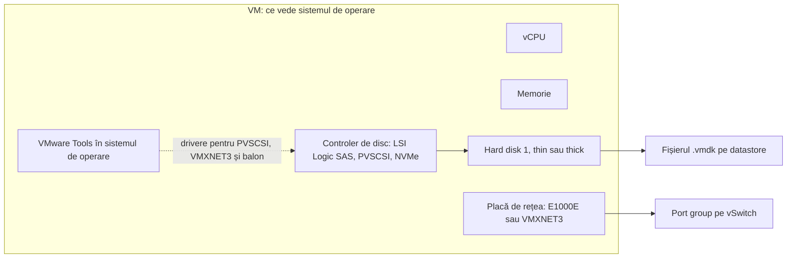
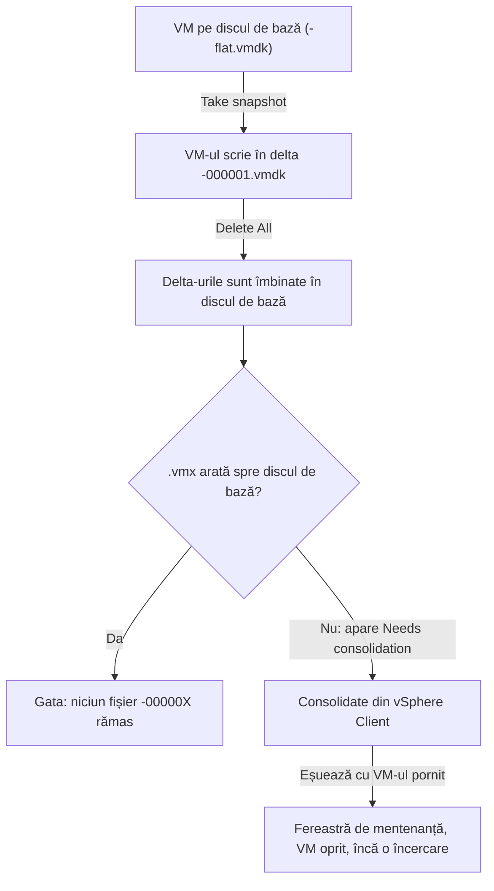

:::analogy
**Durerea din data center.** Un VM (Virtual Machine, mașină virtuală) se creează în două minute, cu setările implicite. Problemele apar mai târziu: un VM migrat pe un host mai vechi refuză să pornească, un server Windows nu mai bootează după o „optimizare” a controlerului de disc, un datastore se umple pentru că toate discurile sunt thin, iar un VM rulează luni de zile pe un snapshot uitat de backup. Toate vin din alegeri făcute la crearea VM-ului sau din lipsa de întreținere. Exam guide-ul VVF (VMware vSphere Foundation, 2V0-16.25) cere administrarea VM-urilor la obiectivul 2.2.3, iar vechiul VCP-DCV (VMware Certified Professional - Data Center Virtualization) avea obiective separate pentru crearea, configurarea și snapshot-urile VM-urilor. [S02] [S47]

**Analogia: un calculator construit din piese, livrat într-o valiză.**

- **Versiunea de hardware virtual** este generația plăcii de bază. O placă nouă nu intră într-o carcasă veche (un host ESXi mai vechi).
- **Discul thin** e o valiză extensibilă: ocupă loc doar cât pui în ea, dar se poate umfla până la mărimea maximă. **Discul thick** e o valiză rigidă: ocupă tot locul din prima zi.
- **Controlerul de disc și placa de rețea** sunt piesele prin care calculatorul vorbește cu discul și cu rețeaua. Unele sunt „universale” (emulate, merg oriunde), altele sunt făcute special pentru VMware (paravirtuale): mai rapide, dar cer un driver.
- **VMware Tools** este kitul de drivere și utilitare care face calculatorul să se simtă „acasă” în VMware.
- **Snapshot-ul** e semnul de carte din lecția 1.1. Dacă uiți semnul în carte, cartea se tot îngroașă.
:::

:::architecture
### 1. Ce este un VM: fișiere și hardware virtual

Ai văzut în lecția 1.1 că un VM este un set de fișiere pe un datastore: `.vmx` (configurația), `.vmdk` și `-flat.vmdk` (discul), `.nvram`, `.vswp`, `.vmsd` și `.vmsn` (snapshot-uri), `.log`. [S38] Pe lângă fișiere, VM-ul are un **hardware virtual** pe care sistemul de operare îl vede ca pe un calculator obișnuit.

### 2. Versiunea de hardware virtual

Fiecare VM are o versiune de hardware virtual (numită în vSphere Client și „compatibility”). Ea decide ce funcții are VM-ul și **pe ce hosturi poate rula**. KB (Knowledge Base article, articol oficial de suport) 312100: [S97]

| Host ESXi | Versiunea maximă de hardware virtual |
|---|---|
| ESXi 9.0 | 22 |
| ESXi 8.0 U2 / U3 | 21 |
| ESXi 8.0 / U1 | 20 |
| ESXi 7.0 U2 / U3 | 19 |

Regula: **un VM cu versiune hardware mai nouă nu poate fi creat, editat sau pornit pe un host mai vechi.** [S97] Într-un cluster cu hosturi de versiuni diferite, dacă ridici versiunea unui VM, îl legi de hosturile noi. Înainte de upgrade-ul versiunii hardware faci un snapshot sau un backup. [S95]

### 3. Discul virtual: thin sau thick

Documentația vSphere descrie trei politici de alocare: [S100]

| Tip | Cum alocă spațiul | Cum șterge (zeroing) | De reținut |
|---|---|---|---|
| **Thin** | Pornește mic și crește la nevoie, până la mărimea maximă | La prima accesare a fiecărui bloc | Cel mai rapid de creat. **Nu** se folosește pentru Fault Tolerance |
| **Thick lazy zeroed** | Tot spațiul la creare | La prima scriere în fiecare bloc | Formatul thick implicit |
| **Thick eager zeroed** | Tot spațiul la creare | Tot discul, la creare | Cel mai lent de creat; tipul cerut de Fault Tolerance și de soluțiile de clustering |

Discurile thin economisesc spațiu, dar îți permit să promiți mai mult decât are datastore-ul. Dacă discurile cresc toate odată, datastore-ul se umple și VM-urile se opresc, ca în cazul cu snapshot-uri din lecția 1.1. Cu thin, monitorizarea spațiului liber devine obligatorie.

### 4. Controlerul de disc

| Controler | Ce este | De reținut |
|---|---|---|
| LSI Logic SAS | Controler emulat, cu driver inclus în majoritatea sistemelor de operare | Alegerea „sigură” la instalare |
| **PVSCSI** (Paravirtual SCSI) | Controler paravirtual VMware | Mai mult throughput și mai puțin CPU (Central Processing Unit); cere hardware virtual 7+ [S104] |
| NVMe (Non-Volatile Memory Express) virtual | Controler NVMe virtual | Disponibil la versiunile hardware mai noi (⚠ de verificat versiunea minimă) |

KB 313507 explică capcana PVSCSI: pe Linux driverul e inclus în kernel la distribuțiile moderne, dar pe Windows vine din VMware Tools. **Dacă muți discul de boot al unui Windows pe PVSCSI fără driver, sistemul pică în ecran albastru la pornire.** Același lucru se întâmplă dacă dezinstalezi VMware Tools de pe un VM care bootează de pe PVSCSI. [S104]

### 5. Placa de rețea virtuală

KB 321259 descrie tipurile de plăci de rețea virtuale: [S98]

| Placă | Ce este |
|---|---|
| E1000 | Emulează o placă Intel 82545EM gigabit; driver inclus în aproape orice sistem de operare |
| E1000E | Emulează o placă Intel 82574 gigabit; implicită pentru unele versiuni Windows |
| **VMXNET3** | Placă paravirtuală, făcută pentru performanță: multiqueue (RSS, Receive Side Scaling, pe Windows), offload-uri IPv6, întreruperi MSI/MSI-X |

În vSphere 9.1, E1000 și E1000e rămân suportate „pentru compatibilitate”, dar Broadcom recomandă trecerea la VMXNET3 oriunde sistemul de operare o suportă, mai ales la probleme de performanță pe Distributed Switch. [S99]

### 6. VMware Tools

VMware Tools este setul de servicii și drivere instalat în sistemul de operare al VM-ului. KB 315382 enumeră ce aduce: afișare mai bună, mouse și copy/paste, sincronizarea ceasului cu hostul și **snapshot-uri quiesced** pentru backup (sistemul de operare își golește bufferele înainte de snapshot). [S101] Tot din VMware Tools vine driverul de balon (`vmmemctl`) folosit la recuperarea memoriei, din lecția 1.5. [S90]

Pe Linux, regula e simplă: VMware recomandă **open-vm-tools** distribuit de producătorul sistemului de operare, instalat și actualizat cu managerul de pachete al distribuției. Nu îl dezinstalezi ca să pui altă variantă. [S102]

### 7. Snapshot-urile: creare, ștergere, consolidare

Ai văzut în lecția 1.1 regulile din KB 318825: cel mult 32 într-un lanț, recomandat 2–3, cel mult 72 de ore, iar snapshot-ul nu e backup. [S41] Partea nouă este ce se întâmplă la ștergere. **Ștergerea unui snapshot nu pierde modificările.** Fișierele delta (`-00000X.vmdk`) sunt îmbinate înapoi în discul de bază: asta se numește commit sau **consolidare**. [S103]

**Ce conține un snapshot.** KB 342618 descrie rolul fiecărui fișier. `.vmsd` este baza de date a snapshot-urilor: din ea citește Snapshot Manager relațiile dintre snapshot-uri și discurile copil. `.vmsn` păstrează configurația VM-ului și, opțional, starea memoriei. Pentru fiecare disc atașat apare un disc copil (delta). Pe VMFS-6 (Virtual Machine File System) toate snapshot-urile folosesc formatul **SEsparse**, indiferent de mărimea discului. [S305]

**Memorie sau quiesce, nu amândouă.** La crearea snapshot-ului alegi între două opțiuni, care se exclud reciproc, spune același articol: [S305]
- **Include memory** (implicit): salvează și RAM-ul (Random Access Memory, memoria de lucru), deci revii la un VM pornit. Durează mai mult, iar VM-ul e oprit pentru scurt timp (stun).
- **Quiesce guest file system**: VMware Tools golește bufferele și pregătește aplicațiile, ca datele de pe disc să fie consistente pentru backup. Merge doar cu VM-ul pornit.
- **Niciuna**: snapshot-ul e doar crash-consistent, ca după o pană de curent.

La Revert, sistemul de operare revine și cu setările vechi (IP, Internet Protocol, și patch-uri), lucru care poate deranja aplicațiile sensibile la timp. [S305]

KB 316575 listează cauzele tipice pentru „Needs consolidation”: snapshot-uri rămase după backup, o aplicație de backup care ține fișierele blocate, sub 1 GB liber pe datastore, conexiuni pierdute între vCenter și host sau mai mult de 32 de snapshot-uri. Verificarea directă: dacă `.vmx` conține o linie de forma `scsi0:0.fileName = "VM-000001.vmdk"`, VM-ul rulează pe un snapshot. [S103]

`[IMAGE SEARCH / PROMPT]` Captură din Host Client: fereastra „New virtual machine” la pasul Compatibility. Captură din Edit settings cu Hard disk 1 extins (Disk Provisioning, Controller). Captură din vSphere Client cu avertismentul „Virtual machine disks consolidation is needed”.
:::

:::exam-alert
### De memorat

| Ce | Valoare / regulă | Sursă |
|---|---|---|
| Hardware virtual maxim pe ESXi 9.0 / 8.0 U2-U3 / 8.0 | 22 / 21 / 20 | KB 312100 [S97] |
| VM cu hardware mai nou pe host mai vechi | Nu rulează | KB 312100 [S97] |
| Disc pentru Fault Tolerance | Thick eager zeroed, nu thin | Docs vSphere [S100] |
| Formatul thick implicit | Thick lazy zeroed | Docs vSphere [S100] |
| PVSCSI | Hardware virtual 7+; pe Windows driverul vine din VMware Tools | KB 313507 [S104] |
| Placa de rețea recomandată | VMXNET3; E1000/E1000e doar pentru compatibilitate (9.1) | KB 447191 [S99] |
| VMware Tools pe Linux | open-vm-tools din distribuție | KB 313456 [S102] |
| Snapshot quiesced | Cere VMware Tools | KB 315382 [S101] |
| Ștergerea snapshot-urilor | Îmbină delta-urile în discul de bază | KB 316575 [S103] |
| Cauze „Needs consolidation” | Resturi de backup, <1 GB liber, >32 snapshot-uri | KB 316575 [S103] |

### 3 capcane de examen

1. **„Pot muta cu vMotion un VM cu hardware 22 pe un host ESXi 8.0 U3, dacă hostul are resurse.”** Fals. ESXi 8.0 U3 suportă cel mult versiunea 21. [S97]
2. **„Thin e mereu cea mai bună alegere, pentru că economisește spațiu.”** Fals. Thin nu e potrivit pentru Fault Tolerance și soluții de clustering, unde se cere thick eager zeroed. [S100]
3. **„Delete All din Snapshot Manager aruncă toate modificările făcute după primul snapshot.”** Fals. Delete All îmbină modificările în discul de bază; VM-ul rămâne în starea curentă. Pentru a reveni la un snapshot folosești Revert. [S103]
:::

:::trenches
**Greșeala 1: discul de boot al unui Windows mutat pe PVSCSI fără driver.**
Un administrator citește că PVSCSI e mai rapid și schimbă controlerul discului de sistem al unui server Windows. La repornire, ecran albastru. KB 313507 descrie exact acest efect: driverul PVSCSI nu e nativ în unele versiuni Windows și vine din VMware Tools. [S104]
**Remediere:** pui controlerul înapoi pe tipul vechi ca să pornească serverul. Apoi urmezi procedura din KB: adaugi temporar un disc mic de 1 GB pe un controler PVSCSI nou, pornești VM-ul ca Windows să încarce driverul, oprești, scoți discul temporar și abia apoi muți discul de boot pe PVSCSI. [S104]

**Greșeala 2: VM-uri care rulează luni de zile pe snapshot-uri uitate.**
După o noapte cu probleme la backup, mai multe VM-uri arată „Needs consolidation”. Fișierele `-00000X.vmdk` au crescut, iar datastore-ul mai are sub 1 GB liber. KB 316575 pune pe primul loc tocmai snapshot-urile rămase după backup și lipsa spațiului liber. [S103]
**Remediere:** eliberezi spațiu pe datastore, verifici că aplicația de backup nu mai ține fișierele blocate, apoi rulezi Delete All sau Consolidate. Dacă eșuează cu VM-ul pornit, reîncerci într-o fereastră de mentenanță, cu VM-ul oprit. **Nu** ștergi de mână fișierele `-00000X`. [S103] [S41]
:::

:::interview
**Întrebare Junior/Mid: „Ce este VMware Tools și ce se întâmplă dacă lipsește?”**

*Răspunsul ideal:* VMware Tools este setul de drivere și servicii din sistemul de operare al VM-ului. Fără el pierzi sincronizarea ceasului cu hostul, snapshot-urile quiesced pentru backup, driverul de balon pentru recuperarea memoriei și, pe Windows, driverele paravirtuale (PVSCSI, VMXNET3). [S101] [S90] [S104] Pe Linux folosesc open-vm-tools din distribuție, actualizat odată cu sistemul de operare. [S102] Un candidat bun adaugă că un Windows care bootează de pe PVSCSI nu mai pornește dacă îi dezinstalezi VMware Tools. [S104]

**Scenariu de troubleshooting: „Un VM arată Needs consolidation, dar Snapshot Manager nu mai listează niciun snapshot. Ce faci?”**

*Răspunsul pe care îl așteaptă un Team Lead:*
1. **Confirm starea:** în setările VM-ului sau în `.vmx` caut discuri care arată spre `-00000X.vmdk`. Dacă există, VM-ul rulează pe delta. [S103]
2. **Verific spațiul liber** pe datastore: sub 1 GB e o cauză clasică. [S103]
3. **Verific backup-ul:** un job blocat poate ține fișierele încuiate; aștept să termine sau îl opresc. [S103]
4. **Rulez Consolidate** din vSphere Client. Dacă nu merge, fac un snapshot nou și apoi Delete All, cum descrie KB 316575. [S103]
5. **Dacă tot eșuează**, programez o fereastră de mentenanță și reîncerc cu VM-ul oprit. Nu șterg niciodată fișierele delta de mână. [S103] [S41]
:::

:::lab
**Scenariu.** Creezi un VM „ca la carte”: alegi conștient versiunea hardware, tipul discului, controlerul și placa de rețea. Instalezi un Linux mic, verifici VMware Tools, apoi parcurgi ciclul complet al unui snapshot și confirmi consolidarea direct în fișierul `.vmx`.

**Ce ai nevoie.** O imagine ISO cu o distribuție Linux mică, urcată pe datastore, și SSH pornit temporar pentru pasul 6.

Pașii de mai jos sunt bifabili, iar progresul se salvează în browser. Numele exacte ale meniurilor pot diferi puțin între Host Client 8 și 9 (`⚠ de verificat`).

**Test de avarie / validare.** La pasul 5 faci un snapshot, iar în `.vmx` discul trebuie să arate spre un fișier `-000001.vmdk`. După Delete All (pasul 6), `.vmx` trebuie să arate din nou spre discul de bază și niciun fișier `-00000X.vmdk` nu mai trebuie să existe în folderul VM-ului. Dacă rămâne unul, ai găsit în laborator exact situația „Needs consolidation”.
:::

:::quiz
Cinci întrebări originale, în stilul examenelor VCP (VMware Certified Professional). Primești explicația pentru fiecare variantă imediat după ce răspunzi.
:::

:::references
- Exam guide VCP-VVF Administrator 2V0-16.25, obiectivul 2.2.3 [S02]
- Exam guide VCP-DCV 2V0-21.23 (certificare Legacy), obiectivele 1.12, 7.1 și 7.2 [S47]
- Documentația vSphere: fișierele unui VM [S38] și politicile de alocare a discurilor [S100]
- KB 312100: versiunile de hardware virtual [S97]
- KB 313507: controlerul PVSCSI [S104]
- KB 321259 și KB 447191: plăcile de rețea virtuale [S98] [S99]
- KB 315382 și KB 313456: VMware Tools și open-vm-tools [S101] [S102]
- KB 318825 și KB 316575: snapshot-uri și consolidare [S41] [S103]
:::
