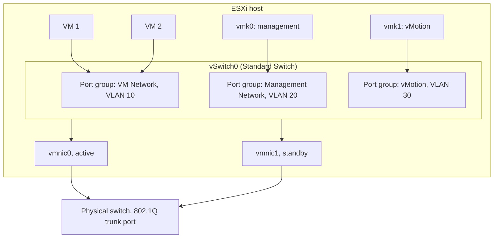
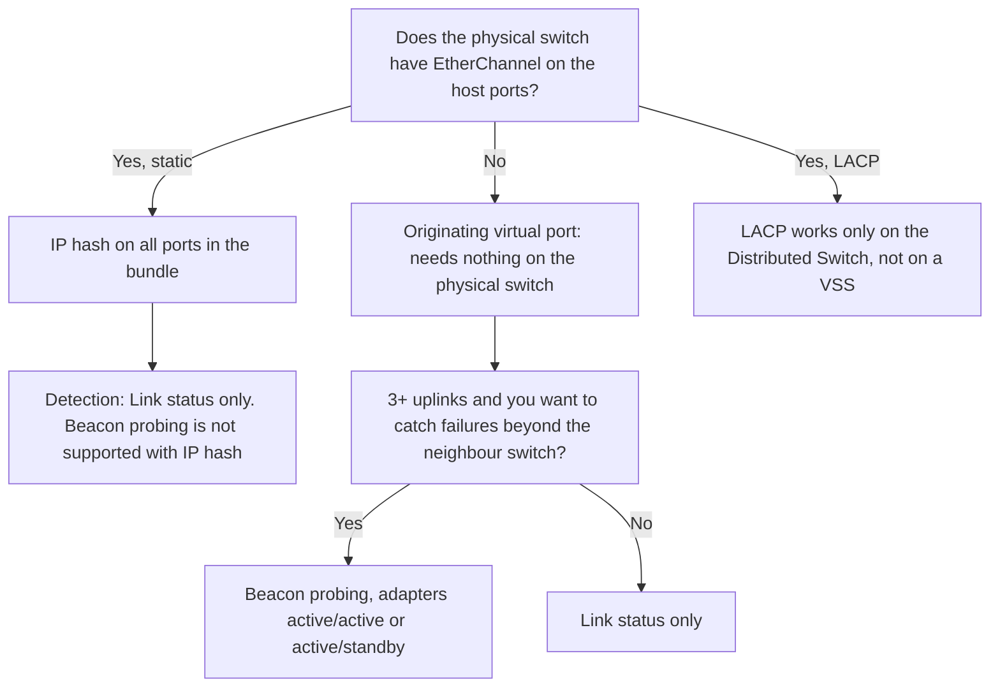

:::analogy
**The data center pain.** A new VM (Virtual Machine) has no network even though "VM Network" is selected. A vMotion fails between two hosts that look identical. After a "small" VLAN (Virtual Local Area Network) change, a host disappears from vCenter. All three come from the same place: the network inside the ESXi host. The VVF (VMware vSphere Foundation, 2V0-16.25) exam guide covers vSphere networking in objective 2.4.1, and the old VCP-DCV (VMware Certified Professional - Data Center Virtualization) had separate objectives for standard switches and their configuration. [S02] [S47]

**The analogy: an office building with its own phone exchange.**

- **The virtual switch** is the building's phone exchange. Offices call each other through it without going out to the city.
- **The host's physical adapters (vmnic, uplinks)** are the lines from the exchange to the city network. Without them the building only talks to itself.
- **Port groups** are departments: each has its own rules (which floor, who may listen, how much bandwidth).
- **VMkernel adapters (vmk)** are the building management's phones: the building itself talks through them (management, vMotion, storage), not the tenants.
:::

:::architecture
### 1. The pieces: switch, uplinks, port groups

A **vSphere Standard Switch** (VSS, vSphere Standard Switch) works much like a physical Ethernet switch. It switches traffic between VMs in the same VLAN inside the host and connects them to the external network through the host's physical adapters, attached to its uplink ports. [S114]

- **Uplinks:** the host's physical network adapters, named by ESXi `vmnic0`, `vmnic1`…
- **Port group:** the VM's virtual network adapter connects to a port group. Each adapter uses one logical port, and each port belongs to one port group. [S114]
- **Without an uplink**, VMs in that port group can talk to each other but not to the external network. [S114]
- **Network label:** a port group name must be unique on the host. On hosts in the same broadcast domain use the same name, so a VM finds its network after migration. [S114]
- **VLAN ID** on a port group (optional) restricts its traffic to one segment. Lesson 1.2 covered the three modes: 0 = EST (External Switch Tagging), 1–4094 = VST (Virtual Switch Tagging), 4095 = VGT (Virtual Guest Tagging). [S114] [S50]
- **A VSS is configured on each host separately.** Ten hosts mean ten configurations to keep identical; that is where the Distributed Switch comes in later (module 2). [S114]



### 2. Two kinds of traffic: VMs and the host itself

Two different things live on the same switch:

- **Ports for VMs**, where virtual network adapters connect (for example VMXNET3 from lesson 1.6).
- **VMkernel adapters (vmk)**, the host's own network interfaces. The VMkernel networking layer carries management traffic and system traffic: vMotion, storage over IP (Internet Protocol), Fault Tolerance, vSAN. [S111]

On each VMkernel adapter you tick the **services** it carries: Management, vMotion, Provisioning, Fault Tolerance logging, vSphere Replication, vSphere Replication NFC (Network File Copy), vSAN, vSphere Backup NFC, NVMe (Non-Volatile Memory Express) over TCP (Transmission Control Protocol) and NVMe over RDMA (Remote Direct Memory Access). [S112] [S113]

| Service | What it carries | Remember |
|---|---|---|
| Management | Communication with vCenter and HA (High Availability) traffic between hosts | Redundancy comes from several physical adapters [S111] |
| vMotion | The VM's memory during live migration | Needed on source **and** destination host; traffic is **not encrypted**, so use a private network [S111] |
| Provisioning | Cold migration, cloning, snapshot migration | Can have its own TCP/IP stack [S111] |
| IP storage | Software iSCSI (Internet Small Computer Systems Interface), NFS (Network File System) 3 and 4.1 | Not a service checkbox: it is traffic on the default stack; iSCSI multipathing needs 2+ physical adapters [S111] |
| FT (Fault Tolerance) logging | Keeps the protected VM in sync with its copy | Only one FT adapter per host [S112] |
| vSAN | vSAN storage traffic | Required on every host in the vSAN cluster [S111] |

Best practice: **one VMkernel adapter per traffic type**, each on its own port group. [S111] [S112]

### 3. TCP/IP stacks

A VMkernel adapter belongs to a **TCP/IP stack**, a separate set of routes and gateway. ESXi has: [S111]

- **Default:** management plus system traffic (vMotion, IP storage, FT), unless you move them elsewhere.
- **vMotion:** isolates live migration. Once an adapter exists on the vMotion stack, the host does vMotion **only** through it; default-stack adapters are no longer used for vMotion.
- **Provisioning:** cold migrations, clones, snapshots. Same rule: once configured, the default stack stops carrying this traffic.
- **Custom** (your own applications) and **Mirror** (traffic mirroring).

Two rules that show up both in the exam and in production:

1. **The stack cannot be changed after you create the adapter.** If you got it wrong, delete the adapter and recreate it. [S112] [S113]
2. **Several VMkernel adapters in the same subnet on the same stack are not supported**, except for iSCSI, multi-NIC (Network Interface Card) vMotion and NSX TEPs (Tunnel Endpoint). ESXi runs no routing protocol, so routes to other subnets are added statically. [S111]

A VMkernel adapter's MTU (Maximum Transmission Unit) comes from the switch or is set manually, at most 9000 bytes. [S113] The `vmkping` test from lesson 1.2 checks exactly that, end to end. [S51]

### 4. Port group policies

Policies are set on the switch and inherited by all its port groups. A setting on a port group **overrides** what it inherited from the switch. [S109]

**a) Security (Layer 2).** Three options, each Accept or Reject: [S105]

| Option | Reject means | Accept means |
|---|---|---|
| Promiscuous mode | The VM's adapter receives only frames addressed to it | It receives all traffic seen on the port (within the VLAN) |
| MAC address changes | If the guest changes its effective MAC (Media Access Control) address, inbound frames to the new address are dropped | Frames to the new address pass |
| Forged transmits | Outbound frames with a source MAC different from the one in `.vmx` are dropped | No check is made |

- **Default:** a VM's adapter cannot run in promiscuous mode. [S120] Since vSphere 7.0, MAC address changes and Forged transmits also default to **Reject**. [S108] The recommended practice is to leave them on Reject. [S107]
- **The risk:** with Accept, a compromised VM can listen to other VMs' traffic or impersonate another VM or the gateway through ARP (Address Resolution Protocol) poisoning. [S106]
- **The home lab exception:** a nested ESXi (ESXi inside a VM) sends traffic from MAC addresses the outer switch does not know. You need Promiscuous mode **and** Forged transmits, **or** MAC learning. On ESXi 8, MAC learning exists only on the Distributed Switch, not on the Standard Switch. Nested ESXi is **not officially supported**: it is a home-lab-only setup. [S27]
- If you must open an option, open it **only on the port group** that needs it, not on the whole switch. [S107]

**b) Teaming and failover.** When a switch has several uplinks, you choose how outbound traffic is spread: [S109]

| Load balancing | How it picks the adapter | Conditions |
|---|---|---|
| Route based on originating virtual port | Each VM or vmk stays on one uplink, by virtual port | Nothing to configure on the physical switch |
| Route based on IP hash | Hash of source and destination IP | On a VSS: **static EtherChannel** on the physical switch; LACP (Link Aggregation Control Protocol) only on the Distributed Switch; no beacon probing [S110] |
| Route based on source MAC hash | Hash of the source MAC address | |
| Use explicit failover order | Always the first working active uplink | No traffic spreading |

- **Failure detection:** *Link status only* sees only an unplugged cable or a powered-off switch. *Beacon probing* also sends probe packets every second and needs adapters in active/active or active/standby. [S109]
- **Notify switches:** tells the physical switch after a failover. Set it to **No** for a VM running Microsoft NLB (Network Load Balancing) in unicast mode. [S109]
- **Failback:** **Yes** by default, so a recovered adapter immediately returns to active duty. [S109]
- **Adapter order:** Active (used), Standby (takes over when an active one fails), Unused (never used). [S109]



**c) Traffic shaping.** On a Standard Switch only **outbound traffic** is shaped: average bandwidth (bits per second), peak (at least the average) and burst size (bytes). The Distributed Switch can shape both directions. [S115]

### 5. When you get a network setting wrong: rollback

**Network rollback** is on by default. If a change disconnects the host from vCenter, the task fails and the host returns to its last good configuration. [S117] Examples of changes that trigger it:

- changing the management adapter's IP;
- setting an MTU larger than the physical network supports;
- removing vmk0 or the physical adapter from the switch;
- on a VSS, changing the VLAN, teaming or traffic shaping of the management port group. [S117]

If you still lose access, go to the host console: the DCUI (Direct Console User Interface) has a **Network Restore Options** menu. [S117] A VLAN change on the management port group should be done with remote server console access (for example iLO, Integrated Lights-Out, on HPE or iDRAC, Integrated Dell Remote Access Controller, on Dell) or physical access. [S119]

**From the command line** (ESXi Shell or SSH, Secure Shell), the KB (Knowledge Base article) 326175 gives the basic VSS commands: [S116]

```bash
esxcli network vswitch standard list
esxcli network vswitch standard add --vswitch-name=vSwitch1
esxcli network vswitch standard uplink add --uplink-name=vmnic1 --vswitch-name=vSwitch1
esxcli network vswitch standard portgroup add --portgroup-name=PG-Lab --vswitch-name=vSwitch1
esxcli network vswitch standard portgroup set --portgroup-name=PG-Lab --vlan-id 10
esxcli network ip interface add --interface-name=vmk1 --portgroup-name=PG-Lab
```

The older `esxcfg-vswitch -l` lists everything (switches, port groups, VLANs, uplinks) on one screen. [S119]

[IMAGE SEARCH / PROMPT] "vSphere Standard Switch topology diagram vmnic port group vmkernel", to see how Host Client draws the switch map.
:::

:::exam-alert
### Memorize

| What | Value / rule | Source |
|---|---|---|
| Where a VSS is configured | On each host separately | Docs [S114] |
| Network label | Unique per host; identical across hosts on the same broadcast domain | Docs [S114] |
| VLAN ID 4095 on a port group | VGT: the VM receives several VLANs | Docs [S114] |
| Port group without uplink | Internal traffic between VMs only | Docs [S114] |
| FT logging adapters per host | Only one | Docs [S112] |
| Maximum vmk MTU | 9000 | Docs [S113] |
| A vmk's TCP/IP stack | Cannot change after creation | Docs [S112] |
| Default security (vSphere 7.0+) | Promiscuous, MAC changes, Forged transmits: Reject | KB 319651 [S108], Docs [S120] |
| IP hash on a VSS | Static EtherChannel; no beacon probing; LACP only on the Distributed Switch | KB 321396 [S110] |
| VSS traffic shaping | Outbound only | Docs [S115] |
| Default failback | Yes | Docs [S109] |
| Network rollback | On by default | KB 311145 [S117] |

### 3 exam traps

1. **"On a vSphere Standard Switch I can also limit traffic going into the VM."** False. The Standard Switch shapes outbound traffic only; both directions exist only on the Distributed Switch. [S115]
2. **"For IP hash on a Standard Switch I configure LACP on the physical switch."** False. A VSS supports only static EtherChannel; LACP needs the Distributed Switch. [S110]
3. **"I added a vmk on the vMotion stack, but vMotion still also runs over vmk0."** False. Once an adapter exists on the vMotion stack, the host does vMotion only through that stack. [S111]
:::

:::trenches
**Mistake 1: the "no management network redundancy" warning hidden instead of fixed.**
When vSphere HA is enabled, a message says the host has no management network redundancy. Someone adds `das.ignoreRedundantNetWarning = true` and forgets about it. Months later the only management adapter fails and HA treats the host as isolated. KB 317612 shows the option only hides the warning. [S118]
**Fix:** add a second physical adapter to the management switch (active or standby), or a second management adapter on another switch and subnet, as the KB describes. Then reconfigure HA on the host. [S118]

**Mistake 2: IP hash on ESXi, but no EtherChannel on the physical switch.**
An admin picks "Route based on IP hash" to "use all the bandwidth". The network team doesn't configure EtherChannel, and the physical switch starts seeing the same MAC addresses on different ports: interfaces flap and VMs lose packets. KB 321396 describes exactly this mismatch. [S110]
**Fix:** either configure **static** EtherChannel on the physical ports (LACP does not work on a VSS), or go back to "Route based on originating virtual port", which needs nothing on the switch. Test failover by shutting the port on the switch, not just by disabling the adapter in ESXi. [S110] [S109]
:::

:::interview
**Junior/Mid question: "What is the difference between a VM port group and a VMkernel adapter?"**

*Ideal answer:* a port group is where a VM's virtual adapter connects, and the traffic belongs to the VM. A VMkernel adapter (vmk) is the host's own network interface: management, vMotion, IP storage, FT or vSAN go through it, depending on the services ticked. [S111] [S112] A strong candidate adds that each traffic type gets its own vmk and port group, that the TCP/IP stack is chosen at creation and cannot change, and that vMotion is unencrypted, so it lives on an isolated network. [S111] [S112]

**Troubleshooting scenario: "A new VM has no network, though it's on the VM Network port group. Other VMs on the same host work. What do you check?"**

*The answer a Team Lead expects:*
1. **Is the adapter connected?** In the VM settings, "Connected" and "Connect at power on" must be ticked.
2. **Is it the right port group?** On another host the label may be spelled differently; labels must be identical across hosts. [S114]
3. **The VLAN.** Check the port group's VLAN ID with `esxcfg-vswitch -l` and compare with the VLANs allowed on the physical trunk. [S119] [S50]
4. **Uplinks.** Does the port group have an active uplink, or did an override leave only an Unused adapter or one without link? [S109]
5. **Security.** If the VM runs something that changes its MAC address (a cluster, a network appliance), Reject on MAC address changes or Forged transmits drops its traffic. Open the option only on its port group, and document it. [S105] [S107]
6. **Only then** the guest OS (Operating System): IP, mask, gateway, adapter driver (VMware Tools for VMXNET3).
:::

:::lab
**Scenario.** You "read" your lab host's network, build an internal switch with no uplink and a new VMkernel adapter, then show in practice what "a port group without uplink" and policy inheritance mean.

**What you need.** The lab ESXi host, the Linux VM from lesson 1.6, and SSH enabled temporarily for steps 1 and 2. Do not touch `vSwitch0`, `Management Network` or `vmk0`: a mistake there cuts your access to the host.

The steps below can be ticked off, and progress is saved in your browser. Exact menu names may differ slightly between Host Client 8 and 9 (`⚠ to verify`).

**Failure / validation test.** In step 4 you move the VM to the port group without uplink: the ping to the gateway must **fail**. When you move it back to `VM Network`, the ping must come back. If the ping works on the internal switch too, you added an uplink by mistake.
:::

:::quiz
Five original questions in the style of the VCP (VMware Certified Professional) exams. You get the explanation for every option right after you answer.
:::

:::references
- VCP-VVF Administrator exam guide 2V0-16.25, objective 2.4.1 [S02]
- VCP-DCV exam guide 2V0-21.23 (Legacy certification), objectives 1.5, 1.5.1 and 4.3 [S47]
- vSphere Networking docs: Standard Switch [S114], the VMkernel layer and TCP/IP stacks [S111], VMkernel adapters [S112] [S113]
- Policies: security [S105] [S120], teaming and failover [S109], traffic shaping [S115]
- KB 319651, KB 427110, KB 446719: security policy defaults and risks [S108] [S107] [S106]
- KB 321396: IP hash and EtherChannel [S110]
- KB 311145: network rollback and DCUI recovery [S117]
- KB 326175 and KB 311057: command-line configuration and VLAN on a port group [S116] [S119]
- KB 317612: the management redundancy warning with vSphere HA [S118]
:::
