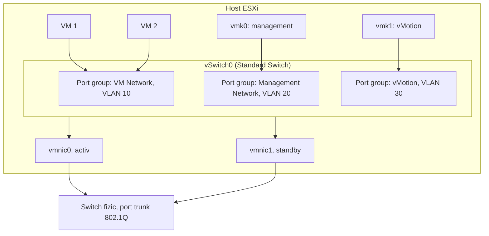
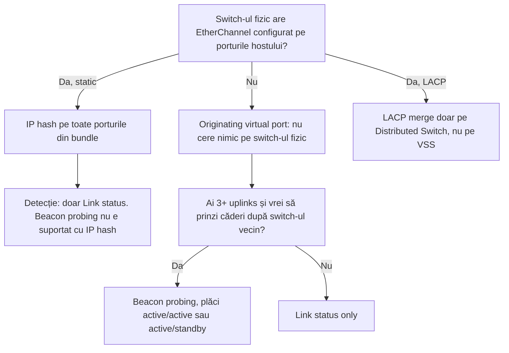

:::analogy
**Durerea din data center.** Un VM (Virtual Machine, mașină virtuală) nou nu are rețea, deși „VM Network” e selectat. Un vMotion eșuează între două hosturi care par identice. După o „mică” schimbare de VLAN (Virtual Local Area Network, rețea locală virtuală), un host dispare din vCenter. Toate trei vin din aceeași zonă: rețeaua din interiorul hostului ESXi. Exam guide-ul VVF (VMware vSphere Foundation, 2V0-16.25) are rețeaua vSphere la obiectivul 2.4.1, iar vechiul VCP-DCV (VMware Certified Professional - Data Center Virtualization) avea obiective separate pentru switch-urile standard și pentru configurarea lor. [S02] [S47]

**Analogia: un bloc de birouri cu centrală telefonică proprie.**

- **Switch-ul virtual** este centrala telefonică din bloc. Birourile își vorbesc între ele prin centrală, fără să iasă în oraș.
- **Plăcile fizice ale hostului (vmnic, uplinks)** sunt liniile care leagă centrala de rețeaua orașului. Fără ele, blocul vorbește doar cu el însuși.
- **Port group-urile** sunt departamentele: fiecare are regulile lui (ce etaj, cine poate asculta, câtă bandă primește).
- **Adaptoarele VMkernel (vmk)** sunt telefoanele administrației blocului: prin ele vorbește clădirea însăși (management, vMotion, stocare), nu chiriașii.
:::

:::architecture
### 1. Piesele: switch, uplinks, port groups

Un **vSphere Standard Switch** (VSS, vSphere Standard Switch) seamănă cu un switch Ethernet fizic. Comută trafic între VM-urile din același VLAN direct în host și le leagă de rețeaua externă prin plăcile fizice ale hostului, conectate la porturile lui de uplink. [S114]

- **Uplinks:** plăcile de rețea fizice ale hostului, numite de ESXi `vmnic0`, `vmnic1`…
- **Port group:** placa de rețea virtuală a VM-ului se conectează la un port group. Fiecare port folosește un singur port logic, iar fiecare port aparține unui singur port group. [S114]
- **Fără uplink**, VM-urile din acel port group comunică doar între ele, nu și cu rețeaua externă. [S114]
- **Network label:** numele port group-ului trebuie să fie unic pe host. Pe hosturile din același domeniu de broadcast pui același nume, ca VM-ul să-și găsească rețeaua după migrare. [S114]
- **VLAN ID** pe port group (opțional) limitează traficul la un singur segment. Ai văzut în lecția 1.2 cele trei moduri: 0 = EST (External Switch Tagging), 1–4094 = VST (Virtual Switch Tagging), 4095 = VGT (Virtual Guest Tagging). [S114] [S50]
- **Un VSS se configurează pe fiecare host în parte.** Zece hosturi înseamnă zece configurații de ținut identice; de aici apare mai târziu nevoia de Distributed Switch (modulul 2). [S114]



### 2. Două feluri de trafic: VM-uri și hostul însuși

Pe același switch stau două lucruri diferite:

- **Porturile pentru VM-uri**, unde intră plăcile de rețea virtuale (de exemplu VMXNET3 din lecția 1.6).
- **Adaptoarele VMkernel (vmk)**, interfețele de rețea ale hostului însuși. Stratul de rețea VMkernel duce traficul de management și traficul de sistem: vMotion, stocare pe IP (Internet Protocol), Fault Tolerance, vSAN. [S111]

Pe fiecare adaptor VMkernel bifezi **serviciile** pe care le duce: Management, vMotion, Provisioning, Fault Tolerance logging, vSphere Replication, vSphere Replication NFC (Network File Copy), vSAN, vSphere Backup NFC, NVMe (Non-Volatile Memory Express) over TCP (Transmission Control Protocol) și NVMe over RDMA (Remote Direct Memory Access). [S112] [S113]

| Serviciu | Ce duce | De reținut |
|---|---|---|
| Management | Comunicarea cu vCenter și traficul HA (High Availability) între hosturi | Redundanța vine din mai multe plăci fizice [S111] |
| vMotion | Memoria VM-ului la migrarea live | Necesar pe hostul sursă **și** pe destinație; traficul **nu e criptat**, deci rețea privată [S111] |
| Provisioning | Migrare la rece, clonare, migrarea snapshot-urilor | Poate avea stiva lui TCP/IP [S111] |
| IP storage | iSCSI (Internet Small Computer Systems Interface) software, NFS (Network File System) 3 și 4.1 | Nu e o bifă de serviciu: e trafic pe stiva implicită; multipathing iSCSI cere 2+ plăci fizice [S111] |
| FT (Fault Tolerance) logging | Sincronizarea VM-ului protejat cu copia lui | Un singur adaptor FT pe host [S112] |
| vSAN | Traficul de stocare vSAN | Obligatoriu pe fiecare host din clusterul vSAN [S111] |

Cea mai bună practică: **un adaptor VMkernel pentru fiecare tip de trafic**, fiecare pe port group-ul lui. [S111] [S112]

### 3. Stivele TCP/IP

Un adaptor VMkernel aparține unei **stive TCP/IP**, adică unui set separat de rute și gateway. ESXi are: [S111]

- **Default:** management plus trafic de sistem (vMotion, stocare pe IP, FT), dacă nu le muți în altă parte.
- **vMotion:** izolează migrarea live. Din momentul în care există un adaptor pe stiva vMotion, hostul face vMotion **doar** prin ea; adaptoarele de pe stiva implicită nu mai sunt folosite pentru vMotion.
- **Provisioning:** migrări la rece, clonări, snapshot-uri. Aceeași regulă: odată configurată, stiva implicită nu mai duce acest trafic.
- **Custom** (aplicații proprii) și **Mirror** (oglindirea traficului).

Două reguli care apar la examen și în producție:

1. **Stiva nu se mai poate schimba după ce ai creat adaptorul.** Dacă ai greșit, ștergi adaptorul și îl creezi din nou. [S112] [S113]
2. **Mai multe adaptoare VMkernel în același subnet, pe aceeași stivă, nu sunt suportate**, cu excepția iSCSI, a vMotion pe mai multe plăci și a TEP-urilor (Tunnel Endpoint) din NSX. ESXi nu rulează protocoale de rutare, deci rutele către alte subneturi se adaugă static. [S111]

MTU-ul (Maximum Transmission Unit) unui adaptor VMkernel se ia de la switch sau se setează manual, cel mult 9000 de octeți. [S113] Testul cu `vmkping` din lecția 1.2 verifică exact acest lucru, cap la cap. [S51]

### 4. Politicile unui port group

Politicile se pun pe switch și sunt moștenite de toate port group-urile lui. O setare pusă pe un port group **suprascrie** ce a moștenit de la switch. [S109]

**a) Securitate (Layer 2).** Trei opțiuni, fiecare cu Accept sau Reject: [S105]

| Opțiune | Reject înseamnă | Accept înseamnă |
|---|---|---|
| Promiscuous mode | Placa VM-ului primește doar cadrele adresate ei | Primește tot traficul vizibil pe port (în limita VLAN-ului) |
| MAC address changes | Dacă sistemul de operare schimbă adresa MAC (Media Access Control) efectivă, cadrele care intră spre noua adresă sunt aruncate | Cadrele spre noua adresă trec |
| Forged transmits | Cadrele care ies cu altă adresă MAC sursă decât cea din `.vmx` sunt aruncate | Nu se face nicio verificare |

- **Implicit:** placa unui VM nu poate funcționa în promiscuous mode. [S120] Din vSphere 7.0, MAC address changes și Forged transmits au trecut și ele implicit pe **Reject**. [S108] Practica recomandată e să le lași pe Reject. [S107]
- **Riscul:** cu Accept, un VM compromis poate asculta traficul altora sau poate impersona alt VM ori gateway-ul, prin otrăvire ARP (Address Resolution Protocol). [S106]
- **Excepția din home lab:** un ESXi nested (ESXi în VM) trimite trafic cu adrese MAC pe care switch-ul exterior nu le cunoaște. Ai nevoie de Promiscuous mode **și** Forged transmits, **sau** de MAC learning. Pe ESXi 8, MAC learning există doar pe Distributed Switch, nu pe Standard Switch. Nested ESXi **nu este suportat** oficial: e o configurație doar pentru home lab. [S27]
- Dacă trebuie să deschizi o opțiune, o deschizi **doar pe port group-ul** care are nevoie de ea, nu pe tot switch-ul. [S107]

**b) Teaming și failover.** Când un switch are mai multe uplinks, alegi cum se împarte traficul care iese: [S109]

| Load balancing | Cum alege placa | Condiții |
|---|---|---|
| Route based on originating virtual port | Fiecare VM sau vmk rămâne legat de un uplink, după portul virtual | Fără configurare pe switch-ul fizic |
| Route based on IP hash | Hash din IP sursă și IP destinație | Pe VSS: **EtherChannel static** pe switch-ul fizic; LACP (Link Aggregation Control Protocol) doar pe Distributed Switch; fără beacon probing [S110] |
| Route based on source MAC hash | Hash din adresa MAC sursă | |
| Use explicit failover order | Mereu primul uplink activ funcțional | Nu face împărțire de trafic |

- **Detectarea căderii:** *Link status only* vede doar cablul scos sau switch-ul oprit. *Beacon probing* trimite în plus pachete de probă în fiecare secundă și cere plăcile în active/active sau active/standby. [S109]
- **Notify switches:** anunță switch-ul fizic după un failover. Se pune pe **No** pentru un VM cu Microsoft NLB (Network Load Balancing) în modul unicast. [S109]
- **Failback:** implicit **Yes**, adică o placă revenită își reia imediat locul de placă activă. [S109]
- **Ordinea plăcilor:** Active (folosită), Standby (intră când pică o activă), Unused (nu e folosită niciodată). [S109]



**c) Traffic shaping.** Pe Standard Switch se limitează **doar traficul care iese**: lățime de bandă medie (biți pe secundă), vârf (cel puțin cât media) și dimensiunea rafalei (octeți). Distributed Switch poate limita ambele direcții. [S115]

### 5. Când greșești o setare de rețea: rollback

**Network rollback** este activ implicit. Dacă o schimbare deconectează hostul de vCenter, sarcina eșuează și hostul revine la ultima configurație bună. [S117] Exemple de schimbări care declanșează rollback-ul:

- schimbi IP-ul adaptorului de management;
- pui un MTU mai mare decât suportă rețeaua fizică;
- scoți vmk0 sau placa fizică de pe switch;
- pe un VSS, schimbi VLAN-ul, teaming-ul sau traffic shaping-ul port group-ului de management. [S117]

Dacă totuși pierzi accesul, intri pe consola hostului: DCUI (Direct Console User Interface) are meniul **Network Restore Options**. [S117] O schimbare de VLAN pe port group-ul de management se face cu acces la consola de la distanță a serverului (de exemplu iLO, Integrated Lights-Out, la HPE sau iDRAC, Integrated Dell Remote Access Controller, la Dell) sau fizic. [S119]

**Din linia de comandă** (ESXi Shell sau SSH, Secure Shell), articolul KB (Knowledge Base article) 326175 dă comenzile de bază pentru VSS: [S116]

```bash
esxcli network vswitch standard list
esxcli network vswitch standard add --vswitch-name=vSwitch1
esxcli network vswitch standard uplink add --uplink-name=vmnic1 --vswitch-name=vSwitch1
esxcli network vswitch standard portgroup add --portgroup-name=PG-Lab --vswitch-name=vSwitch1
esxcli network vswitch standard portgroup set --portgroup-name=PG-Lab --vlan-id 10
esxcli network ip interface add --interface-name=vmk1 --portgroup-name=PG-Lab
```

Comanda mai veche `esxcfg-vswitch -l` listează tot (switch-uri, port group-uri, VLAN-uri, uplinks) într-un singur ecran. [S119]

[IMAGE SEARCH / PROMPT] „vSphere Standard Switch topology diagram vmnic port group vmkernel”, ca să vezi cum desenează Host Client harta switch-ului.
:::

:::exam-alert
### De memorat

| Ce | Valoare / regulă | Sursă |
|---|---|---|
| Unde se configurează un VSS | Pe fiecare host în parte | Docs [S114] |
| Network label | Unic pe host; identic pe hosturile din același domeniu de broadcast | Docs [S114] |
| VLAN ID 4095 pe port group | VGT: VM-ul primește mai multe VLAN-uri | Docs [S114] |
| Port group fără uplink | Doar trafic intern între VM-uri | Docs [S114] |
| Adaptoare FT logging pe host | Unul singur | Docs [S112] |
| MTU maxim al unui vmk | 9000 | Docs [S113] |
| Stiva TCP/IP a unui vmk | Nu se mai schimbă după creare | Docs [S112] |
| Securitate implicită (vSphere 7.0+) | Promiscuous, MAC changes, Forged transmits: Reject | KB 319651 [S108], Docs [S120] |
| IP hash pe VSS | EtherChannel static; fără beacon probing; LACP doar pe Distributed Switch | KB 321396 [S110] |
| Traffic shaping pe VSS | Doar trafic care iese | Docs [S115] |
| Failback implicit | Yes | Docs [S109] |
| Network rollback | Activ implicit | KB 311145 [S117] |

### 3 capcane de examen

1. **„Pe un vSphere Standard Switch pot limita și traficul care intră în VM.”** Fals. Standard Switch limitează doar traficul care iese; ambele direcții există doar pe Distributed Switch. [S115]
2. **„Pentru IP hash pe un Standard Switch configurez LACP pe switch-ul fizic.”** Fals. Pe VSS e suportat doar EtherChannel static; LACP cere Distributed Switch. [S110]
3. **„Am adăugat un vmk pe stiva vMotion, dar vMotion merge în continuare și pe vmk0.”** Fals. Odată ce există un adaptor pe stiva vMotion, hostul face vMotion doar prin acea stivă. [S111]
:::

:::trenches
**Greșeala 1: avertismentul „no management network redundancy” ascuns în loc să fie rezolvat.**
La activarea vSphere HA apare mesajul că hostul nu are redundanță pe rețeaua de management. Cineva adaugă `das.ignoreRedundantNetWarning = true` și uită de el. Luni mai târziu, singura placă de management cade, iar HA crede că hostul e izolat. KB 317612 arată că opțiunea doar ascunde avertismentul. [S118]
**Remediere:** adaugi a doua placă fizică pe switch-ul de management (activă sau standby) sau un al doilea adaptor de management pe alt switch și alt subnet, cum descrie KB-ul. Abia apoi reconfigurezi HA pe host. [S118]

**Greșeala 2: IP hash pe ESXi, dar switch-ul fizic nu are EtherChannel.**
Un administrator alege „Route based on IP hash” ca să „folosească toată banda”. Echipa de rețea nu configurează EtherChannel, iar switch-ul fizic începe să vadă aceleași adrese MAC pe porturi diferite: interfețele „flap-uiesc”, VM-urile pierd pachete. KB 321396 descrie exact această nepotrivire. [S110]
**Remediere:** fie configurezi EtherChannel **static** pe porturile fizice (pe VSS nu merge LACP), fie revii la „Route based on originating virtual port”, care nu cere nimic pe switch-ul fizic. Testezi failover-ul oprind portul de pe switch, nu doar dezactivând placa din ESXi. [S110] [S109]
:::

:::interview
**Întrebare Junior/Mid: „Care e diferența dintre un port group pentru VM-uri și un adaptor VMkernel?”**

*Răspunsul ideal:* port group-ul e locul unde se conectează placa virtuală a unui VM, iar traficul aparține VM-ului. Adaptorul VMkernel (vmk) e interfața de rețea a hostului însuși: prin el trec management-ul, vMotion, stocarea pe IP, FT sau vSAN, în funcție de serviciile bifate. [S111] [S112] Un candidat bun adaugă că fiecare tip de trafic primește vmk-ul și port group-ul lui, că stiva TCP/IP se alege la creare și nu se mai schimbă, și că vMotion nu e criptat, deci stă într-o rețea izolată. [S111] [S112]

**Scenariu de troubleshooting: „Un VM nou nu are rețea, deși e pe port group-ul VM Network. Alte VM-uri de pe același host merg. Ce verifici?”**

*Răspunsul pe care îl așteaptă un Team Lead:*
1. **Placa e conectată?** În setările VM-ului, „Connected” și „Connect at power on” trebuie să fie bifate.
2. **Port group-ul e cel corect?** Pe un alt host, eticheta poate fi scrisă diferit; etichetele trebuie să fie identice între hosturi. [S114]
3. **VLAN-ul.** Verific VLAN ID-ul port group-ului cu `esxcfg-vswitch -l` și compar cu VLAN-ul permis pe trunk-ul fizic. [S119] [S50]
4. **Uplinks.** Port group-ul are uplink activ sau a primit un override care lasă doar o placă Unused ori fără link? [S109]
5. **Securitatea.** Dacă în VM rulează ceva care schimbă adresa MAC (un cluster, un appliance de rețea), Reject pe MAC address changes sau Forged transmits îi aruncă traficul. Deschid opțiunea doar pe port group-ul lui, documentat. [S105] [S107]
6. **Abia apoi** sistemul de operare: IP, mască, gateway, driverul plăcii (VMware Tools pentru VMXNET3).
:::

:::lab
**Scenariu.** Îți „citești” rețeaua hostului din lab, construiești un switch intern fără uplink și un adaptor VMkernel nou, apoi demonstrezi practic ce înseamnă „port group fără uplink” și moștenirea politicilor.

**Ce ai nevoie.** Hostul ESXi din lab, VM-ul Linux din lecția 1.6 și SSH pornit temporar pentru pașii 1 și 2. Nu modifica `vSwitch0`, `Management Network` sau `vmk0`: o greșeală acolo îți taie accesul la host.

Pașii de mai jos sunt bifabili, iar progresul se salvează în browser. Numele exacte ale meniurilor pot diferi puțin între Host Client 8 și 9 (`⚠ de verificat`).

**Test de avarie / validare.** La pasul 4 muți VM-ul pe port group-ul fără uplink: ping-ul spre gateway trebuie să **eșueze**. Când îl muți înapoi pe `VM Network`, ping-ul trebuie să revină. Dacă ping-ul merge și pe switch-ul intern, ai adăugat din greșeală un uplink.
:::

:::quiz
Cinci întrebări originale, în stilul examenelor VCP (VMware Certified Professional). Primești explicația pentru fiecare variantă imediat după ce răspunzi.
:::

:::references
- Exam guide VCP-VVF Administrator 2V0-16.25, obiectivul 2.4.1 [S02]
- Exam guide VCP-DCV 2V0-21.23 (certificare Legacy), obiectivele 1.5, 1.5.1 și 4.3 [S47]
- Documentația vSphere Networking: Standard Switch [S114], stratul VMkernel și stivele TCP/IP [S111], adaptoarele VMkernel [S112] [S113]
- Politicile: securitate [S105] [S120], teaming și failover [S109], traffic shaping [S115]
- KB 319651, KB 427110, KB 446719: valorile implicite și riscurile politicilor de securitate [S108] [S107] [S106]
- KB 321396: IP hash și EtherChannel [S110]
- KB 311145: network rollback și recuperarea din DCUI [S117]
- KB 326175 și KB 311057: configurarea din linia de comandă și VLAN pe port group [S116] [S119]
- KB 317612: avertismentul de redundanță pe management la vSphere HA [S118]
:::
