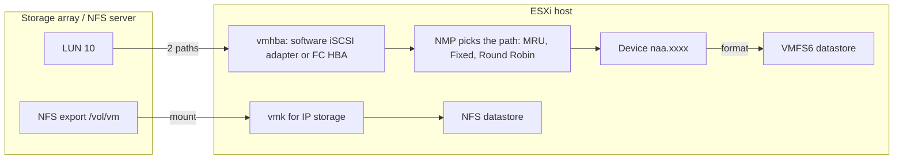
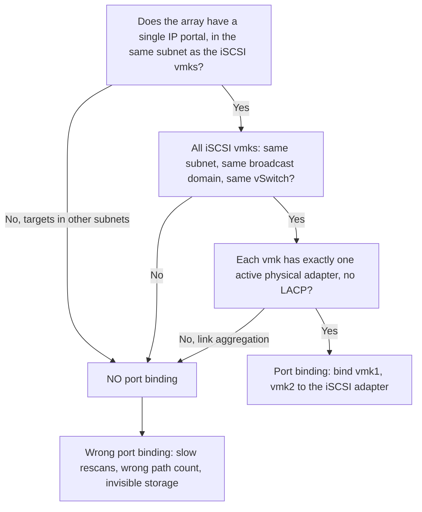

:::analogy
**The data center pain.** The storage team "deleted an old, unused LUN (Logical Unit Number)", and ten ESXi hosts suddenly show "Not responding" in vCenter. An iSCSI (Internet Small Computer Systems Interface) datastore shows one path even though the server has two network adapters. An admin looks for an "Upgrade to VMFS6" button and can't find one. All three are exam topics: the VVF (VMware vSphere Foundation, 2V0-16.25) exam guide covers vSphere storage in objective 2.3.1, and the old VCP-DCV (VMware Certified Professional - Data Center Virtualization) had separate objectives for storage and datastore management. [S02] [S47]

**The analogy: a warehouse with several access roads.**

- **The LUN** (the logical disk you get from the storage array) is the empty plot. **VMFS** (Virtual Machine File System) is the warehouse built on it, with shelves for VM files.
- **NFS** (Network File System) is a warehouse rented from someone else: you build nothing, you just get the key (you mount the share).
- **Multipathing** means the roads to the warehouse. If one road closes, trucks take another.
- **APD** (All Paths Down) and **PDL** (Permanent Device Loss) are the two kinds of "I can't reach the warehouse": the roads are blocked and you don't know for how long, or you have been told plainly the warehouse was demolished.
:::

:::architecture
### 1. From device to datastore

Lesson 1.3 covered the datastore types: VMFS on block devices (local, Fibre Channel, iSCSI, NVMe, Non-Volatile Memory Express), NFS mounted directly, vSAN and vVols. [S67] This lesson shows what you actually do on the host with the first three.



### 2. VMFS5 vs VMFS6

ESXi reads and writes both versions. [S121]

| | VMFS5 | VMFS6 |
|---|---|---|
| Block | 1 MB | 1 MB |
| Datastores per host | 512 | 512 |
| 4Kn devices (native 4096-byte sectors) | No | Yes |
| Automatic space reclamation (UNMAP) | No | Yes |
| Manual reclamation (esxcli) | Yes | Yes |
| Default snapshot format | VMFSsparse below 2 TB, SEsparse from 2 TB | SEsparse for all disks |

- **There is no in-place upgrade from VMFS5 to VMFS6.** Create a new VMFS6 datastore and move the VMs to it with Storage vMotion. [S121] [S122]
- The KB (Knowledge Base article) 316475 also describes a staging variant: empty the old datastore, delete it, recreate it as VMFS6 on the same LUN and bring the VMs back. [S122]

### 3. Growing a VMFS datastore

Two methods, both **without powering off VMs**: [S130]

- **Expand (grow the existing extent):** works only if the device has free space right after the datastore. The vSphere Client shows it as "Expandable: Yes". Typical case: the storage team grew the LUN.
- **Add extent (add another device):** the datastore spans several devices but appears as one volume. The minimum extent is 1.3 GB.

Two warnings from the docs: the "Use all available partitions" option reformats the chosen disk and **erases** what was on it, and after growing you rescan at cluster level so vCenter sees the new capacity. [S130]

### 4. iSCSI on ESXi

**Adapter types.** The **software** adapter uses ordinary network adapters and the host's network stack. [S126] The **dependent hardware** adapter has an iSCSI engine on the card but relies on VMware networking: it works only once you bind it to a VMkernel adapter. [S127]

**Steps for the software adapter** (ESXi 7.x and 8.x): [S133] [S126]

1. Networking: a switch (or port groups) dedicated to iSCSI and one VMkernel adapter per physical adapter, with a static IP (Internet Protocol) in the iSCSI subnet.
2. **Storage Adapters → Add Software Adapter → iSCSI.** The host automatically gets an IQN (iSCSI Qualified Name).
3. **Network Port Binding**, only if you are in the right case (see below).
4. **Discovery:** *Dynamic* (SendTargets: you give the array address and it returns the target list) or *Static* (you enter each target by hand). [S127]
5. **CHAP** (Challenge-Handshake Authentication Protocol), if your network uses it: set on the adapter or separately per target. [S127]
6. **Rescan**, check the number of paths, and only then create the VMFS datastore. [S133]

Practical rules from the docs: do not run iSCSI on 100 Mbps or slower adapters, and do not hardcode the adapter name (`vmhbaXX`) in scripts, because it can change between releases. [S126]

**Port binding: when yes and when no.** Port binding ties the software iSCSI adapter to specific vmk adapters to get several paths to the same array. [S128]



The rule comes from KB 317719: port binding needs vmks in the same subnet and broadcast domain, on the same vSwitch, each mapped 1 to 1 to a vmnic. Do not use it when targets are in another subnet or with link aggregation (LACP, Link Aggregation Control Protocol). [S128] KB 410819 adds that two iSCSI vmks in the same subnet **without** port binding can end with zero active paths. [S133] It is the same multihoming exception you saw in lesson 1.7. [S111]

### 5. NFS on ESXi

ESXi mounts NFS 3 and NFS 4.1. Never mount the same share with both versions (lesson 1.3). [S68] NFS 3 has a single active connection per mount; 4.1 allows several connections and multipathing if the server supports them. Since vSphere 8.0 Update 1 there is also nConnect, meaning several TCP (Transmission Control Protocol) connections per mount. [S132]

From the command line (over SSH, Secure Shell), KB 344470 gives the commands: [S131]

```bash
esxcli storage nfs list
esxcli storage nfs add -H 192.168.10.50 -s /export/vm -v NFS-Lab
esxcli storage nfs remove -v NFS-Lab
esxcli storage nfs41 list
```

The server name and share path are **case-sensitive**: write them identically on every host. [S131] Otherwise hosts may see the same export as different datastores.

### 6. Multipathing: NMP and PSP

When a LUN is visible over several paths, the NMP (Native Multipathing Plug-in) uses a PSP (Path Selection Policy): [S123]

| Policy | Behaviour | Default for |
|---|---|---|
| MRU (Most Recently Used) | Uses the first good path; on failure moves to another and **stays** there, no failback | Active/Passive arrays |
| Fixed | Uses the preferred path; **returns** to it after repair | Active/Active arrays |
| Round Robin | Rotates I/O (Input/Output) across available paths; by default switches path every 1000 operations | Not a default; you set it |

- With ALUA (Asymmetric Logical Unit Access), Round Robin uses only "active optimized" paths. [S123]
- See each device's policy with `esxcli storage nmp device list`. [S123]
- Round Robin is not supported on every array. Check the vendor's documentation first; a wrong policy can cut storage access. [S123]

### 7. APD and PDL

| | APD (All Paths Down) | PDL (Permanent Device Loss) |
|---|---|---|
| What happened | All paths are down; the host doesn't know if it is temporary | The array said explicitly that the device no longer exists |
| How the host knows | It receives no PDL code | It receives SCSI (Small Computer System Interface) codes like 0x25/0x0 or 0x68/0x0 |
| What the host does | Retries forever; after **140 seconds** it fast-fails I/O that does not come from VMs | Stops trying to reconnect |
| Effect | Management agents can hang, the host shows "Not responding" | VMs with RDM (Raw Device Mapping) disks on the device stop with a Retry/Cancel question |

Sources: KB 318712 and KB 318850. [S124] [S125] There is no clean recovery from APD on the host: fix the array or storage network, and sometimes the host needs a reboot. [S124] [S125]

**Removing a LUN correctly** (KB 323128), repeated on every host that sees it: [S129]

1. Move or unregister VMs, templates and ISOs; check the datastore isn't used for HA (High Availability) heartbeating, coredump or scratch.
2. Find the NAA (Network Address Authority) identifier with `esxcli storage vmfs extent list`.
3. Unmount: `esxcli storage filesystem unmount -l DATASTORE_NAME`.
4. Detach the device: `esxcli storage core device set --state=off -d NAA_ID`.
5. **Only now** the storage team removes the LUN from the array.
6. Rescan: `esxcli storage core adapter rescan --all`.

If the storage team does step 5 before steps 3–4, hosts that did not detach the device go into APD. [S129]

[IMAGE SEARCH / PROMPT] "vSphere Client storage adapters iSCSI network port binding paths", to see where paths and port binding appear in the UI.
:::

:::exam-alert
### Memorize

| What | Value / rule | Source |
|---|---|---|
| VMFS5 and VMFS6 block | 1 MB | Docs [S121] |
| Datastores per host | 512 | Docs [S121] |
| 4Kn and automatic UNMAP | VMFS6 only | Docs [S121] |
| VMFS5 → VMFS6 upgrade | No in-place upgrade; new datastore + Storage vMotion | Docs [S121], KB 316475 [S122] |
| Minimum extent | 1.3 GB | Docs [S130] |
| Software iSCSI | Not on 100 Mbps or slower adapters | Docs [S126] |
| Port binding | Same subnet and vSwitch, 1 vmk = 1 active vmnic, no LACP | KB 317719 [S128] |
| Default PSP | MRU for Active/Passive, Fixed for Active/Active | KB 339621 [S123] |
| Round Robin | Switches path every 1000 operations (default) | KB 339621 [S123] |
| APD timeout | 140 seconds | KB 318850 [S125] |
| LUN removal order | Unmount → detach (on all hosts) → removed from array → rescan | KB 323128 [S129] |

### 3 exam traps

1. **"I upgrade VMFS5 to VMFS6 in place from the datastore menu."** False. There is no in-place upgrade; create a VMFS6 datastore and move the VMs. [S121]
2. **"Port binding is required whenever I use software iSCSI."** False. It is not used when targets are in other subnets or when the vmks are in different broadcast domains. [S128]
3. **"MRU automatically returns to the original path once it is repaired."** False. MRU stays on the new path; Fixed is the policy that returns to the preferred path. [S123]
:::

:::trenches
**Mistake 1: LUN removed from the array before detach.**
The storage team cleans up "unused" LUNs straight on the array. Hosts that still had the datastore mounted go into APD, management agents hang and the hosts show "Not responding". KB 323128 warns about exactly this wrong order. [S129] [S125]
**Fix:** if the LUN can be presented again, present it, then follow the correct steps: unmount, detach on every host, only then remove it from the array and rescan. If not, clearing the APD means rebooting the affected hosts. From now on, the decommissioning procedure must include checking that the device shows "off" on every host. [S129] [S125]

**Mistake 2: port binding set "out of habit" with targets in different subnets.**
The array has two controllers in two subnets and the hosts have port binding on. Rescans take minutes, host reboots are slow and the path count per device is wrong. KB 317719 lists exactly these symptoms for a mismatched design. [S128]
**Fix:** remove the vmks from Network Port Binding and let the host reach the targets through the stack's normal routing. After a rescan, check that every device has the expected number of paths. [S128] [S133]
:::

:::interview
**Junior/Mid question: "What is the difference between APD and PDL, and why does it matter?"**

*Ideal answer:* in APD (All Paths Down) all paths are down but the host doesn't know whether it is temporary, so it retries forever; after 140 seconds it fast-fails I/O that doesn't come from VMs. Management agents can hang and the host may show as disconnected. [S124] [S125] In PDL (Permanent Device Loss) the array sent a clear code that the device no longer exists, and the host stops trying. [S124] It matters because APD is the more dangerous state, with no clean recovery on the host, and because you avoid it mainly through the correct LUN removal procedure. [S124] [S129]

**Troubleshooting scenario: "You configured software iSCSI with two adapters, but each LUN shows a single path. What do you check?"**

*The answer a Team Lead expects:*
1. **Networking:** two vmks, each with a single active physical adapter (the other Unused), in the same subnet as the array portal. [S128]
2. **Port binding:** both vmks appear in Network Port Binding with a healthy status. Without port binding, with vmks in the same subnet, you can even end up with zero active paths. [S133]
3. **Discovery:** the Dynamic Discovery address is correct and the array exposes the target on both paths. [S127]
4. **Connectivity per vmk:** `vmkping -I vmk1` and `vmkping -I vmk2` to the portal, possibly with a jumbo frame test as in lesson 1.2. [S51]
5. **Rescan** and check the paths on the device; then `esxcli storage nmp device list` for the PSP. [S133] [S123]
6. **LUN presentation:** the same LUN ID to every host, otherwise volumes get treated as snapshots (lesson 1.3). [S73]
:::

:::lab
**Scenario.** You mount an NFS datastore from the command line, create a VMFS6 datastore on a free disk, enable the software iSCSI adapter and read the path policy. At the end you remove the VMFS datastore exactly in the KB 323128 order.

**What you need.** The NFS server from the lesson 1.3 lab (with `no_root_squash`), SSH enabled temporarily and a free disk the host can see. If your lab is a nested ESXi, simply add a new virtual disk to the nested ESXi VM. Do **not** use the boot disk or the datastore your VMs live on.

The steps below can be ticked off, and progress is saved in your browser. Exact menu names may differ slightly between Host Client 8 and 9 (`⚠ to verify`).

**Failure / validation test.** After step 6, `esxcli storage core device list -d NAA_ID` must show the device in state "off", and only then do you remove the disk. If you remove it before detaching, the host events will show an "All Paths Down" message: exactly the production mistake above.
:::

:::quiz
Five original questions in the style of the VCP (VMware Certified Professional) exams. You get the explanation for every option right after you answer.
:::

:::references
- VCP-VVF Administrator exam guide 2V0-16.25, objective 2.3.1 [S02]
- VCP-DCV exam guide 2V0-21.23 (Legacy certification), objectives 1.3 and 7.4.1 [S47]
- vSphere Storage docs: VMFS versions [S121], growing a datastore [S130], software and dependent hardware iSCSI [S126] [S127]
- KB 316475: migrating VMFS5 → VMFS6 [S122]
- KB 317719 and KB 410819: port binding and step-by-step iSCSI setup [S128] [S133]
- KB 344470 and KB 370665: NFS from the command line and NFS in vSphere 8 [S131] [S132]
- KB 339621: multipathing policies [S123]
- KB 318712 and KB 318850: APD and PDL [S124] [S125]
- KB 323128: removing a LUN correctly [S129]
:::
