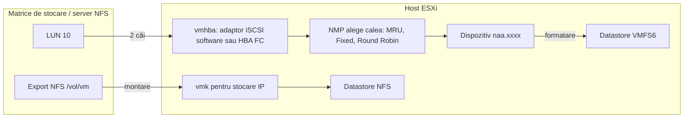
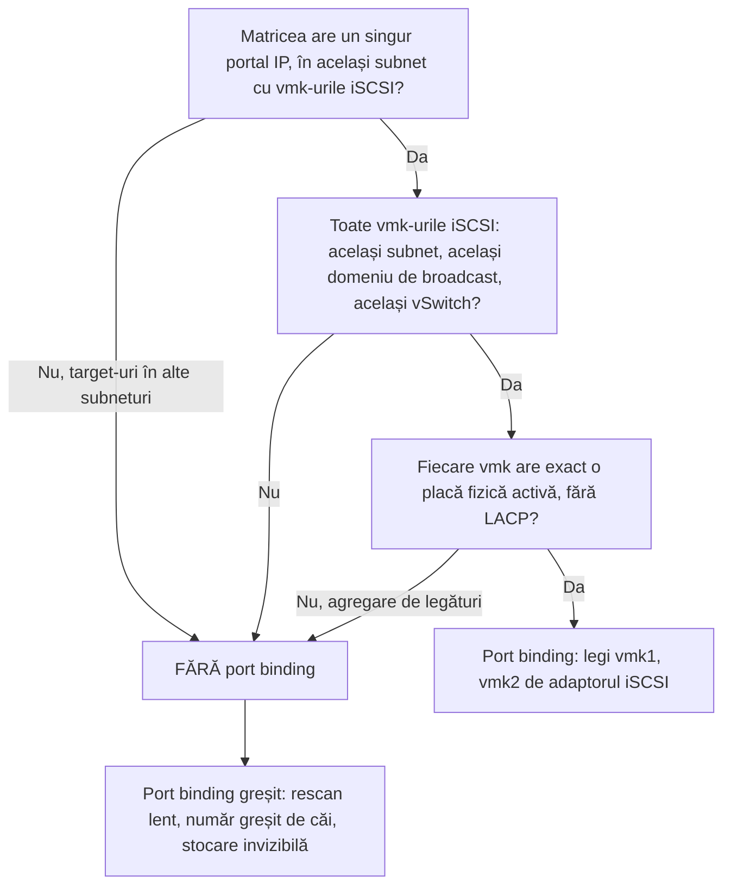

:::analogy
**Durerea din data center.** Echipa de stocare „a șters un LUN (Logical Unit Number) vechi, nefolosit”, iar zece hosturi ESXi apar brusc „Not responding” în vCenter. Un datastore iSCSI (Internet Small Computer Systems Interface) arată o singură cale, deși serverul are două plăci de rețea. Un administrator caută butonul „Upgrade la VMFS6” și nu-l găsește. Toate trei sunt subiecte de examen: exam guide-ul VVF (VMware vSphere Foundation, 2V0-16.25) cere stocarea vSphere la obiectivul 2.3.1, iar vechiul VCP-DCV (VMware Certified Professional - Data Center Virtualization) avea obiective separate pentru stocare și pentru administrarea datastore-urilor. [S02] [S47]

**Analogia: un depozit de mărfuri cu mai multe drumuri de acces.**

- **LUN-ul** (Logical Unit Number, discul logic primit de la matricea de stocare) este terenul gol. **VMFS** (Virtual Machine File System) este depozitul construit pe el, cu rafturi pentru fișierele VM-urilor.
- **NFS** (Network File System) este un depozit închiriat de la altcineva: nu construiești nimic, doar primești cheia (montezi share-ul).
- **Căile multiple (multipathing)** sunt drumurile spre depozit. Dacă un drum se închide, camioanele merg pe altul.
- **APD** (All Paths Down) și **PDL** (Permanent Device Loss) sunt cele două feluri de „nu mai ajung la depozit”: drumurile sunt blocate și nu știi pentru cât timp, sau ți s-a spus clar că depozitul a fost demolat.
:::

:::architecture
### 1. De la dispozitiv la datastore

Ai văzut în lecția 1.3 tipurile de datastore: VMFS pe dispozitive bloc (local, Fibre Channel, iSCSI, NVMe, Non-Volatile Memory Express), NFS montat direct, vSAN și vVols. [S67] Lecția de acum arată ce faci concret pe host cu primele trei.



### 2. VMFS5 vs VMFS6

ESXi citește și scrie ambele versiuni. [S121]

| | VMFS5 | VMFS6 |
|---|---|---|
| Bloc | 1 MB | 1 MB |
| Datastore-uri pe host | 512 | 512 |
| Dispozitive 4Kn (sectoare native de 4096 de octeți) | Nu | Da |
| Recuperare automată a spațiului (UNMAP) | Nu | Da |
| Recuperare manuală (esxcli) | Da | Da |
| Format implicit pentru snapshot-uri | VMFSsparse sub 2 TB, SEsparse de la 2 TB | SEsparse pentru toate discurile |

- **Nu există upgrade pe loc din VMFS5 în VMFS6.** Creezi un datastore VMFS6 nou și muți VM-urile pe el cu Storage vMotion. [S121] [S122]
- Articolul KB (Knowledge Base article) 316475 descrie și varianta cu un datastore de tranzit: golești datastore-ul vechi, îl ștergi, îl recreezi ca VMFS6 pe același LUN și aduci VM-urile înapoi. [S122]

### 3. Mărirea unui datastore VMFS

Două metode, ambele **fără oprirea VM-urilor**: [S130]

- **Expand (mărești extent-ul existent):** merge doar dacă dispozitivul are spațiu liber imediat după datastore. vSphere Client îl arată ca „Expandable: Yes”. Cazul tipic: echipa de stocare a mărit LUN-ul.
- **Add extent (adaugi alt dispozitiv):** datastore-ul se întinde pe mai multe dispozitive, dar apare ca un singur volum. Extent-ul minim are 1,3 GB.

Două avertismente din documentație: opțiunea „Use all available partitions” reformatează discul ales și **șterge** ce era pe el, iar după mărire faci rescan la nivel de cluster, ca vCenter să vadă noua capacitate. [S130]

### 4. iSCSI pe ESXi

**Tipuri de adaptoare.** Adaptorul **software** folosește plăcile de rețea obișnuite și stiva de rețea a hostului. [S126] Adaptorul **dependent hardware** are un motor iSCSI pe placă, dar depinde de rețeaua VMware: funcționează abia după ce îl legi de un adaptor VMkernel. [S127]

**Pașii pentru adaptorul software** (ESXi 7.x și 8.x): [S133] [S126]

1. Rețeaua: un switch (sau port group-uri) dedicat iSCSI și câte un adaptor VMkernel pe fiecare placă fizică, cu IP (Internet Protocol) static în subnetul iSCSI.
2. **Storage Adapters → Add Software Adapter → iSCSI.** Hostul primește automat un nume IQN (iSCSI Qualified Name).
3. **Network Port Binding**, doar dacă ești în cazul potrivit (vezi mai jos).
4. **Discovery:** *Dynamic* (SendTargets: dai adresa matricei, iar ea îți întoarce lista de target-uri) sau *Static* (introduci manual fiecare target). [S127]
5. **CHAP** (Challenge-Handshake Authentication Protocol), dacă rețeaua îl folosește: se poate pune pe adaptor sau separat pe fiecare target. [S127]
6. **Rescan**, verifici numărul de căi și abia apoi creezi datastore-ul VMFS. [S133]

Reguli practice din documentație: nu folosi iSCSI pe plăci de 100 Mbps sau mai lente și nu scrie numele adaptorului (`vmhbaXX`) în scripturi, pentru că se poate schimba între versiuni. [S126]

**Port binding: când da și când nu.** Port binding leagă adaptorul iSCSI software de anumite vmk-uri, ca să obții mai multe căi spre aceeași matrice. [S128]



Regula vine din KB 317719: port binding cere vmk-uri în același subnet și domeniu de broadcast, pe același vSwitch, fiecare legat 1 la 1 de un vmnic. Nu îl folosești când target-urile sunt în alt subnet sau cu agregare de legături (LACP, Link Aggregation Control Protocol). [S128] KB 410819 adaugă că două vmk-uri iSCSI în același subnet **fără** port binding pot duce la zero căi active. [S133] E aceeași excepție de la multihoming pe care ai văzut-o în lecția 1.7. [S111]

### 5. NFS pe ESXi

ESXi montează NFS 3 și NFS 4.1. Nu monta niciodată același share cu ambele versiuni (lecția 1.3). [S68] NFS 3 are o singură conexiune activă pe montare; 4.1 permite mai multe conexiuni și căi multiple, dacă serverul le suportă. Din vSphere 8.0 Update 1 există și nConnect, adică mai multe conexiuni TCP (Transmission Control Protocol) pe o singură montare. [S132]

Din linia de comandă (prin SSH, Secure Shell), KB 344470 dă comenzile: [S131]

```bash
esxcli storage nfs list
esxcli storage nfs add -H 192.168.10.50 -s /export/vm -v NFS-Lab
esxcli storage nfs remove -v NFS-Lab
esxcli storage nfs41 list
```

Numele serverului și calea share-ului sunt **case-sensitive**: scrie-le identic pe toate hosturile. [S131] Altfel, hosturile pot vedea același export ca datastore-uri diferite.

### 6. Căile multiple: NMP și PSP

Când un LUN e vizibil pe mai multe căi, modulul NMP (Native Multipathing Plug-in) folosește o politică PSP (Path Selection Policy): [S123]

| Politică | Comportament | Implicită pentru |
|---|---|---|
| MRU (Most Recently Used) | Folosește prima cale bună; la cădere trece pe alta și **rămâne** acolo, fără failback | Matrice Active/Passive |
| Fixed | Folosește calea preferată; după reparare **revine** pe ea | Matrice Active/Active |
| Round Robin | Rotește operațiile I/O (Input/Output) pe căile disponibile; implicit schimbă calea la 1000 de operații | Nu e implicită; se setează |

- Cu ALUA (Asymmetric Logical Unit Access), Round Robin folosește doar căile „active optimized”. [S123]
- Vezi politica fiecărui dispozitiv cu `esxcli storage nmp device list`. [S123]
- Round Robin nu e suportat pe orice matrice. Verifică întâi documentația producătorului; o politică greșită poate opri accesul la stocare. [S123]

### 7. APD și PDL

| | APD (All Paths Down) | PDL (Permanent Device Loss) |
|---|---|---|
| Ce s-a întâmplat | Toate căile au căzut; hostul nu știe dacă e temporar | Matricea a spus explicit că dispozitivul nu mai există |
| Cum află hostul | Nu primește niciun cod de PDL | Primește coduri SCSI (Small Computer System Interface) de tip 0x25/0x0 sau 0x68/0x0 |
| Ce face hostul | Reîncearcă la nesfârșit; după **140 de secunde** abandonează rapid I/O-ul care nu vine de la VM-uri | Nu mai încearcă să se reconecteze |
| Efect | Agenții de management se pot bloca, hostul apare „Not responding” | VM-urile cu discuri RDM (Raw Device Mapping) pe dispozitiv se opresc cu întrebarea Retry/Cancel |

Surse: KB 318712 și KB 318850. [S124] [S125] Pentru APD nu există o recuperare curată pe host: repari matricea sau rețeaua de stocare, iar uneori hostul trebuie repornit. [S124] [S125]

**Scoaterea corectă a unui LUN** (KB 323128), repetată pe fiecare host care îl vede: [S129]

1. Muți sau dezînregistrezi VM-urile, șabloanele și ISO-urile; verifici că datastore-ul nu e folosit pentru heartbeat de HA (High Availability), coredump sau scratch.
2. Afli identificatorul NAA (Network Address Authority) cu `esxcli storage vmfs extent list`.
3. Demontezi: `esxcli storage filesystem unmount -l NUME_DATASTORE`.
4. Detașezi dispozitivul: `esxcli storage core device set --state=off -d NAA_ID`.
5. **Abia acum** echipa de stocare scoate LUN-ul de pe matrice.
6. Faci rescan: `esxcli storage core adapter rescan --all`.

Dacă echipa de stocare face pasul 5 înaintea pașilor 3–4, hosturile care nu au detașat dispozitivul intră în APD. [S129]

[IMAGE SEARCH / PROMPT] „vSphere Client storage adapters iSCSI network port binding paths”, ca să vezi unde apar căile și port binding-ul în interfață.
:::

:::exam-alert
### De memorat

| Ce | Valoare / regulă | Sursă |
|---|---|---|
| Bloc VMFS5 și VMFS6 | 1 MB | Docs [S121] |
| Datastore-uri pe host | 512 | Docs [S121] |
| 4Kn și UNMAP automat | Doar VMFS6 | Docs [S121] |
| Upgrade VMFS5 → VMFS6 | Nu există pe loc; datastore nou + Storage vMotion | Docs [S121], KB 316475 [S122] |
| Extent minim | 1,3 GB | Docs [S130] |
| iSCSI software | Nu pe plăci de 100 Mbps sau mai lente | Docs [S126] |
| Port binding | Același subnet și vSwitch, 1 vmk = 1 vmnic activ, fără LACP | KB 317719 [S128] |
| PSP implicit | MRU pentru Active/Passive, Fixed pentru Active/Active | KB 339621 [S123] |
| Round Robin | Schimbă calea la 1000 de operații (implicit) | KB 339621 [S123] |
| Timeout APD | 140 de secunde | KB 318850 [S125] |
| Ordinea la scoaterea unui LUN | Unmount → detach (pe toate hosturile) → scos de pe matrice → rescan | KB 323128 [S129] |

### 3 capcane de examen

1. **„Fac upgrade pe loc din VMFS5 în VMFS6 din meniul datastore-ului.”** Fals. Nu există upgrade pe loc; creezi un datastore VMFS6 și muți VM-urile. [S121]
2. **„Port binding e obligatoriu oricând folosesc iSCSI software.”** Fals. Nu se folosește când target-urile sunt în alte subneturi sau când vmk-urile sunt în domenii de broadcast diferite. [S128]
3. **„MRU revine automat pe calea inițială după ce se repară.”** Fals. MRU rămâne pe calea nouă; Fixed este politica ce revine pe calea preferată. [S123]
:::

:::trenches
**Greșeala 1: LUN scos de pe matrice înainte de detach.**
Echipa de stocare curăță LUN-urile „nefolosite” direct din matrice. Hosturile care încă aveau datastore-ul montat intră în APD, agenții de management se blochează și hosturile apar „Not responding”. KB 323128 avertizează exact asupra acestei ordini greșite. [S129] [S125]
**Remediere:** dacă LUN-ul se poate prezenta din nou, îl reprezinți, apoi faci pașii corecți: unmount, detach pe fiecare host, abia apoi scoaterea de pe matrice și rescan. Dacă nu, rezolvarea APD trece prin repornirea hosturilor afectate. Pe viitor, procedura de decomisionare include obligatoriu verificarea că dispozitivul arată „off” pe toate hosturile. [S129] [S125]

**Greșeala 2: port binding pus „din reflex” cu target-uri în subneturi diferite.**
Matricea are două controlere în două subneturi, iar hosturile au port binding activ. Rescan-urile durează minute, repornirea hosturilor e lentă și numărul de căi pe dispozitiv e greșit. KB 317719 enumeră exact aceste simptome pentru un design nepotrivit. [S128]
**Remediere:** scoți vmk-urile din Network Port Binding și lași hostul să ajungă la target-uri prin rutarea normală a stivei. Verifici după rescan că fiecare dispozitiv are numărul de căi așteptat. [S128] [S133]
:::

:::interview
**Întrebare Junior/Mid: „Ce diferență e între APD și PDL și de ce contează?”**

*Răspunsul ideal:* în APD (All Paths Down) toate căile au căzut, dar hostul nu știe dacă e temporar, așa că reîncearcă la nesfârșit; după 140 de secunde abandonează rapid I/O-ul care nu vine de la VM-uri. Agenții de management se pot bloca și hostul poate apărea deconectat. [S124] [S125] În PDL (Permanent Device Loss) matricea a trimis un cod clar că dispozitivul nu mai există, iar hostul nu mai încearcă. [S124] Contează pentru că APD e starea mai periculoasă, fără o recuperare curată pe host, și pentru că se evită în primul rând prin procedura corectă de scoatere a unui LUN. [S124] [S129]

**Scenariu de troubleshooting: „Ai configurat iSCSI software cu două plăci, dar fiecare LUN arată o singură cale. Ce verifici?”**

*Răspunsul pe care îl așteaptă un Team Lead:*
1. **Rețeaua:** două vmk-uri, fiecare cu o singură placă fizică activă (cealaltă Unused), în același subnet cu portalul matricei. [S128]
2. **Port binding:** ambele vmk-uri apar în Network Port Binding și au starea în regulă. Fără port binding, cu vmk-uri în același subnet, poți avea chiar zero căi active. [S133]
3. **Discovery:** adresa din Dynamic Discovery e corectă, iar matricea expune target-ul pe ambele căi. [S127]
4. **Conectivitatea pe fiecare vmk:** `vmkping -I vmk1` și `vmkping -I vmk2` spre portal, eventual cu test de jumbo frames ca în lecția 1.2. [S51]
5. **Rescan** și verificarea căilor pe dispozitiv; apoi `esxcli storage nmp device list` pentru politica PSP. [S133] [S123]
6. **Prezentarea LUN-ului:** același LUN ID pe toate hosturile, altfel apar volume tratate ca snapshot (lecția 1.3). [S73]
:::

:::lab
**Scenariu.** Montezi un datastore NFS din linia de comandă, creezi un datastore VMFS6 pe un disc liber, activezi adaptorul iSCSI software și citești politica de căi. La final scoți datastore-ul VMFS exact în ordinea din KB 323128.

**Ce ai nevoie.** Serverul NFS din lab-ul lecției 1.3 (cu `no_root_squash`), SSH pornit temporar și un disc liber văzut de host. Dacă lab-ul tău e un ESXi nested, adaugi pur și simplu un disc virtual nou VM-ului ESXi nested. **Nu** folosi discul de boot sau datastore-ul pe care stau VM-urile tale.

Pașii de mai jos sunt bifabili, iar progresul se salvează în browser. Numele exacte ale meniurilor pot diferi puțin între Host Client 8 și 9 (`⚠ de verificat`).

**Test de avarie / validare.** După pasul 6, `esxcli storage core device list -d NAA_ID` trebuie să arate dispozitivul cu starea „off”, iar abia după aceea scoți discul. Dacă îl scoți înainte de detach, vei vedea în evenimentele hostului un mesaj de „All Paths Down”: exact greșeala din producție de mai sus.
:::

:::quiz
Cinci întrebări originale, în stilul examenelor VCP (VMware Certified Professional). Primești explicația pentru fiecare variantă imediat după ce răspunzi.
:::

:::references
- Exam guide VCP-VVF Administrator 2V0-16.25, obiectivul 2.3.1 [S02]
- Exam guide VCP-DCV 2V0-21.23 (certificare Legacy), obiectivele 1.3 și 7.4.1 [S47]
- Documentația vSphere Storage: versiunile VMFS [S121], mărirea datastore-ului [S130], iSCSI software și dependent hardware [S126] [S127]
- KB 316475: migrarea VMFS5 → VMFS6 [S122]
- KB 317719 și KB 410819: port binding și configurarea pas cu pas a iSCSI [S128] [S133]
- KB 344470 și KB 370665: NFS din linia de comandă și NFS în vSphere 8 [S131] [S132]
- KB 339621: politicile de căi multiple [S123]
- KB 318712 și KB 318850: APD și PDL [S124] [S125]
- KB 323128: scoaterea corectă a unui LUN [S129]
:::
