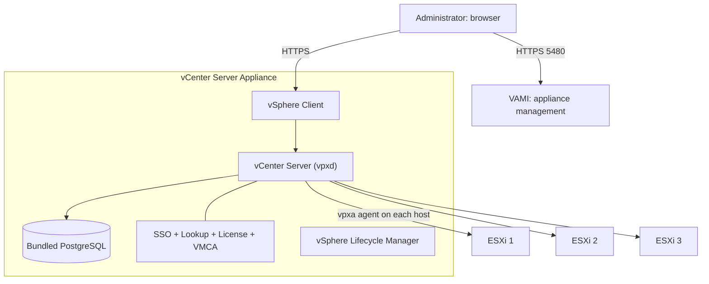
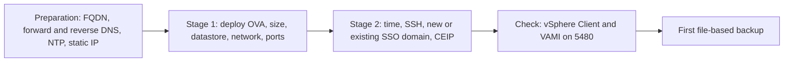

:::analogy
**The data center pain.** You have three ESXi hosts, each managed through its own Host Client. You want to move a VM (Virtual Machine) from one to another without downtime, restart VMs automatically on another host when one fails, and give a colleague rights on just one folder of VMs. None of that exists without **vCenter Server**. The VVF (VMware vSphere Foundation, 2V0-16.25) exam guide covers vCenter in objective 2.2.1 and its deployment and configuration in objectives 4.1.1 and 4.1.2, and the old VCP-DCV (VMware Certified Professional - Data Center Virtualization) had separate objectives for its architecture and its deployment. [S02] [S47]

**The analogy: an airport control tower.**

- **ESXi hosts** are the planes. Each can fly on its own, with its own pilot (Host Client).
- **vCenter** is the control tower: it sees every plane, coordinates them and decides who lands where. If the tower closes for an hour, the planes **keep flying**; only coordination stops.
- **The SSO (Single Sign-On) domain** is the airport badge: whoever has one can enter the tower, and everyone only gets into their own rooms.
- **VAMI** (vCenter Server Appliance Management Interface) is the tower's technical room: from there you fix power, the clock and take backups, even when the tower screens are dark.
:::

:::architecture
### 1. What vCenter Server is, inside

vCenter runs as a Linux appliance, the VCSA (vCenter Server Appliance), with a bundled PostgreSQL database installed automatically. [S136] Since vSphere 7.0 an external PSC (Platform Services Controller) is neither necessary nor possible: its services now live in vCenter. [S136]

The services fall into two groups: [S136]

| Group | Service | What it does |
|---|---|---|
| Authentication | vCenter Single Sign-On | Components authenticate through token exchange; the built-in identity provider defaults to the `vsphere.local` domain; SSO is required |
| Authentication | License Service | Common license inventory for every vCenter in the SSO domain |
| Authentication | Lookup Service | Listed by the docs among the authentication services |
| Authentication | VMCA (VMware Certificate Authority) | Signs ESXi host certificates by default |
| vCenter | vCenter Server | The central management platform for hosts and VMs |
| vCenter | vSphere Client | The HTML5 web interface |
| vCenter | vSphere Lifecycle Manager | Centralized updates for hosts |
| vCenter | Auto Deploy, ESXi Dump Collector | Mass host provisioning; collecting memory dumps when a host crashes |



Lesson 1.4 showed that every host runs the `vpxa` agent, through which vCenter talks to `hostd`. vCenter does not run VMs: if it stops, VMs keep running and only centralized management stops.

### 2. Deployment in two stages

The GUI installer runs from a Windows, Linux or Mac machine on the same network and works in two stages: [S134]

**Stage 1: deploy the OVA (Open Virtual Appliance).**
- connect to an ESXi host or an existing vCenter;
- set the appliance name and root password;
- choose the **deployment size** (CPU, Central Processing Unit, and memory) and the **storage size**;
- choose the datastore, optionally with thin disk mode;
- configure networking: IPv4 or IPv6 (versions 4 and 6 of IP, Internet Protocol), static or DHCP (Dynamic Host Configuration Protocol), plus the HTTP (Hypertext Transfer Protocol) and HTTPS (secure HTTP) ports. **Ports can only be customized during installation, not afterwards.** [S134]

**Stage 2: set up the appliance.**
- time synchronization: with the ESXi host or with NTP (Network Time Protocol) servers, NTP by default; [S135]
- SSH (Secure Shell) access: enable it or not; vCenter HA (High Availability) requires it; [S135]
- **SSO domain:** create a new one or join an existing one. Joining an existing domain enables ELM (Enhanced Linked Mode); [S134]
- SSO administrator password: 8 to 20 characters, with an upper-case letter, a lower-case letter, a digit and a special character; [S135]
- CEIP (Customer Experience Improvement Program): join or decline. [S135]



**Preparation matters more than the install.** The docs recommend an FQDN (Fully Qualified Domain Name) and, if you use an IP, static allocation, because a DHCP address can change. [S134] The install fails if the FQDN cannot be resolved, and the upgrade pre-check fails if the reverse PTR (Pointer record) entry is missing: you saw both in lesson 1.2. [S55] [S56] Synchronized time is a security requirement, because certificates and tokens depend on it. [S59]

### 3. Appliance size

The size is chosen at deploy or upgrade time and sets the vCPU (virtual CPU) count and memory: [S19]

| Size | vCPU | Memory (GB) | Max hosts | Max VMs |
|---|---|---|---|---|
| Tiny | 2 | 14 | 10 | 100 |
| Small | 4 | 21 | 100 | 1,000 |
| Medium | 8 | 30 | 400 | 4,000 |
| Large | 16 | 39 | 1,000 | 10,000 |
| X-Large | 24 | 58 | 2,000 | 35,000 |

- The table above is from the vSphere 8 docs. A VMware article on VCF (VMware Cloud Foundation) 9.1 gives the same vCPU and memory values for Small–X-Large and no longer lists Tiny (`⚠ to verify` for 9.0 in the official docs). [S19] [S141]
- A host with more than 512 LUNs (Logical Unit Number) and 2,048 paths needs a Large or X-Large vCenter. [S19]
- **Resizing only grows:** you cannot reduce vCPU, memory or disk. VCF 9.1 adds an API (Application Programming Interface) for resizing; before 9.1 the options were upgrading to a larger size or restoring a backup into a larger appliance. [S141]

### 4. The SSO domain and linking several vCenters

The SSO domain is the identity boundary: its users, groups, identity sources and licenses are shared by every vCenter in it. [S136] The main account is `administrator@<domain>`, usually `administrator@vsphere.local`.

- **ELM (Enhanced Linked Mode):** several vCenters in one SSO domain, with the directory database replicated between them. It allows up to 15 appliances in one domain. [S142] ELM is still supported in vSphere 9.0. [S143]
- **VCF 9: vCenter Linking.** The new VCF 9 SSO architecture does not use ELM. vCenters are grouped from VCF Operations (*Infrastructure Operations → Configurations → vCenter Linking*), can keep separate SSO domains and no longer need identical builds. [S142] [S143]
- If you log in with a local account (for example `administrator@vsphere.local`), you only see that vCenter's inventory; the shared view requires logging in through VCF SSO. [S143]

### 5. Day-to-day operations: VAMI, services, backup

The **VAMI** opens at `https://FQDN:5480`, with root or an administrator. [S138] From there you see appliance health, set time, networking, SSH and take backups.

**Services** are checked and started from the appliance shell with `service-control`: [S140]

```bash
service-control --status --all
service-control --stop <service_name>
service-control --start <service_name>
service-control --start --all --dry-run
```

Take the exact service name from the `--status --all` list. [S140]

**File-based backup** is the recommended method for the appliance and is done from the VAMI. [S139] Supported protocols: FTP (File Transfer Protocol), FTPS (FTP secured with TLS, Transport Layer Security), HTTP, HTTPS, SFTP (SSH File Transfer Protocol), NFS (Network File System) and SMB (Server Message Block). FTP and HTTP are insecure, and HTTP/HTTPS need WebDAV (Web Distributed Authoring and Versioning) on the backup server. [S137] You can set an encryption password. [S138]

What to know about a restore: [S137]
- VM settings, resource pools, cluster membership and DRS (Distributed Resource Scheduler) revert to the backup state;
- Distributed Switch configuration, Content Library, storage policies, vSAN and HA can fall out of sync; export the Distributed Switch configuration before restoring;
- vCenter HA must be reconfigured after the restore;
- security patches applied after the backup must be reapplied.

[IMAGE SEARCH / PROMPT] "vCenter Server Appliance Management Interface 5480 backup schedule", to see what the VAMI backup screen looks like.
:::

:::exam-alert
### Memorize

| What | Value / rule | Source |
|---|---|---|
| External PSC | Gone since vSphere 7.0 | Docs [S136] |
| Database | Bundled PostgreSQL | Docs [S136] |
| Built-in identity provider default domain | `vsphere.local` | Docs [S136] |
| Install stages | 1: deploy OVA and network; 2: time, SSH, SSO, CEIP | Docs [S134] |
| vCenter HTTP/HTTPS ports | Chosen only at install time | Docs [S134] |
| SSO administrator password | 8–20 characters, upper, lower, digit, special | Docs [S135] |
| Tiny / Small / Medium | 10 hosts and 100 VMs / 100 and 1,000 / 400 and 4,000 | vSphere 8 docs [S19] |
| Large / X-Large | 1,000 and 10,000 / 2,000 and 35,000 | vSphere 8 docs [S19] |
| Resizing | Up only | VMware blog [S141] |
| ELM | Up to 15 vCenters; supported in 9.0; VCF 9 uses vCenter Linking | [S142] [S143] |
| VAMI | `https://FQDN:5480` | KB (Knowledge Base article) 375278 [S138] |
| Backup protocols | FTP, FTPS, HTTP, HTTPS, SFTP, NFS, SMB | Docs [S137] |

### 3 exam traps

1. **"For a large environment I install an external PSC first and then vCenter."** False. Since vSphere 7.0 an external PSC is no longer possible; its services are in vCenter. [S136]
2. **"I can change vCenter's HTTPS port from the VAMI after install."** False. Custom ports are chosen only at install time. [S134]
3. **"A Small vCenter is enough for 300 hosts and 3,000 VMs."** False. Small handles 100 hosts and 1,000 VMs; you need at least Medium. [S19]
:::

:::trenches
**Mistake 1: vCenter installed with an IP and no reverse DNS (Domain Name System), "because it works anyway".**
The install succeeds, but at the first upgrade the pre-check stops: the PTR record for vCenter is missing. KB 405215 describes exactly this block, and KB 305807 shows that without a resolvable FQDN even the install fails. [S56] [S55]
**Fix:** create the A and PTR records for vCenter, check from vCenter and from your workstation that name and IP resolve both ways, then rerun the pre-check. For new installs, DNS is the first item on the preparation list. [S55] [S56]

**Mistake 2: no vCenter backup "because the VMs are backed up".**
The vCenter appliance breaks after a storage problem. VM backups exist, but not vCenter's: cluster configuration, permissions and DRS settings must be rebuilt by hand. KB 318731 shows the recommended method for the appliance is the VAMI backup. [S139]
**Fix:** configure a scheduled VAMI backup to an SFTP, SMB or NFS server, with an encryption password kept separately. Test a restore periodically and remember the limits: after a restore some settings (Distributed Switch, HA, vCenter HA) must be checked or redone. [S138] [S137]
:::

:::interview
**Junior/Mid question: "What happens to the VMs if vCenter goes down?"**

*Ideal answer:* the VMs keep running, because they run on the ESXi hosts, not in vCenter. Centralized management is lost: the vSphere Client, admin-initiated vMotion, DRS and any operation that goes through vCenter. Hosts can still be managed one by one through Host Client. A strong candidate adds that vCenter is recovered from the VAMI file-based backup, the recommended method for the appliance. [S139]

**Troubleshooting scenario: "The vSphere Client fails at login, but the VAMI on 5480 works. What do you do?"**

*The answer a Team Lead expects:*
1. **VAMI → Summary:** overall and service health. If the VAMI works, the appliance is up and its network is fine. [S138]
2. **Time:** an out-of-sync clock breaks SSO tokens; check NTP in the VAMI. [S59]
3. **Services:** SSH into the shell and run `service-control --status --all`. Look for stopped services, for example SSO or vCenter Server. [S140]
4. **Start what is stopped** with `service-control --start <name>`; if it won't start, read that service's log.
5. **DNS:** if vCenter's FQDN no longer resolves correctly, authentication can fail. [S55]
:::

:::lab
**Scenario.** You tour a lab vCenter like a new admin: check DNS, size, SSO domain and services, take the first backup and see in practice what happens when the main service stops.

**What you need.** Your lab vCenter, VAMI access, SSH enabled temporarily on the appliance, and the lab NFS or SFTP server as a backup target.

The steps below can be ticked off, and progress is saved in your browser. Exact menu names may differ slightly between versions 8 and 9 (`⚠ to verify`).

**Failure / validation test.** In step 6 you stop the vCenter Server service: the vSphere Client stops working, but the VAMI on 5480 works and your lab VMs keep running (check from Host Client). After starting it again, the vSphere Client comes back.
:::

:::quiz
Five original questions in the style of the VCP (VMware Certified Professional) exams. You get the explanation for every option right after you answer.
:::

:::references
- VCP-VVF Administrator exam guide 2V0-16.25, objectives 2.2.1, 4.1.1 and 4.1.2 [S02]
- VCP-DCV exam guide 2V0-21.23 (Legacy certification), objectives 1.2, 4.1 and 4.5 [S47]
- vCenter Installation docs: services [S136], two-stage deployment [S134], deployment worksheet [S135], hardware requirements [S19]
- Backup docs: restore considerations [S137]; KB 375278 and KB 318731 [S138] [S139]
- KB 340943: the service-control command [S140]
- KB 305807 and KB 405215: DNS for vCenter [S55] [S56]
- VMware blogs on resizing and vCenter Linking in VCF 9 [S141] [S142] [S143]
:::
