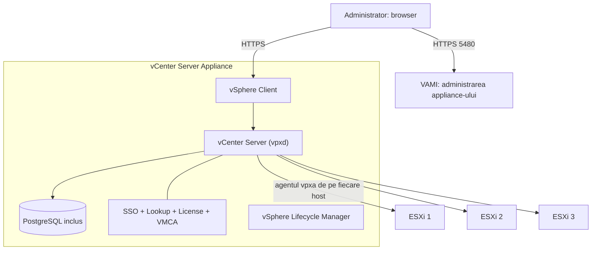
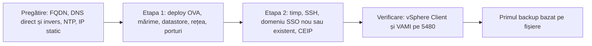

:::analogy
**Durerea din data center.** Ai trei hosturi ESXi administrate fiecare prin Host Client. Vrei să muți un VM (Virtual Machine, mașină virtuală) de pe unul pe altul fără oprire, să pornești automat VM-urile pe alt host când unul cade, să dai unui coleg drepturi doar pe un folder de VM-uri. Nimic din toate astea nu există fără **vCenter Server**. Exam guide-ul VVF (VMware vSphere Foundation, 2V0-16.25) are vCenter la obiectivul 2.2.1 și instalarea și configurarea lui la obiectivele 4.1.1 și 4.1.2, iar vechiul VCP-DCV (VMware Certified Professional - Data Center Virtualization) avea obiective separate pentru arhitectura și pentru instalarea lui. [S02] [S47]

**Analogia: turnul de control al unui aeroport.**

- **Hosturile ESXi** sunt avioanele. Fiecare zboară și singur, cu pilotul lui (Host Client).
- **vCenter** este turnul de control: vede toate avioanele, le coordonează și decide cine aterizează unde. Dacă turnul se închide o oră, avioanele **continuă să zboare**; doar coordonarea se oprește.
- **Domeniul SSO** (Single Sign-On) este legitimația aeroportului: cine o are poate intra în turn, iar fiecare are acces doar la sălile lui.
- **VAMI** (vCenter Server Appliance Management Interface) este camera tehnică a turnului: de acolo repari curentul, ceasul și faci copii de siguranță, chiar dacă ecranele din turn sunt stinse.
:::

:::architecture
### 1. Ce e vCenter Server, pe dinăuntru

vCenter rulează ca appliance Linux, VCSA (vCenter Server Appliance), cu o bază de date PostgreSQL inclusă, instalată automat. [S136] Din vSphere 7.0 nu mai e nici necesar, nici posibil un PSC (Platform Services Controller) extern: serviciile lui sunt acum în vCenter. [S136]

Serviciile se împart în două grupuri: [S136]

| Grup | Serviciu | Ce face |
|---|---|---|
| Autentificare | vCenter Single Sign-On | Componentele se autentifică prin schimb de token-uri; identity provider-ul inclus are implicit domeniul `vsphere.local`; SSO e obligatoriu |
| Autentificare | License Service | Inventarul comun de licențe pentru toate vCenter-ele din domeniul SSO |
| Autentificare | Lookup Service | Listat de documentație printre serviciile de autentificare |
| Autentificare | VMCA (VMware Certificate Authority) | Semnează implicit certificatele hosturilor ESXi |
| vCenter | vCenter Server | Platforma centrală de administrare a hosturilor și VM-urilor |
| vCenter | vSphere Client | Interfața web HTML5 |
| vCenter | vSphere Lifecycle Manager | Actualizări centralizate pentru hosturi |
| vCenter | Auto Deploy, ESXi Dump Collector | Instalare de hosturi în masă; colectarea memoriei la căderea unui host |



Ai văzut în lecția 1.4 că pe fiecare host rulează agentul `vpxa`, prin care vCenter vorbește cu `hostd`. vCenter nu rulează VM-uri: dacă se oprește, VM-urile merg mai departe, doar administrarea centralizată se oprește.

### 2. Instalarea în două etape

Instalatorul grafic rulează de pe un calculator Windows, Linux sau Mac din aceeași rețea și lucrează în două etape: [S134]

**Etapa 1: deploy pentru OVA (Open Virtual Appliance).**
- te conectezi la un host ESXi sau la un vCenter existent;
- dai numele appliance-ului și parola de root;
- alegi **mărimea** (deployment size: CPU, Central Processing Unit, și memorie) și **mărimea stocării**;
- alegi datastore-ul, opțional cu thin disk mode;
- configurezi rețeaua: IPv4 sau IPv6 (versiunile 4 și 6 ale IP, Internet Protocol), static sau DHCP (Dynamic Host Configuration Protocol), plus porturile HTTP (Hypertext Transfer Protocol) și HTTPS (HTTP securizat). **Porturile se pot schimba doar la instalare, nu și după.** [S134]

**Etapa 2: configurarea appliance-ului.**
- sincronizarea timpului: cu hostul ESXi sau cu servere NTP (Network Time Protocol), implicit NTP; [S135]
- accesul SSH (Secure Shell): îl activezi sau nu; vCenter HA (High Availability) îl cere; [S135]
- **domeniul SSO:** creezi unul nou sau intri într-unul existent. Intrarea într-un domeniu existent activează ELM (Enhanced Linked Mode); [S134]
- parola administratorului SSO: între 8 și 20 de caractere, cu literă mare, literă mică, cifră și caracter special; [S135]
- CEIP (Customer Experience Improvement Program): accepți sau refuzi. [S135]



**Pregătirea contează mai mult decât instalarea.** Documentația recomandă un FQDN (Fully Qualified Domain Name) și, dacă folosești IP (Internet Protocol), alocare statică, pentru că un IP din DHCP se poate schimba. [S134] Instalarea eșuează dacă FQDN-ul nu se poate rezolva, iar pre-check-ul de upgrade eșuează dacă lipsește înregistrarea PTR (Pointer record) inversă: le-ai văzut pe amândouă în lecția 1.2. [S55] [S56] Timpul sincronizat e o cerință de securitate, pentru că certificatele și token-urile depind de el. [S59]

### 3. Mărimea appliance-ului

Mărimea se alege la deploy sau la upgrade și fixează numărul de vCPU (virtual CPU) și memoria: [S19]

| Mărime | vCPU | Memorie (GB) | Hosturi max | VM-uri max |
|---|---|---|---|---|
| Tiny | 2 | 14 | 10 | 100 |
| Small | 4 | 21 | 100 | 1.000 |
| Medium | 8 | 30 | 400 | 4.000 |
| Large | 16 | 39 | 1.000 | 10.000 |
| X-Large | 24 | 58 | 2.000 | 35.000 |

- Tabelul de mai sus e cel din documentația vSphere 8. Un articol VMware despre VCF (VMware Cloud Foundation) 9.1 dă aceleași valori de vCPU și memorie pentru Small–X-Large și nu mai listează Tiny (`⚠ de verificat` pentru 9.0 în documentația oficială). [S19] [S141]
- Un host cu peste 512 LUN-uri (Logical Unit Number) și 2.048 de căi cere un vCenter Large sau X-Large. [S19]
- **Redimensionarea doar crește:** nu poți reduce vCPU, memoria sau discul. În VCF 9.1 există un API (Application Programming Interface) pentru redimensionare; înainte de 9.1, variantele erau un upgrade spre o mărime mai mare sau restaurarea unui backup într-un appliance mai mare. [S141]

### 4. Domeniul SSO și legarea mai multor vCenter-e

Domeniul SSO e granița de identitate: utilizatorii, grupurile, sursele de identitate și licențele lui sunt comune pentru toate vCenter-ele din el. [S136] Contul principal e `administrator@<domeniu>`, de obicei `administrator@vsphere.local`.

- **ELM (Enhanced Linked Mode):** mai multe vCenter-e în același domeniu SSO, cu baza de date de directoare replicată între ele. Permite până la 15 appliance-uri într-un domeniu. [S142] ELM este încă suportat în vSphere 9.0. [S143]
- **VCF 9: vCenter Linking.** Noua arhitectură SSO din VCF (VMware Cloud Foundation) 9 nu folosește ELM. vCenter-ele se grupează din VCF Operations (*Infrastructure Operations → Configurations → vCenter Linking*), pot păstra domenii SSO separate și nu mai trebuie să aibă exact aceeași versiune. [S142] [S143]
- Dacă te autentifici cu un cont local (de exemplu `administrator@vsphere.local`), vezi doar inventarul acelui vCenter; vizualizarea comună cere autentificare prin VCF SSO. [S143]

### 5. Operarea zilnică: VAMI, servicii, backup

**VAMI** (vCenter Server Appliance Management Interface) se deschide la `https://FQDN:5480`, cu root sau un administrator. [S138] De acolo vezi starea appliance-ului, setezi timpul, rețeaua, SSH-ul și faci backup.

**Serviciile** se verifică și se pornesc din shell-ul appliance-ului, cu `service-control`: [S140]

```bash
service-control --status --all
service-control --stop <nume_serviciu>
service-control --start <nume_serviciu>
service-control --start --all --dry-run
```

Numele exact al unui serviciu îl iei din lista dată de `--status --all`. [S140]

**Backup-ul bazat pe fișiere** este metoda recomandată pentru appliance și se face din VAMI. [S139] Protocoale suportate: FTP (File Transfer Protocol), FTPS (FTP securizat cu TLS, Transport Layer Security), HTTP (Hypertext Transfer Protocol), HTTPS (HTTP securizat), SFTP (SSH File Transfer Protocol), NFS (Network File System) și SMB (Server Message Block). FTP și HTTP nu sunt sigure, iar HTTP/HTTPS cer WebDAV (Web Distributed Authoring and Versioning) pe serverul de backup. [S137] Poți pune o parolă de criptare. [S138]

Ce trebuie să știi la restaurare: [S137]
- setările VM-urilor, resource pool-urile, componența clusterelor și DRS (Distributed Resource Scheduler) revin la starea din backup;
- configurația Distributed Switch, Content Library, politicile de stocare, vSAN și HA pot ieși din sincronizare; exportă configurația Distributed Switch înainte de restaurare;
- vCenter HA trebuie reconfigurat după restaurare;
- patch-urile de securitate aplicate după backup trebuie reaplicate.

[IMAGE SEARCH / PROMPT] „vCenter Server Appliance Management Interface 5480 backup schedule”, ca să vezi cum arată ecranul de backup din VAMI.
:::

:::exam-alert
### De memorat

| Ce | Valoare / regulă | Sursă |
|---|---|---|
| PSC extern | Nu mai există din vSphere 7.0 | Docs [S136] |
| Baza de date | PostgreSQL inclus | Docs [S136] |
| Domeniul implicit al identity provider-ului inclus | `vsphere.local` | Docs [S136] |
| Etapele instalării | 1: deploy OVA și rețea; 2: timp, SSH, SSO, CEIP | Docs [S134] |
| Porturile HTTP/HTTPS ale vCenter | Se aleg doar la instalare | Docs [S134] |
| Parola SSO administrator | 8–20 caractere, mare, mică, cifră, special | Docs [S135] |
| Tiny / Small / Medium | 10 hosturi și 100 VM-uri / 100 și 1.000 / 400 și 4.000 | Docs vSphere 8 [S19] |
| Large / X-Large | 1.000 și 10.000 / 2.000 și 35.000 | Docs vSphere 8 [S19] |
| Redimensionare | Doar în sus | Blog VMware [S141] |
| ELM | Până la 15 vCenter-e; suportat în 9.0; VCF 9 folosește vCenter Linking | [S142] [S143] |
| VAMI | `https://FQDN:5480` | KB (Knowledge Base article) 375278 [S138] |
| Protocoale backup | FTP, FTPS, HTTP, HTTPS, SFTP, NFS, SMB | Docs [S137] |

### 3 capcane de examen

1. **„Pentru un mediu mare instalez un PSC extern și apoi vCenter.”** Fals. Din vSphere 7.0 PSC extern nu mai e posibil; serviciile lui sunt în vCenter. [S136]
2. **„Pot schimba portul HTTPS al vCenter din VAMI după instalare.”** Fals. Porturile personalizate se aleg doar la instalare. [S134]
3. **„Un vCenter Small e suficient pentru 300 de hosturi și 3.000 de VM-uri.”** Fals. Small duce 100 de hosturi și 1.000 de VM-uri; îți trebuie cel puțin Medium. [S19]
:::

:::trenches
**Greșeala 1: vCenter instalat cu IP, fără DNS (Domain Name System) invers, „că merge și așa”.**
Instalarea trece, dar la primul upgrade pre-check-ul se oprește: lipsește înregistrarea PTR pentru vCenter. KB 405215 descrie exact acest blocaj, iar KB 305807 arată că, fără un FQDN rezolvabil, nici instalarea nu reușește. [S56] [S55]
**Remediere:** creezi înregistrările A și PTR pentru vCenter, verifici din vCenter și de pe stația de lucru că numele și IP-ul se rezolvă în ambele sensuri, apoi reiei pre-check-ul. La instalările noi, DNS-ul e primul punct din lista de pregătire. [S55] [S56]

**Greșeala 2: niciun backup al vCenter-ului „pentru că VM-urile sunt salvate”.**
Appliance-ul vCenter se strică după o problemă de stocare. Backup-ul VM-urilor există, dar nu și cel al vCenter-ului: configurația clusterelor, permisiunile și setările DRS trebuie refăcute de mână. KB 318731 arată că metoda recomandată pentru appliance e backup-ul din VAMI. [S139]
**Remediere:** configurezi în VAMI un backup programat pe un server SFTP, SMB sau NFS, cu parolă de criptare păstrată separat. Testezi periodic o restaurare și ții minte limitele: după restaurare, unele setări (Distributed Switch, HA, vCenter HA) trebuie verificate sau refăcute. [S138] [S137]
:::

:::interview
**Întrebare Junior/Mid: „Ce se întâmplă cu VM-urile dacă vCenter cade?”**

*Răspunsul ideal:* VM-urile continuă să ruleze, pentru că rulează pe hosturile ESXi, nu în vCenter. Se pierde administrarea centralizată: vSphere Client, migrările vMotion inițiate de administrator, DRS și orice operație care trece prin vCenter. Hosturile se pot administra individual prin Host Client. Un candidat bun adaugă că recuperarea vCenter-ului se face din backup-ul bazat pe fișiere din VAMI, metoda recomandată pentru appliance. [S139]

**Scenariu de troubleshooting: „vSphere Client dă eroare la login, dar VAMI pe 5480 merge. Ce faci?”**

*Răspunsul pe care îl așteaptă un Team Lead:*
1. **VAMI → Summary:** starea generală și a serviciilor. Dacă VAMI merge, appliance-ul e pornit și rețeaua e în regulă. [S138]
2. **Timpul:** un ceas desincronizat strică token-urile SSO; verific NTP în VAMI. [S59]
3. **Serviciile:** intru prin SSH în shell și rulez `service-control --status --all`. Caut serviciile oprite, de exemplu cel de SSO sau vCenter Server. [S140]
4. **Pornesc ce e oprit** cu `service-control --start <nume>`; dacă nu pornește, citesc log-ul acelui serviciu.
5. **DNS:** dacă FQDN-ul vCenter nu se mai rezolvă corect, autentificarea poate eșua. [S55]
:::

:::lab
**Scenariu.** Faci turul unui vCenter din lab ca un administrator nou venit: verifici DNS-ul, mărimea, domeniul SSO și serviciile, faci primul backup și vezi practic ce se întâmplă când serviciul principal se oprește.

**Ce ai nevoie.** vCenter-ul din lab, acces la VAMI, SSH activ temporar pe appliance și serverul NFS sau SFTP din lab ca destinație de backup.

Pașii de mai jos sunt bifabili, iar progresul se salvează în browser. Numele exacte ale meniurilor pot diferi puțin între versiunile 8 și 9 (`⚠ de verificat`).

**Test de avarie / validare.** La pasul 6 oprești serviciul vCenter Server: vSphere Client nu mai merge, dar VAMI pe 5480 merge, iar VM-urile din lab rulează mai departe (verifici din Host Client). După pornire, vSphere Client revine.
:::

:::quiz
Cinci întrebări originale, în stilul examenelor VCP (VMware Certified Professional). Primești explicația pentru fiecare variantă imediat după ce răspunzi.
:::

:::references
- Exam guide VCP-VVF Administrator 2V0-16.25, obiectivele 2.2.1, 4.1.1 și 4.1.2 [S02]
- Exam guide VCP-DCV 2V0-21.23 (certificare Legacy), obiectivele 1.2, 4.1 și 4.5 [S47]
- Documentația vCenter Installation: serviciile [S136], instalarea în două etape [S134], fișa de instalare [S135], cerințele hardware [S19]
- Documentația pentru backup: considerente la restaurare [S137]; KB 375278 și KB 318731 [S138] [S139]
- KB 340943: comanda service-control [S140]
- KB 305807 și KB 405215: DNS pentru vCenter [S55] [S56]
- Blogurile VMware despre redimensionare și vCenter Linking în VCF 9 [S141] [S142] [S143]
:::
