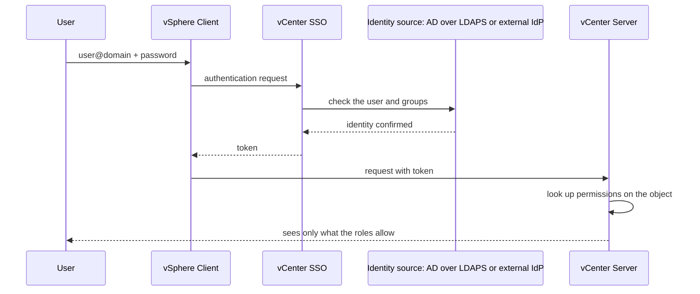
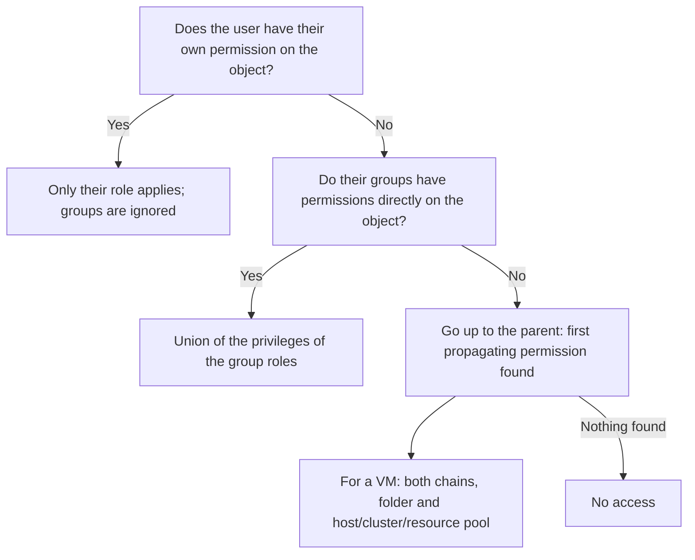

:::analogy
**The data center pain.** A new colleague from the application team needs to power on their own test VMs (VM, Virtual Machine). Someone gives them the Administrator role on the whole vCenter "so they stop calling". A month later a production VM gets deleted by mistake. Meanwhile another new user from AD (Active Directory) cannot log in at all, and nobody understands why. Both problems are about RBAC (Role-Based Access Control). The VVF (VMware vSphere Foundation, 2V0-16.25) exam guide covers identity and access in objective 4.2.1, and the old VCP-DCV (VMware Certified Professional - Data Center Virtualization) had separate objectives for SSO, roles and permissions. [S02] [S47]

**The analogy: an office building with key cards.**

- **Authentication** is the front-desk guard checking your ID (who you are). In vSphere, SSO (Single Sign-On) does it.
- **The identity source** is the register the guard checks your ID against: the building's own list (`vsphere.local`) or the company register (Active Directory).
- **Privileges** are individual doors, a **role** is a card programmed for a set of doors, and a **permission** says on which floor the card works and for whom.
- **Propagation** means a card valid for a floor also opens the offices on that floor.
:::

:::architecture
### 1. Authentication: SSO and identity sources

vCenter Single Sign-On authenticates users; its built-in identity provider (IdP, Identity Provider) can use these identity sources: [S152]

- **local accounts** in `vsphere.local`;
- **Active Directory or OpenLDAP** over LDAP (Lightweight Directory Access Protocol) or LDAPS (LDAP over SSL, where SSL means Secure Sockets Layer);
- **IWA (Integrated Windows Authentication)**;
- other mechanisms such as smart card and RSA SecurID.

**The default domain.** vCenter uses `vsphere.local` by default, a name you can change at install time. If you log in with just a user name, SSO looks in the default domain; if you write `DOMAIN\user` or `user@DOMAIN`, it looks there. [S152]

**IWA is gone.** It was deprecated in vSphere 7.0 and removed in vSphere 9.0. The replacements are AD over LDAPS (port 636, or 3269 for Global Catalog) or federation with an external IdP. Before upgrading to 9.x, configure the new identity source and manually remove the VCSA (vCenter Server Appliance) from the AD domain; otherwise the upgrade pre-check fails. If you keep the same domain name and alias, existing permissions stay. [S151]

**Federation with an external IdP** moves authentication outside vCenter: [S152]

| External IdP | Since |
|---|---|
| AD FS (Active Directory Federation Services) | vSphere 7.0 |
| Okta | vSphere 8.0 Update 1 |
| Microsoft Entra ID | vSphere 8.0 Update 2 |
| PingFederate | vSphere 8.0 Update 3 |

If the external IdP is unreachable, you can still log in with local `vsphere.local` accounts. [S152] That is why the `administrator@vsphere.local` password stays the environment's spare key.

**What changes in 9.0.** In VVF 9, IdPs are still managed from the vSphere Client, with an identity broker embedded in vCenter; VVF does not use VCF SSO. [S153] In VCF (VMware Cloud Foundation) 9, shared authentication goes through VCF SSO, as you saw with vCenter Linking in lesson 2.1. [S143]

### 2. Authorization: privileges, roles, permissions

- A **privilege** is the smallest right, for example powering on a VM.
- A **role** is a set of privileges.
- A **permission** ties four things together: the inventory **object**, the **user or group**, the **role** and the **propagate** option. Propagation is **off by default**; you must tick "Propagate to children". [S144]

**System roles** are permanent: they cannot be modified or deleted. [S146]

| System role | What it allows |
|---|---|
| Administrator | Every action on the object, including granting permissions |
| Read-only | Sees status and details but cannot act (for example cannot open the console) |
| No access | Cannot see or change the object; the default role for new users |

**Sample roles** (for example Virtual machine user, Resource pool administrator) can be cloned, modified or removed. [S146] A new user has No access and needs at least Read-only to be able to log in. [S152]

**Watch out for encryption.** The Administrator role also includes encryption rights (key servers, disk encryption). Where you use VM or vSAN encryption, the DISA (Defense Information Systems Agency) security guide requires normal administrators to get the **No cryptography administrator** role, which has everything except cryptographic operations. [S154]

### 3. Inheritance in the inventory

- A permission set directly on a child object **overrides** the one propagated from the parent. [S144] [S150]
- Most objects have a single parent; a datastore, for example, inherits from its folder or the datacenter. [S144]
- **VMs have two parents at the same time:** the VM folder and the host, cluster or resource pool. [S144]
- You cannot set permissions on a vSphere Standard Switch. A Distributed Switch and its port groups get them from a parent (folder or datacenter) with propagation. [S144] [S150]
- Global objects (roles, licenses, custom fields, statistics intervals, sessions) take their permissions from the root. [S144]
- vCenter periodically validates users and groups against the identity source; if a user is renamed or removed, their permissions disappear at the next check. [S144] [S149]

### 4. When several permissions overlap

The rules from the docs: [S145]

1. A user or group can hold **only one** permission on an object.
2. A child object inherits only if the parent permission has propagation on.
3. A permission set directly on the child beats the inherited one.
4. If the user is in several groups with roles on the same object and does **not** have their own permission there, they get the **union** of the privileges of all those roles.
5. If the user **does** have their own permission on the object, it overrides all their groups' permissions.

Example 3 in the docs is the one most often asked: a group has a power-on role on a folder, and one group member is directly given **No access** on the same folder. The user's own permission wins: they no longer see the folder or the VMs in it. [S145]

### 5. Global permissions

Global permissions sit on a global root object above all hierarchies and also cover global objects such as **tags** and **content libraries**. [S147]

- Without "Propagate to children", the user only gets global functions (for example creating roles), not inventory access. [S147]
- Tags are not controlled by vCenter object permissions: you need the tagging privilege globally or on the tag. A global permission cannot be narrowed at tag level. [S147]
- A local permission lower down (for example on one vCenter's root folder) overrides the global permission. [S144]
- The docs urge caution: a global permission grants access to every object in every hierarchy. [S147]

### 6. Best practices

From the security docs: [S148]

- assign roles to **groups**, not individual users;
- apply **least privilege**: only on the objects needed, only to those who need it, with as few rights as possible;
- before giving a restrictive role to a group, check it doesn't contain administrators;
- use **folders** to grant permissions on sets of objects;
- be careful at the **root**, where global settings are visible;
- use **No access** to mask areas of the hierarchy, remembering that VMs have two propagation chains.

[IMAGE SEARCH / PROMPT] "vSphere Client Administration Access Control Roles Global Permissions", to see where roles and global permissions sit in the menu.
:::

:::exam-alert
### Memorize

| What | Value / rule | Source |
|---|---|---|
| Default SSO domain | `vsphere.local` (changeable at install) | Docs [S152] |
| IWA | Deprecated in 7.0, removed in 9.0 | KB (Knowledge Base article) 314324 [S151] |
| LDAPS ports for AD | 636 and 3269 (Global Catalog) | KB 314324 [S151] |
| Federation | AD FS 7.0; Okta 8.0 U1; Entra ID 8.0 U2; PingFederate 8.0 U3 | Docs [S152] |
| System roles | Administrator, Read-only, No access; permanent | Docs [S146] |
| New user | No access; needs at least Read-only to log in | Docs [S152] |
| Propagation | Off by default | Docs [S144] |
| VMs inherit from | Folder **and** host/cluster/resource pool | Docs [S144] |
| Permissions on a Standard Switch | Cannot be set | Docs [S144] |
| User in several groups | Union of the roles, unless they have their own permission | Docs [S145] |
| The user's own permission | Overrides group permissions | Docs [S145] |

### 3 exam traps

1. **"When I set a permission on a folder, the VMs in it get it automatically."** False. Propagation is off by default; without "Propagate to children" the permission stays on the folder only. [S144]
2. **"If a user is in two groups with different roles, the more restrictive role wins."** False. They get the union of the privileges, unless they have their own permission on the object. [S145]
3. **"I modify the Read-only role to add powering on VMs."** False. System roles are permanent and cannot be modified; create a new role or clone a sample role and change that one. [S146]
:::

:::trenches
**Mistake 1: Administrator at the root for an application team.**
To "solve a request quickly", someone gives the application team's group the Administrator role on vCenter with propagation. The team sees the whole inventory, production included, and a VM gets deleted by mistake. The docs ask for exactly the opposite: roles on groups, least privilege and caution at the root. [S148]
**Fix:** create a role cloned from a sample role (for example Virtual machine user), keep only the privileges needed, move the team's VMs into a dedicated folder and grant the role on that folder with propagation. Remove the root permission. [S146] [S148]

**Mistake 2: upgrade to 9.0 blocked by IWA.**
vCenter still uses Integrated Windows Authentication. The vSphere 9 upgrade pre-check fails, because IWA no longer exists in 9.0 and the appliance is still joined to the AD domain. [S151]
**Fix:** first add an AD over LDAPS identity source (or federation), with the same domain name and alias so permissions stay, check that users can log in, manually remove the VCSA from the domain, and only then rerun the upgrade. [S151]
:::

:::interview
**Junior/Mid question: "What is the difference between a role and a permission in vCenter?"**

*Ideal answer:* a role is a set of privileges, for example "can power VMs on and off". A permission applies a role to a user or group on a specific inventory object, with or without propagation to child objects. [S144] The same role can be used in many permissions. A strong candidate adds that system roles (Administrator, Read-only, No access) cannot be modified and that propagation is off by default. [S146] [S144]

**Troubleshooting scenario: "An AD user is in the VM-Operators group, which has an operator role on the Apps folder, but they see no VMs in the folder. What do you check?"**

*The answer a Team Lead expects:*
1. **Propagation:** does the group's permission on the folder have "Propagate to children" ticked? Without it, the VMs don't inherit it. [S144]
2. **Own permission:** does the user have a direct permission (for example No access) on the folder or the VMs? It overrides the group. [S145]
3. **Permissions on children:** are there permissions set directly on the VMs that override what comes from the folder? [S144]
4. **The other chain:** for VMs the host, cluster or resource pool also matter; a propagating No access on the other chain doesn't remove privileges from the folder chain, but a direct permission on the VM does. [S148] [S144]
5. **Identity:** does the user log in to the right domain (`user@domain`), and is the group found in the identity source? A renamed or removed user loses permissions at the next validation. [S152] [S144]
:::

:::lab
**Scenario.** You build "least privilege" access for a test team: local SSO users and group, your own role, a folder and a propagating permission. Then you prove in practice the rule "the user's own permission overrides the group".

**What you need.** Your lab vCenter, the `administrator@vsphere.local` account (or your SSO domain) and a test VM, for example the one from lesson 1.6.

The steps below can be ticked off, and progress is saved in your browser. Exact menu and privilege names may differ slightly between versions 8 and 9 (`⚠ to verify`).

**Failure / validation test.** In step 5, user `test.ops` must see and be able to power on the VM in the folder, but not delete it. In step 6, after getting No access directly on the folder, the folder and the VM must disappear from their view, even though the group still has the role.
:::

:::quiz
Five original questions in the style of the VCP (VMware Certified Professional) exams. You get the explanation for every option right after you answer.
:::

:::references
- VCP-VVF Administrator exam guide 2V0-16.25, objective 4.2.1 [S02]
- VCP-DCV exam guide 2V0-21.23 (Legacy certification), objectives 1.10, 4.4 and 7.7 [S47]
- vSphere Authentication docs: how SSO authenticates, identity sources and federation [S152]
- vSphere Security docs: inheritance [S144], multiple permissions [S145], roles [S146], global permissions [S147], best practices [S148], managing permissions [S149]
- KB 314324: removal of IWA and migration to LDAPS or federation [S151]
- KB 436518: IdPs in VVF 9 [S153]; KB 380445: permission inheritance [S150]
- DISA STIG V-258951: the No cryptography administrator role [S154]
:::
