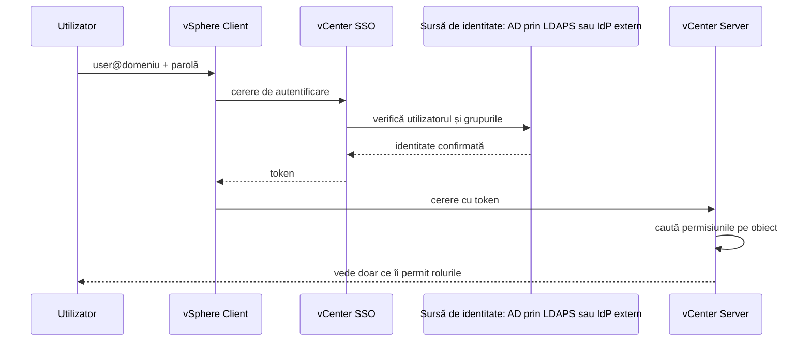
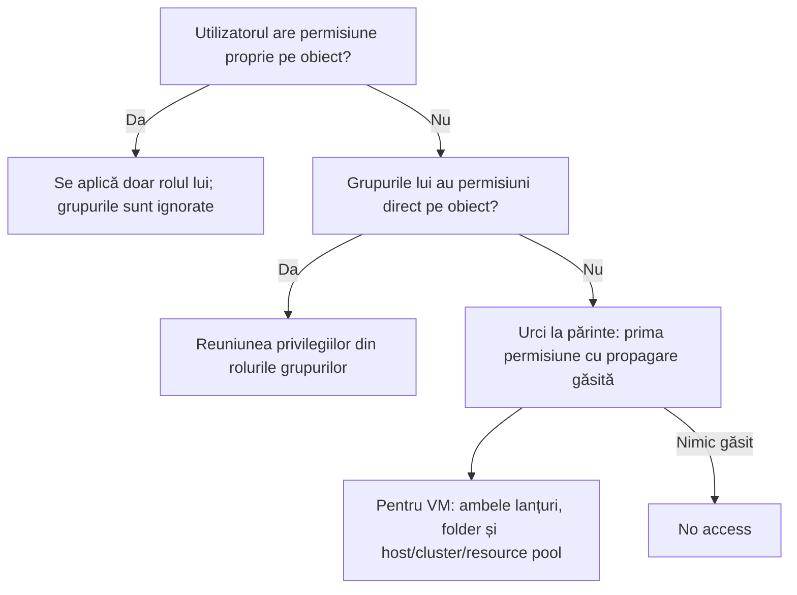

:::analogy
**Durerea din data center.** Un coleg nou de la echipa de aplicații are nevoie să-și pornească singur VM-urile (VM, Virtual Machine, mașină virtuală) de test. Cineva îi dă rolul Administrator pe tot vCenter-ul, „ca să nu mai sune”. După o lună, un VM de producție e șters din greșeală. În același timp, alt utilizator nou din AD (Active Directory) nu poate intra deloc și nimeni nu înțelege de ce. Ambele probleme țin de RBAC (Role-Based Access Control, controlul accesului bazat pe roluri). Exam guide-ul VVF (VMware vSphere Foundation, 2V0-16.25) are identitatea și accesul la obiectivul 4.2.1, iar vechiul VCP-DCV (VMware Certified Professional - Data Center Virtualization) avea obiective separate pentru SSO, roluri și permisiuni. [S02] [S47]

**Analogia: o clădire de birouri cu cartele.**

- **Autentificarea** este paza de la intrare: îți verifică buletinul (cine ești). În vSphere o face SSO (Single Sign-On).
- **Sursa de identitate** este registrul în care paza caută buletinul: lista proprie a clădirii (`vsphere.local`) sau registrul firmei (Active Directory).
- **Privilegiile** sunt ușile individuale, **rolul** este o cartelă programată pentru un set de uși, iar **permisiunea** spune pe ce etaj e valabilă cartela și pentru cine.
- **Propagarea** înseamnă că o cartelă valabilă pe etaj deschide și birourile de pe acel etaj.
:::

:::architecture
### 1. Autentificarea: SSO și sursele de identitate

vCenter Single Sign-On autentifică utilizatorii; identity provider-ul (IdP, Identity Provider) inclus poate folosi aceste surse de identitate: [S152]

- **conturi locale** în `vsphere.local`;
- **Active Directory sau OpenLDAP** prin LDAP (Lightweight Directory Access Protocol) sau LDAPS (LDAP over SSL, cu SSL însemnând Secure Sockets Layer);
- **IWA (Integrated Windows Authentication)**;
- alte mecanisme, precum smart card și RSA SecurID.

**Domeniul implicit.** vCenter folosește implicit `vsphere.local`, nume care se poate schimba la instalare. Dacă te autentifici doar cu numele de utilizator, SSO îl caută în domeniul implicit; dacă scrii `DOMENIU\user` sau `user@DOMENIU`, îl caută acolo. [S152]

**IWA a fost eliminat.** A fost depreciat în vSphere 7.0 și eliminat în vSphere 9.0. Înlocuitorii sunt AD prin LDAPS (portul 636 sau 3269 pentru Global Catalog) sau federarea cu un IdP extern. Înainte de upgrade la 9.x configurezi noua sursă de identitate și scoți manual VCSA (vCenter Server Appliance) din domeniul AD; altfel pre-check-ul de upgrade eșuează. Dacă păstrezi același nume de domeniu și alias, permisiunile existente rămân. [S151]

**Federarea cu un IdP extern** mută autentificarea în afara vCenter: [S152]

| IdP extern | De la versiunea |
|---|---|
| AD FS (Active Directory Federation Services) | vSphere 7.0 |
| Okta | vSphere 8.0 Update 1 |
| Microsoft Entra ID | vSphere 8.0 Update 2 |
| PingFederate | vSphere 8.0 Update 3 |

Dacă IdP-ul extern nu răspunde, poți intra în continuare cu conturile locale din `vsphere.local`. [S152] De aceea parola lui `administrator@vsphere.local` rămâne cheia de rezervă a mediului.

**Ce se schimbă în 9.0.** În VVF 9, IdP-urile se administrează tot din vSphere Client, cu un broker de identitate inclus în vCenter; VVF nu folosește VCF SSO. [S153] În VCF (VMware Cloud Foundation) 9, autentificarea comună trece prin VCF SSO, cum ai văzut la vCenter Linking în lecția 2.1. [S143]

### 2. Autorizarea: privilegii, roluri, permisiuni

- **Privilegiul** este cel mai mic drept, de exemplu pornirea unui VM (Virtual Machine, mașină virtuală).
- **Rolul** este un set de privilegii.
- **Permisiunea** leagă patru lucruri: **obiectul** din inventar, **utilizatorul sau grupul**, **rolul** și opțiunea de **propagare**. Propagarea este **dezactivată implicit**; trebuie să bifezi „Propagate to children”. [S144]

**Rolurile de sistem** sunt permanente: nu se modifică și nu se șterg. [S146]

| Rol de sistem | Ce permite |
|---|---|
| Administrator | Toate acțiunile pe obiect, inclusiv acordarea de permisiuni |
| Read-only | Vede starea și detaliile, dar nu poate face acțiuni (de exemplu nu deschide consola) |
| No access | Nu vede și nu schimbă obiectul; e rolul implicit al utilizatorilor noi |

**Rolurile exemplu** (de exemplu Virtual machine user, Resource pool administrator) se pot clona, modifica sau șterge. [S146] Un utilizator nou are No access și are nevoie de cel puțin Read-only ca să se poată autentifica. [S152]

**Atenție la criptare.** Rolul Administrator include și drepturile de criptare (servere de chei, criptarea discurilor). Unde folosești criptarea VM-urilor sau a vSAN, ghidul de securitate DISA (Defense Information Systems Agency) cere ca administratorii obișnuiți să primească rolul **No cryptography administrator**, care are tot în afară de operațiile criptografice. [S154]

### 3. Moștenirea în inventar

- O permisiune pusă direct pe un obiect copil **suprascrie** permisiunea propagată de la părinte. [S144] [S150]
- Majoritatea obiectelor au un singur părinte; un datastore, de exemplu, moștenește de la folderul lui sau de la datacenter. [S144]
- **VM-urile au doi părinți în același timp:** folderul de VM-uri și hostul, clusterul sau resource pool-ul. [S144]
- Nu poți pune permisiuni pe un vSphere Standard Switch. Un Distributed Switch și port group-urile lui le primesc de la un părinte (folder sau datacenter), cu propagare. [S144] [S150]
- Obiectele globale (roluri, licențe, câmpuri personalizate, intervale de statistici, sesiuni) își iau permisiunile de la rădăcină. [S144]
- vCenter verifică periodic utilizatorii și grupurile în sursa de identitate; dacă un utilizator e redenumit sau șters, permisiunile lui dispar la următoarea verificare. [S144] [S149]

### 4. Când se suprapun mai multe permisiuni

Regulile din documentație: [S145]

1. Un utilizator sau grup poate avea **o singură** permisiune pe un obiect.
2. Un obiect copil moștenește doar dacă permisiunea părintelui are propagarea activă.
3. Permisiunea pusă direct pe copil câștigă în fața celei moștenite.
4. Dacă utilizatorul e în mai multe grupuri cu roluri pe același obiect și **nu** are o permisiune proprie acolo, primește **reuniunea** privilegiilor din toate rolurile.
5. Dacă utilizatorul **are** o permisiune proprie pe obiect, ea suprascrie toate permisiunile grupurilor lui.

Exemplul 3 din documentație e cel mai des întrebat: un grup are rolul de pornire a VM-urilor pe un folder, iar un membru al grupului primește direct **No access** pe același folder. Permisiunea proprie câștigă: utilizatorul nu mai vede nici folderul, nici VM-urile din el. [S145]

### 5. Permisiunile globale

Permisiunile globale se pun pe un obiect rădăcină global, deasupra tuturor ierarhiilor, și acoperă și obiectele globale precum **tag-urile** și **content library**. [S147]

- Fără „Propagate to children”, utilizatorul primește doar funcții globale (de exemplu crearea de roluri), nu acces la inventar. [S147]
- Tag-urile nu se controlează prin permisiunile pe obiecte din vCenter: ai nevoie de privilegiul de tagging global sau pe tag. O permisiune globală nu se poate restrânge la nivel de tag. [S147]
- O permisiune locală pusă mai jos (de exemplu pe folderul rădăcină al unui vCenter) suprascrie permisiunea globală. [S144]
- Documentația cere prudență: o permisiune globală dă acces la toate obiectele din toate ierarhiile. [S147]

### 6. Bune practici

Din documentația de securitate: [S148]

- dai roluri **grupurilor**, nu utilizatorilor individuali;
- aplici **least privilege**: doar pe obiectele necesare, doar celor care au nevoie, cu cât mai puține drepturi;
- înainte de a da un rol restrictiv unui grup, verifici că nu conține administratori;
- folosești **foldere** ca să dai permisiuni pe grupuri de obiecte;
- ești prudent la **rădăcină**, unde se văd setări globale;
- folosești **No access** ca să ascunzi zone din ierarhie, ținând minte că VM-urile au două lanțuri de propagare.

[IMAGE SEARCH / PROMPT] „vSphere Client Administration Access Control Roles Global Permissions”, ca să vezi unde stau rolurile și permisiunile globale în meniu.
:::

:::exam-alert
### De memorat

| Ce | Valoare / regulă | Sursă |
|---|---|---|
| Domeniul implicit SSO | `vsphere.local` (se poate schimba la instalare) | Docs [S152] |
| IWA | Depreciat în 7.0, eliminat în 9.0 | KB (Knowledge Base article) 314324 [S151] |
| Porturile LDAPS pentru AD | 636 și 3269 (Global Catalog) | KB 314324 [S151] |
| Federare | AD FS 7.0; Okta 8.0 U1; Entra ID 8.0 U2; PingFederate 8.0 U3 | Docs [S152] |
| Rolurile de sistem | Administrator, Read-only, No access; permanente | Docs [S146] |
| Utilizator nou | No access; are nevoie de cel puțin Read-only ca să intre | Docs [S152] |
| Propagarea | Dezactivată implicit | Docs [S144] |
| VM-urile moștenesc de la | Folder **și** host/cluster/resource pool | Docs [S144] |
| Permisiuni pe Standard Switch | Nu se pot pune | Docs [S144] |
| Utilizator în mai multe grupuri | Reuniunea rolurilor, dacă nu are permisiune proprie | Docs [S145] |
| Permisiune proprie a utilizatorului | Suprascrie permisiunile grupurilor | Docs [S145] |

### 3 capcane de examen

1. **„Când dau o permisiune pe un folder, VM-urile din el o primesc automat.”** Fals. Propagarea e dezactivată implicit; fără „Propagate to children”, permisiunea rămâne doar pe folder. [S144]
2. **„Dacă un utilizator e în două grupuri cu roluri diferite, câștigă rolul mai restrictiv.”** Fals. Primește reuniunea privilegiilor, cu excepția cazului în care are o permisiune proprie pe obiect. [S145]
3. **„Modific rolul Read-only ca să-i adaug pornirea VM-urilor.”** Fals. Rolurile de sistem sunt permanente și nu se modifică; creezi un rol nou sau clonezi un rol exemplu și îl schimbi pe acela. [S146]
:::

:::trenches
**Greșeala 1: Administrator pe rădăcină pentru o echipă de aplicații.**
Ca să „rezolve rapid” o cerere, cineva dă grupului echipei de aplicații rolul Administrator pe vCenter, cu propagare. Echipa vede tot inventarul, inclusiv producția, iar un VM e șters din greșeală. Documentația cere exact opusul: roluri pe grupuri, least privilege și prudență la rădăcină. [S148]
**Remediere:** creezi un rol clonat dintr-un rol exemplu (de exemplu Virtual machine user), păstrezi doar privilegiile necesare, muți VM-urile echipei într-un folder dedicat și dai rolul pe acel folder, cu propagare. Scoți permisiunea de pe rădăcină. [S146] [S148]

**Greșeala 2: upgrade la 9.0 blocat de IWA.**
vCenter folosește încă Integrated Windows Authentication. Pre-check-ul de upgrade la vSphere 9 eșuează, pentru că IWA nu mai există în 9.0, iar appliance-ul e încă membru în domeniul AD. [S151]
**Remediere:** adaugi întâi o sursă de identitate AD prin LDAPS (sau federare), cu același nume de domeniu și alias ca să rămână permisiunile, verifici că utilizatorii se pot autentifica, scoți manual VCSA din domeniu și abia apoi reiei upgrade-ul. [S151]
:::

:::interview
**Întrebare Junior/Mid: „Care e diferența dintre un rol și o permisiune în vCenter?”**

*Răspunsul ideal:* rolul este un set de privilegii, de exemplu „poate porni și opri VM-uri”. Permisiunea aplică un rol unui utilizator sau grup pe un obiect anume din inventar, cu sau fără propagare spre obiectele copil. [S144] Același rol poate fi folosit în multe permisiuni. Un candidat bun adaugă că rolurile de sistem (Administrator, Read-only, No access) nu se pot modifica și că propagarea e dezactivată implicit. [S146] [S144]

**Scenariu de troubleshooting: „Un utilizator din AD e în grupul VM-Operators, care are rol de operator pe folderul Aplicații, dar nu vede niciun VM din folder. Ce verifici?”**

*Răspunsul pe care îl așteaptă un Team Lead:*
1. **Propagarea:** permisiunea grupului pe folder are „Propagate to children” bifat? Fără ea, VM-urile nu o moștenesc. [S144]
2. **Permisiune proprie:** utilizatorul are o permisiune directă (de exemplu No access) pe folder sau pe VM-uri? Ea suprascrie grupul. [S145]
3. **Permisiuni pe copii:** există pe VM-uri permisiuni puse direct, care suprascriu ce vine de la folder? [S144]
4. **Celălalt lanț:** pentru VM-uri contează și hostul, clusterul sau resource pool-ul; un No access propagat pe celălalt lanț nu anulează privilegiile primite pe lanțul folderului, dar o permisiune directă pe VM da. [S148] [S144]
5. **Identitatea:** utilizatorul se autentifică în domeniul corect (`user@domeniu`), iar grupul se găsește în sursa de identitate? Un utilizator redenumit sau șters își pierde permisiunile la următoarea verificare. [S152] [S144]
:::

:::lab
**Scenariu.** Construiești un acces „least privilege” pentru o echipă de test: utilizatori și grup local în SSO, un rol propriu, un folder și o permisiune cu propagare. Apoi demonstrezi practic regula „permisiunea proprie a utilizatorului suprascrie grupul”.

**Ce ai nevoie.** vCenter-ul din lab, contul `administrator@vsphere.local` (sau domeniul tău SSO) și un VM de test, de exemplu cel din lecția 1.6.

Pașii de mai jos sunt bifabili, iar progresul se salvează în browser. Numele exacte ale meniurilor și privilegiilor pot diferi puțin între versiunile 8 și 9 (`⚠ de verificat`).

**Test de avarie / validare.** La pasul 5, utilizatorul `test.ops` trebuie să vadă și să poată porni VM-ul din folder, dar nu să-l șteargă. La pasul 6, după ce primește direct No access pe folder, folderul și VM-ul trebuie să dispară din vederea lui, deși grupul are în continuare rolul.
:::

:::quiz
Cinci întrebări originale, în stilul examenelor VCP (VMware Certified Professional). Primești explicația pentru fiecare variantă imediat după ce răspunzi.
:::

:::references
- Exam guide VCP-VVF Administrator 2V0-16.25, obiectivul 4.2.1 [S02]
- Exam guide VCP-DCV 2V0-21.23 (certificare Legacy), obiectivele 1.10, 4.4 și 7.7 [S47]
- Documentația vSphere Authentication: cum autentifică SSO, surse de identitate și federare [S152]
- Documentația vSphere Security: moștenirea [S144], permisiuni multiple [S145], roluri [S146], permisiuni globale [S147], bune practici [S148], administrarea permisiunilor [S149]
- KB 314324: eliminarea IWA și migrarea spre LDAPS sau federare [S151]
- KB 436518: IdP-urile în VVF 9 [S153]; KB 380445: moștenirea permisiunilor [S150]
- DISA STIG V-258951: rolul No cryptography administrator [S154]
:::
