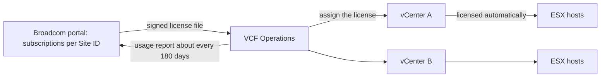
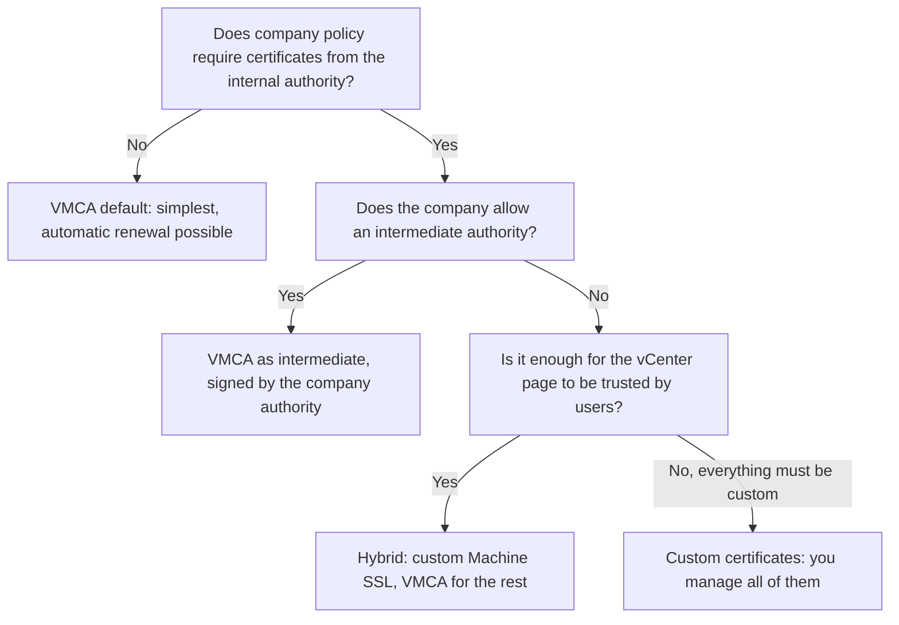

:::analogy
**The data center pain.** Monday morning, the vSphere Client shows "503 Service Unavailable": the vCenter certificates expired over the weekend. Another company finds out its evaluation period has ended: the hosts disconnected from vCenter, and new VMs (VM, Virtual Machine) no longer power on. Both situations are on the objectives list: the VVF (VMware vSphere Foundation, 2V0-16.25) exam guide covers licensing in objective 4.2.2 and certificates in 4.2.3, and the older VCP-DCV (VMware Certified Professional - Data Center Virtualization) had certificates in objective 4.13. [S02] [S47]

**The analogy: a gym membership and access badges.**

- **The license** is the membership: you pay by size (the number of cores), and one membership covers every gym room (host) connected to the front desk (vCenter).
- **The evaluation period** is the trial week: after it, the doors no longer open for new visitors, but whoever is already inside is not thrown out.
- **Certificates** are the badges with a photo and an expiry date. If the front desk's badge expires, nobody gets through the door, even if the membership is paid.
:::

:::architecture
### 1. The 9.0 licensing model

From 9.0, VCF (VMware Cloud Foundation) and VVF use **the same model**: [S155]

- **Primary licenses are per physical core.** Only ESX hosts consume capacity.
- **At least 16 cores per physical CPU (Central Processing Unit).** A CPU with fewer cores still consumes 16. (VCF Edge has a minimum of 8.) [S155] [S157]
- **The license is assigned to vCenter**, through VCF Operations; the hosts managed by that vCenter are licensed automatically. [S155] [S156]
- **One license file**, digitally signed, replaces the separate per-product, per-version keys. You no longer need another key when upgrading from 8.x to 9.0. [S156]
- The 25-character vSphere 8 keys **cannot be converted** into 9.x licenses: 9 licensing comes from the subscription, through the VCF Business Services Console. [S164]
- **Subscriptions pool together**: two subscriptions for the same product, the same unit of measure and the same Site ID become one license, for example 200 + 300 cores = 500. [S155]



**Usage reporting.** About once every 180 days, VCF Operations sends Broadcom a license usage report (no personal data). In **connected** mode it is a single click; in **disconnected** mode (no internet) you upload the usage file to the portal and import the license file you receive. [S156]

**Counting cores**, with the examples from KB (Knowledge Base article) 313548: [S157]

| Hosts | CPUs × cores | Licensed cores | vSAN included in VVF |
|---|---|---|---|
| A: 2 × 8, B: 2 × 24 | | 16 + 16 + 24 + 24 = 80 | 20 TiB |
| 3 hosts | 1 × 8 | 3 × 16 = 48 | 12 TiB |
| 3 hosts | 2 × 16 | 96 | 24 TiB |

**vSAN in the license.** VVF includes 0.25 TiB (tebibyte) of vSAN for each licensed core, rounded up; VCF includes 1 TiB per core. Raw capacity above that requires a vSAN add-on in TiB. [S157] vSAN capacity from VVF, VCF and add-ons pools into one license. [S155]

### 2. Evaluation and expiry

- **Evaluation period: up to 90 days** from installation (previously 60), for ESX hosts, vCenter and VCF Operations, including after an upgrade from version 8. [S155] [S156]
- An ESX host added to a vCenter with no free capacity keeps its own evaluation clock, which started when it was installed. [S155]

**What happens on expiry:** [S155]

| What expires | Effect |
|---|---|
| vCenter evaluation | **All** of its hosts disconnect |
| Only a host's evaluation (vCenter is licensed) | Only that host disconnects |
| Any component | Management operations are blocked; you cannot create or power on workloads |
| Running workloads | Are **not** stopped automatically |
| vCenter or VCF Operations powered off after expiry | Only power on again on a licensed host |

Recovery: assign a valid license to vCenter from VCF Operations, or add the host to a licensed vCenter with free capacity. [S155]

### 3. Certificates in vCenter

vCenter has its own certificate authority, VMCA (VMware Certificate Authority), and certificates are stored in VECS (VMware Endpoint Certificate Store). [S136] [S158] Two certificate types always show up in the exam: [S158]

- **Machine SSL certificate:** secures vCenter's SSL (Secure Sockets Layer) traffic, meaning the vSphere Client page and the APIs (API, Application Programming Interface).
- **Solution user certificates:** used only to authenticate internal services to SSO (Single Sign-On).

**Four ways of working:** [S158]

| Mode | What it means |
|---|---|
| VMCA default | VMCA issues and signs everything. The VMCA root expires after 10 years by default, and with it every certificate it signed |
| VMCA as intermediate CA | You replace the VMCA root with one signed by the company's certificate authority; VMCA keeps signing, as a subordinate |
| Custom certificates | You put your own certificates directly into VECS; you issue and track all of them |
| Hybrid | Machine SSL is custom; VMCA stays for solution users and hosts. A fit when company policy does not allow intermediate authorities |



### 4. ESXi host certificates

The mode is chosen in vCenter, under **Configure → Settings → Advanced Settings**, through the `vpxd.certmgmt.mode` setting: [S159]

- **vmca:** recommended by VMware unless company policy requires otherwise; hosts automatically get certificates from VMCA.
- **custom:** for a different root authority; renewal becomes your responsibility.
- **thumbprint:** only as a temporary fallback.

You see a host's certificate under **host → Configure → System → Certificate**. From vCenter 8.0 Update 3, the **Manage with VMCA → Renew** button renews it. Prerequisites: a valid VMCA root, a connected host, and correct time and DNS (Domain Name System) between vCenter and the host. [S163]

### 5. Alarms, automatic renewal and expired certificates

- **The expiry alarm** typically fires 30 days ahead. [S163] Thresholds are changed in vCenter's advanced settings: `vpxd.cert.threshold` (warning), `vpxd.certmgmt.certs.hardThreshold` (critical alarm), while `vpxd.certmgmt.certs.daysValid` sets how long new certificates are valid. [S161]
- **Automatic renewal** (vCenter 8.0 U3h and VVF 9.0.2): ESXi certificates renew 10 days before expiry, Machine SSL 5 days before, without restarting services. It only works in `vmca` mode. In VCF 9.0.2, Fleet Management in VCF Operations renews 60 days ahead. [S160]
- **When vCenter certificates have expired**: login is blocked, "503 Service Unavailable" or "no healthy upstream" errors appear, and some services no longer start after a reboot. [S162]

Checking from the command line, on vCenter, as root (the command from KB 344201): [S162]

```bash
for store in $(/usr/lib/vmware-vmafd/bin/vecs-cli store list | grep -v TRUSTED_ROOT_CRLS); do echo "[*] Store :" $store; /usr/lib/vmware-vmafd/bin/vecs-cli entry list --store $store --text | grep -ie "Alias" -ie "Not After";done;
```

For replacement, KB 344201 recommends the **vCert** script or the `certificate-manager` utility, always after a snapshot or backup of vCenter. [S162]

[IMAGE SEARCH / PROMPT] "vSphere Client Certificate Management Machine SSL Trusted Root VMCA", to see the vCenter certificates screen.
:::

:::exam-alert
### Memorize

| What | Value / rule | Source |
|---|---|---|
| Primary license unit | Physical core; only ESX hosts consume | VCF 9 docs [S155] |
| Minimum per CPU | 16 cores (VCF Edge: 8) | Docs [S155], KB 313548 [S157] |
| Where the license is assigned | vCenter, through VCF Operations; hosts are licensed automatically | Docs [S155] |
| vSphere 8 keys | Do not convert to 9.x licenses | KB 437250 [S164] |
| Usage report | About every 180 days; connected or disconnected | VMware blog [S156] |
| Evaluation | Up to 90 days (previously 60) | Docs [S155], blog [S156] |
| vCenter evaluation expires | All its hosts disconnect; running VMs are not stopped | Docs [S155] |
| Included vSAN | VVF 0.25 TiB per core; VCF 1 TiB per core | KB 313548 [S157] |
| VMCA root | Valid 10 years by default | Docs [S158] |
| ESXi modes | vmca (recommended), custom, thumbprint (temporary) | Docs [S159] |
| Expiry alarm | Typically 30 days ahead | KB 374032 [S163] |
| Auto-renew ESXi / Machine SSL | 10 / 5 days ahead; vmca mode only | KB 427937 [S160] |

### 3 exam traps

1. **"A host with two 8-core CPUs consumes 16 license cores."** False. Each CPU consumes at least 16 cores, so the host consumes 32. [S157]
2. **"When the evaluation expires, ESXi stops all VMs."** False. Running workloads are not stopped; you can no longer create or power on others, and management is blocked. [S155]
3. **"Thumbprint mode is the recommended choice for hosts because it needs no certificates."** False. Thumbprint is only a temporary fallback; vmca mode is the recommended one. [S159]
:::

:::trenches
**Mistake 1: vCenter certificates left to expire.**
Certificate alarms appeared a month ahead but were ignored. After expiry, the vSphere Client answers "no healthy upstream", and after a reboot the vCenter services do not start. KB 344201 describes exactly these symptoms. [S162]
**Fix:** snapshot or back up vCenter, check the "Not After" dates with the `vecs-cli` command from the KB and replace the expired certificates with vCert or `certificate-manager`, then restart the services with `service-control`. Going forward, enable automatic renewal (vmca mode) and treat the 30-day alarm as a ticket. [S162] [S160] [S163]

**Mistake 2: the "test" lab that became production, on evaluation.**
An environment installed for testing started hosting real applications. At 90 days the vCenter evaluation expires: all hosts disconnect, and a VM powered off for maintenance cannot be powered on again. [S155]
**Fix:** assign a valid license to vCenter from VCF Operations, check in the VCF Business Services Console that the license is active and error-free, and schedule usage reporting. Going forward, track the evaluation expiry date from day one. [S155] [S164]
:::

:::interview
**Junior/Mid question: "How many license cores does a 4-host cluster consume, each host with 2 CPUs of 12 cores?"**

*Ideal answer:* each CPU has fewer than 16 cores, so it consumes the 16 minimum. One host consumes 2 × 16 = 32, and the cluster 4 × 32 = **128** cores. [S157] With VVF it includes 128 × 0.25 = 32 TiB of vSAN; with VCF, 128 TiB. [S157] A strong candidate adds that the license is assigned to vCenter from VCF Operations, not to each host. [S155]

**Troubleshooting scenario: "A host shows the ESXi Host Certificate Status alarm. What do you do?"**

*The answer a Team Lead expects:*
1. **Check the certificate:** host → Configure → System → Certificate, the expiry date and the issuer. [S163]
2. **Check the prerequisites:** valid VMCA root in Certificate Management, host connected, correct time and DNS, vCenter's Machine SSL certificate valid. [S163]
3. **The mode:** is `vpxd.certmgmt.mode` set to `vmca` or `custom`? With `custom`, the certificate is issued by the company authority, not VMCA. [S159]
4. **Renew:** in vCenter 8.0 U3+, Manage with VMCA → Renew. [S163]
5. **Prevent:** automatic renewal in vmca mode renews ESXi certificates 10 days before expiry. [S160]
:::

:::lab
**Scenario.** You calculate the licenses needed for your lab hosts, check the license status and read all the important certificates: Machine SSL, the VMCA root and a host certificate. At the end you renew a host certificate with VMCA.

**What you need.** The lab vCenter and SSH temporarily enabled on the appliance for step 5.

The steps below can be ticked off, and progress is saved in the browser. Exact menu names may differ slightly between versions 8 and 9 (`⚠ to verify`).

**Validation test.** At step 6, after Renew, the host certificate's "Valid from" date must be today, and the host must stay connected to vCenter. If the host disconnects, check time and DNS between the host and vCenter.
:::

:::quiz
Five original questions, in the style of VCP (VMware Certified Professional) exams. You get the explanation for every option right after answering.
:::

:::references
- VCP-VVF Administrator 2V0-16.25 exam guide, objectives 4.2.2 and 4.2.3 [S02]
- VCP-DCV 2V0-21.23 exam guide (Legacy certification), objective 4.13 [S47]
- VCF 9.0 documentation: the licensing model [S155]
- VMware blog on licensing in VCF 9.0 [S156]
- KB 313548 and KB 437250: counting cores and moving from vSphere 8 licenses [S157] [S164]
- vSphere documentation: certificate options [S158] and ESXi modes [S159]
- KB 427937, KB 415719, KB 374032, KB 344201: automatic renewal, thresholds, the ESXi alarm, expired certificates [S160] [S161] [S163] [S162]
:::
