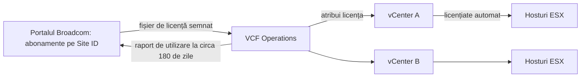
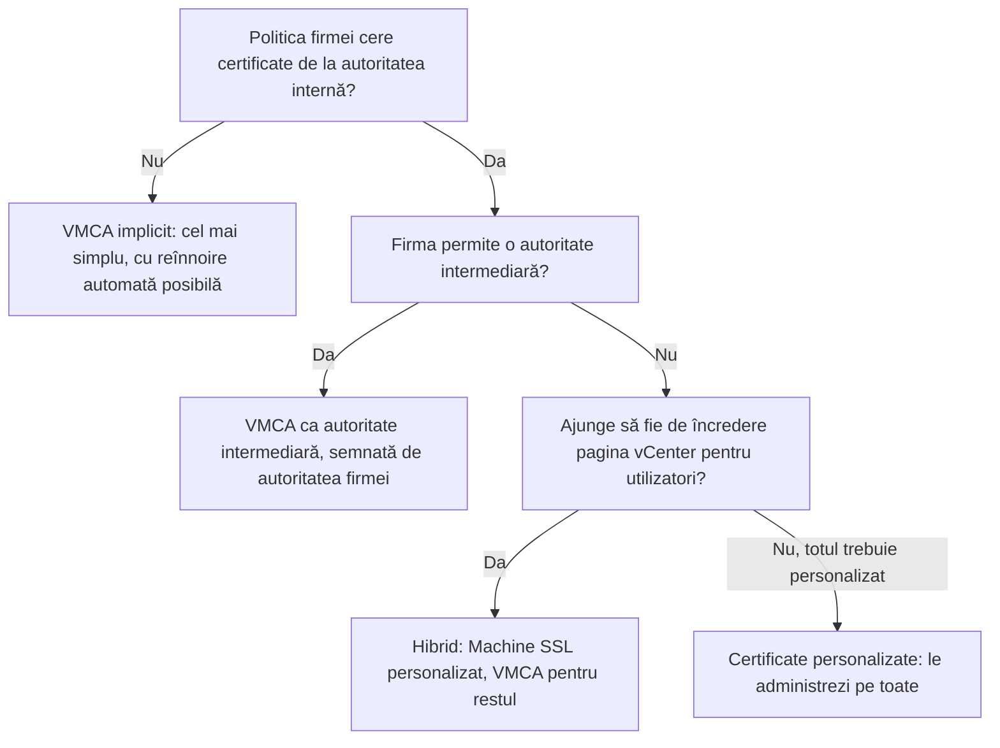

:::analogy
**Durerea din data center.** Luni dimineață, vSphere Client afișează „503 Service Unavailable”: certificatele vCenter au expirat peste weekend. Altă firmă descoperă că perioada de evaluare a expirat: hosturile s-au deconectat de la vCenter, iar VM-urile (VM, Virtual Machine, mașină virtuală) noi nu mai pornesc. Ambele situații sunt pe lista de obiective: exam guide-ul VVF (VMware vSphere Foundation, 2V0-16.25) are licențierea la obiectivul 4.2.2 și certificatele la 4.2.3, iar vechiul VCP-DCV (VMware Certified Professional - Data Center Virtualization) avea certificatele la obiectivul 4.13. [S02] [S47]

**Analogia: abonamentul la sală și legitimațiile de acces.**

- **Licența** e abonamentul: plătești după mărime (numărul de nuclee), iar un singur abonament acoperă toate sălile (hosturile) legate de recepție (vCenter).
- **Perioada de evaluare** e săptămâna de probă: după ea, ușile nu se mai deschid pentru clienți noi, dar cine e deja înăuntru nu e dat afară.
- **Certificatele** sunt legitimațiile cu poză și dată de expirare. Dacă expiră legitimația recepției, nimeni nu mai trece de ușă, chiar dacă abonamentul e plătit.
:::

:::architecture
### 1. Modelul de licențiere 9.0

Din 9.0, VCF (VMware Cloud Foundation) și VVF folosesc **același model**: [S155]

- **Licențele principale se dau pe nuclee fizice.** Doar hosturile ESX consumă capacitate.
- **Minimum 16 nuclee pe fiecare procesor fizic.** Un procesor cu mai puține nuclee consumă tot 16. (VCF Edge are minimul de 8.) [S155] [S157]
- **Licența se atribuie vCenter-ului**, prin VCF Operations; hosturile administrate de acel vCenter sunt licențiate automat. [S155] [S156]
- **Un singur fișier de licență**, semnat digital, înlocuiește cheile separate pe produs și pe versiune. Nu mai ai nevoie de altă cheie la upgrade de la 8.x la 9.0. [S156]
- Cheile vSphere 8 de 25 de caractere **nu se pot transforma** în licențe 9.x: licențierea 9 vine din abonament, prin VCF Business Services Console. [S164]
- **Abonamentele se adună** (pooling): două abonamente de același produs, aceeași unitate de măsură și același Site ID devin o singură licență, de exemplu 200 + 300 de nuclee = 500. [S155]



**Raportarea utilizării.** Aproximativ o dată la 180 de zile, VCF Operations trimite la Broadcom un raport de utilizare a licențelor (fără date personale). În modul **connected** e un singur click; în modul **disconnected** (fără internet) urci fișierul de utilizare în portal și imporți fișierul de licență primit. [S156]

**Calculul nucleelor**, cu exemplele din articolul KB (Knowledge Base article) 313548: [S157]

| Hosturi | Procesoare × nuclee | Nuclee licențiate | vSAN inclus în VVF |
|---|---|---|---|
| A: 2 × 8, B: 2 × 24 | | 16 + 16 + 24 + 24 = 80 | 20 TiB |
| 3 hosturi | 1 × 8 | 3 × 16 = 48 | 12 TiB |
| 3 hosturi | 2 × 16 | 96 | 24 TiB |

**vSAN în licență.** VVF include 0,25 TiB (tebibyte) de vSAN pentru fiecare nucleu licențiat, rotunjit în sus; VCF include 1 TiB pe nucleu. Capacitatea brută peste această valoare cere un add-on vSAN în TiB. [S157] Capacitatea vSAN din VVF, VCF și add-on se adună într-o singură licență. [S155]

### 2. Evaluarea și expirarea

- **Perioada de evaluare: până la 90 de zile** de la instalare (înainte era 60), pentru hosturile ESX, vCenter și VCF Operations, inclusiv după un upgrade de la versiunea 8. [S155] [S156]
- Un host ESX adăugat într-un vCenter fără capacitate liberă își păstrează ceasul de evaluare, care pornește de la instalarea lui. [S155]

**Ce se întâmplă la expirare:** [S155]

| Ce expiră | Efect |
|---|---|
| Evaluarea vCenter | **Toate** hosturile lui se deconectează |
| Doar evaluarea unui host (vCenter e licențiat) | Doar acel host se deconectează |
| Orice componentă | Operațiile de administrare sunt blocate; nu poți crea sau porni workload-uri |
| Workload-urile care rulează | **Nu** sunt oprite automat |
| vCenter sau VCF Operations oprite după expirare | Nu mai pornesc decât pe un host licențiat |

Recuperarea: atribui o licență validă vCenter-ului din VCF Operations sau adaugi hostul într-un vCenter licențiat cu capacitate liberă. [S155]

### 3. Certificatele în vCenter

vCenter are propria autoritate de certificare, VMCA (VMware Certificate Authority), iar certificatele se păstrează în VECS (VMware Endpoint Certificate Store). [S136] [S158] Două tipuri de certificate apar mereu la examen: [S158]

- **Machine SSL certificate:** securizează traficul SSL (Secure Sockets Layer) al vCenter, adică pagina vSphere Client și API-urile (API, Application Programming Interface).
- **Solution user certificates:** servesc doar la autentificarea serviciilor interne în SSO (Single Sign-On).

**Patru moduri de lucru:** [S158]

| Mod | Ce înseamnă |
|---|---|
| VMCA implicit | VMCA emite și semnează tot. Rădăcina VMCA expiră implicit după 10 ani, și odată cu ea toate certificatele semnate de ea |
| VMCA ca autoritate intermediară | Înlocuiești rădăcina VMCA cu una semnată de autoritatea de certificare a firmei; VMCA semnează mai departe, ca subordonată |
| Certificate personalizate | Pui certificatele tale direct în VECS; tu le emiți și le urmărești pe toate |
| Hibrid | Machine SSL e personalizat; VMCA rămâne pentru solution users și hosturi. Potrivit când politica firmei nu permite autorități intermediare |



### 4. Certificatele hosturilor ESXi

Modul se alege în vCenter, la **Configure → Settings → Advanced Settings**, prin setarea `vpxd.certmgmt.mode`: [S159]

- **vmca:** recomandat de VMware, dacă politica firmei nu cere altceva; hosturile primesc automat certificate de la VMCA.
- **custom:** pentru altă autoritate rădăcină; reînnoirea devine responsabilitatea ta.
- **thumbprint:** doar ca soluție temporară, de rezervă.

Certificatul unui host îl vezi la **host → Configure → System → Certificate**. Din vCenter 8.0 Update 3, butonul **Manage with VMCA → Renew** îl reînnoiește. Condiții: rădăcina VMCA validă, host conectat, timp și DNS (Domain Name System) corecte între vCenter și host. [S163]

### 5. Alarme, reînnoire automată și certificate expirate

- **Alarma de expirare** pornește de obicei cu 30 de zile înainte. [S163] Pragurile se schimbă din setările avansate ale vCenter: `vpxd.cert.threshold` (avertisment), `vpxd.certmgmt.certs.hardThreshold` (alarmă critică), iar `vpxd.certmgmt.certs.daysValid` stabilește cât sunt valabile certificatele noi. [S161]
- **Reînnoirea automată** (vCenter 8.0 U3h și VVF 9.0.2): certificatele ESXi se reînnoiesc cu 10 zile înainte de expirare, Machine SSL cu 5 zile înainte, fără repornirea serviciilor. Funcționează doar în modul `vmca`. În VCF 9.0.2, Fleet Management din VCF Operations reînnoiește cu 60 de zile înainte. [S160]
- **Când certificatele vCenter au expirat**: login-ul se blochează, apar erorile „503 Service Unavailable” sau „no healthy upstream”, iar unele servicii nu mai pornesc după repornire. [S162]

Verificarea din linia de comandă, pe vCenter, ca root (comanda din KB 344201): [S162]

```bash
for store in $(/usr/lib/vmware-vmafd/bin/vecs-cli store list | grep -v TRUSTED_ROOT_CRLS); do echo "[*] Store :" $store; /usr/lib/vmware-vmafd/bin/vecs-cli entry list --store $store --text | grep -ie "Alias" -ie "Not After";done;
```

Pentru înlocuire, KB 344201 recomandă scriptul **vCert** sau utilitarul `certificate-manager`, întotdeauna după un snapshot sau backup al vCenter. [S162]

[IMAGE SEARCH / PROMPT] „vSphere Client Certificate Management Machine SSL Trusted Root VMCA”, ca să vezi ecranul cu certificatele vCenter.
:::

:::exam-alert
### De memorat

| Ce | Valoare / regulă | Sursă |
|---|---|---|
| Unitatea licenței principale | Nucleu fizic; doar hosturile ESX consumă | Docs VCF 9 [S155] |
| Minimum pe procesor | 16 nuclee (VCF Edge: 8) | Docs [S155], KB 313548 [S157] |
| Unde se atribuie licența | vCenter, prin VCF Operations; hosturile se licențiază automat | Docs [S155] |
| Chei vSphere 8 | Nu se transformă în licențe 9.x | KB 437250 [S164] |
| Raport de utilizare | Circa la 180 de zile; connected sau disconnected | Blog VMware [S156] |
| Evaluare | Până la 90 de zile (înainte 60) | Docs [S155], blog [S156] |
| Expiră evaluarea vCenter | Toate hosturile lui se deconectează; VM-urile pornite nu se opresc | Docs [S155] |
| vSAN inclus | VVF 0,25 TiB pe nucleu; VCF 1 TiB pe nucleu | KB 313548 [S157] |
| Rădăcina VMCA | Valabilă implicit 10 ani | Docs [S158] |
| Moduri ESXi | vmca (recomandat), custom, thumbprint (temporar) | Docs [S159] |
| Alarma de expirare | De obicei cu 30 de zile înainte | KB 374032 [S163] |
| Reînnoire automată ESXi / Machine SSL | Cu 10 / 5 zile înainte; doar în modul vmca | KB 427937 [S160] |

### 3 capcane de examen

1. **„Un host cu două procesoare de 8 nuclee consumă 16 nuclee de licență.”** Fals. Fiecare procesor consumă minimum 16 nuclee, deci hostul consumă 32. [S157]
2. **„Când expiră evaluarea, ESXi oprește toate VM-urile.”** Fals. Workload-urile care rulează nu sunt oprite; nu mai poți crea sau porni altele, iar administrarea e blocată. [S155]
3. **„Modul thumbprint e alegerea recomandată pentru hosturi, pentru că nu cere certificate.”** Fals. Thumbprint e doar o soluție de rezervă, temporară; recomandat e modul vmca. [S159]
:::

:::trenches
**Greșeala 1: certificatele vCenter lăsate să expire.**
Alarmele de certificat au apărut cu o lună înainte, dar au fost ignorate. După expirare, vSphere Client răspunde cu „no healthy upstream”, iar după o repornire serviciile vCenter nu mai pornesc. KB 344201 descrie exact aceste simptome. [S162]
**Remediere:** faci snapshot sau backup la vCenter, verifici datele „Not After” cu comanda `vecs-cli` din KB și înlocuiești certificatele expirate cu vCert sau `certificate-manager`, apoi repornești serviciile cu `service-control`. Pe viitor activezi reînnoirea automată (modul vmca) și tratezi alarma de la 30 de zile ca pe un tichet. [S162] [S160] [S163]

**Greșeala 2: laboratorul „de test” devenit producție, pe evaluare.**
Un mediu instalat pentru test a început să găzduiască aplicații reale. La 90 de zile, evaluarea vCenter expiră: toate hosturile se deconectează, iar un VM oprit pentru mentenanță nu mai poate fi pornit. [S155]
**Remediere:** atribui o licență validă vCenter-ului din VCF Operations, verifici în VCF Business Services Console că licența e activă și fără erori și programezi raportarea de utilizare. Pe viitor urmărești data de expirare a evaluării din prima zi. [S155] [S164]
:::

:::interview
**Întrebare Junior/Mid: „Câte nuclee de licență consumă un cluster de 4 hosturi, fiecare cu 2 procesoare de 12 nuclee?”**

*Răspunsul ideal:* fiecare procesor are sub 16 nuclee, deci consumă minimul de 16. Un host consumă 2 × 16 = 32, iar clusterul 4 × 32 = **128** de nuclee. [S157] Dacă e VVF, include 128 × 0,25 = 32 TiB de vSAN; dacă e VCF, 128 TiB. [S157] Un candidat bun adaugă că licența se atribuie vCenter-ului din VCF Operations, nu fiecărui host. [S155]

**Scenariu de troubleshooting: „Un host apare cu alarma ESXi Host Certificate Status. Ce faci?”**

*Răspunsul pe care îl așteaptă un Team Lead:*
1. **Verific certificatul:** host → Configure → System → Certificate, data de expirare și emitentul. [S163]
2. **Verific condițiile:** rădăcina VMCA validă în Certificate Management, hostul conectat, timp și DNS corecte, certificatul Machine SSL al vCenter valid. [S163]
3. **Modul:** `vpxd.certmgmt.mode` e `vmca` sau `custom`? Cu `custom`, certificatul îl emite autoritatea firmei, nu VMCA. [S159]
4. **Reînnoiesc:** în vCenter 8.0 U3+, Manage with VMCA → Renew. [S163]
5. **Prevenire:** reînnoirea automată în modul vmca reînnoiește certificatele ESXi cu 10 zile înainte de expirare. [S160]
:::

:::lab
**Scenariu.** Calculezi licențele necesare pentru hosturile din lab, verifici starea licențelor și citești toate certificatele importante: Machine SSL, rădăcina VMCA și certificatul unui host. La final reînnoiești certificatul unui host cu VMCA.

**Ce ai nevoie.** vCenter-ul din lab și SSH activ temporar pe appliance pentru pasul 5.

Pașii de mai jos sunt bifabili, iar progresul se salvează în browser. Numele exacte ale meniurilor pot diferi puțin între versiunile 8 și 9 (`⚠ de verificat`).

**Test de validare.** La pasul 6, după Renew, data „Valid from” a certificatului hostului trebuie să fie cea de azi, iar hostul trebuie să rămână conectat la vCenter. Dacă hostul se deconectează, verifici timpul și DNS-ul dintre host și vCenter.
:::

:::quiz
Cinci întrebări originale, în stilul examenelor VCP (VMware Certified Professional). Primești explicația pentru fiecare variantă imediat după ce răspunzi.
:::

:::references
- Exam guide VCP-VVF Administrator 2V0-16.25, obiectivele 4.2.2 și 4.2.3 [S02]
- Exam guide VCP-DCV 2V0-21.23 (certificare Legacy), obiectivul 4.13 [S47]
- Documentația VCF 9.0: modelul de licențiere [S155]
- Blogul VMware despre licențierea în VCF 9.0 [S156]
- KB 313548 și KB 437250: numărarea nucleelor și trecerea de la licențele vSphere 8 [S157] [S164]
- Documentația vSphere: opțiunile de certificate [S158] și modurile ESXi [S159]
- KB 427937, KB 415719, KB 374032, KB 344201: reînnoire automată, praguri, alarma ESXi, certificate expirate [S160] [S161] [S163] [S162]
:::
