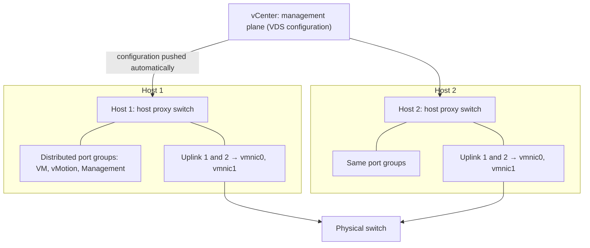
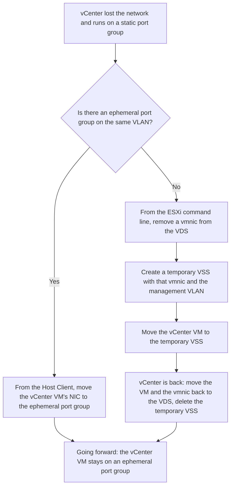

:::analogy
**The data center pain.** You have 20 hosts, each with a VSS (vSphere Standard Switch). The network team asks for a new VLAN (Virtual Local Area Network), and someone creates it by hand on every host. Host 17 gets a typo, and the VMs (VM, Virtual Machine) that DRS (Distributed Resource Scheduler) moves there lose the network. With a VDS (vSphere Distributed Switch), the port group is created once, in vCenter, and lands identically on every host. The VVF (VMware vSphere Foundation, 2V0-16.25) exam guide covers VDS in objective 2.4.1, and the older VCP-DCV (VMware Certified Professional - Data Center Virtualization) had switches in objectives 1.5.2–1.5.4, 4.2 and 5.4. [S02] [S47]

**The analogy: a franchise store chain.**

- **Headquarters (vCenter)** writes the rulebook once: prices, opening hours, uniforms.
- **Each store (host)** keeps a copy of the rulebook and serves customers on its own. That is the **host proxy switch**.
- **If headquarters closes for a day**, the stores keep working with the rules they have; you just cannot change the rules or open a new department until headquarters is back.
:::

:::architecture
### 1. Two planes: management and data

Every switch has a **data plane** (switches, filters and tags packets) and a **management plane** (configures it). A VSS has both on every host, so you configure each host separately. A VDS splits them: [S165]

- **The management plane lives in vCenter.** What you configure there is pushed automatically to every host.
- **The data plane stays on each host**, as the **host proxy switch**. VM traffic does not go through vCenter.
- **Uplink port group:** VDS uplinks are templates; on each host you map them to physical NICs (vmnic). Failover and load balancing policies set on uplinks land identically on every host.
- **Distributed port groups:** connect VMs and VMkernel adapters. The network label must be unique in the data center. You set teaming, VLAN, security and traffic shaping on them. [S165]

**If vCenter goes down:** network traffic is not affected, whatever the port binding type. [S170] Only management stops (see section 3).

### 2. VSS vs VDS

| | VSS | VDS |
|---|---|---|
| Where it is configured | On each host [S114] | Once, in vCenter [S165] |
| Route Based on Physical NIC Load (NIC, Network Interface Card; LBT, Load-Based Teaming) | No | Yes, VDS only [S173] |
| Dynamic LACP (Link Aggregation Control Protocol) | No | Yes, through LAGs (LAG, Link Aggregation Group) [S175] |
| NIOC (Network I/O Control) v3 | No | Yes, from version 6.5.0 [S176] |
| PVLAN (Private VLAN), port mirroring, NetFlow, health check, export/restore | Not in the VSS chapter | Described in the VDS chapter [S178] [S179] [S180] [S181] [S183] |

### 3. Versions, upgrade and port binding

**The VDS version** is chosen at creation (right-click the data center → Distributed Switch → New Distributed Switch). In vSphere 8 the options are 8.0.3, 8.0.0, 7.0.3, 7.0.2, 7.0.0 and 6.6.0; each needs hosts at that version or later and lacks the features of later versions. [S166] Examples of new features per version: 6.6.0 MAC (Media Access Control) Learning, 7.0.2 LACP fast mode, 7.0.3 NVMe over TCP (NVMe, Non-Volatile Memory Express; TCP, Transmission Control Protocol), 8.0.3 Dual DPU (DPU, Data Processing Unit), 9.0.0 (with ESX 9.0) Industrial vSwitch. [S167]

At creation you also choose: **Network Offloads Compatibility** (None, Pensando, NVIDIA BlueField; needs version 8.0.0+ and **disables NIOC**), the number of uplinks and whether NIOC is enabled. [S166]

**VDS upgrade:** [S168] [S169]

- First vCenter and **all hosts** connected at the target version.
- From 6.5, the upgrade may bring a brief outage; from 6.6 or later, possibly none. KB (Knowledge Base article) 413452 recommends doing 6.5 → 6.6 separately, before the bigger jump.
- The documentation describes no downgrade; it recommends **exporting the configuration** first, so you can rebuild it if the upgrade fails.
- KB 413452 also asks for: VDS alerts resolved, DRS set to Manual during the upgrade, and network validation afterwards.

**Port binding** decides how a VM gets a port on the VDS: [S170]

| | Static (default) | Ephemeral |
|---|---|---|
| When the port is allocated | On connection; stays reserved until you remove the VM from the port group | The host creates the port when the VM powers on and deletes it at power-off |
| Who can connect a VM | Only vCenter | The host too, directly, without vCenter |
| vCenter down | Running VMs keep the network, but you cannot power on or reconfigure VMs on this port group | You can connect VMs from the Host Client |
| Recommended for | General use | Recovery: the vCenter VM, the management network |
| Drawbacks | Depends on vCenter | Slower operations; port permissions and history are lost across power cycles |

The binding type of a static port group cannot be changed; you create a new port group. [S170] KB 426300 recommends an ephemeral port group for the vCenter VM, to avoid the circular dependency (vCenter runs on the switch it manages). [S171]

The steps for the no-ephemeral case come from KB 318719. If you have LACP on the physical switch, coordinate with the network team first. [S172]

### 4. Teaming on a VDS: LBT and LACP

**Route Based on Physical NIC Load (LBT)** exists only on a VDS. [S173] It starts from "originating virtual port" but checks real load: every 30 seconds, if an uplink exceeds 75%, the VM port with the most traffic moves to another uplink. [S173] [S174] It needs no change on the physical switch. [S173]

**LACP on a VDS** uses a **LAG**, a group of physical NICs aggregated dynamically: [S175]

- Up to 64 LAGs on a VDS and 32 on a host.
- A LAG has at least 2 ports; the NICs share the same speed and duplex.
- Each host has its own LACP port channel on the physical switch.
- The LAG's hashing algorithm must match the physical port channel's.

### 5. NIOC v3: sharing bandwidth

NIOC v3 requires VDS 6.5.0 or later, with NIOC enabled. [S176] **System traffic** types include Management, Fault Tolerance, NFS (Network File System), vSAN, vMotion, vSphere Replication, vSphere Data Protection Backup, Virtual machine and NVMe over TCP. [S176] For each you set, per physical adapter: [S176]

| Parameter | What it does |
|---|---|
| Shares (1–100) | Relative priority when the adapter is congested |
| Reservation (Mbps) | Guaranteed minimum. **Total reservations cannot exceed 75% of the capacity of the slowest physical adapter** (7.5 Gbps on 10 GbE adapters) |
| Limit (Mbps or Gbps) | The maximum that traffic type can use |

**Per-VM traffic:** you set shares, reservation and limit on the VM's network adapter. VM reservations come out of the reservation made for "Virtual machine" system traffic. **Network resource pools** split that reservation among port groups. At power-on the VDS checks that the VM's reservation fits; DRS and HA (High Availability) place the VM on a host that can guarantee it. [S177]

### 6. Security and monitoring

- **PVLAN:** a primary VLAN has secondary VLANs. **Promiscuous** talks to all; **isolated** talks only to promiscuous; **community** talks to promiscuous and to ports in the same community. The physical switch must support PVLAN and have the same VLAN IDs. [S178]
- **Port mirroring** (VDS 5.0.0+), four session types: [S179]
  - *Distributed Port Mirroring*: between ports on the **same host**.
  - *Remote Mirroring Source*: to the host's uplinks.
  - *Remote Mirroring Destination*: from a set of VLANs to distributed ports.
  - *Encapsulated Remote Mirroring (L3) Source*: through an IP (Internet Protocol) tunnel to a remote agent.
  - A port cannot be a source and a destination at the same time.
- **NetFlow:** from vSphere 8.0 and VCF (VMware Cloud Foundation) 9.0, the VDS supports IPFIX (IP Flow Information Export), that is NetFlow version 10. Collection starts once you set the collector IP and port. [S180]
- **Health check:** compares the VDS VLANs, MTU (Maximum Transmission Unit) and teaming with the physical switch ports. By default it checks every 1 minute. VLAN/MTU needs at least 2 active NICs; teaming needs 2 NICs and 2 hosts. Results are under VDS → Monitor → Health. [S181] With IP hash and EtherChannel it can falsely report "Not Supported"; KB 315270 recommends checking manually and disabling health check afterwards. [S182]

### 7. Backup and migration from VSS

**The VDS configuration is saved separately from vCenter:** right-click the VDS → Export Configuration (switch only, or with port groups). **Import** creates a new VDS; **Restore** overwrites an existing VDS's settings. When importing into another vCenter, do **not** select "Preserve original distributed switch and port group identifiers". Importing from a newer vCenter into an older one is not supported. [S183]

**VSS → VDS migration without an outage** (KB 427273): [S184]

1. Create the VDS and identical port groups (same VLANs).
2. Add the host and move **only one** physical NIC to the VDS; the other stays on the VSS.
3. Move vmk0 (management), then the VMs.
4. Move the last NIC, test vMotion and management, then delete the empty VSS.

If a change disconnects you, **network rollback** reverts to the good configuration. [S117] [S184]

[IMAGE SEARCH / PROMPT] "vSphere Distributed Switch topology diagram uplinks distributed port groups", to see what the topology looks like in the vSphere Client.
:::

:::exam-alert
### Memorize

| What | Value / rule | Source |
|---|---|---|
| Where the management plane lives | vCenter; data plane = host proxy switch on each host | Docs [S165] |
| vCenter down | Traffic flows; on static port groups you cannot power on or reconfigure VMs | KB 324492 [S170] |
| Default port binding | Static; ephemeral for recovery (the vCenter VM) | KB 324492 [S170], KB 426300 [S171] |
| VDS upgrade | First vCenter and all hosts; export before | Docs [S168] |
| Network offload (DPU) | VDS 8.0.0+; disables NIOC | Docs [S166] |
| LBT | VDS only; every 30 s; 75% threshold | Docs [S173] |
| LAG | Max 64 per VDS, 32 per host; at least 2 ports | Docs [S175] |
| NIOC v3 | VDS 6.5.0+; shares 1–100; reservations max 75% of the slowest adapter | Docs [S176] |
| Port mirroring | VDS 5.0.0+; Distributed Port Mirroring same host only | Docs [S179] |
| NetFlow | IPFIX = NetFlow v10 | KB 433680 [S180] |
| Health check | Every 1 minute by default; at least 2 active NICs | Docs [S181] |

### 3 exam traps

1. **"If vCenter goes down, VMs on the VDS lose the network."** False. The data plane is on the hosts and traffic is unaffected; you just cannot power on or reconfigure VMs on static port groups. [S165] [S170]
2. **"With NIOC you can reserve 100% of the adapter for system traffic."** False. Total reservations are capped at 75% of the slowest physical adapter's capacity. [S176]
3. **"Distributed Port Mirroring copies traffic from a VM on host A to an analyzer on host B."** False. It only works between ports on the same host; for another host you use Remote Mirroring or Encapsulated Remote Mirroring (L3). [S179]
:::

:::trenches
**Mistake 1: vCenter on a static port group, then a wrong network change.**
Someone changes the management port group's VLAN, and vCenter loses the network. The vCenter VM's NIC cannot be reconnected, because static port groups need vCenter itself to allocate the port. `vmkernel.log` shows "DVS port handle not found". [S172]
**Fix:** follow KB 318719: remove a vmnic from the VDS, create a temporary VSS, move vCenter to it, then back to the VDS once it recovers. Going forward, create an ephemeral port group for the vCenter VM, with the same teaming settings as the management port group (KB 426300). [S172] [S171]

**Mistake 2: migrating to the VDS with both NICs at once.**
In the "Add and Manage Hosts" wizard, the admin moves both physical NICs and vmk0 in the same step, and the host loses the network completely. KB 427273 says plainly not to move both NICs at once. [S184]
**Fix:** network rollback usually undoes the change on its own once the host cannot see vCenter. [S117] [S184] If not, use Network Restore Options in the DCUI (Direct Console User Interface). [S117] Next time move one NIC, verify, then move the second, and export the VDS configuration beforehand. [S184] [S183]
:::

:::interview
**Junior/Mid question: "What is the main difference between a VSS and a VDS, and why does it matter?"**

*Ideal answer:* a VSS keeps both management and data on each host, so you configure each host separately. A VDS moves management into vCenter and leaves on each host a host proxy switch that switches the traffic; the configuration is pushed automatically to every host, so the network is identical everywhere. [S165] A strong candidate adds that only the VDS has LBT, LACP through LAGs and NIOC v3 [S173] [S175] [S176], and that the VDS does not need vCenter to switch traffic, only to change the configuration. [S170]

**Troubleshooting scenario: "You created a new port group on the VDS with VLAN 120. VMs have network on some hosts but not on others. What do you do?"**

*The answer a Team Lead expects:*
1. **Narrow it down:** on which hosts and uplinks it works, and on which it does not. [S165]
2. **Enable health check** on the VDS (VLAN and MTU) and look at Monitor → Health: VLAN 120 is probably missing from the trunk on some physical ports. [S181]
3. **Check MTU** end to end, if the port group is for vMotion or storage. [S181]
4. **Watch out for IP hash:** with EtherChannel, health check can falsely report "Not Supported"; check the port configuration manually. [S182]
5. **Ask the network team** to add the VLAN to the trunk, retest, then disable health check if it is no longer needed. [S182]
:::

:::lab
**Scenario.** You build a VDS for the lab, move a host from VSS to VDS without losing connectivity, create an ephemeral port group for vCenter, enable health check, read NIOC and save the configuration.

**What you need.** The lab vCenter and at least one host with two network adapters (physical or, in the nested lab, virtual). The nested lab is **home-lab only**, not a supported production configuration.

The steps below can be ticked off, and progress is saved in the browser. Exact menu names may differ slightly between versions 8 and 9 (`⚠ to verify`).

**Failure and validation test.** After step 3, temporarily disconnect the NIC still on the VSS (in the nested ESXi VM's settings, Disconnect): the host must stay connected to vCenter through the VDS. If it disconnects, network rollback should revert on its own; otherwise use DCUI → Network Restore Options. At step 7, the exported file must exist on disk.
:::

:::quiz
Five original questions, in the style of VCP (VMware Certified Professional) exams. You get the explanation for every option right after answering.
:::

:::references
- VCP-VVF Administrator 2V0-16.25 exam guide, objective 2.4.1 [S02]
- VCP-DCV 2V0-21.23 exam guide (Legacy certification), objectives 1.5.2–1.5.4, 4.2, 5.4 [S47]
- vSphere 8 Networking docs: VDS architecture [S165], creation [S166] and upgrade [S168]
- KB 324492, KB 426300, KB 318719: port binding, vCenter on ephemeral, recovering vCenter networking [S170] [S171] [S172]
- vSphere docs: load balancing (LBT) [S173] and LACP [S175]
- vSphere docs: NIOC v3 for system traffic [S176] and for VMs [S177]
- vSphere docs: PVLAN [S178], port mirroring [S179], health check [S181]
- KB 338595 and KB 427273: export/restore and VSS → VDS migration [S183] [S184]
:::
