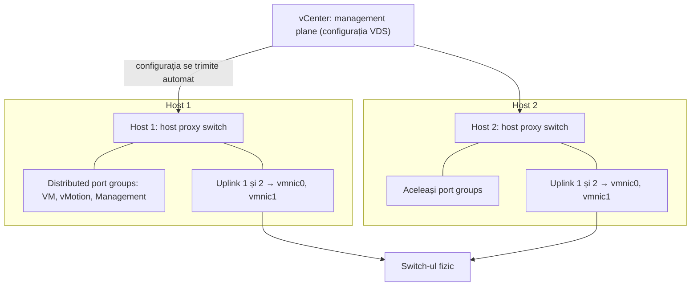
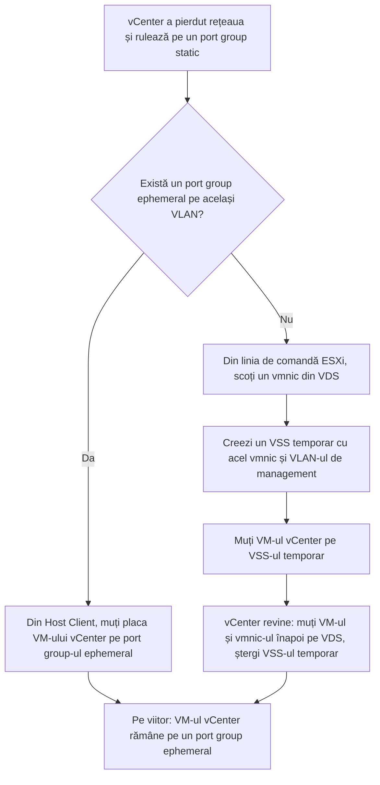

:::analogy
**Durerea din data center.** Ai 20 de hosturi, fiecare cu VSS (vSphere Standard Switch). Echipa de rețea cere un VLAN (Virtual Local Area Network) nou, iar cineva îl creează de mână pe fiecare host. Pe hostul 17 apare o greșeală de tastare, iar VM-urile (VM, Virtual Machine) mutate acolo de DRS (Distributed Resource Scheduler) pierd rețeaua. Cu VDS (vSphere Distributed Switch), port group-ul se creează o singură dată, în vCenter, și ajunge identic pe toate hosturile. Exam guide-ul VVF (VMware vSphere Foundation, 2V0-16.25) are VDS la obiectivul 2.4.1, iar vechiul VCP-DCV (VMware Certified Professional - Data Center Virtualization) avea switch-urile la obiectivele 1.5.2–1.5.4, 4.2 și 5.4. [S02] [S47]

**Analogia: rețeaua de magazine în franciză.**

- **Sediul central (vCenter)** scrie regulamentul o singură dată: prețuri, program, uniforme.
- **Fiecare magazin (host)** are o copie a regulamentului și servește clienții singur. Asta e **host proxy switch**-ul.
- **Dacă sediul central se închide o zi**, magazinele merg mai departe cu regulile pe care le au; doar că nu poți schimba regulile și nu poți deschide un raion nou până revine sediul.
:::

:::architecture
### 1. Două planuri: management și date

Orice switch are un **data plane** (comută, filtrează și etichetează pachetele) și un **management plane** (îl configurează). VSS le are pe amândouă pe fiecare host, deci configurezi fiecare host separat. VDS le desparte: [S165]

- **Management plane-ul stă în vCenter.** Ce configurezi acolo se trimite automat la toate hosturile.
- **Data plane-ul rămâne pe fiecare host**, sub numele de **host proxy switch**. Traficul VM-urilor nu trece prin vCenter.
- **Uplink port group:** uplink-urile VDS sunt șabloane; pe fiecare host le legi de plăcile fizice (vmnic). Politicile de failover și load balancing puse pe uplink-uri ajung identic pe toate hosturile.
- **Distributed port groups:** dau conectivitate VM-urilor și adaptoarelor VMkernel. Eticheta (network label) trebuie să fie unică în data center. Pe ele setezi teaming, VLAN, securitate și traffic shaping. [S165]

**Dacă vCenter cade:** traficul de rețea nu e afectat, indiferent de tipul de port binding. [S170] Doar administrarea se oprește (vezi secțiunea 3).

### 2. VSS vs VDS

| | VSS | VDS |
|---|---|---|
| Unde se configurează | Pe fiecare host [S114] | O dată, în vCenter [S165] |
| Route Based on Physical NIC Load (NIC, Network Interface Card; LBT, Load-Based Teaming) | Nu | Da, doar pe VDS [S173] |
| LACP (Link Aggregation Control Protocol) dinamic | Nu | Da, prin LAG-uri (LAG, Link Aggregation Group) [S175] |
| NIOC (Network I/O Control) v3 | Nu | Da, de la versiunea 6.5.0 [S176] |
| PVLAN (Private VLAN), port mirroring, NetFlow, health check, export/restore | Nu apar în capitolul despre VSS | Descrise în capitolul despre VDS [S178] [S179] [S180] [S181] [S183] |

### 3. Versiuni, upgrade și port binding

**Versiunea VDS** se alege la creare (click dreapta pe data center → Distributed Switch → New Distributed Switch). În vSphere 8, variantele sunt 8.0.3, 8.0.0, 7.0.3, 7.0.2, 7.0.0 și 6.6.0; fiecare cere hosturi la acea versiune sau mai nouă și nu are funcțiile versiunilor următoare. [S166] Exemple de funcții noi pe versiune: 6.6.0 MAC (Media Access Control) Learning, 7.0.2 LACP fast mode, 7.0.3 NVMe over TCP (NVMe, Non-Volatile Memory Express; TCP, Transmission Control Protocol), 8.0.3 Dual DPU (DPU, Data Processing Unit), 9.0.0 (cu ESX 9.0) Industrial vSwitch. [S167]

La creare mai alegi: **Network Offloads Compatibility** (None, Pensando, NVIDIA BlueField; cere versiunea 8.0.0+ și **dezactivează NIOC**), numărul de uplink-uri și dacă NIOC e activ. [S166]

**Upgrade-ul VDS:** [S168] [S169]

- Întâi vCenter și **toate hosturile** conectate la versiunea țintă.
- De la 6.5, upgrade-ul poate aduce o întrerupere scurtă; de la 6.6 sau mai nou, poate fi fără întrerupere. KB (Knowledge Base article) 413452 recomandă trecerea 6.5 → 6.6 separat, înaintea saltului mai mare.
- Documentația nu descrie un downgrade, ci recomandă **exportul configurației** înainte, ca s-o poți reface dacă upgrade-ul eșuează.
- KB 413452 mai cere: alertele VDS rezolvate, DRS pus pe Manual în timpul upgrade-ului și verificarea rețelei după.

**Port binding** decide cum primește un VM un port pe VDS: [S170]

| | Static (implicit) | Ephemeral |
|---|---|---|
| Când se alocă portul | La conectare; rămâne rezervat până scoți VM-ul din port group | Hostul creează portul la pornirea VM-ului și îl șterge la oprire |
| Cine poate conecta un VM | Doar vCenter | Și hostul, direct, fără vCenter |
| vCenter căzut | VM-urile care rulează au rețea, dar nu poți porni sau reconfigura VM-uri pe acest port group | Poți conecta VM-uri din Host Client |
| Recomandat pentru | Uz general | Recuperare: VM-ul vCenter, rețeaua de management |
| Dezavantaje | Depinde de vCenter | Operații mai lente; permisiunile pe port și istoricul se pierd la repornire |

Tipul de binding al unui port group static nu se poate schimba; creezi un port group nou. [S170] KB 426300 recomandă un port group ephemeral pentru VM-ul vCenter, ca să eviți dependența circulară (vCenter rulează pe switch-ul pe care tot el îl administrează). [S171]

Pașii pentru varianta fără port group ephemeral vin din KB 318719. Dacă ai LACP pe switch-ul fizic, coordonezi întâi cu echipa de rețea. [S172]

### 4. Teaming pe VDS: LBT și LACP

**Route Based on Physical NIC Load (LBT)** există doar pe VDS. [S173] Pornește de la „originating virtual port”, dar verifică încărcarea reală: la fiecare 30 de secunde, dacă un uplink trece de 75%, portul VM-ului cu cel mai mult trafic e mutat pe alt uplink. [S173] [S174] Nu cere nicio schimbare pe switch-ul fizic. [S173]

**LACP pe VDS** se face prin **LAG** (Link Aggregation Group), un grup de plăci fizice agregate dinamic: [S175]

- Maximum 64 de LAG-uri pe un VDS și 32 pe un host.
- Un LAG are minimum 2 porturi; plăcile au aceeași viteză și același duplex.
- Fiecare host are propriul port channel LACP pe switch-ul fizic.
- Algoritmul de hashing al LAG-ului trebuie să fie același cu cel al port channel-ului fizic.

### 5. NIOC v3: împărțirea lățimii de bandă

NIOC v3 cere VDS 6.5.0 sau mai nou, cu NIOC activ. [S176] Tipurile de **system traffic** includ Management, Fault Tolerance, NFS (Network File System), vSAN, vMotion, vSphere Replication, vSphere Data Protection Backup, Virtual machine și NVMe over TCP. [S176] Pentru fiecare setezi, pe fiecare placă fizică: [S176]

| Parametru | Ce face |
|---|---|
| Shares (1–100) | Prioritatea relativă când placa e aglomerată |
| Reservation (Mbps) | Minimul garantat. **Suma rezervărilor nu poate trece de 75% din capacitatea celei mai lente plăci fizice** (7,5 Gbps la plăci de 10 GbE) |
| Limit (Mbps sau Gbps) | Maximul pe care îl poate folosi acel tip de trafic |

**Trafic per VM:** pui shares, reservation și limit pe placa de rețea a VM-ului. Rezervările VM-urilor vin din rezervarea făcută pentru „Virtual machine” system traffic. **Network resource pools** împart acea rezervare între port groups. La pornire, VDS verifică dacă rezervarea VM-ului încape; DRS și HA (High Availability) plasează VM-ul pe un host care o poate garanta. [S177]

### 6. Securitate și monitorizare

- **PVLAN (Private VLAN):** un VLAN primar are VLAN-uri secundare. **Promiscuous** vorbește cu toate; **isolated** vorbește doar cu promiscuous; **community** vorbește cu promiscuous și cu porturile din aceeași comunitate. Switch-ul fizic trebuie să suporte PVLAN și să aibă aceleași VLAN ID-uri. [S178]
- **Port mirroring** (VDS 5.0.0+), patru tipuri de sesiune: [S179]
  - *Distributed Port Mirroring*: între porturi de pe **același host**.
  - *Remote Mirroring Source*: spre uplink-uri ale hostului.
  - *Remote Mirroring Destination*: dintr-un set de VLAN-uri spre porturi distribuite.
  - *Encapsulated Remote Mirroring (L3) Source*: printr-un tunel IP (Internet Protocol) spre un agent la distanță.
  - Un port nu poate fi sursă și destinație în același timp.
- **NetFlow:** de la vSphere 8.0 și VCF (VMware Cloud Foundation) 9.0, VDS suportă IPFIX (IP Flow Information Export), adică NetFlow versiunea 10. Colectarea pornește după ce setezi IP-ul și portul colectorului. [S180]
- **Health check:** compară VLAN-urile, MTU-ul (Maximum Transmission Unit) și teaming-ul VDS cu porturile switch-ului fizic. Implicit verifică la 1 minut. VLAN/MTU cere minimum 2 plăci active; teaming cere 2 plăci și 2 hosturi. Rezultatele sunt la VDS → Monitor → Health. [S181] Cu IP hash și EtherChannel poate raporta fals „Not Supported”; KB 315270 recomandă verificarea manuală și dezactivarea health check după aceea. [S182]

### 7. Backup și migrarea de pe VSS

**Configurația VDS se salvează separat de vCenter:** click dreapta pe VDS → Export Configuration (doar switch-ul sau și port groups). **Import** creează un VDS nou; **Restore** suprascrie setările unui VDS existent. La import în alt vCenter, **nu** bifezi „Preserve original distributed switch and port group identifiers”. Importul dintr-un vCenter mai nou într-unul mai vechi nu e suportat. [S183]

**Migrarea VSS → VDS, fără întrerupere** (KB 427273): [S184]

1. Creezi VDS-ul și port groups identice (aceleași VLAN-uri).
2. Adaugi hostul și muți **o singură** placă fizică pe VDS; cealaltă rămâne pe VSS.
3. Muți vmk0 (management), apoi VM-urile.
4. Muți ultima placă, testezi vMotion și management, apoi ștergi VSS-ul gol.

Dacă o schimbare te deconectează, **network rollback** revine la configurația bună. [S117] [S184]

[IMAGE SEARCH / PROMPT] „vSphere Distributed Switch topology diagram uplinks distributed port groups”, ca să vezi cum arată topologia în vSphere Client.
:::

:::exam-alert
### De memorat

| Ce | Valoare / regulă | Sursă |
|---|---|---|
| Unde stă management plane-ul | vCenter; data plane = host proxy switch pe fiecare host | Docs [S165] |
| vCenter căzut | Traficul merge; pe port groups statice nu poți porni sau reconfigura VM-uri | KB 324492 [S170] |
| Port binding implicit | Static; ephemeral pentru recuperare (VM-ul vCenter) | KB 324492 [S170], KB 426300 [S171] |
| Upgrade VDS | Întâi vCenter și toate hosturile; export înainte | Docs [S168] |
| Network offload (DPU) | VDS 8.0.0+; dezactivează NIOC | Docs [S166] |
| LBT | Doar VDS; la 30 s; prag 75% | Docs [S173] |
| LAG | Max 64 pe VDS, 32 pe host; minimum 2 porturi | Docs [S175] |
| NIOC v3 | VDS 6.5.0+; shares 1–100; rezervări max 75% din cea mai lentă placă | Docs [S176] |
| Port mirroring | VDS 5.0.0+; Distributed Port Mirroring doar pe același host | Docs [S179] |
| NetFlow | IPFIX = NetFlow v10 | KB 433680 [S180] |
| Health check | Implicit la 1 minut; minimum 2 plăci active | Docs [S181] |

### 3 capcane de examen

1. **„Dacă vCenter cade, VM-urile de pe VDS pierd rețeaua.”** Fals. Data plane-ul e pe hosturi și traficul nu e afectat; doar nu poți porni sau reconfigura VM-uri pe port groups statice. [S165] [S170]
2. **„Cu NIOC poți rezerva 100% din placă pentru system traffic.”** Fals. Suma rezervărilor e limitată la 75% din capacitatea celei mai lente plăci fizice. [S176]
3. **„Distributed Port Mirroring copiază traficul de pe un VM de pe hostul A spre un analizor de pe hostul B.”** Fals. Funcționează doar între porturi de pe același host; pentru alt host folosești Remote Mirroring sau Encapsulated Remote Mirroring (L3). [S179]
:::

:::trenches
**Greșeala 1: vCenter pe un port group static, apoi o schimbare greșită de rețea.**
Cineva schimbă VLAN-ul port group-ului de management, iar vCenter pierde rețeaua. Placa VM-ului vCenter nu mai poate fi reconectată, pentru că port group-urile statice au nevoie chiar de vCenter ca să aloce portul. În `vmkernel.log` apare „DVS port handle not found”. [S172]
**Remediere:** urmezi KB 318719: scoți un vmnic din VDS, creezi un VSS temporar, muți vCenter pe el, apoi înapoi pe VDS după ce își revine. Pe viitor creezi un port group ephemeral pentru VM-ul vCenter, cu aceleași setări de teaming ca port group-ul de management (KB 426300). [S172] [S171]

**Greșeala 2: migrarea pe VDS cu ambele plăci deodată.**
În wizard-ul „Add and Manage Hosts”, adminul mută ambele plăci fizice și vmk0 în același pas, iar hostul pierde complet rețeaua. KB 427273 spune clar să nu muți ambele plăci deodată. [S184]
**Remediere:** de obicei network rollback anulează schimbarea singur după ce hostul nu mai vede vCenter. [S117] [S184] Dacă nu, folosești Network Restore Options din DCUI (Direct Console User Interface). [S117] Data viitoare muți o placă, verifici, apoi o muți pe a doua, și faci înainte un export al configurației VDS. [S184] [S183]
:::

:::interview
**Întrebare Junior/Mid: „Care e diferența principală dintre VSS și VDS și de ce contează?”**

*Răspunsul ideal:* VSS ține și management-ul, și datele pe fiecare host, deci configurezi fiecare host separat. VDS mută management-ul în vCenter și lasă pe fiecare host un host proxy switch care comută traficul; configurația se trimite automat la toate hosturile, deci rețeaua e identică peste tot. [S165] Un candidat bun adaugă că doar VDS are LBT, LACP prin LAG-uri și NIOC v3 [S173] [S175] [S176] și că VDS-ul nu are nevoie de vCenter ca să comute traficul, doar ca să schimbi configurația. [S170]

**Scenariu de troubleshooting: „Ai creat un port group nou pe VDS, cu VLAN 120. VM-urile au rețea pe unele hosturi, pe altele nu. Ce faci?”**

*Răspunsul pe care îl așteaptă un Team Lead:*
1. **Restrâng problema:** pe ce hosturi și pe ce uplink-uri merge, și pe care nu. [S165]
2. **Pornesc health check** pe VDS (VLAN and MTU) și mă uit la Monitor → Health: probabil VLAN 120 lipsește din trunk-ul unor porturi fizice. [S181]
3. **Verific MTU-ul** cap-coadă, dacă port group-ul e pentru vMotion sau stocare. [S181]
4. **Atenție la IP hash:** cu EtherChannel, health check poate raporta fals „Not Supported”; verific manual configurația portului. [S182]
5. **Cer rețelei** să adauge VLAN-ul pe trunk, retestez, apoi opresc health check dacă nu mai e nevoie. [S182]
:::

:::lab
**Scenariu.** Construiești un VDS pentru lab, muți un host de pe VSS pe VDS fără să pierzi conexiunea, creezi un port group ephemeral pentru vCenter, activezi health check, citești NIOC și salvezi configurația.

**Ce ai nevoie.** vCenter-ul din lab și cel puțin un host cu două plăci de rețea (fizice sau, în lab-ul nested, virtuale). Lab-ul nested e **home-lab only**, nu e o configurație suportată în producție.

Pașii de mai jos sunt bifabili, iar progresul se salvează în browser. Numele exacte ale meniurilor pot diferi puțin între versiunile 8 și 9 (`⚠ de verificat`).

**Test de avarie și validare.** După pasul 3, oprește temporar placa rămasă pe VSS (din setările VM-ului ESXi nested, Disconnect): hostul trebuie să rămână conectat la vCenter prin VDS. Dacă se deconectează, network rollback ar trebui să revină singur; altfel folosești DCUI → Network Restore Options. La pasul 7, fișierul exportat trebuie să existe pe disc.
:::

:::quiz
Cinci întrebări originale, în stilul examenelor VCP (VMware Certified Professional). Primești explicația pentru fiecare variantă imediat după ce răspunzi.
:::

:::references
- Exam guide VCP-VVF Administrator 2V0-16.25, obiectivul 2.4.1 [S02]
- Exam guide VCP-DCV 2V0-21.23 (certificare Legacy), obiectivele 1.5.2–1.5.4, 4.2, 5.4 [S47]
- Documentația vSphere 8 Networking: arhitectura VDS [S165], crearea [S166] și upgrade-ul [S168]
- KB 324492, KB 426300, KB 318719: port binding, vCenter pe ephemeral, recuperarea rețelei vCenter [S170] [S171] [S172]
- Documentația vSphere: load balancing (LBT) [S173] și LACP [S175]
- Documentația vSphere: NIOC v3 pentru system traffic [S176] și pentru VM-uri [S177]
- Documentația vSphere: PVLAN [S178], port mirroring [S179], health check [S181]
- KB 338595 și KB 427273: export/restore și migrarea VSS → VDS [S183] [S184]
:::
