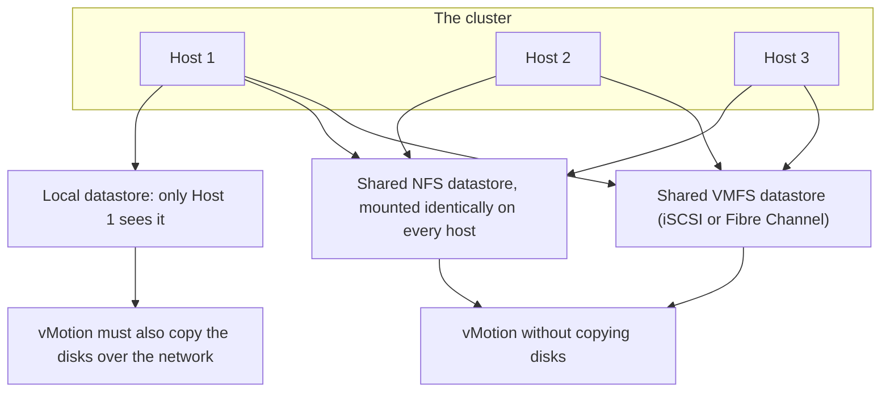
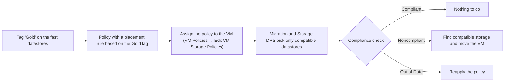

:::analogy
**The data center pain.** A new admin adds a host to the cluster and mounts the NFS (Network File System) export using the IP (Internet Protocol) address. The other hosts had mounted it by FQDN (Fully Qualified Domain Name). In vCenter the same export now shows up as two different datastores, and migrations get confused. At another company, critical VMs (VM, Virtual Machine) have "High" shares in their SIOC (Storage I/O Control) policy, but after moving to 9.0 they no longer get any priority. Both situations are about shared storage: the VVF (VMware vSphere Foundation, 2V0-16.25) exam guide covers it in objective 2.3.1, and the older VCP-DCV (VMware Certified Professional - Data Center Virtualization) in 1.3, 1.3.3, 1.3.4 and 7.4. [S02] [S47]

**The analogy: the city library.**

- **The shared datastore** is the central library: every school (host) borrows from the same building, so a book (a VM) can be read by anyone.
- **The library's address** must be written the same way on every card. If one school writes "1 Main Street" and another "Central Library", the register thinks there are two libraries.
- **The storage policy** is the rule "rare books stay only in the air-conditioned room". The librarian checks regularly that the rule is followed.
:::

:::architecture
### 1. Why shared storage matters

For vMotion, the VM must live on storage **accessible to both the source and the target host**. Accepted types are Fibre Channel SAN (Storage Area Network), iSCSI (Internet Small Computer Systems Interface) and NAS (Network Attached Storage). If the VM uses RDM (Raw Device Mapping), the LUN IDs (LUN, Logical Unit Number) must be the same on every host. [S185] Without shared storage, vMotion also copies the disk contents over the network. [S185]

### 2. Same storage, mounted the same way everywhere

**NFS mounted identically.** With NFS 3, the datastore UUID (UUID, Universally Unique Identifier) is computed from the server name as you typed it and the export path. IP and FQDN count as different names, so the same export gets different UUIDs on different hosts. The fix: on every host use the same form (IP only or FQDN only) and the same path. [S186]

**Do not mix NFS versions.** A datastore can never be mounted with NFS 3 and NFS 4.1 at the same time, and ESXi does not convert 3 to 4.1 automatically. [S69] The differences that matter in a cluster: [S69]

| | NFS 3 | NFS 4.1 |
|---|---|---|
| File locking | Client-side (VMware proprietary) | Server-side |
| Multipathing | No | Yes, through session trunking |
| Authentication | AUTH_SYS | AUTH_SYS and Kerberos (krb5, krb5i) |
| SIOC | Yes | No |
| Storage DRS (DRS, Distributed Resource Scheduler) | Full | Only initial placement and space-based balancing |

**iSCSI and paths, the same on every host.** The rules from lesson 1.8 apply to each host in the cluster: port binding only when all iSCSI vmk ports are in the same subnet [S128], and the path policy, PSP (Path Selection Policy), is chosen by array type, as in lesson 1.8. [S123]

### 3. Shared VMFS: locking and hardware acceleration

On VMFS (Virtual Machine File System) several hosts write to the same LUN, so they need locks. **ATS (Atomic Test and Set)** locks only the file and replaces SCSI-2 reservations (SCSI, Small Computer System Interface), which locked the whole device. A new single-extent VMFS-5 uses ATS only; devices without ATS use SCSI-2 reservations. [S187]

ATS is part of **VAAI (vSphere APIs for Array Integration)**, the operations ESXi hands off to the array: [S187]

| Primitive (block) | What it does |
|---|---|
| ATS | Hardware locking on VMFS |
| Clone Blocks / Full Copy / XCOPY | Copies inside the array |
| Zero Blocks / Write Same | Writes zeros to disk regions |
| Block Delete (UNMAP) | Reclaims deleted space |

For NAS, VAAI needs a vendor plugin, installed as a VIB (vSphere Installation Bundle) with the host in maintenance mode and a reboot. You see the status in the **Hardware Acceleration** column (Supported, Not Supported, Unknown) or with `esxcli storage core device vaai status get`; for NFS, with `esxcli storage nfs list`. [S187]

### 4. Storage policies (SPBM)

SPBM (Storage Policy-Based Management) ties VMs to the right storage through **VM storage policies**. A policy has: [S188]

- **Host-based rule set:** services provided by the host (for example encryption or replication through I/O filters); it does not decide placement.
- **Datastore-specific rule sets:** placement rules that are **capability-based** (advertised by the storage) or **tag-based** (for example the "Gold" tag).
- **Logic:** OR between rule sets, AND inside one rule set. A policy needs at least one rule set. [S188]

Capabilities come from **storage providers**, through VASA (vSphere APIs for Storage Awareness). Built-in ones (vSAN, I/O filters) register themselves; third-party ones you register under vCenter → Configure → Storage Providers. Do not install a VASA provider on the same system as vCenter. [S191]

**vVols in 9.0:** vSphere Virtual Volumes are **deprecated** in VCF (VMware Cloud Foundation) 9.0 and VVF 9.0 and will be removed in a future release; vVols certifications for 9.0 have stopped. [S192]

Steps for a tag-based policy (KB, Knowledge Base article, 404217): create a tag category for Datastores and the tags, put them on datastores, create the policy under Policies and Profiles → VM Storage Policies with "Datastore specific rules" and the tag-based rule, then assign it to the VM, even while it is powered on. [S189]

**Compliance:** [S190]

- **Noncompliant:** the VM or its disks sit on datastores that do not meet the policy. Find compatible storage and migrate, if you cannot bring the current datastore into compliance.
- **Out of Date:** the policy was edited, but the datastore has not received the new requirements yet. Reapply the policy.

### 5. SIOC and Storage DRS: what changed

**SIOC** prioritizes I/O on a congested datastore by shares, only when latency exceeds the congestion threshold. [S193]

- Default shares: Normal (1000) for every VM. The IOPS (Input/Output Operations Per Second) limit is unlimited by default. Example from the docs: a 10 MB/s limit with 64 KiB blocks means 160 IOPS. [S193]
- It works on Fibre Channel, iSCSI and NFS; not with RDM, not on datastores with multiple extents, and the datastores must be managed by a single vCenter. [S193] It is not supported on NFS 4.1. [S69]
- The threshold: by default the latency estimated at 90% of peak throughput; "Reset" returns to 30 ms. [S194] [S195] The range for a manual value differs between versions and sources (`⚠ to verify` on your version). [S194] [S195]

**Deprecations announced since 8.0 U3:** [S196] [S199]

- **Deprecated:** enabling SIOC on a datastore, shares and reservations in SIOC policies, Storage DRS balancing by I/O latency and by I/O reservations.
- **Remaining:** IOPS limits in SIOC policies and space-based Storage DRS, including evacuation on maintenance mode.

**In VCF 9.0**, SIOC policies support **only limits**: the SIOCV2 backend ignores shares and reservations. The default components (High, Normal, Low) now contain only limits; KB 385396 recommends creating your own Storage Policy Components with the IOPS limit you want. [S197]

**Storage DRS (SDRS, Storage Distributed Resource Scheduler)** works on a **datastore cluster**: [S198]

- Default thresholds: 80% space used, 15 ms I/O latency.
- Only two modes: fully automated or manual.
- A datastore cluster does not mix VMFS and NFS.
- Maintenance mode on a datastore moves all VM files off it with Storage vMotion.
- The default rule keeps all of a VM's VMDKs (VMDK, Virtual Machine Disk) on the same datastore.

[IMAGE SEARCH / PROMPT] "vSphere Client VM Storage Policies tag based placement rule", to see the policy creation screen.
:::

:::exam-alert
### Memorize

| What | Value / rule | Source |
|---|---|---|
| Storage for vMotion | Accessible to both hosts: Fibre Channel SAN, iSCSI, NAS | Docs [S185] |
| NFS 3 UUID | From the typed server name + path; IP ≠ FQDN | KB 400097 [S186] |
| NFS 3 and 4.1 on one datastore | Never at the same time; no automatic conversion | Docs [S69] |
| ATS | Replaces SCSI-2 reservations for VMFS locking | KB 318941 [S187] |
| Rule sets in a policy | OR between them, AND inside | Docs [S188] |
| Compliance states | Noncompliant → migrate; Out of Date → reapply | Docs [S190] |
| VASA provider | Not on the vCenter system | Docs [S191] |
| vVols | Deprecated in VCF/VVF 9.0 | KB 401070 [S192] |
| Default SIOC shares | Normal (1000) | Docs [S193] |
| SIOC threshold | 90% of peak throughput; Reset = 30 ms | Docs [S194] |
| SIOC in VCF 9.0 | IOPS limits only | KB 385396 [S197] |
| Storage DRS | 80% space, 15 ms; no VMFS + NFS in one cluster | KB 320864 [S198] |

### 3 exam traps

1. **"The same NFS export mounted by IP on one host and by FQDN on another is the same datastore."** False. The UUID is computed from the server name as typed, so you get different UUIDs. [S186]
2. **"You can mount a datastore as NFS 3 on some hosts and as NFS 4.1 on others."** False. The docs say a datastore can never be mounted with both protocols at the same time. [S69]
3. **"In VCF 9.0, High shares in the SIOC policy give a VM priority."** False. In 9.0, SIOC policies support only limits; shares and reservations are ignored. [S197]
:::

:::trenches
**Mistake 1: the NFS export mounted differently on a new host.**
A new host mounts the export by IP, the others by FQDN. The same export shows a different UUID on different hosts, and KB 400097 warns that any deviation in mount details leads to UUID problems. [S186]
**Fix:** pick one mount form. On the wrong host, move the VMs to another datastore (or power them off and unregister them), unmount the export, mount it again in the right form, check the UUID matches everywhere, then bring the VMs back. Option two: a new NFS datastore mounted correctly on all hosts, and migrate the VMs onto it. [S186]

**Mistake 2: the policy changed and forgotten.**
Someone changes the tag rule in a storage policy. VMs show "Out of Date", and some, after reapplying, "Noncompliant", because they sit on datastores without the new tag. [S190]
**Fix:** reapply the policy to the "Out of Date" objects. For "Noncompliant" ones, find compatible storage and move them with Storage vMotion, if you cannot put the right tag on the current datastore. [S190] [S189]
:::

:::interview
**Junior/Mid question: "What is a tag-based storage policy and when do you use it?"**

*Ideal answer:* it is a VM policy with a datastore-specific rule set that contains a tag-based placement rule. You put a tag (for example "Gold") on the right datastores, create the policy, then assign it to VMs; migrations and Storage DRS will pick only datastores with that tag. [S188] [S189] You use it when the storage does not advertise capabilities through VASA, for example a plain VMFS or NFS datastore. [S191] A strong candidate adds that they check compliance regularly: Noncompliant means move, Out of Date means reapply. [S190]

**Troubleshooting scenario: "After the upgrade to 9.0, the database VM no longer gets I/O priority when the datastore is congested. What do you check?"**

*The answer a Team Lead expects:*
1. **The VM's policy:** which SIOC component it uses. If it relies on shares, in VCF 9.0 they are ignored. [S197]
2. **The context:** enabling SIOC and shares are deprecated since 8.0 U3; only limits remain. [S196]
3. **The fix:** limit IOPS for the noisy VMs, through your own Storage Policy Component with a limit. [S197]
4. **Placement:** move the critical VM to a separate datastore, through a tag-based policy. [S189]
5. **Check the datastore:** NFS 4.1 does not support SIOC at all. [S69]
:::

:::lab
**Scenario.** You check that an NFS export is mounted identically on every host, read the VAAI status, create a tag-based storage policy, assign it to a VM and check compliance. At the end you deliberately cause the "Noncompliant" state and fix it.

**What you need.** The lab vCenter, at least two datastores and the NFS export from lesson 1.8. SSH temporarily enabled on the hosts for steps 1 and 2.

The steps below can be ticked off, and progress is saved in the browser. Exact menu names may differ slightly between versions 8 and 9 (`⚠ to verify`).

**Failure and validation test.** At step 6 you remove the tag from the datastore the VM lives on: after "Check Compliance", the VM must show "Noncompliant". You fix it by putting the tag back (or moving the VM to a tagged datastore), and the state must return to "Compliant".
:::

:::quiz
Five original questions, in the style of VCP (VMware Certified Professional) exams. You get the explanation for every option right after answering.
:::

:::references
- VCP-VVF Administrator 2V0-16.25 exam guide, objective 2.3.1 [S02]
- VCP-DCV 2V0-21.23 exam guide (Legacy certification), objectives 1.3, 1.3.3, 1.3.4, 7.4 [S47]
- vSphere 8 docs: vMotion storage requirements [S185] and NFS 3 vs 4.1 [S69]
- KB 400097 and KB 318941: NFS UUID and VAAI [S186] [S187]
- vSphere 8 Storage docs: policy rules [S188], compliance [S190], storage providers [S191]
- KB 404217 and KB 401070: tag-based policies and the vVols deprecation [S189] [S192]
- SIOC documentation [S193] and the VMware blog on deprecations [S196]
- KB 385396 and KB 320864: SIOC in VCF 9.0 and Storage DRS [S197] [S198]
:::
