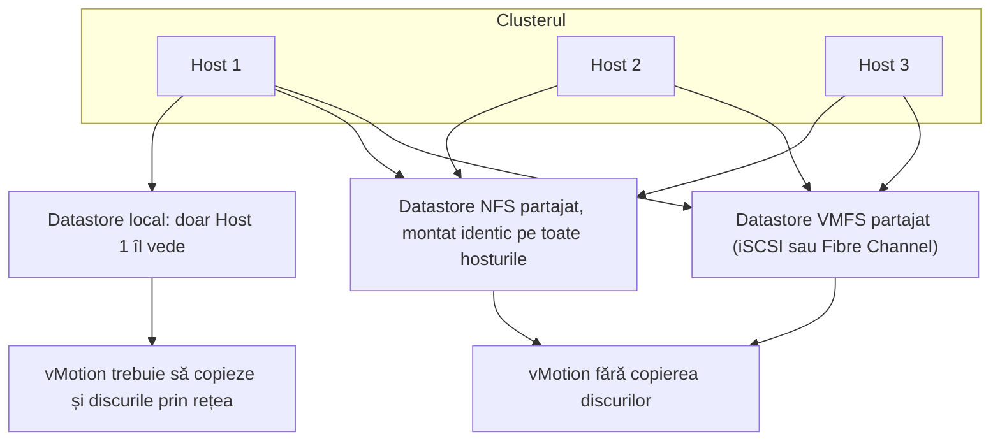
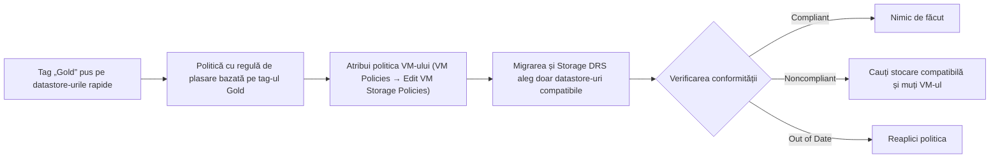

:::analogy
**Durerea din data center.** Un nou admin adaugă un host în cluster și montează exportul NFS (Network File System) folosind adresa IP (Internet Protocol). Celelalte hosturi îl montaseră prin FQDN (Fully Qualified Domain Name). În vCenter, același export apare acum ca două datastore-uri diferite, iar migrările se încurcă. În altă firmă, VM-urile (VM, Virtual Machine) critice au shares „High” în politica SIOC (Storage I/O Control), dar după trecerea la 9.0 nu mai primesc nicio prioritate. Ambele situații țin de stocarea partajată: exam guide-ul VVF (VMware vSphere Foundation, 2V0-16.25) o acoperă la obiectivul 2.3.1, iar vechiul VCP-DCV (VMware Certified Professional - Data Center Virtualization) la 1.3, 1.3.3, 1.3.4 și 7.4. [S02] [S47]

**Analogia: biblioteca orașului.**

- **Datastore-ul partajat** e biblioteca centrală: toate școlile (hosturile) împrumută din aceeași clădire, deci o carte (un VM) poate fi citită de oricine.
- **Adresa bibliotecii** trebuie scrisă la fel pe toate fișele. Dacă o școală scrie „Strada Mare 1”, iar alta „Biblioteca Centrală”, registrul crede că sunt două biblioteci.
- **Politica de stocare** e regula „cărțile rare stau doar în sala cu aer condiționat”. Bibliotecarul verifică periodic dacă regula e respectată.
:::

:::architecture
### 1. De ce contează stocarea partajată

Pentru vMotion, VM-ul trebuie să stea pe o stocare **accesibilă și hostului sursă, și celui destinație**. Tipurile acceptate sunt Fibre Channel SAN (Storage Area Network), iSCSI (Internet Small Computer Systems Interface) și NAS (Network Attached Storage). Dacă VM-ul are RDM (Raw Device Mapping), LUN ID-urile (LUN, Logical Unit Number) trebuie să fie aceleași pe toate hosturile. [S185] Fără stocare partajată, vMotion copiază și conținutul discurilor prin rețea. [S185]

### 2. Aceeași stocare, montată la fel peste tot

**NFS montat identic.** La NFS 3, UUID-ul datastore-ului (UUID, Universally Unique Identifier) se calculează din numele serverului așa cum l-ai scris și din calea exportului. IP-ul și FQDN-ul contează ca nume diferite, deci același export primește UUID-uri diferite pe hosturi diferite. Soluția: pe toate hosturile folosești aceeași formă (doar IP sau doar FQDN) și aceeași cale. [S186]

**Nu amesteca versiunile NFS.** Un datastore nu poate fi montat niciodată cu NFS 3 și NFS 4.1 în același timp, iar ESXi nu convertește automat 3 în 4.1. [S69] Diferențele care contează într-un cluster: [S69]

| | NFS 3 | NFS 4.1 |
|---|---|---|
| Blocarea fișierelor | La client (proprietară VMware) | La server |
| Multipathing | Nu | Da, prin session trunking |
| Autentificare | AUTH_SYS | AUTH_SYS și Kerberos (krb5, krb5i) |
| SIOC | Da | Nu |
| Storage DRS (DRS, Distributed Resource Scheduler) | Complet | Doar plasare inițială și echilibrare după spațiu |

**iSCSI și căile, la fel pe toate hosturile.** Regulile din lecția 1.8 se aplică pe fiecare host al clusterului: port binding doar când toate vmk-urile iSCSI sunt în același subnet [S128], iar politica de căi, PSP (Path Selection Policy), se alege după tipul matricei, ca în lecția 1.8. [S123]

### 3. VMFS partajat: blocări și accelerare hardware

Pe VMFS (Virtual Machine File System), mai multe hosturi scriu pe același LUN, deci au nevoie de blocări. **ATS (Atomic Test and Set)** blochează doar fișierul și înlocuiește rezervările SCSI-2 (SCSI, Small Computer System Interface), care blocau tot dispozitivul. Un VMFS-5 nou, cu un singur extent, folosește doar ATS; dispozitivele fără ATS folosesc rezervări SCSI-2. [S187]

ATS face parte din **VAAI (vSphere APIs for Array Integration)**, adică operațiile pe care ESXi le lasă matricei: [S187]

| Primitiva (bloc) | Ce face |
|---|---|
| ATS | Blocare hardware pe VMFS |
| Clone Blocks / Full Copy / XCOPY | Copiere în interiorul matricei |
| Zero Blocks / Write Same | Scrie zero-uri pe zone de disc |
| Block Delete (UNMAP) | Eliberează spațiul șters |

Pentru NAS, VAAI cere un plugin de la producător, instalat ca VIB (vSphere Installation Bundle) cu hostul în maintenance mode și restart. Starea o vezi în coloana **Hardware Acceleration** (Supported, Not Supported, Unknown) sau cu `esxcli storage core device vaai status get`; pentru NFS, cu `esxcli storage nfs list`. [S187]

### 4. Politici de stocare (SPBM)

SPBM (Storage Policy-Based Management) leagă VM-urile de stocarea potrivită prin **VM storage policies**. O politică are: [S188]

- **Host-based rule set:** servicii date de host (de exemplu criptare sau replicare prin I/O filters); nu decide plasarea.
- **Datastore-specific rule sets:** reguli de plasare **bazate pe capabilități** (anunțate de stocare) sau **bazate pe tag-uri** (de exemplu tag-ul „Gold”).
- **Logica:** între rule sets e OR, în interiorul unui rule set e AND. Politica are nevoie de cel puțin un rule set. [S188]

Capabilitățile vin de la **storage providers**, prin VASA (vSphere APIs for Storage Awareness). Cele integrate (vSAN, I/O filters) se înregistrează singure; cele de la terți le înregistrezi la vCenter → Configure → Storage Providers. Nu instalezi un VASA provider pe același sistem cu vCenter. [S191]

**vVols în 9.0:** vSphere Virtual Volumes sunt **deprecated** în VCF (VMware Cloud Foundation) 9.0 și VVF 9.0 și vor fi scoase într-o versiune viitoare; certificările vVols pentru 9.0 s-au oprit. [S192]

Pașii pentru politica bazată pe tag-uri (KB, Knowledge Base article, 404217): creezi o categorie de tag-uri pentru Datastores și tag-urile, le pui pe datastore-uri, creezi politica la Policies and Profiles → VM Storage Policies cu „Datastore specific rules” și regula bazată pe tag, apoi o atribui VM-ului, chiar și pornit. [S189]

**Conformitatea:** [S190]

- **Noncompliant:** VM-ul sau discurile lui stau pe datastore-uri care nu respectă politica. Cauți stocare compatibilă și migrezi, dacă nu poți aduce datastore-ul actual în regulă.
- **Out of Date:** politica a fost modificată, dar datastore-ul nu a primit încă noile cerințe. Reaplici politica.

### 5. SIOC și Storage DRS: ce s-a schimbat

**SIOC** dă prioritate I/O-ului pe un datastore aglomerat, după shares, doar când latența trece de pragul de congestie. [S193]

- Shares implicit: Normal (1000) pentru fiecare VM. Limita IOPS (Input/Output Operations Per Second) e nelimitată implicit. Exemplu din documentație: o limită de 10 MB/s, la blocuri de 64 KiB, înseamnă 160 IOPS. [S193]
- Merge pe Fibre Channel, iSCSI și NFS; nu cu RDM, nu pe datastore-uri cu mai multe extents, iar datastore-urile trebuie administrate de un singur vCenter. [S193] Pe NFS 4.1 nu e suportat. [S69]
- Pragul: implicit la latența estimată pentru 90% din throughput-ul maxim; „Reset” revine la 30 ms. [S194] [S195] Intervalul pentru valoarea manuală diferă între versiuni și surse (`⚠ de verificat` pe versiunea ta). [S194] [S195]

**Deprecări anunțate din 8.0 U3:** [S196] [S199]

- **Deprecated:** activarea SIOC pe un datastore, shares și rezervările în politicile SIOC, echilibrarea Storage DRS după latența I/O și după rezervări I/O.
- **Rămân:** limitele IOPS în politicile SIOC și Storage DRS după spațiu, inclusiv evacuarea la maintenance mode.

**În VCF 9.0**, politicile SIOC suportă **doar limite**: backend-ul SIOCV2 ignoră shares și rezervările. Componentele implicite (High, Normal, Low) conțin acum doar limite; KB 385396 recomandă să-ți creezi propriile Storage Policy Components cu limita IOPS dorită. [S197]

**Storage DRS (SDRS, Storage Distributed Resource Scheduler)** lucrează pe un **datastore cluster**: [S198]

- Praguri implicite: 80% spațiu ocupat, 15 ms latență I/O.
- Doar două moduri: fully automated sau manual.
- Un datastore cluster nu amestecă VMFS cu NFS.
- Maintenance mode pe un datastore mută cu Storage vMotion toate fișierele VM-urilor de pe el.
- Regula implicită ține toate VMDK-urile (VMDK, Virtual Machine Disk) unui VM pe același datastore.

[IMAGE SEARCH / PROMPT] „vSphere Client VM Storage Policies tag based placement rule”, ca să vezi ecranul de creare a politicii.
:::

:::exam-alert
### De memorat

| Ce | Valoare / regulă | Sursă |
|---|---|---|
| Stocare pentru vMotion | Accesibilă ambelor hosturi: Fibre Channel SAN, iSCSI, NAS | Docs [S185] |
| UUID NFS 3 | Din numele serverului scris + cale; IP ≠ FQDN | KB 400097 [S186] |
| NFS 3 și 4.1 pe același datastore | Niciodată în același timp; fără conversie automată | Docs [S69] |
| ATS | Înlocuiește rezervările SCSI-2 la blocarea VMFS | KB 318941 [S187] |
| Rule sets în politică | OR între ele, AND în interior | Docs [S188] |
| Stări de conformitate | Noncompliant → migrezi; Out of Date → reaplici | Docs [S190] |
| VASA provider | Nu pe sistemul vCenter | Docs [S191] |
| vVols | Deprecated în VCF/VVF 9.0 | KB 401070 [S192] |
| SIOC shares implicit | Normal (1000) | Docs [S193] |
| Prag SIOC | 90% din throughput-ul maxim; Reset = 30 ms | Docs [S194] |
| SIOC în VCF 9.0 | Doar limite IOPS | KB 385396 [S197] |
| Storage DRS | 80% spațiu, 15 ms; fără VMFS + NFS în același cluster | KB 320864 [S198] |

### 3 capcane de examen

1. **„Același export NFS montat prin IP pe un host și prin FQDN pe altul e același datastore.”** Fals. UUID-ul se calculează din numele serverului așa cum l-ai scris, deci primești UUID-uri diferite. [S186]
2. **„Poți monta un datastore ca NFS 3 pe unele hosturi și ca NFS 4.1 pe altele.”** Fals. Documentația spune că un datastore nu poate fi montat niciodată cu ambele protocoale în același timp. [S69]
3. **„În VCF 9.0, shares High în politica SIOC dau prioritate unui VM.”** Fals. În 9.0, politicile SIOC suportă doar limite; shares și rezervările sunt ignorate. [S197]
:::

:::trenches
**Greșeala 1: exportul NFS montat diferit pe un host nou.**
Un host nou montează exportul prin IP, celelalte prin FQDN. Același export apare cu UUID diferit pe hosturi diferite, iar KB 400097 avertizează că orice abatere în detaliile de montare aduce probleme cu UUID-urile. [S186]
**Remediere:** alegi o singură formă de montare. Pe hostul greșit muți VM-urile pe alt datastore (sau le oprești și le scoți din inventar), demontezi exportul, îl montezi din nou în forma corectă, verifici că UUID-ul e același peste tot, apoi aduci VM-urile înapoi. Varianta a doua: un datastore NFS nou, montat corect pe toate hosturile, și migrarea VM-urilor pe el. [S186]

**Greșeala 2: politica modificată și uitată.**
Cineva schimbă regula de tag dintr-o politică de stocare. VM-urile apar „Out of Date”, iar unele, după reaplicare, „Noncompliant”, pentru că stau pe datastore-uri fără noul tag. [S190]
**Remediere:** reaplici politica pentru obiectele „Out of Date”. Pentru cele „Noncompliant” cauți stocare compatibilă și le muți cu Storage vMotion, dacă nu poți pune tag-ul corect pe datastore-ul actual. [S190] [S189]
:::

:::interview
**Întrebare Junior/Mid: „Ce e o politică de stocare bazată pe tag-uri și când o folosești?”**

*Răspunsul ideal:* e o politică VM cu un datastore-specific rule set care conține o regulă de plasare bazată pe tag. Pui un tag (de exemplu „Gold”) pe datastore-urile potrivite, creezi politica, apoi o atribui VM-urilor; migrările și Storage DRS vor alege doar datastore-uri cu acel tag. [S188] [S189] O folosești când stocarea nu anunță capabilități prin VASA, de exemplu la un VMFS sau NFS obișnuit. [S191] Un candidat bun adaugă că verifică periodic conformitatea: Noncompliant înseamnă mutare, Out of Date înseamnă reaplicare. [S190]

**Scenariu de troubleshooting: „După upgrade-ul la 9.0, VM-ul de baze de date nu mai primește prioritate la I/O când datastore-ul e aglomerat. Ce verifici?”**

*Răspunsul pe care îl așteaptă un Team Lead:*
1. **Politica VM-ului:** ce componentă SIOC folosește. Dacă se bazează pe shares, în VCF 9.0 acestea sunt ignorate. [S197]
2. **Contextul:** activarea SIOC și shares-urile sunt deprecated din 8.0 U3; rămân doar limitele. [S196]
3. **Soluția:** limitezi IOPS pentru VM-urile zgomotoase, printr-o Storage Policy Component proprie cu limită. [S197]
4. **Plasarea:** muți VM-ul critic pe un datastore separat, printr-o politică bazată pe tag-uri. [S189]
5. **Verific datastore-ul:** NFS 4.1 nu suportă SIOC deloc. [S69]
:::

:::lab
**Scenariu.** Verifici că un export NFS e montat identic pe toate hosturile, citești starea VAAI, creezi o politică de stocare bazată pe tag-uri, o atribui unui VM și verifici conformitatea. La final provoci intenționat starea „Noncompliant” și o repari.

**Ce ai nevoie.** vCenter-ul din lab, cel puțin două datastore-uri și exportul NFS din lecția 1.8. SSH pornit temporar pe hosturi pentru pașii 1 și 2.

Pașii de mai jos sunt bifabili, iar progresul se salvează în browser. Numele exacte ale meniurilor pot diferi puțin între versiunile 8 și 9 (`⚠ de verificat`).

**Test de avarie și validare.** La pasul 6 scoți tag-ul de pe datastore-ul pe care stă VM-ul: după „Check Compliance”, VM-ul trebuie să apară „Noncompliant”. Repari punând tag-ul înapoi (sau mutând VM-ul pe un datastore cu tag), iar starea trebuie să revină „Compliant”.
:::

:::quiz
Cinci întrebări originale, în stilul examenelor VCP (VMware Certified Professional). Primești explicația pentru fiecare variantă imediat după ce răspunzi.
:::

:::references
- Exam guide VCP-VVF Administrator 2V0-16.25, obiectivul 2.3.1 [S02]
- Exam guide VCP-DCV 2V0-21.23 (certificare Legacy), obiectivele 1.3, 1.3.3, 1.3.4, 7.4 [S47]
- Documentația vSphere 8: cerințele vMotion pentru stocare [S185] și NFS 3 vs 4.1 [S69]
- KB 400097 și KB 318941: UUID-ul NFS și VAAI [S186] [S187]
- Documentația vSphere 8 Storage: reguli în politici [S188], conformitate [S190], storage providers [S191]
- KB 404217 și KB 401070: politici bazate pe tag-uri și deprecarea vVols [S189] [S192]
- Documentația SIOC [S193] și blogul VMware despre deprecări [S196]
- KB 385396 și KB 320864: SIOC în VCF 9.0 și Storage DRS [S197] [S198]
:::
