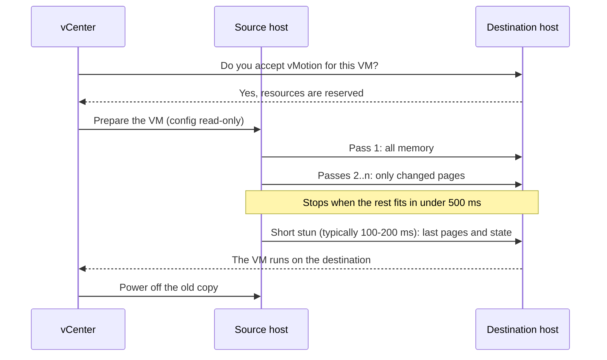
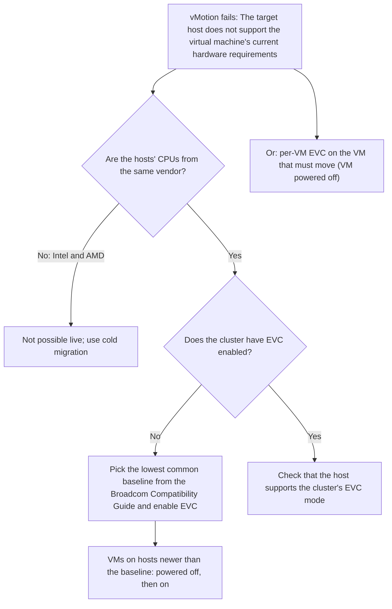

:::analogy
**The data center pain.** You want to empty a host for maintenance, and vMotion hangs at 10% and then times out. Another time you buy a new, faster server, add it to the cluster, and moving VMs (VM, Virtual Machine) onto it fails with "The target host does not support the virtual machine's current hardware requirements". Both are exam topics: the VVF (VMware vSphere Foundation, 2V0-16.25) exam guide covers migration in objectives 2.2.4 and 2.2.5, and the older VCP-DCV (VMware Certified Professional - Data Center Virtualization) in 1.4.2 and 7.6. [S02] [S47] [S208] [S207]

**The analogy: moving an office without stopping work.**

- **Pre-copy** is moving the files the day before: you take everything, then in the evening only what changed during the day, and so on, until a few sheets remain.
- **The stun** is the one-minute pause where the employee stands up from the old desk and sits at the new one, the last sheets in hand.
- **EVC (Enhanced vMotion Compatibility)** is the rule "every desk has the same basic tools": if a new desk has extra tools, they stay in the drawer, so the employee can work the same way anywhere.
:::

:::architecture
### 1. Migration types

| Type | VM state | What moves | Technology |
|---|---|---|---|
| Cold migration | Powered off or suspended | Host, optionally the files | Plain copy |
| Compute only | Powered on | Host, cluster or resource pool | vMotion |
| Storage only | Powered on | Files, to another datastore, same host | Storage vMotion |
| Compute and storage | Powered on or off | Both host and datastore | vMotion without shared storage, or cold |
| Between vCenters | Powered on or off | The VM into another vCenter | Cross vCenter vMotion |

Source: [S210]. Moving to another inventory folder, cloning or copying are **not** migrations. [S210]

### 2. How vMotion works

The steps, per KB (Knowledge Base article) 321009: [S208]

1. vCenter receives the request and asks the destination host whether it accepts vMotion.
2. The source host prepares the VM: the configuration file becomes read-only.
3. The destination host creates and powers on an "empty" copy of the VM.
4. The source copies the VM's memory and state, then stuns it very briefly to send the last changes.
5. vCenter moves the VM to the destination and powers off the copy on the source.

**Pre-copy and convergence** (VMware blog "The vMotion process under the hood"): the first pass copies all memory; later passes send only pages changed in the meantime. Copying stops when what is left can be sent in under 500 ms. The final stun typically lasts 100–200 ms. If the VM dirties memory faster than the network sends it, **SDPS (Stun During Page Send)** inserts pauses of a few microseconds so the migration can finish. [S209]

### 3. vMotion requirements

From the vSphere 8 documentation: [S185]

- **A license** for vMotion on every host.
- **Shared storage** (Fibre Channel SAN, Storage Area Network; iSCSI, Internet Small Computer Systems Interface; NAS, Network Attached Storage) seen by both hosts; without it, disk contents go over the network. RDM (Raw Device Mapping): the same LUN IDs (LUN, Logical Unit Number) on every host.
- **At least one VMkernel adapter for vMotion** on each host, on a secure network reachable only by trusted parties.
- **At least 250 Mbps dedicated for each concurrent vMotion.** From 7.0 Update 2, a single VMkernel adapter can fill 25, 40 and 100 GbE links.
- **Across subnets:** the vMotion TCP/IP (Transmission Control Protocol/Internet Protocol) stack, with its own gateway, separate from management. [S185] [S111]
- **Jumbo frames:** if you use them, the MTU (Maximum Transmission Unit) must be set along the whole path: adapters, virtual and physical switches. [S185]
- **Long distance:** round-trip time between hosts of at most 150 ms. [S185]
- Bandwidth can be guaranteed or limited with NIOC (Network I/O Control) on a VDS (vSphere Distributed Switch). [S185] [S176]

### 4. Simultaneous migration limits

vCenter assigns a "cost" to each operation (ESXi 6.0–8.0): [S200]

| Resource | Max cost | Cost per operation |
|---|---|---|
| Host network, 1 GbE | 4 | vMotion: 1 → 4 at once |
| Host network, 10 GbE | 8 | vMotion: 1 → 8 at once |
| Host | 8 | vMotion 1; Storage vMotion 4; vMotion without shared storage 4; other operations (clone, deploy, cold migration) 1 |
| Datastore | 128 | vMotion 1; Storage vMotion 16 (on source and destination) |

So at most 2 Storage vMotions run at once on a host. [S200]

### 5. Encrypted vMotion

For **unencrypted** VMs you pick the mode: [S201]

- **Disabled:** no encryption.
- **Opportunistic:** encrypted if both hosts support it (ESXi 6.5 or later).
- **Required:** encrypted only; if a host does not support it, the migration is blocked.

**Encrypted** VMs always use encrypted vMotion and you cannot turn it off. It also works between vCenters if both have the same key provider, with the same name. [S201]

### 6. Storage vMotion

Requirements and limitations: [S212] [S213]

- Disks are in **persistent** mode or are RDMs.
- The host running the VM sees **both** datastores.
- **Virtual-mode RDM:** move only the mapping file or convert it to a thin or thick disk (not if the destination is NFS, Network File System).
- **Physical-mode RDM:** move only the mapping file; data goes into a VMDK (Virtual Machine Disk) only through cold migration.
- Do not migrate while VMware Tools is being installed.
- RDM mapping files live on VMFS (Virtual Machine File System), not on NFS. [S213]

### 7. EVC: the same CPU features across the cluster

EVC presents every VM in the cluster with the same CPU (Central Processing Unit) feature set, even when the physical processors differ. It hides only the features that matter for vMotion; VMs still use the higher clock speed and extra cores. [S202]

- **The EVC mode** is a baseline equal to or below the feature set of the weakest host. [S202]
- **Requirements:** ESXi 6.7+, hosts in vCenter, processors from **one vendor** (Intel only or AMD only), advanced features enabled in the BIOS (Basic Input/Output System), CPU supported for the chosen mode, vMotion configured. [S202] EVC does not allow vMotion between Intel and AMD. [S205]
- **Raising the mode:** powered-on VMs stay on, but get the new features only after a **full power cycle**; a reboot from the guest OS (Operating System) is not enough. [S202]
- **Lowering the mode:** VMs running at a higher mode must be powered off. [S202]
- **A new, faster host:** put it in maintenance mode and add it; EVC hides its features above the baseline, and powered-on VMs can move onto it with vMotion. [S206]

**Per-VM EVC:** the mode is set on the VM (VM Options → VMware EVC). It needs vCenter and ESXi 7.0+ and virtual hardware 14+. It is changed **only with the VM powered off**, cannot exceed the cluster's EVC mode, and follows the VM across clusters and vCenters. [S203] [S204]

The left-hand steps come from KB 318962. [S207]

### 8. Migration between vCenters and application notification

- **With Enhanced Linked Mode** (ELM): the same SSO (Single Sign-On) domain, vCenter and ESXi 6.7+, vCenter clocks synchronized. [S211]
- **Advanced Cross vCenter vMotion:** from vCenter 7.0 Update 1c, through **Import VMs** or **Export VMs**, without ELM and across different SSO domains. [S210] [S211]
- **vMotion application notification** (vSphere 8): vMotion notifies the application inside the VM and waits for an acknowledgment, up to a timeout, before migrating. It needs virtual hardware 20+, up-to-date VMware Tools, and enabling on the VM and the host; it is **disabled by default**. Typical example: draining a SQL Server cluster node before the move. [S214]

[IMAGE SEARCH / PROMPT] "vSphere Client Migrate wizard select a migration type change compute resource storage both", to see the migration type screen.
:::

:::exam-alert
### Memorize

| What | Value / rule | Source |
|---|---|---|
| vMotion bandwidth | At least 250 Mbps dedicated per concurrent vMotion | Docs [S185] |
| Long distance | RTT (round-trip time) at most 150 ms | Docs [S185] |
| Concurrent vMotions per host | 4 on 1 GbE, 8 on 10 GbE | Docs [S200] |
| Concurrent Storage vMotions per host | 2 (cost 4 of 8) | Docs [S200] |
| Datastore | Max cost 128; Storage vMotion costs 16 | Docs [S200] |
| Switchover stun | Typically 100–200 ms | VMware blog [S209] |
| Encrypted vMotion | Disabled / Opportunistic / Required; encrypted VM = always encrypted | Docs [S201] |
| EVC | One vendor; ESXi 6.7+ | Docs [S202] |
| Raising EVC | New features after a full power cycle | Docs [S202] |
| Per-VM EVC | HW 14+, only with VM off, ≤ cluster EVC | Docs [S203] |
| Advanced Cross vCenter vMotion | vCenter 7.0 U1c+, different SSO domains | Docs [S210] [S211] |

### 3 exam traps

1. **"You raise the EVC mode, restart Windows, and the VM sees the new features."** False. The VM needs a full power cycle; a reboot from the guest OS is not enough. [S202]
2. **"A host with 1 GbE for vMotion runs 8 vMotions at once."** False. On 1 GbE the limit is 4; 8 is the 10 GbE limit. [S200]
3. **"Per-VM EVC can be changed with the VM powered on, like cluster EVC."** False. The documentation says per-VM EVC is changed only with the VM powered off. [S203]
:::

:::trenches
**Mistake 1: jumbo frames set only halfway.**
The admin sets MTU 9000 on the vMotion VMkernel adapters but not on the physical switch. vMotion hangs at 10% and then times out. KB 321009 lists a mismatched MTU among the typical causes. [S208]
**Fix:** test the path end to end with the command from KB 321009, for adapters on the vMotion stack: `vmkping -d -s 8972 -S vmotion -I vmk<#> <destination-IP>` (8972 = 9000 minus 28 bytes of headers; on the default stack drop `-S vmotion`). If the packet does not pass, set the MTU along the whole path or go back to 1500 everywhere. [S208] [S185]

**Mistake 2: a new, different-generation host in a cluster without EVC.**
The new server has a newer processor. VMs powered on there can no longer move back to the old hosts: the error "The target host does not support the virtual machine's current hardware requirements" appears. [S207]
**Fix:** identify each host's processor, look up the lowest common baseline in the Broadcom Compatibility Guide, power off VMs on hosts newer than the baseline, enable EVC under Configure → VMware EVC and power the VMs on. For a single VM you can use per-VM EVC. Going forward, new hosts join the cluster in maintenance mode. [S207] [S206] [S203]
:::

:::interview
**Junior/Mid question: "Briefly explain how vMotion moves a running VM."**

*Ideal answer:* vCenter checks the destination, which creates a copy of the VM. The source copies memory in successive passes: all of it first, then only changed pages. When the rest fits in under 500 ms, the VM is stunned very briefly (typically 100–200 ms), the last pages and state reach the destination, and the VM continues there. [S208] [S209] A strong candidate adds the requirements: storage both hosts can see, a vMotion VMkernel adapter, at least 250 Mbps per migration and a secure vMotion network; for encryption, pick the right encrypted vMotion mode. [S185] [S201]

**Troubleshooting scenario: "vMotion between two hosts hangs at 10% and times out. What do you check?"**

*The answer a Team Lead expects:*
1. **vMotion enabled** on a VMkernel adapter on both hosts. [S208]
2. **Connectivity:** `vmkping` from the vMotion vmk to the other host's vMotion IP, including on the vMotion stack. [S208]
3. **MTU** end to end, with `-d -s 8972` if you use jumbo frames. [S208]
4. **Packet loss, name resolution, clock** synchronized on hosts and the host connected to vCenter. [S208]
5. **Across subnets:** the vMotion TCP/IP stack with its own gateway. [S185]
:::

:::lab
**Scenario.** You check the vMotion network, move a running VM between hosts, then to another datastore, read the cluster's EVC mode and configure per-VM EVC on a powered-off VM.

**What you need.** Two hosts in the same cluster, a shared datastore and one more datastore, plus a small test VM. SSH temporarily enabled for step 2. In a nested lab, EVC depends on your computer's physical processor; if EVC options are unavailable, read only what you can (**home-lab only**).

The steps below can be ticked off, and progress is saved in the browser. Exact menu names may differ slightly between versions 8 and 9 (`⚠ to verify`).

**Failure and validation test.** At step 3, keep a continuous ping to the VM during vMotion. The stun typically lasts 100–200 ms [S209], so normally the ping continues with very few losses or none. If you see many losses, check the MTU and the VM network on the destination host.
:::

:::quiz
Five original questions, in the style of VCP (VMware Certified Professional) exams. You get the explanation for every option right after answering.
:::

:::references
- VCP-VVF Administrator 2V0-16.25 exam guide, objectives 2.2.4 and 2.2.5 [S02]
- VCP-DCV 2V0-21.23 exam guide (Legacy certification), objectives 1.4.2 and 7.6 [S47]
- vSphere 8 docs: vMotion requirements [S185], migration types [S210], limits [S200]
- KB 321009 and the blog "The vMotion process under the hood" [S208] [S209]
- vSphere 8 docs: encrypted vMotion [S201] and Storage vMotion [S212]
- EVC documentation [S202] and per-VM EVC [S203]
- KB 318962, KB 411652, KB 324991: EVC in practice [S207] [S206] [S205]
- Documentation for migration between vCenters [S211] and the blog on application notification [S214]
:::
