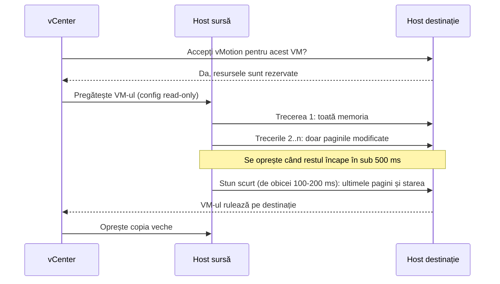
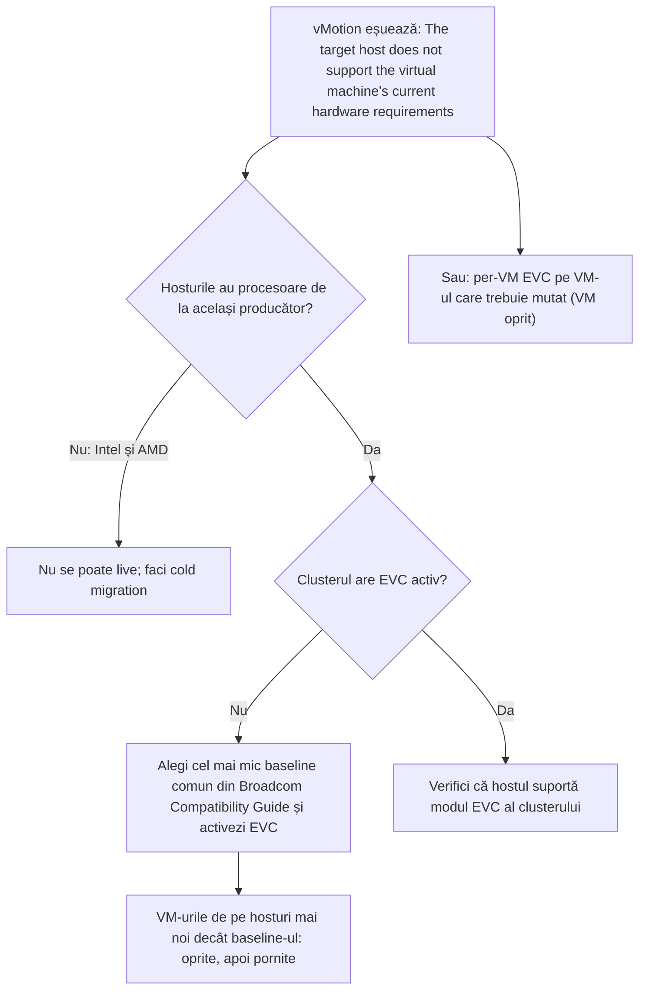

:::analogy
**Durerea din data center.** Vrei să golești un host pentru mentenanță, iar vMotion se blochează la 10% și apoi expiră. Altă dată cumperi un server nou, mai performant, îl pui în cluster, iar mutarea VM-urilor (VM, Virtual Machine) pe el eșuează cu mesajul „The target host does not support the virtual machine's current hardware requirements”. Ambele sunt subiecte de examen: exam guide-ul VVF (VMware vSphere Foundation, 2V0-16.25) are migrarea la obiectivele 2.2.4 și 2.2.5, iar vechiul VCP-DCV (VMware Certified Professional - Data Center Virtualization) la 1.4.2 și 7.6. [S02] [S47] [S208] [S207]

**Analogia: mutarea unui birou fără să oprești lucrul.**

- **Pre-copy** e mutarea dosarelor cu o zi înainte: duci tot, apoi seara duci doar ce s-a schimbat peste zi, și tot așa, până rămân câteva foi.
- **Stun-ul** e pauza de un minut în care angajatul se ridică de la biroul vechi și se așază la cel nou, cu ultimele foi în mână.
- **EVC (Enhanced vMotion Compatibility)** e regula „toate birourile au aceleași unelte de bază”: dacă un birou nou are unelte în plus, ele stau în sertar, ca angajatul să poată lucra oriunde la fel.
:::

:::architecture
### 1. Tipurile de migrare

| Tip | Starea VM-ului | Ce se mută | Tehnologia |
|---|---|---|---|
| Cold migration | Oprit sau suspendat | Host, opțional și fișierele | Copiere obișnuită |
| Doar compute | Pornit | Hostul, cluster-ul sau resource pool-ul | vMotion |
| Doar stocare | Pornit | Fișierele, pe alt datastore, același host | Storage vMotion |
| Compute și stocare | Pornit sau oprit | Și hostul, și datastore-ul | vMotion fără stocare partajată sau cold |
| Între vCenter-e | Pornit sau oprit | VM-ul în alt vCenter | Cross vCenter vMotion |

Sursa: [S210]. Mutarea într-un alt folder din inventar, clonarea sau copierea **nu** sunt migrări. [S210]

### 2. Cum lucrează vMotion

Pașii, după KB (Knowledge Base article) 321009: [S208]

1. vCenter primește cererea și întreabă hostul destinație dacă acceptă vMotion.
2. Hostul sursă pregătește VM-ul: fișierul de configurare devine read-only.
3. Hostul destinație creează și pornește o copie „goală” a VM-ului.
4. Sursa copiază memoria și starea VM-ului, apoi îl oprește foarte scurt (stun) ca să trimită ultimele schimbări.
5. vCenter mută VM-ul pe destinație și oprește copia de pe sursă.

**Pre-copy și convergența** (blogul VMware „The vMotion process under the hood”): prima trecere copiază toată memoria; următoarele trimit doar paginile modificate între timp. Copierea se oprește când ce a rămas se poate trimite în mai puțin de 500 ms. Stun-ul final durează de obicei 100–200 ms. Dacă VM-ul murdărește memoria mai repede decât o trimite rețeaua, **SDPS (Stun During Page Send)** inserează pauze de ordinul microsecundelor, ca migrarea să se poată termina. [S209]

### 3. Cerințele vMotion

Din documentația vSphere 8: [S185]

- **Licență** pentru vMotion pe fiecare host.
- **Stocare partajată** (Fibre Channel SAN, Storage Area Network; iSCSI, Internet Small Computer Systems Interface; NAS, Network Attached Storage) văzută de ambele hosturi; dacă nu există, conținutul discurilor trece prin rețea. RDM (Raw Device Mapping): aceleași LUN ID-uri (LUN, Logical Unit Number) pe toate hosturile.
- **Cel puțin un adaptor VMkernel pentru vMotion** pe fiecare host, într-o rețea sigură, accesibilă doar celor de încredere.
- **Cel puțin 250 Mbps dedicați pentru fiecare vMotion simultan.** De la 7.0 Update 2, un singur adaptor VMkernel poate umple legături de 25, 40 și 100 GbE.
- **Între subneturi:** stiva TCP/IP (Transmission Control Protocol/Internet Protocol) vMotion, cu gateway propriu, separat de management. [S185] [S111]
- **Jumbo frames:** dacă le folosești, MTU-ul (Maximum Transmission Unit) trebuie setat pe tot drumul: plăci, switch-uri virtuale și fizice. [S185]
- **Distanță mare:** timpul dus-întors (round-trip time) între hosturi de maximum 150 ms. [S185]
- Lățimea de bandă se poate garanta sau limita cu NIOC (Network I/O Control) pe VDS (vSphere Distributed Switch). [S185] [S176]

### 4. Limitele de migrări simultane

vCenter calculează un „cost” pentru fiecare operație (ESXi 6.0–8.0): [S200]

| Resursă | Cost maxim | Cost per operație |
|---|---|---|
| Rețeaua hostului, 1 GbE | 4 | vMotion: 1 → 4 simultan |
| Rețeaua hostului, 10 GbE | 8 | vMotion: 1 → 8 simultan |
| Hostul | 8 | vMotion 1; Storage vMotion 4; vMotion fără stocare partajată 4; alte operații (clone, deploy, cold migration) 1 |
| Datastore-ul | 128 | vMotion 1; Storage vMotion 16 (pe sursă și pe destinație) |

Deci pe un host rulează simultan cel mult 2 Storage vMotion. [S200]

### 5. Encrypted vMotion

Pentru VM-urile **necriptate** alegi modul: [S201]

- **Disabled:** fără criptare.
- **Opportunistic:** criptat dacă ambele hosturi îl suportă (ESXi 6.5 sau mai nou).
- **Required:** doar criptat; dacă un host nu îl suportă, migrarea e blocată.

VM-urile **criptate** folosesc mereu encrypted vMotion și nu poți dezactiva asta. Merge și între vCenter-e, dacă ambele au același key provider, cu același nume. [S201]

### 6. Storage vMotion

Cerințe și limitări: [S212] [S213]

- Discurile sunt în modul **persistent** sau sunt RDM.
- Hostul pe care rulează VM-ul vede **ambele** datastore-uri.
- **RDM în modul virtual:** muți doar fișierul de mapare sau îl convertești în disc thin sau thick (nu dacă destinația e NFS, Network File System).
- **RDM în modul fizic:** muți doar fișierul de mapare; datele trec în VMDK (Virtual Machine Disk) numai prin cold migration.
- Nu migrezi în timp ce se instalează VMware Tools.
- Fișierele de mapare RDM stau pe VMFS (Virtual Machine File System), nu pe NFS. [S213]

### 7. EVC: aceleași funcții de procesor în tot clusterul

EVC arată tuturor VM-urilor din cluster același set de funcții CPU (Central Processing Unit), chiar dacă procesoarele fizice diferă. Ascunde doar funcțiile care contează pentru vMotion; VM-urile folosesc în continuare frecvența mai mare și nucleele în plus. [S202]

- **Modul EVC** e un baseline egal cu sau mai mic decât setul de funcții al celui mai slab host. [S202]
- **Cerințe:** ESXi 6.7+, hosturi în vCenter, procesoare de la **un singur producător** (doar Intel sau doar AMD), funcțiile avansate activate în BIOS (Basic Input/Output System), CPU suportat pentru modul ales, vMotion configurat. [S202] EVC nu permite vMotion între Intel și AMD. [S205]
- **Ridici modul:** VM-urile pornite rămân pornite, dar primesc funcțiile noi abia după un **power cycle complet**; un reboot din sistemul de operare nu ajunge. [S202]
- **Cobori modul:** VM-urile care rulează la un mod mai mare trebuie oprite. [S202]
- **Host nou, mai puternic:** îl pui în maintenance mode și îl adaugi; EVC îi ascunde funcțiile peste baseline, iar VM-urile pornite se pot muta pe el prin vMotion. [S206]

**Per-VM EVC:** modul se setează pe VM (VM Options → VMware EVC). Cere vCenter și ESXi 7.0+ și hardware virtual 14+. Se schimbă **doar cu VM-ul oprit**, nu poate depăși modul EVC al clusterului și îl urmează pe VM între clustere și vCenter-e. [S203] [S204]

Pașii din stânga vin din KB 318962. [S207]

### 8. Migrarea între vCenter-e și notificarea aplicațiilor

- **Cu Enhanced Linked Mode** (ELM): același domeniu SSO (Single Sign-On), vCenter și ESXi 6.7+, ceasurile vCenter-elor sincronizate. [S211]
- **Advanced Cross vCenter vMotion:** de la vCenter 7.0 Update 1c, prin **Import VMs** sau **Export VMs**, fără ELM și între domenii SSO diferite. [S210] [S211]
- **vMotion application notification** (vSphere 8): vMotion anunță aplicația din VM și așteaptă confirmarea, până la un timeout, înainte de migrare. Cere hardware virtual 20+, VMware Tools actualizat, activare pe VM și pe host; e **dezactivată implicit**. Exemplu tipic: un nod de cluster SQL Server golit înainte de mutare. [S214]

[IMAGE SEARCH / PROMPT] „vSphere Client Migrate wizard select a migration type change compute resource storage both”, ca să vezi ecranul de alegere a tipului de migrare.
:::

:::exam-alert
### De memorat

| Ce | Valoare / regulă | Sursă |
|---|---|---|
| Lățime de bandă vMotion | Minimum 250 Mbps dedicați pe fiecare vMotion simultan | Docs [S185] |
| Distanță mare | RTT (round-trip time) maximum 150 ms | Docs [S185] |
| vMotion simultane pe host | 4 la 1 GbE, 8 la 10 GbE | Docs [S200] |
| Storage vMotion simultane pe host | 2 (cost 4 din 8) | Docs [S200] |
| Datastore | Cost maxim 128; Storage vMotion costă 16 | Docs [S200] |
| Stun la switchover | De obicei 100–200 ms | Blog VMware [S209] |
| Encrypted vMotion | Disabled / Opportunistic / Required; VM criptat = mereu criptat | Docs [S201] |
| EVC | Un singur producător; ESXi 6.7+ | Docs [S202] |
| Ridicarea EVC | Funcțiile noi după power cycle complet | Docs [S202] |
| Per-VM EVC | HW 14+, doar cu VM-ul oprit, ≤ EVC-ul clusterului | Docs [S203] |
| Advanced Cross vCenter vMotion | vCenter 7.0 U1c+, domenii SSO diferite | Docs [S210] [S211] |

### 3 capcane de examen

1. **„Ridici modul EVC, faci restart din Windows, iar VM-ul vede funcțiile noi.”** Fals. E nevoie de un power cycle complet al VM-ului; reboot-ul din sistemul de operare nu ajunge. [S202]
2. **„Un host cu 1 GbE pentru vMotion rulează 8 vMotion simultan.”** Fals. La 1 GbE limita e 4; 8 e limita la 10 GbE. [S200]
3. **„Per-VM EVC se poate schimba cu VM-ul pornit, ca EVC-ul de cluster.”** Fals. Documentația spune că per-VM EVC se schimbă doar cu VM-ul oprit. [S203]
:::

:::trenches
**Greșeala 1: jumbo frames setate doar pe jumătate.**
Adminul pune MTU 9000 pe adaptoarele VMkernel vMotion, dar nu și pe switch-ul fizic. vMotion se blochează la 10% și apoi expiră. KB 321009 enumeră MTU-ul nepotrivit printre cauzele tipice. [S208]
**Remediere:** testezi drumul cap-coadă cu comanda din KB 321009, pentru adaptoarele de pe stiva vMotion: `vmkping -d -s 8972 -S vmotion -I vmk<#> <IP-destinație>` (8972 = 9000 minus 28 de octeți de antete; pe stiva implicită renunți la `-S vmotion`). Dacă pachetul nu trece, setezi MTU-ul pe tot drumul sau revii la 1500 peste tot. [S208] [S185]

**Greșeala 2: host nou, de altă generație, în cluster fără EVC.**
Serverul nou are procesor mai nou. VM-urile pornite pe el nu se mai pot muta înapoi pe hosturile vechi: apare eroarea „The target host does not support the virtual machine's current hardware requirements”. [S207]
**Remediere:** identifici procesorul fiecărui host, cauți în Broadcom Compatibility Guide cel mai mic baseline comun, oprești VM-urile de pe hosturile mai noi decât baseline-ul, activezi EVC la Configure → VMware EVC și pornești VM-urile. Pentru un singur VM poți folosi per-VM EVC. Pe viitor, hosturile noi intră în cluster în maintenance mode. [S207] [S206] [S203]
:::

:::interview
**Întrebare Junior/Mid: „Explică pe scurt cum mută vMotion un VM pornit.”**

*Răspunsul ideal:* vCenter verifică destinația, care creează o copie a VM-ului. Sursa copiază memoria în treceri succesive: întâi toată, apoi doar paginile modificate. Când restul încape în sub 500 ms, VM-ul e oprit foarte scurt (de obicei 100–200 ms), ultimele pagini și starea ajung pe destinație, iar VM-ul continuă acolo. [S208] [S209] Un candidat bun adaugă cerințele: stocare văzută de ambele hosturi, adaptor VMkernel vMotion, minimum 250 Mbps pe migrare și o rețea vMotion sigură; pentru criptare alege modul encrypted vMotion potrivit. [S185] [S201]

**Scenariu de troubleshooting: „vMotion între două hosturi se blochează la 10% și expiră. Ce verifici?”**

*Răspunsul pe care îl așteaptă un Team Lead:*
1. **vMotion activ** pe un adaptor VMkernel pe ambele hosturi. [S208]
2. **Conectivitatea:** `vmkping` de pe vmk-ul vMotion spre IP-ul vMotion al celuilalt host, inclusiv pe stiva vMotion. [S208]
3. **MTU-ul** cap-coadă, cu `-d -s 8972` dacă folosești jumbo frames. [S208]
4. **Pierderile de pachete, rezolvarea numelor, ceasul** sincronizat pe hosturi și hostul conectat la vCenter. [S208]
5. **Între subneturi:** stiva TCP/IP vMotion cu gateway propriu. [S185]
:::

:::lab
**Scenariu.** Verifici rețeaua vMotion, muți un VM pornit între hosturi, apoi pe alt datastore, citești modul EVC al clusterului și configurezi per-VM EVC pe un VM oprit.

**Ce ai nevoie.** Două hosturi în același cluster, un datastore partajat și încă un datastore, plus un VM de test mic. SSH pornit temporar pentru pasul 2. Într-un lab nested, EVC depinde de procesorul fizic al calculatorului tău; dacă opțiunile EVC sunt indisponibile, citești doar ce se poate (**home-lab only**).

Pașii de mai jos sunt bifabili, iar progresul se salvează în browser. Numele exacte ale meniurilor pot diferi puțin între versiunile 8 și 9 (`⚠ de verificat`).

**Test de avarie și validare.** La pasul 3, lași un ping continuu spre VM în timpul vMotion. Stun-ul durează de obicei 100–200 ms [S209], deci în mod normal ping-ul continuă cu foarte puține pierderi sau deloc. Dacă vezi multe pierderi, verifici MTU-ul și rețeaua de VM pe hostul destinație.
:::

:::quiz
Cinci întrebări originale, în stilul examenelor VCP (VMware Certified Professional). Primești explicația pentru fiecare variantă imediat după ce răspunzi.
:::

:::references
- Exam guide VCP-VVF Administrator 2V0-16.25, obiectivele 2.2.4 și 2.2.5 [S02]
- Exam guide VCP-DCV 2V0-21.23 (certificare Legacy), obiectivele 1.4.2 și 7.6 [S47]
- Documentația vSphere 8: cerințele vMotion [S185], tipurile de migrare [S210], limitele [S200]
- KB 321009 și blogul „The vMotion process under the hood” [S208] [S209]
- Documentația vSphere 8: encrypted vMotion [S201] și Storage vMotion [S212]
- Documentația EVC [S202] și per-VM EVC [S203]
- KB 318962, KB 411652, KB 324991: EVC în practică [S207] [S206] [S205]
- Documentația pentru migrarea între vCenter-e [S211] și blogul despre notificarea aplicațiilor [S214]
:::
