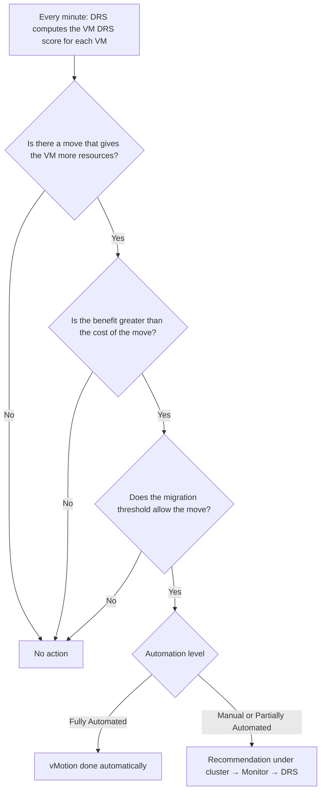
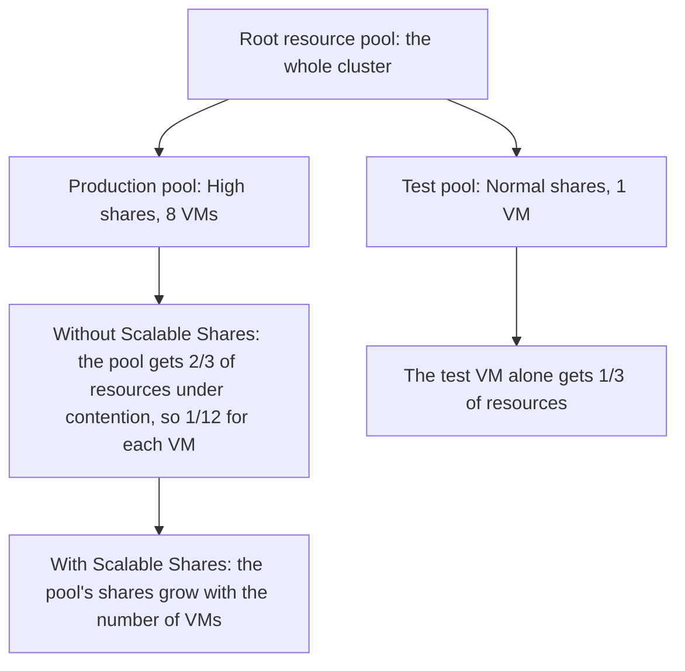

:::analogy
**The data center pain.** You put a host in maintenance mode for a memory upgrade, and the task sits at 30% for a whole hour. Nobody noticed that DRS (Distributed Resource Scheduler) was set to "Partially Automated". Another time, the production team complains that their VMs (VM, Virtual Machine), placed in a "High" resource pool, run worse than the single test VM in the "Normal" pool. Both are exam topics: the VVF (VMware vSphere Foundation, 2V0-16.25) exam guide covers DRS in objective 2.2.2, and the older VCP-DCV (VMware Certified Professional - Data Center Virtualization) in 1.4.1, 1.4.3, 5.1 and 7.5. [S02] [S47] [S228] [S218]

**The analogy: the taxi dispatch office.**

- **DRS** is the dispatcher: when a new customer calls (you power on a VM), it picks the best car; when an area gets crowded, it moves drivers around.
- **The automation level** is how much the dispatcher may decide alone: only suggest, choose only the first ride, or move cars at any time.
- **Resource pools** are company contracts: company A has double priority over company B. But if company A sends 10 employees and B just one, B's employee may end up with more room than each person from A.
- **Affinity rules** are requests like "these two customers do not ride in the same car" or "the VIP customer rides only in the black cars".
:::

:::architecture
### 1. What DRS does and what it needs

DRS does two things: it picks the host when a VM powers on (**initial placement**) and moves VMs with vMotion to balance the cluster (**load balancing**). [S215] For that, hosts must be able to vMotion between each other [S185], and the processors must be compatible: same vendor and same family, or EVC (Enhanced vMotion Compatibility) enabled on the cluster. [S223] [S202]

| Automation level | Initial placement | Balancing migrations |
|---|---|---|
| Manual | Recommendation | Recommendation |
| Partially Automated | **Automatic** | Recommendation |
| Fully Automated | Automatic | **Automatic** |

At the VM level you can override the cluster's level, including with **Disabled**: vCenter neither moves the VM nor recommends moving it. [S215]

### 2. How DRS decides (vSphere 7 and later)

The VMware performance study on DRS in vSphere 7 describes the change: [S216]

- **Old DRS** (6.7 and older): ran every 5 minutes and looked at the imbalance between hosts (the standard deviation of load).
- **New DRS:** runs **every minute** and is **VM-centric**. It looks for moves that give a VM more available resources and makes them only if the benefit outweighs the cost of the move.
- **VM DRS score** shows how well the VM gets its resources; DRS moves VMs to raise it. The cluster score is a weighted average of the powered-on VMs' scores. [S216] [S215]

**The migration threshold**, from conservative to aggressive: [S216]

| Level | When DRS moves |
|---|---|
| 1 | Only mandatory moves: rule violations, maintenance mode |
| 2 | Only at or near contention |
| 3 (default) | Also to raise VM DRS score and spread load better |
| 4 | Reacts to occasional sudden spikes |
| 5 | Reacts to every load change |

Other options in the DRS settings: **Predictive DRS** (works with forecasts from a supported operations server, vRealize Operations in the 8.0 docs), **VM Distribution** (spreads VMs for availability), **CPU Over-Commitment** (CPU, Central Processing Unit) and **Scalable Shares**. [S215]

### 3. Resource pools

Every host and every DRS cluster has an invisible **root resource pool** holding all its resources. Under it you create pools, which can have their own pools. [S217] Each pool has: [S217]

- **Shares:** priority relative to "siblings" (pools and VMs on the same level). Low : Normal : High = **1 : 2 : 4**.
- **Reservation:** the guaranteed minimum of CPU or memory; 0 by default. It is subtracted from the parent's unreserved resources.
- **Limit:** the maximum; usually Unlimited.
- **Expandable reservation:** **on by default**. If the pool's VMs need more reservation at power-on than the pool has, it borrows from its parent and ancestors.

**Admission control** runs when you power on a VM in a pool or create a child pool: you cannot break the reservation or the limit. With a fixed reservation, the pool must have enough unreserved resources on its own; with expandable, it can borrow, but isolation weakens. [S217]

**The resource pool paradox.** Shares are split first between pools, then between the VMs in each pool. A High pool with many VMs can give each VM less than the single VM in a Normal pool receives. **Scalable Shares** (vSphere 7) fixes this: it also accounts for how many VMs each pool holds. It is enabled on the cluster or on a pool. [S218] [S215]

The example is computed from the 4 : 2 ratio between High and Normal (2/3 versus 1/3) and only matters under contention. [S217] [S89]

### 4. Affinity rules

**VM-VM:** [S219]

- **Affinity:** DRS tries to keep the VMs on the **same** host (for example for performance).
- **Anti-affinity:** DRS tries to keep them on **different** hosts, so a single host failure does not take them all down.
- If the rule is already violated when you create it, DRS tries to correct it. Rules DRS cannot satisfy show up under cluster → Monitor → DRS → **Faults**.

**VM-Host:** links a **VM group** to a **host group**, with "must" or "should" and "run on" or "not run on". All VMs and hosts in the rule are in the same cluster. [S220]

| | Must (required) | Should (preferential) |
|---|---|---|
| DRS | Respects it in placement and migration | Respects it normally |
| HA (High Availability) | Respects it at failover too | May break it to restart VMs |
| If all hosts in the group fail | VMs stay **powered off** | VMs start on other hosts |
| Fits | Strict licensing or compliance | Performance, logical grouping |

Sources: [S221] [S222]. When two VM-Host rules conflict, **the older one** wins and the newer one is disabled. You can set an alarm on the event "VM is violating VM-Host Affinity Rule". [S221]

### 5. Maintenance mode

A host enters maintenance mode only when you ask. Until all running VMs are moved (manually or by DRS) or powered off, the host stays in "Entering Maintenance Mode"; meanwhile you cannot power on or move VMs onto it. [S227] If DRS is Manual or Partially Automated, the task stops around 29–32%, because vCenter only recommends the migrations. The fix: Fully Automated or migrating each VM manually. [S228]

### 6. vCLS: the cluster services

**vCLS (vSphere Cluster Services)** keeps DRS and HA available through a few system VMs, which you do not touch unless support tells you to. [S225]

- **Classic vCLS:** 1–3 VMs per cluster, depending on cluster size. [S225]
- **Embedded vCLS (from 8.0 U3):** turns on when vCenter is 8.0 U3 and the cluster has at least one 8.0 U3 host. At most 2 VMs (1 in a single-host cluster), running **only in host memory**, with no datastore, and they do not move with vMotion. [S226] [S224]
- **Before 9.0**, DRS needs at least one running vCLS VM: after 3 minutes without any, the state becomes Unhealthy and DRS skips its run. [S224] [S225]
- **In 9.0 and later**, KB (Knowledge Base article) 312147 says disabling vCLS no longer affects DRS or HA. [S225]
- For troubleshooting there is **retreat mode** (KB 316514). [S225]

[IMAGE SEARCH / PROMPT] "vSphere Client cluster Monitor vSphere DRS VM DRS Score histogram", to see what DRS scores look like.
:::

:::exam-alert
### Memorize

| What | Value / rule | Source |
|---|---|---|
| Partially Automated | Automatic initial placement, migrations only recommended | Docs [S215] |
| How often DRS runs | Every minute (vSphere 7+; previously every 5 minutes) | VMware study [S216] |
| Default migration threshold | 3 of 5; level 1 = mandatory moves only | VMware study [S216] |
| Shares in pools | Low : Normal : High = 1 : 2 : 4 | Docs [S217] |
| Expandable reservation | On by default | Docs [S217] |
| Resource pool paradox | Solved by Scalable Shares (vSphere 7) | Blog [S218] |
| Conflicting VM-Host rules | The oldest wins | Docs [S221] |
| Must run on + the group fails | HA does not restart VMs outside the group | KB 447700 [S222] |
| Maintenance mode stuck at ~30% | DRS Manual or Partially Automated | KB 451053 [S228] |
| Embedded vCLS | From 8.0 U3; max 2 VMs; no datastore | VMware blog [S226] |
| vCLS in 9.0 | Disabling it does not affect DRS or HA | KB 312147 [S225] |

### 3 exam traps

1. **"In Partially Automated, DRS moves VMs on its own when the cluster is unbalanced."** False. Only initial placement is automatic; balancing migrations stay recommendations. [S215]
2. **"A VM in a High pool always gets more than one in a Normal pool."** False. Shares are split first between pools; a High pool with many VMs can give each less. That is why Scalable Shares exists. [S218] [S217]
3. **"With a Must run on rule, HA still restarts the VMs on another host if the whole group fails."** False. Must rules are respected by HA too; the VMs stay powered off. [S221] [S222]
:::

:::trenches
**Mistake 1: maintenance mode that never finishes.**
The cluster had been set to Partially Automated "so DRS stops moving VMs during the day". At maintenance time, the task sits between 29% and 32%, and vMotion starts for no VM. [S228]
**Fix:** either set DRS to Fully Automated (cluster → Configure → vSphere DRS → Edit → Automation Level) or move each VM manually with Migrate. If you want fewer moves during the day, lower the migration threshold, not the automation. [S228] [S216]

**Mistake 2: the reflexive "Must" rule.**
For an "important" application, someone created a VM-Host rule "Must run on hosts in group" with two hosts. Both hosts fail (same power feed), and HA does not restart the VMs on the other healthy hosts in the cluster. [S222]
**Fix:** change the rule to "Should run on", so HA can restart the VMs anywhere. Keep "Must" only for real licensing or compliance requirements, accepting that the VMs stay down if the group fails. [S222] [S221]
:::

:::interview
**Junior/Mid question: "What are the DRS automation levels and when do you use each?"**

*Ideal answer:* Manual: DRS only recommends both placement and migrations; good when you want full control. Partially Automated: placement at power-on is automatic, migrations stay recommendations. Fully Automated: DRS does both placement and migrations on its own; the usual choice in production. [S215] A strong candidate adds that aggressiveness is tuned through the migration threshold (default 3), and that with Manual or Partially Automated, maintenance mode waits for manual migrations. [S216] [S228]

**Troubleshooting scenario: "DRS has made no recommendation for hours, although one host is much busier. What do you check?"**

*The answer a Team Lead expects:*
1. **vCLS health:** on 8.x, with no vCLS VM running for 3 minutes, DRS skips its run. [S224]
2. **DRS settings:** automation level and migration threshold; at level 1 DRS makes only mandatory moves. [S216]
3. **VM overrides:** VMs with automation Disabled are not moved. [S215]
4. **Rules and Faults:** cluster → Monitor → DRS → Faults shows which rules DRS cannot satisfy. [S219]
5. **Compatibility:** vMotion configured on the hosts and compatible CPUs or EVC. [S185] [S223]
:::

:::lab
**Scenario.** You read the DRS settings, create two resource pools and see the paradox, make a VM-VM anti-affinity rule and a VM-Host "should" rule, then put a host in maintenance mode first with Partially Automated, then with Fully Automated.

**What you need.** A cluster with at least two hosts, DRS enabled, working vMotion (lesson 2.6) and three small test VMs.

The steps below can be ticked off, and progress is saved in the browser. Exact menu names may differ slightly between versions 8 and 9 (`⚠ to verify`).

**Failure and validation test.** At step 5, with DRS on Partially Automated, maintenance mode must stay stuck (around 30%). After switching to Fully Automated, the VMs must leave the host on their own, and the two anti-affinity VMs must stay on different hosts as long as two hosts are available.
:::

:::quiz
Five original questions, in the style of VCP (VMware Certified Professional) exams. You get the explanation for every option right after answering.
:::

:::references
- VCP-VVF Administrator 2V0-16.25 exam guide, objective 2.2.2 [S02]
- VCP-DCV 2V0-21.23 exam guide (Legacy certification), objectives 1.4.1, 1.4.3, 5.1, 7.5 [S47]
- vSphere 8 docs: DRS settings [S215] and resource pools [S217]
- VMware study "DRS in vSphere 7" [S216] and the Scalable Shares article [S218]
- vSphere 8 docs: VM-VM rules [S219] and VM-Host rules [S220] [S221]
- KB 447700 and KB 451053: must vs should and stuck maintenance mode [S222] [S228]
- vCLS documentation [S224], KB 312147 [S225] and the embedded vCLS blog [S226]
:::
