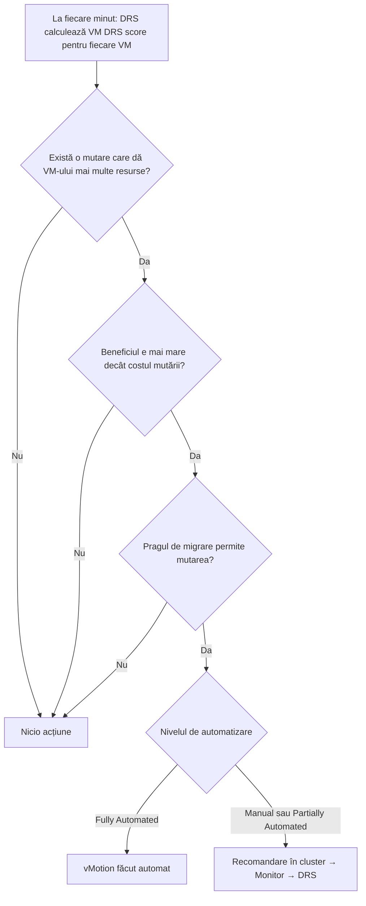
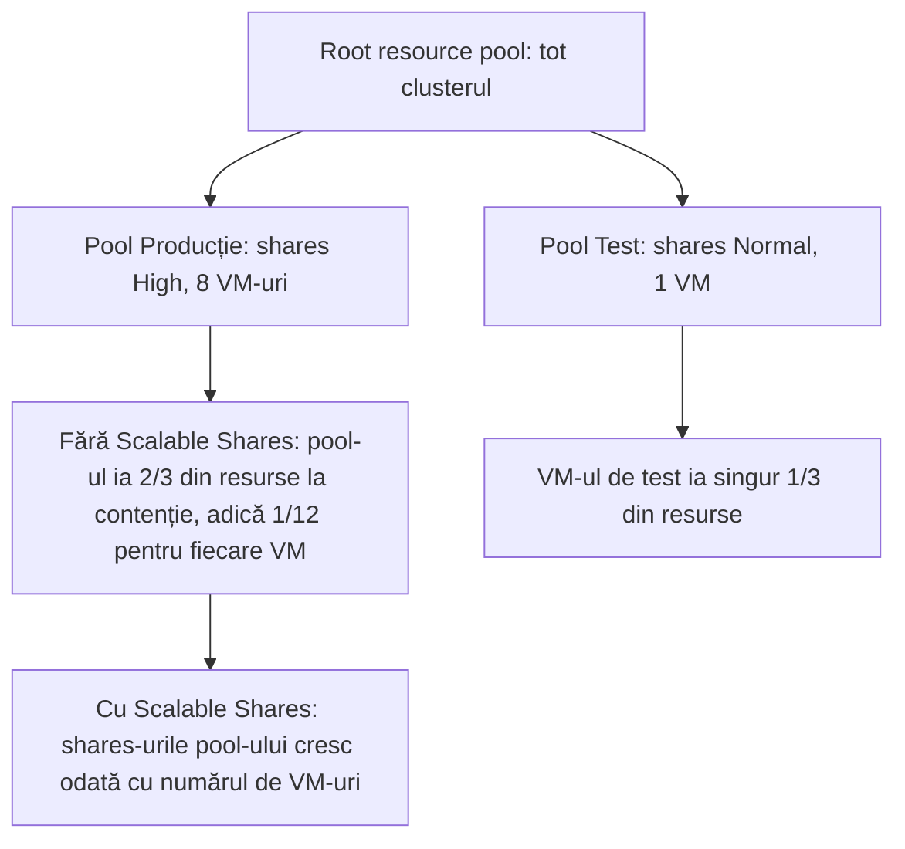

:::analogy
**Durerea din data center.** Pui un host în maintenance mode pentru un upgrade de memorie, iar task-ul stă la 30% o oră întreagă. Nimeni nu s-a uitat că DRS (Distributed Resource Scheduler) era pe „Partially Automated”. Altă dată, echipa de producție se plânge că VM-urile (VM, Virtual Machine) ei, puse într-un resource pool „High”, merg mai prost decât singurul VM de test din pool-ul „Normal”. Ambele sunt subiecte de examen: exam guide-ul VVF (VMware vSphere Foundation, 2V0-16.25) are DRS la obiectivul 2.2.2, iar vechiul VCP-DCV (VMware Certified Professional - Data Center Virtualization) la 1.4.1, 1.4.3, 5.1 și 7.5. [S02] [S47] [S228] [S218]

**Analogia: dispeceratul de taxiuri.**

- **DRS** e dispecerul: când sună un client nou (pornești un VM), îi alege mașina cea mai potrivită; când o zonă se aglomerează, mută șoferi dintr-o parte în alta.
- **Nivelul de automatizare** e cât de mult are voie dispecerul să decidă singur: doar să propună, să aleagă doar la prima cursă sau să mute oricând.
- **Resource pools** sunt contractele firmelor: firma A are prioritate dublă față de firma B. Dar dacă firma A trimite 10 angajați, iar B unul singur, angajatul lui B poate ajunge să aibă mai mult loc decât fiecare om de la A.
- **Regulile de afinitate** sunt cereri de tipul „acești doi clienți nu merg în aceeași mașină” sau „clientul VIP merge doar cu mașinile negre”.
:::

:::architecture
### 1. Ce face DRS și ce îi trebuie

DRS face două lucruri: alege hostul la pornirea unui VM (**initial placement**) și mută VM-uri cu vMotion ca să echilibreze clusterul (**load balancing**). [S215] Pentru asta, hosturile trebuie să poată face vMotion între ele [S185], iar procesoarele trebuie să fie compatibile: același producător și aceeași familie, sau EVC (Enhanced vMotion Compatibility) activ pe cluster. [S223] [S202]

| Nivel de automatizare | Plasarea inițială | Migrările de echilibrare |
|---|---|---|
| Manual | Recomandare | Recomandare |
| Partially Automated | **Automată** | Recomandare |
| Fully Automated | Automată | **Automate** |

La nivel de VM poți suprascrie nivelul clusterului, inclusiv cu **Disabled**: vCenter nici nu mută VM-ul, nici nu recomandă mutarea lui. [S215]

### 2. Cum decide DRS (vSphere 7 și mai nou)

Studiul de performanță VMware despre DRS în vSphere 7 descrie schimbarea: [S216]

- **DRS vechi** (6.7 și mai vechi): rula la 5 minute și se uita la dezechilibrul dintre hosturi (deviația standard a încărcării).
- **DRS nou:** rulează **la fiecare minut** și e **centrat pe VM**. Caută mutări care dau unui VM mai multe resurse disponibile și le face doar dacă beneficiul e mai mare decât costul mutării.
- **VM DRS score** arată cât de bine își primește VM-ul resursele; DRS mută VM-uri ca să-l crească. Scorul clusterului e o medie ponderată a scorurilor VM-urilor pornite. [S216] [S215]

**Pragul de migrare** (Migration threshold), de la conservator la agresiv: [S216]

| Nivel | Când mută DRS |
|---|---|
| 1 | Doar mutări obligatorii: încălcări de reguli, maintenance mode |
| 2 | Doar la contenție sau aproape de ea |
| 3 (implicit) | Și ca să crească VM DRS score și să distribuie mai bine încărcarea |
| 4 | Reacționează la creșteri bruște ocazionale |
| 5 | Reacționează la fiecare schimbare de încărcare |

Alte opțiuni din setările DRS: **Predictive DRS** (lucrează cu prognoze de la un server de operațiuni suportat, în documentația 8.0 vRealize Operations), **VM Distribution** (împrăștie VM-urile pentru disponibilitate), **CPU Over-Commitment** (CPU, Central Processing Unit) și **Scalable Shares**. [S215]

### 3. Resource pools

Fiecare host și fiecare cluster DRS are un **root resource pool** invizibil, cu toate resursele lui. Sub el creezi pool-uri, care pot avea la rândul lor pool-uri. [S217] Fiecare pool are: [S217]

- **Shares:** prioritatea față de „frați” (pool-uri și VM-uri de pe același nivel). Low : Normal : High = **1 : 2 : 4**.
- **Reservation:** minimul garantat de CPU sau memorie; implicit 0. Se scade din resursele nerezervate ale părintelui.
- **Limit:** maximul; de obicei Unlimited.
- **Expandable reservation:** **activă implicit**. Dacă VM-urile din pool cer la pornire mai multă rezervare decât are pool-ul, acesta împrumută de la părinte și de la strămoși.

**Admission control** se face când pornești un VM într-un pool sau creezi un pool copil: nu poți încălca rezervarea sau limita. Cu rezervare fixă, pool-ul trebuie să aibă singur destule resurse nerezervate; cu expandable, poate împrumuta, dar izolarea scade. [S217]

**Paradoxul resource pool-urilor.** Shares se împart întâi între pool-uri, apoi între VM-urile din fiecare pool. Un pool High cu multe VM-uri poate da fiecărui VM mai puțin decât primește singurul VM dintr-un pool Normal. **Scalable Shares** (vSphere 7) rezolvă asta: ține cont și de câte VM-uri are fiecare pool. Se activează pe cluster sau pe un pool. [S218] [S215]

Exemplul e calculat din raportul 4 : 2 dintre High și Normal (2/3 față de 1/3) și contează doar când există contenție. [S217] [S89]

### 4. Reguli de afinitate

**VM-VM:** [S219]

- **Affinity:** DRS încearcă să țină VM-urile pe **același** host (de exemplu pentru performanță).
- **Anti-affinity:** DRS încearcă să le țină pe hosturi **diferite**, ca o singură cădere de host să nu le oprească pe toate.
- Dacă regula e deja încălcată când o creezi, DRS încearcă s-o corecteze. Regulile pe care nu le poate respecta apar la cluster → Monitor → DRS → **Faults**.

**VM-Host:** leagă un **grup de VM-uri** de un **grup de hosturi**, cu „must” sau „should” și „run on” sau „not run on”. Toate VM-urile și hosturile din regulă sunt în același cluster. [S220]

| | Must (obligatorie) | Should (preferențială) |
|---|---|---|
| DRS | O respectă la plasare și migrare | O respectă în mod normal |
| HA (High Availability) | O respectă și la failover | O poate încălca, ca să repornească VM-urile |
| Dacă toate hosturile din grup cad | VM-urile rămân **oprite** | VM-urile pornesc pe alte hosturi |
| Potrivită pentru | Licențiere sau conformitate strictă | Performanță, grupare logică |

Surse: [S221] [S222]. Când două reguli VM-Host se contrazic, **cea mai veche** câștigă, iar cea nouă e dezactivată. Poți pune o alarmă pe evenimentul „VM is violating VM-Host Affinity Rule”. [S221]

### 5. Maintenance mode

Un host intră în maintenance mode doar la cererea ta. Până când toate VM-urile pornite sunt mutate (manual sau de DRS) sau oprite, hostul stă în starea „Entering Maintenance Mode”; între timp nu poți porni sau muta VM-uri pe el. [S227] Dacă DRS e pe Manual sau Partially Automated, task-ul se oprește în jur de 29–32%, pentru că vCenter doar recomandă migrările. Soluția: Fully Automated sau migrare manuală a fiecărui VM. [S228]

### 6. vCLS: serviciile de cluster

**vCLS (vSphere Cluster Services)** ține DRS și HA disponibile prin câteva VM-uri de sistem, pe care nu le modifici decât la indicația suportului. [S225]

- **vCLS clasic:** 1–3 VM-uri pe cluster, în funcție de mărimea clusterului. [S225]
- **Embedded vCLS (de la 8.0 U3):** se activează când vCenter e 8.0 U3 și clusterul are cel puțin un host 8.0 U3. Maximum 2 VM-uri (1 la un cluster cu un singur host), rulează **doar în memoria hostului**, fără datastore, și nu se mută cu vMotion. [S226] [S224]
- **Înainte de 9.0**, DRS are nevoie de cel puțin un VM vCLS pornit: după 3 minute fără niciunul, starea devine Unhealthy, iar DRS sare peste rulare. [S224] [S225]
- **În 9.0 și mai nou**, articolul KB (Knowledge Base article) 312147 spune că dezactivarea vCLS nu mai afectează DRS sau HA. [S225]
- Pentru depanare există **retreat mode** (KB 316514). [S225]

[IMAGE SEARCH / PROMPT] „vSphere Client cluster Monitor vSphere DRS VM DRS Score histogram”, ca să vezi cum arată scorurile DRS.
:::

:::exam-alert
### De memorat

| Ce | Valoare / regulă | Sursă |
|---|---|---|
| Partially Automated | Plasare inițială automată, migrări doar recomandate | Docs [S215] |
| Cât de des rulează DRS | La fiecare minut (vSphere 7+; înainte la 5 minute) | Studiu VMware [S216] |
| Pragul de migrare implicit | 3 din 5; nivelul 1 = doar mutări obligatorii | Studiu VMware [S216] |
| Shares în pool-uri | Low : Normal : High = 1 : 2 : 4 | Docs [S217] |
| Expandable reservation | Activă implicit | Docs [S217] |
| Paradoxul pool-urilor | Rezolvat de Scalable Shares (vSphere 7) | Blog [S218] |
| Reguli VM-Host în conflict | Câștigă cea mai veche | Docs [S221] |
| Must run on + grupul cade | HA nu repornește VM-urile în afara grupului | KB 447700 [S222] |
| Maintenance mode blocat la ~30% | DRS Manual sau Partially Automated | KB 451053 [S228] |
| Embedded vCLS | De la 8.0 U3; max 2 VM-uri; fără datastore | Blog VMware [S226] |
| vCLS în 9.0 | Dezactivarea nu afectează DRS sau HA | KB 312147 [S225] |

### 3 capcane de examen

1. **„În Partially Automated, DRS mută singur VM-urile când clusterul e dezechilibrat.”** Fals. Automată e doar plasarea inițială; migrările de echilibrare rămân recomandări. [S215]
2. **„Un VM dintr-un pool High primește mereu mai mult decât unul dintr-un pool Normal.”** Fals. Shares se împart întâi între pool-uri; un pool High cu multe VM-uri poate da fiecăruia mai puțin. De aceea există Scalable Shares. [S218] [S217]
3. **„Cu o regulă Must run on, HA repornește totuși VM-urile pe alt host dacă tot grupul cade.”** Fals. Regulile must sunt respectate și de HA; VM-urile rămân oprite. [S221] [S222]
:::

:::trenches
**Greșeala 1: maintenance mode care nu se mai termină.**
Clusterul fusese trecut pe Partially Automated „ca să nu mai mute DRS VM-uri ziua”. La mentenanță, task-ul stă între 29% și 32%, iar vMotion nu pornește pentru niciun VM. [S228]
**Remediere:** fie treci DRS pe Fully Automated (cluster → Configure → vSphere DRS → Edit → Automation Level), fie muți manual fiecare VM cu Migrate. Dacă vrei mai puține mutări ziua, scazi pragul de migrare, nu automatizarea. [S228] [S216]

**Greșeala 2: regula „Must” pusă din reflex.**
Pentru o aplicație „importantă” s-a creat o regulă VM-Host „Must run on hosts in group” cu două hosturi. Ambele hosturi cad (aceeași sursă de curent), iar HA nu repornește VM-urile pe celelalte hosturi sănătoase din cluster. [S222]
**Remediere:** transformi regula în „Should run on”, ca HA să poată reporni VM-urile oriunde. Păstrezi „Must” doar pentru cerințe reale de licențiere sau conformitate, acceptând că VM-urile rămân oprite dacă grupul cade. [S222] [S221]
:::

:::interview
**Întrebare Junior/Mid: „Care sunt nivelurile de automatizare DRS și când îl folosești pe fiecare?”**

*Răspunsul ideal:* Manual: DRS doar recomandă și plasarea, și migrările; e bun când vrei control total. Partially Automated: plasarea la pornire e automată, migrările rămân recomandări. Fully Automated: DRS face singur și plasarea, și migrările; e alegerea obișnuită în producție. [S215] Un candidat bun adaugă că agresivitatea se reglează din pragul de migrare (implicit 3), iar cu Manual sau Partially Automated maintenance mode așteaptă migrările manuale. [S216] [S228]

**Scenariu de troubleshooting: „DRS nu a mai făcut nicio recomandare de câteva ore, deși un host e mult mai încărcat. Ce verifici?”**

*Răspunsul pe care îl așteaptă un Team Lead:*
1. **Starea vCLS:** pe 8.x, fără niciun VM vCLS pornit timp de 3 minute, DRS sare peste rulare. [S224]
2. **Setările DRS:** nivelul de automatizare și pragul de migrare; la nivelul 1 DRS face doar mutări obligatorii. [S216]
3. **Override-uri pe VM:** VM-urile cu automatizarea Disabled nu sunt mutate. [S215]
4. **Regulile și Faults:** cluster → Monitor → DRS → Faults arată ce reguli nu poate respecta DRS. [S219]
5. **Compatibilitatea:** vMotion configurat pe hosturi și CPU-uri compatibile sau EVC. [S185] [S223]
:::

:::lab
**Scenariu.** Citești setările DRS, creezi două resource pools și vezi paradoxul, faci o regulă VM-VM anti-affinity și o regulă VM-Host „should”, apoi pui un host în maintenance mode întâi cu Partially Automated, apoi cu Fully Automated.

**Ce ai nevoie.** Un cluster cu cel puțin două hosturi, DRS activ, vMotion funcțional (lecția 2.6) și trei VM-uri de test mici.

Pașii de mai jos sunt bifabili, iar progresul se salvează în browser. Numele exacte ale meniurilor pot diferi puțin între versiunile 8 și 9 (`⚠ de verificat`).

**Test de avarie și validare.** La pasul 5, cu DRS pe Partially Automated, maintenance mode trebuie să rămână blocat (în jur de 30%). După trecerea pe Fully Automated, VM-urile trebuie să plece singure de pe host, iar cele două VM-uri cu anti-affinity trebuie să rămână pe hosturi diferite atâta timp cât există două hosturi disponibile.
:::

:::quiz
Cinci întrebări originale, în stilul examenelor VCP (VMware Certified Professional). Primești explicația pentru fiecare variantă imediat după ce răspunzi.
:::

:::references
- Exam guide VCP-VVF Administrator 2V0-16.25, obiectivul 2.2.2 [S02]
- Exam guide VCP-DCV 2V0-21.23 (certificare Legacy), obiectivele 1.4.1, 1.4.3, 5.1, 7.5 [S47]
- Documentația vSphere 8: setările DRS [S215] și resource pools [S217]
- Studiul VMware „DRS in vSphere 7” [S216] și articolul despre Scalable Shares [S218]
- Documentația vSphere 8: reguli VM-VM [S219] și VM-Host [S220] [S221]
- KB 447700 și KB 451053: must vs should și maintenance mode blocat [S222] [S228]
- Documentația vCLS [S224], KB 312147 [S225] și blogul despre embedded vCLS [S226]
:::
