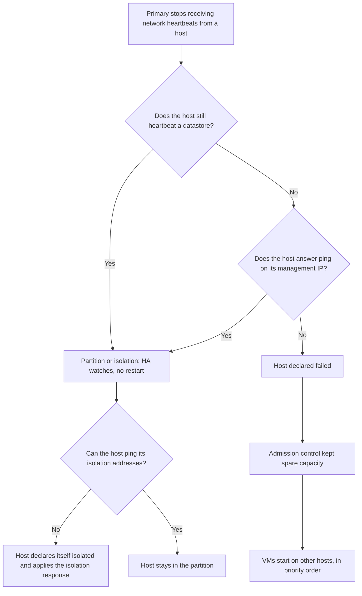
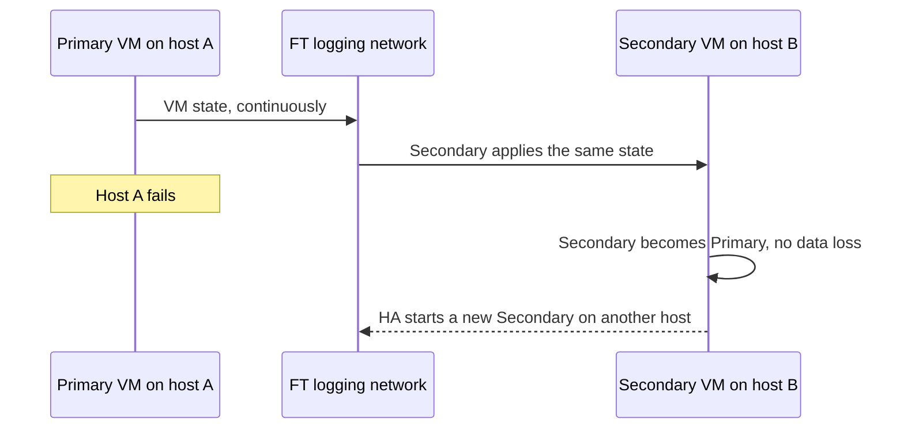

:::analogy
**The data center pain.** A host dies at 3 a.m. because of its motherboard. With vSphere HA (High Availability) configured, its VMs (VM, Virtual Machine) start by themselves on the other hosts within minutes and nobody gets called. Without HA, you wait for someone to wake up. But HA means a **restart**: the application has a pause. For a system that must not stop even for a second there is FT (Fault Tolerance), with a copy running in parallel. Both are on the exam: the VVF (VMware vSphere Foundation, 2V0-16.25) exam guide has them under objective 2.2.2, and the older VCP-DCV (VMware Certified Professional - Data Center Virtualization) under 1.4.4, 1.4.5 and 4.6. [S02] [S47]

**The analogy: the hospital.**

- **HA** is the on-call team: when a patient collapses (the host fails), they move them at once to another ward and revive them. There is a pause, but the patient recovers.
- **Heartbeats** are the nurses doing rounds. If a ward does not answer the intercom, the nurse also checks the logbook in the hallway (the datastore) before raising the alarm.
- **Admission control** is the rule "we always keep a few beds free for emergencies": you do not admit everyone just because beds are empty right now.
- **FT** is a second surgeon mirroring every move in another room. If the first one faints, the second carries on with no pause.
:::

:::architecture
### 1. What an HA cluster needs

The checklist in the vSphere 8 documentation: [S242]

- at least **2 hosts**, licensed for HA;
- **static IPs** on the hosts (IP, Internet Protocol) or DHCP (Dynamic Host Configuration Protocol) reservations that do not change on reboot;
- at least **one common management network** (two recommended), on VMkernel adapters with Management ticked;
- the same VM networks and **the same shared datastores**: a VM on a local disk cannot be restarted elsewhere;
- VMware Tools in the VMs if you want VM Monitoring; HA works over IPv4 and IPv6.

**Primary and secondary.** When HA is enabled, one host is elected **primary** automatically. It talks to vCenter and watches the protected VMs and the other hosts (**secondaries**). [S229] In 9.0, the HA components ship in the base ESX image, so they no longer have to be pushed to each host separately. [S256]

### 2. How HA knows a host has failed

Hosts exchange **network heartbeats every second**. When the primary stops receiving heartbeats from a secondary, it makes two checks before deciding: [S230]

1. whether the host still writes heartbeats to a datastore (**datastore heartbeating**);
2. whether the host answers ping, that is ICMP (Internet Control Message Protocol), on its management IPs.

| Situation | What the primary sees | What HA does |
|---|---|---|
| **Failure** (host is down) | No network, no datastore, no ping | Restarts the VMs on other hosts |
| **Isolation** | The host runs but lost the management network and cannot ping its isolation addresses either | The isolated host applies the *isolation response*; the primary restarts VMs that were powered off |
| **Partition** | The host no longer talks to the primary but still heartbeats a datastore | Restarts nothing; keeps watching the host |

Sources: [S230] [S231].

**Heartbeat datastores.** By default vCenter picks **2 datastores per host** (advanced option `das.heartbeatdsperhost`, maximum 5), trying to avoid datastores on the same LUN (Logical Unit Number) or the same NFS (Network File System) server. On each datastore HA creates a `.vSphere-HA` folder, which you do not delete. [S231] You can keep the automatic choice, force a list, or combine both. [S232]

**Isolation addresses.** By default, a host checks for isolation by pinging the **management network default gateway**. You can set up to 10 addresses with `das.isolationaddress0` … `das.isolationaddress9`; you then set `das.usedefaultisolationaddress` to `false`. The change takes effect only after you disable and re-enable HA. [S241] [S244]

### 3. What HA does with the VMs

**Host failure response:** *Disabled* (no monitoring and no restarts) or *Restart VMs*. [S236]

**Isolation response** (what the isolated host does with its VMs): [S238] [S241]

- *Power off and restart VMs*: hard power-off, then restart elsewhere;
- *Shutdown and restart VMs*: clean shutdown, needs VMware Tools; HA waits **300 seconds** (`das.isolationshutdowntimeout`), then powers off.

**Restart priority** has five levels: *Lowest, Low, Medium, High, Highest*; *Lowest* and *Highest* appeared in 6.5. Per VM there is also *Disabled* (HA does not restart the VM). [S246] By default, VMs are on *Medium*. [S247] HA moves on to the next priority level after a **condition** and an optional delay: [S236] [S247]

| Condition | What it means |
|---|---|
| Resources allocated (default) | The primary found a host for the VM; takes milliseconds |
| Powered on | The power-on started, but the application may not be ready |
| Guest Heartbeats detected | VMware Tools in the VM sends heartbeats |
| App Heartbeats detected | The application sends heartbeats (needs Application Monitoring) |

**Where a VM restarts.** The chosen host must see the VM's files, be compatible (including VM-Host rules), have enough unreserved resources and stay within VM and FT limits. If none qualifies, HA logs an insufficient-resources event and retries later. [S238] HA honors VM-VM anti-affinity rules by default [S241] and the "must" VM-Host rules from lesson 2.7. [S221] [S222]

### 4. Admission control: capacity kept for failover

Admission control reserves capacity so VMs can restart after a failure. It blocks **powering on a VM, migrating it and increasing reservations** if they would use the kept capacity. The calculation uses CPU (Central Processing Unit) and memory **reservations** plus overhead, not real usage. [S233]

| Policy | How it works |
|---|---|
| **Cluster resource percentage** (default since 6.5) | Keeps a percentage of CPU and memory. With *Host failures cluster tolerates* = 1, the percentage is computed automatically: 50% with 2 hosts, 25% with 4 hosts. It can be overridden manually. [S235] [S234] |
| **Slot policy** | The default policy before 6.5. [S235] |
| **Dedicated failover hosts** | Hosts kept free for failover. [S233] |

**VM resource reduction event threshold** says how much performance loss you accept after failover. The default is 100% (no warnings) and it needs DRS (Distributed Resource Scheduler) enabled. [S233]

### 5. VM Monitoring, VMCP (VM Component Protection) and Proactive HA

**VM Monitoring** watches VMware Tools heartbeats. If they are missing for the whole failure interval and the VM's disk and network show no activity in the last **120 seconds** (`das.iostatsinterval`), HA resets the VM. [S237]

| Sensitivity | Failure interval | Reset period |
|---|---|---|
| High | 30 s | 1 hour |
| Medium | 60 s | 24 hours |
| Low | 120 s | 7 days |

By default there are at most **3 resets** in a reset period. [S237]

**VMCP** reacts when the host loses a datastore: [S239] [S240]

- **PDL (Permanent Device Loss):** the storage clearly reports that the device will not come back. Options: *Disabled*, *Issue events*, *Power off and restart VMs*.
- **APD (All Paths Down):** a temporary or unclear loss of access that can recover. Options: *Disabled*, *Issue events*, *Power off and restart VMs* with a *Conservative* or *Aggressive* policy, plus *Response recovery* in minutes.
- On the host, `Misc.APDTimeout` is **140 seconds** by default. VMware recommends not changing these host settings without support. [S243]

**Proactive HA** handles partial faults, for example one of several power supplies: VMs are evacuated and the host enters **Quarantine mode** or **Maintenance mode**. [S230]

**vCLS (vSphere Cluster Services)** in 9.0: disabling it no longer affects DRS or HA (KB, Knowledge Base article, 312147). [S225]

### 6. Fault Tolerance: a copy running in parallel

The protected VM becomes the **Primary VM**, and a **Secondary VM** runs on **another host**. The Primary's state is copied continuously to the Secondary. The two cannot sit on the same host. [S248] Synchronization usually takes under 1 ms, and FT pauses the VM very briefly tens of times per second to keep the copies in step. [S254]

When the Primary's host fails (or on an uncorrectable memory error), the Secondary takes over **at once**, with no data loss, and a new Secondary starts automatically. File locking on shared storage prevents two copies from running as Primary. [S248] Failover and creating the new Secondary work even when vCenter is down. [S254]

**Requirements and limits (vSphere 8 documentation):** [S249] [S251] [S253]

| Requirement | Value |
|---|---|
| HA | Enabled on the cluster before you power on FT VMs |
| Network | VMkernel for vMotion and for FT logging, separate; 10 Gbit dedicated recommended; at least 2 physical NICs per host, 3 recommended |
| CPU | vMotion-compatible, with hardware MMU (Memory Management Unit) virtualization: Intel EPT (Extended Page Tables) or AMD RVI (Rapid Virtualization Indexing); Intel Sandy Bridge+ (not Avoton), AMD Bulldozer+ |
| BIOS (Basic Input/Output System) | Hardware Virtualization enabled |
| Storage | All VM files except VMDKs on shared storage |
| vCPU (virtual CPU) per FT VM | 2 in Standard and Enterprise, 8 in Enterprise Plus (vSphere 8 editions; in VVF/VCF (VMware Cloud Foundation) 9 `⚠ to verify`) |
| Per host, default | 4 FT VMs and 8 FT vCPUs; not fixed maximums, they can be changed |

The NIC (Network Interface Card) count above comes from the FT networking page. [S253]

**What does not work with FT:** snapshots (exception: disk-only snapshots for backup), Storage vMotion (you turn FT off temporarily), linked clones, vVols datastores, SPBM (Storage Policy-Based Management) except vSAN, I/O filters and VMs with VBS (Virtualization-Based Security). VM encryption is supported since 7.0 U2. FT cannot be enabled on NSX-T port groups (VLAN, Virtual Local Area Network, or overlay segments). [S250] [S249]

| | vSphere HA | Fault Tolerance |
|---|---|---|
| On host failure | Restarts the VM on another host | The Secondary takes over at once |
| Downtime | Yes, as long as the boot takes | No visible interruption |
| Cost | Spare capacity (admission control) | A second VM running all the time, plus the FT logging network |
| Limits | All VMs in the cluster | At most 8 vCPUs per VM, few VMs per host |
| Guest OS (OS, Operating System) crash | VM Monitoring resets the VM | The copy runs the same instructions, so it does not help `⚠ to verify` |

`[IMAGE SEARCH / PROMPT]` "vSphere HA isolation partition datastore heartbeat diagram" and "vSphere Fault Tolerance primary secondary FT logging diagram".
:::

:::exam-alert
### Must memorize

| What | Value / rule | Source |
|---|---|---|
| Minimum HA hosts | 2 | Docs [S242] |
| Network heartbeat | Every second | Docs [S230] |
| Heartbeat datastores | 2 per host by default, maximum 5 | Docs [S231] |
| Default isolation address | Management default gateway; up to 10 addresses | Docs, KB 341627 [S241] [S244] |
| Shutdown on isolation | Waits 300 s, needs VMware Tools | Docs [S238] [S241] |
| Default restart priority | Medium; default condition Resources allocated | Blog [S247] |
| Default admission control | Cluster resource percentage (since 6.5) | Blog [S235] |
| 1 failure tolerated | 50% with 2 hosts, 25% with 4 hosts | Blog [S235] |
| VM Monitoring | I/O 120 s; Medium = 60 s / 24 h; 3 resets | Docs [S237] |
| Host APD timeout | 140 s | KB 406100 [S243] |
| FT vCPUs per VM | 8 (Enterprise Plus), 2 (Standard/Enterprise) | Docs [S249] |
| FT per host, default | 4 VMs, 8 vCPUs | Docs [S249] |

### 3 exam traps

1. **"HA moves the VMs with vMotion when a host fails."** False. A failed host can no longer vMotion; HA **restarts** the VMs, so there is downtime. Only FT has no downtime. [S229] [S248]
2. **"Admission control looks at what the VMs consume right now."** False. The calculation uses reservations plus overhead, not real usage. [S233]
3. **"You can snapshot or Storage vMotion a running FT VM."** False. Snapshots are not supported (only disk-only ones for backup), and for Storage vMotion you turn FT off first. [S250]
:::

:::trenches
### Mistake 1: the gateway that does not answer ping

The management gateway's firewall blocks ping. HA shows a configuration issue, and during a short network blip a host can believe it is isolated and power off its VMs, even though all datastores were fine. [S244]
**Fix:** add one or two addresses that reliably answer ping (`das.isolationaddress0`, `das.isolationaddress1`), set `das.usedefaultisolationaddress = false`, then disable and re-enable HA. If no address answers, the HA configuration fails; if only some do, the cluster turns yellow. [S244] [S241]

### Mistake 2: the failover host is too small

Someone chose the *Dedicated failover hosts* policy and made the smallest server the spare host. The cluster shows "Insufficient configured resources to satisfy the desired vSphere HA failover level on the cluster", and VM power-ons are blocked. [S245]
**Fix (KB 318133):** make the host with the most CPU and memory the spare host, or switch to *Cluster resource percentage*. Disabling admission control is the last resort, because you lose the failover guarantee. [S245] [S233]
:::

:::interview
**Junior/Mid question: "What is the difference between vSphere HA and Fault Tolerance, and when do you choose each?"**

*Ideal answer:* HA restarts the VMs on another host after a failure, so the application pauses for as long as the boot takes; it protects the whole cluster at almost no extra cost. [S229] FT keeps a synchronous Secondary on another host and takes over without interruption, but it doubles the resources, has limits (8 vCPUs per VM, by default 4 FT VMs per host) and does not support snapshots. [S248] [S249] [S250] A good candidate adds that for a hung operating system VM Monitoring helps, by resetting the VM when VMware Tools heartbeats are missing. [S237]

**Troubleshooting scenario: "A host failed, but some VMs did not restart. What do you check?"**

*The answer a Team Lead expects:*
1. **HA events:** is there an insufficient-resources event? HA retries when resources free up. [S238]
2. **VM overrides:** restart priority *Disabled* means HA does not restart them. [S246]
3. **Rules:** a "must" VM-Host rule or anti-affinity can prevent power-on on the remaining hosts. [S222] [S241]
4. **Storage:** VMs with files on a local datastore cannot restart elsewhere. [S242]
5. **The type of situation:** was it really a failure, or was the host only partitioned and still heartbeating a datastore? [S230]
:::

:::lab
**Scenario.** You check the HA settings, the heartbeat datastores and admission control, set different priorities on two VMs, cause a host failure and measure the downtime, then enable FT on a small VM and test failover.

**What you need.** The cluster from lesson 2.7 (at least two hosts, working DRS and vMotion), a shared datastore and three small test VMs. For FT: a VMkernel network with FT logging on each host.

The steps below can be ticked, and progress is saved in the browser. Exact menu names may differ slightly between versions 8 and 9 (`⚠ to verify`).

**Home lab only / not supported.** Forcing a host failure (step 5) and FT in a nested lab (ESXi running as a VM) are for learning only; a nested lab is not a supported configuration, and FT can be slow without the recommended 10 Gbit network. [S249]

**Failure test and validation.** At step 5, the VMs of the powered-off host must start on the other hosts, the High-priority one first. At step 6, after *Test Failover*, the FT VM must keep answering ping, and a new Secondary must appear on another host.
:::

:::quiz
Five original questions in the style of the VCP (VMware Certified Professional) exams. You get the explanation for each option right after you answer.
:::

:::references
- VCP-VVF Administrator 2V0-16.25 exam guide, objective 2.2.2 [S02]
- VCP-DCV 2V0-21.23 exam guide (Legacy certification), objectives 1.4.4, 1.4.5, 4.6 [S47]
- vSphere 8 Availability docs: how HA works [S229], failure types [S230], datastore heartbeating [S231] and the HA checklist [S242]
- vSphere 8 docs: admission control [S233], failure and isolation responses [S236] [S238], VM Monitoring [S237], VMCP [S239] and advanced options [S241]
- KB 341627 (isolation addresses), KB 318133 (insufficient resources), KB 406100 (APD and PDL) [S244] [S245] [S243]
- Yellow Bricks: restart priority [S247]
- vSphere 8 docs: Fault Tolerance, how it works [S248], requirements and limits [S249], what it does not support [S250], best practices [S252]
- KB 307309: Fault Tolerance FAQ [S254]
- KB 306275: the Turn on Fault Tolerance option is missing. Careful: the article still says SMP (Symmetric Multiprocessing, several vCPUs) VMs are not supported, although the vSphere 8 documentation allows up to 8 vCPUs. Check its thick-disk requirement in the documentation for your version (`⚠ to verify`) [S255] [S249]
:::
