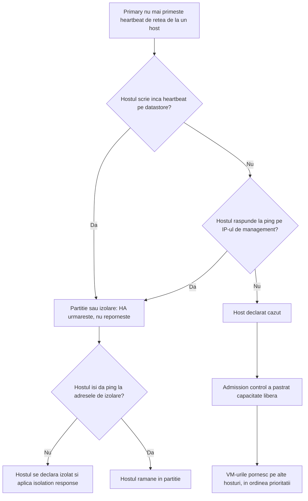
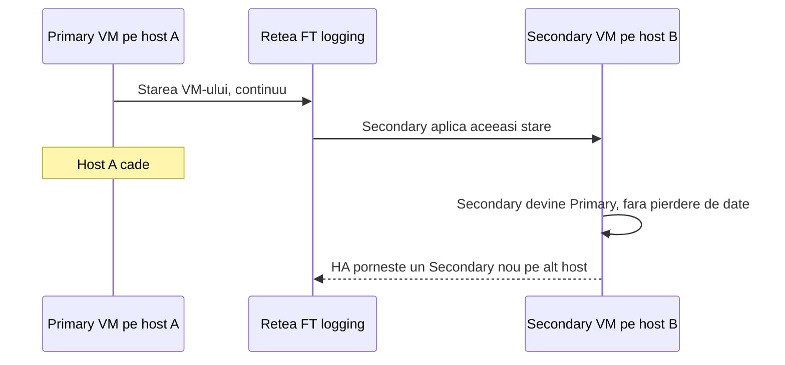

:::analogy
**Durerea din data center.** Un host cade la 3 noaptea din cauza plăcii de bază. Cu vSphere HA (High Availability) configurat, VM-urile (VM, Virtual Machine) lui pornesc singure pe celelalte hosturi în câteva minute și nimeni nu e sunat. Fără HA, aștepți să se trezească cineva. Dar HA înseamnă **repornire**: aplicația are o pauză. Pentru un sistem care nu are voie să se oprească nici o secundă există FT (Fault Tolerance), cu o copie care rulează în paralel. Ambele sunt la examen: exam guide-ul VVF (VMware vSphere Foundation, 2V0-16.25) le are la obiectivul 2.2.2, iar vechiul VCP-DCV (VMware Certified Professional - Data Center Virtualization) la 1.4.4, 1.4.5 și 4.6. [S02] [S47]

**Analogia: spitalul.**

- **HA** e echipa de gardă: când un pacient se prăbușește (hostul cade), îl duce imediat în alt salon și îl readuce la viață. Există o pauză, dar pacientul își revine.
- **Heartbeat-urile** sunt asistentele care trec pe la fiecare salon. Dacă un salon nu răspunde pe interfon, asistenta verifică și registrul de pe hol (datastore-ul) înainte să declare alarma.
- **Admission control** e regula „ținem mereu câteva paturi libere pentru urgențe”: nu internezi pe toată lumea doar pentru că sunt paturi goale acum.
- **FT** e un chirurg secund care face fiecare mișcare în oglindă, în altă sală. Dacă primul leșină, al doilea continuă operația fără nicio pauză.
:::

:::architecture
### 1. Ce îi trebuie unui cluster HA

Checklist-ul din documentația vSphere 8: [S242]

- cel puțin **2 hosturi**, licențiate pentru HA;
- **IP-uri statice** pe hosturi (IP, Internet Protocol) sau rezervări DHCP (Dynamic Host Configuration Protocol) care nu se schimbă la reboot;
- cel puțin **o rețea de management comună** (recomandat două), pe adaptoare VMkernel cu Management bifat;
- aceleași rețele de VM-uri și **aceleași datastore-uri partajate**: un VM de pe un disc local nu poate fi repornit în altă parte;
- VMware Tools în VM-uri, dacă vrei VM Monitoring; HA merge pe IPv4 și pe IPv6.

**Primary și secondary.** La activarea HA, un host e ales automat **primary**. El vorbește cu vCenter, urmărește VM-urile protejate și celelalte hosturi (**secondary**). [S229] În 9.0, componentele HA vin direct în imaginea de bază ESX, deci nu mai trebuie împinse pe fiecare host separat. [S256]

### 2. Cum își dă seama HA că un host a căzut

Hosturile schimbă **heartbeat-uri de rețea la fiecare secundă**. Când primary nu mai primește heartbeat de la un secondary, face două verificări înainte să decidă: [S230]

1. dacă hostul mai scrie heartbeat pe un datastore (**datastore heartbeating**);
2. dacă hostul răspunde la ping, adică ICMP (Internet Control Message Protocol), pe IP-urile de management.

| Situație | Ce vede primary | Ce face HA |
|---|---|---|
| **Failure** (hostul a căzut) | Nici rețea, nici datastore, nici ping | Repornește VM-urile pe alte hosturi |
| **Isolation** (izolare) | Hostul rulează, dar a pierdut rețeaua de management și nu-și poate da ping nici la adresele de izolare | Hostul izolat aplică *isolation response*; primary repornește VM-urile oprite |
| **Partition** (partiție) | Hostul nu mai vorbește cu primary, dar scrie încă heartbeat pe datastore | Nu repornește nimic; continuă să urmărească hostul |

Surse: [S230] [S231].

**Datastore-urile de heartbeat.** vCenter alege implicit **2 datastore-uri pe host** (opțiunea avansată `das.heartbeatdsperhost`, maximum 5), încercând să evite datastore-uri pe același LUN (Logical Unit Number) sau pe același server NFS (Network File System). Pe fiecare datastore HA creează directorul `.vSphere-HA`, pe care nu îl ștergi. [S231] Poți lăsa alegerea automată, poți impune o listă sau poți combina cele două. [S232]

**Adresele de izolare.** Implicit, un host își verifică izolarea dând ping la **default gateway-ul rețelei de management**. Poți pune până la 10 adrese cu `das.isolationaddress0` … `das.isolationaddress9`; atunci setezi `das.usedefaultisolationaddress` pe `false`. Modificarea se aplică abia după ce dezactivezi și reactivezi HA. [S241] [S244]

### 3. Ce face HA cu VM-urile

**Host failure response:** *Disabled* (fără monitorizare și fără reporniri) sau *Restart VMs*. [S236]

**Isolation response** (ce face hostul izolat cu VM-urile lui): [S238] [S241]

- *Power off and restart VMs*: oprire bruscă, apoi repornire în altă parte;
- *Shutdown and restart VMs*: oprire curată, cere VMware Tools; HA așteaptă **300 de secunde** (`das.isolationshutdowntimeout`), apoi oprește forțat.

**Restart priority** are cinci niveluri: *Lowest, Low, Medium, High, Highest*; *Lowest* și *Highest* au apărut în 6.5. Per VM mai există *Disabled* (HA nu repornește VM-ul). [S246] Implicit, VM-urile sunt pe *Medium*. [S247] HA trece la următorul nivel de prioritate după o **condiție** și o întârziere opțională: [S236] [S247]

| Condiție | Ce înseamnă |
|---|---|
| Resources allocated (implicită) | Primary a găsit un host pentru VM; durează milisecunde |
| Powered on | Pornirea a început, dar aplicația poate să nu fie gata |
| Guest Heartbeats detected | VMware Tools din VM trimite heartbeat |
| App Heartbeats detected | Aplicația trimite heartbeat (cere Application Monitoring) |

**Unde repornește un VM.** Hostul ales trebuie să vadă fișierele VM-ului, să fie compatibil (inclusiv cu regulile VM-Host), să aibă destule resurse nerezervate și să nu depășească limitele de VM-uri sau de FT. Dacă nu găsește niciunul, HA scrie un eveniment de resurse insuficiente și reîncearcă mai târziu. [S238] HA respectă implicit regulile VM-VM anti-affinity [S241] și regulile VM-Host „must” din lecția 2.7. [S221] [S222]

### 4. Admission control: capacitate păstrată pentru failover

Admission control rezervă capacitate ca VM-urile să poată reporni după o cădere. Blochează **pornirea unui VM, migrarea lui și creșterea rezervărilor** dacă ar consuma capacitatea păstrată. Calculul folosește **rezervările** de CPU (Central Processing Unit) și memorie plus overhead-ul, nu consumul real. [S233]

| Politică | Cum lucrează |
|---|---|
| **Cluster resource percentage** (implicită din 6.5) | Păstrează un procent din CPU și memorie. Cu *Host failures cluster tolerates* = 1, procentul se calculează singur: 50% la 2 hosturi, 25% la 4 hosturi. Se poate suprascrie manual. [S235] [S234] |
| **Slot policy** | Politica implicită înainte de 6.5. [S235] |
| **Dedicated failover hosts** | Hosturi ținute libere pentru failover. [S233] |

**VM resource reduction event threshold** spune cât de mult îți permiți să scadă performanța după failover. Implicit e 100% (fără avertismente) și cere DRS (Distributed Resource Scheduler) activ. [S233]

### 5. VM Monitoring, VMCP (VM Component Protection) și Proactive HA

**VM Monitoring** urmărește heartbeat-urile VMware Tools. Dacă lipsesc pe toată perioada de failure interval și nici discul sau rețeaua VM-ului nu arată activitate în ultimele **120 de secunde** (`das.iostatsinterval`), HA dă reset VM-ului. [S237]

| Sensibilitate | Failure interval | Reset period |
|---|---|---|
| High | 30 s | 1 oră |
| Medium | 60 s | 24 de ore |
| Low | 120 s | 7 zile |

Implicit sunt cel mult **3 reseturi** într-un reset period. [S237]

**VMCP** reacționează când hostul pierde un datastore: [S239] [S240]

- **PDL (Permanent Device Loss):** storage-ul spune clar că dispozitivul nu mai revine. Opțiuni: *Disabled*, *Issue events*, *Power off and restart VMs*.
- **APD (All Paths Down):** pierdere temporară sau neclară a accesului, care se poate recupera. Opțiuni: *Disabled*, *Issue events*, *Power off and restart VMs* cu politică *Conservative* sau *Aggressive*, plus *Response recovery* în minute.
- Pe host, `Misc.APDTimeout` e implicit **140 de secunde**. VMware recomandă să nu schimbi aceste setări de host fără suport. [S243]

**Proactive HA** tratează defectele parțiale, de exemplu una din mai multe surse de alimentare: VM-urile sunt evacuate, iar hostul intră în **Quarantine mode** sau **Maintenance mode**. [S230]

**vCLS (vSphere Cluster Services)** în 9.0: dezactivarea lui nu mai afectează DRS sau HA (KB, Knowledge Base article, 312147). [S225]

### 6. Fault Tolerance: o copie care rulează în paralel

VM-ul protejat devine **Primary VM**, iar pe **alt host** rulează un **Secondary VM**. Starea Primary e copiată continuu pe Secondary. Cele două nu pot sta pe același host. [S248] Sincronizarea durează de obicei sub 1 ms, iar FT oprește foarte scurt VM-ul de zeci de ori pe secundă ca să țină copiile la zi. [S254]

La căderea hostului Primary (sau la o eroare de memorie necorectabilă), Secondary preia **imediat**, fără pierdere de date, iar un Secondary nou pornește automat. Blocarea fișierelor pe storage-ul partajat împiedică două copii să ruleze ca Primary. [S248] Failover-ul și crearea noului Secondary merg chiar dacă vCenter e oprit. [S254]

**Cerințe și limite (documentația vSphere 8):** [S249] [S251] [S253]

| Cerință | Valoare |
|---|---|
| HA | Activ pe cluster înainte să pornești VM-uri FT |
| Rețea | VMkernel pentru vMotion și pentru FT logging, separate; recomandat 10 Gbit, dedicat; minim 2 plăci fizice pe host, 3 recomandat |
| CPU | Compatibil vMotion, cu virtualizare hardware a MMU (Memory Management Unit): Intel EPT (Extended Page Tables) sau AMD RVI (Rapid Virtualization Indexing); Intel Sandy Bridge+ (fără Avoton), AMD Bulldozer+ |
| BIOS (Basic Input/Output System) | Hardware Virtualization activă |
| Stocare | Toate fișierele VM-ului, în afară de VMDK-uri, pe storage partajat |
| vCPU (virtual CPU) pe VM FT | 2 în Standard și Enterprise, 8 în Enterprise Plus (ediții vSphere 8; în VVF/VCF (VMware Cloud Foundation) 9 `⚠ de verificat`) |
| Pe host, implicit | 4 VM-uri FT și 8 vCPU FT; nu sunt maxime fixe, se pot schimba |

**Ce nu merge cu FT:** snapshot-uri (excepție: snapshot-uri doar de disc pentru backup), Storage vMotion (oprești FT temporar), linked clones, datastore-uri vVols, SPBM (Storage Policy-Based Management) în afară de vSAN, I/O filters și VM-uri cu VBS (Virtualization-Based Security). Criptarea VM-ului e suportată de la 7.0 U2. FT nu se poate activa pe port group-uri NSX-T (segmente VLAN, Virtual Local Area Network, sau overlay). [S250] [S249]

| | vSphere HA | Fault Tolerance |
|---|---|---|
| Ce face la căderea hostului | Repornește VM-ul pe alt host | Secondary preia imediat |
| Downtime | Da, cât durează boot-ul | Fără întrerupere vizibilă |
| Cost | Capacitate de rezervă (admission control) | Un al doilea VM care rulează tot timpul, plus rețeaua de FT logging |
| Limite | Toate VM-urile din cluster | Maximum 8 vCPU pe VM, puține VM-uri pe host |
| Crash al OS-ului (OS, Operating System) | VM Monitoring dă reset VM-ului | Copia execută aceleași instrucțiuni, deci nu ajută `⚠ de verificat` |

`[IMAGE SEARCH / PROMPT]` „vSphere HA isolation partition datastore heartbeat diagram” și „vSphere Fault Tolerance primary secondary FT logging diagram”.
:::

:::exam-alert
### De memorat

| Ce | Valoare / regulă | Sursă |
|---|---|---|
| Minim hosturi HA | 2 | Docs [S242] |
| Heartbeat de rețea | La fiecare secundă | Docs [S230] |
| Datastore-uri de heartbeat | 2 pe host implicit, maximum 5 | Docs [S231] |
| Adresa de izolare implicită | Default gateway-ul de management; până la 10 adrese | Docs, KB 341627 [S241] [S244] |
| Shutdown la izolare | Așteaptă 300 s, cere VMware Tools | Docs [S238] [S241] |
| Restart priority implicită | Medium; condiția implicită Resources allocated | Blog [S247] |
| Admission control implicit | Cluster resource percentage (din 6.5) | Blog [S235] |
| 1 cădere tolerată | 50% la 2 hosturi, 25% la 4 hosturi | Blog [S235] |
| VM Monitoring | I/O 120 s; Medium = 60 s / 24 h; 3 reseturi | Docs [S237] |
| APD timeout pe host | 140 s | KB 406100 [S243] |
| FT vCPU pe VM | 8 (Enterprise Plus), 2 (Standard/Enterprise) | Docs [S249] |
| FT pe host, implicit | 4 VM-uri, 8 vCPU | Docs [S249] |

### 3 capcane de examen

1. **„HA mută VM-urile cu vMotion când un host cade.”** Fals. Un host căzut nu mai poate face vMotion; HA **repornește** VM-urile, deci există downtime. Fără downtime e doar FT. [S229] [S248]
2. **„Admission control se uită la cât consumă VM-urile acum.”** Fals. Calculul folosește rezervările plus overhead-ul, nu consumul real. [S233]
3. **„Poți face snapshot sau Storage vMotion pe un VM FT pornit.”** Fals. Snapshot-urile nu sunt suportate (doar cele de disc pentru backup), iar pentru Storage vMotion oprești întâi FT. [S250]
:::

:::trenches
### Greșeala 1: gateway-ul care nu răspunde la ping

Firewall-ul de la gateway-ul de management blochează ping-ul. HA arată o problemă de configurare, iar la o mică întrerupere de rețea un host se poate crede izolat și își oprește VM-urile, deși toate datastore-urile erau bune. [S244]
**Remediere:** adaugi una sau două adrese care răspund sigur la ping (`das.isolationaddress0`, `das.isolationaddress1`), pui `das.usedefaultisolationaddress = false`, apoi dezactivezi și reactivezi HA. Dacă nicio adresă nu răspunde, configurarea HA eșuează; dacă doar unele, clusterul devine galben. [S244] [S241]

### Greșeala 2: hostul de failover prea mic

Cineva a ales politica *Dedicated failover hosts* și a pus ca host de rezervă cel mai mic server. Clusterul arată „Insufficient configured resources to satisfy the desired vSphere HA failover level on the cluster”, iar pornirile de VM-uri sunt blocate. [S245]
**Remediere (KB 318133):** alegi ca host de rezervă hostul cu cel mai mult CPU și memorie sau treci pe *Cluster resource percentage*. Dezactivarea admission control e ultima variantă, pentru că pierzi garanția de failover. [S245] [S233]
:::

:::interview
**Întrebare Junior/Mid: „Care e diferența dintre vSphere HA și Fault Tolerance și când alegi fiecare?”**

*Răspunsul ideal:* HA repornește VM-urile pe alt host după o cădere, deci aplicația are o pauză cât durează boot-ul; protejează tot clusterul aproape fără cost în plus. [S229] FT ține un Secondary sincron pe alt host și preia fără întrerupere, dar dublează resursele, are limite (8 vCPU pe VM, implicit 4 VM-uri FT pe host) și nu suportă snapshot-uri. [S248] [S249] [S250] Un candidat bun adaugă că pentru un sistem de operare blocat ajută VM Monitoring, care dă reset VM-ului când lipsesc heartbeat-urile VMware Tools. [S237]

**Scenariu de troubleshooting: „Un host a căzut, dar câteva VM-uri nu au repornit. Ce verifici?”**

*Răspunsul pe care îl așteaptă un Team Lead:*
1. **Evenimentele HA:** apare un eveniment de resurse insuficiente? HA reîncearcă atunci când se eliberează resurse. [S238]
2. **Override-urile pe VM:** restart priority *Disabled* înseamnă că HA nu le repornește. [S246]
3. **Regulile:** o regulă VM-Host „must” sau anti-affinity poate împiedica pornirea pe hosturile rămase. [S222] [S241]
4. **Stocarea:** VM-urile cu fișiere pe un datastore local nu pot reporni în altă parte. [S242]
5. **Tipul situației:** a fost cu adevărat o cădere, sau hostul era doar partiționat și încă scria heartbeat pe datastore? [S230]
:::

:::lab
**Scenariu.** Verifici setările HA, datastore-urile de heartbeat și admission control, setezi priorități diferite pe două VM-uri, provoci căderea unui host și măsori downtime-ul, apoi activezi FT pe un VM mic și testezi failover-ul.

**Ce ai nevoie.** Clusterul din lecția 2.7 (cel puțin două hosturi, DRS și vMotion funcționale), un datastore partajat și trei VM-uri de test mici. Pentru FT: o rețea VMkernel cu FT logging pe fiecare host.

Pașii de mai jos sunt bifabili, iar progresul se salvează în browser. Numele exacte ale meniurilor pot diferi puțin între versiunile 8 și 9 (`⚠ de verificat`).

**Home lab only / not supported.** Căderea forțată a unui host (pasul 5) și FT într-un lab nested (ESXi rulat ca VM) sunt doar pentru învățare; un lab nested nu e o configurație suportată, iar FT poate fi lent fără rețeaua de 10 Gbit recomandată. [S249]

**Test de avarie și validare.** La pasul 5, VM-urile de pe hostul oprit trebuie să pornească pe celelalte hosturi, întâi cel cu prioritatea High. La pasul 6, după *Test Failover*, VM-ul FT trebuie să răspundă în continuare la ping, iar un Secondary nou trebuie să apară pe alt host.
:::

:::quiz
Cinci întrebări originale, în stilul examenelor VCP (VMware Certified Professional). Primești explicația pentru fiecare variantă imediat după ce răspunzi.
:::

:::references
- Exam guide VCP-VVF Administrator 2V0-16.25, obiectivul 2.2.2 [S02]
- Exam guide VCP-DCV 2V0-21.23 (certificare Legacy), obiectivele 1.4.4, 1.4.5, 4.6 [S47]
- Documentația vSphere 8 Availability: cum funcționează HA [S229], tipuri de cădere [S230], datastore heartbeating [S231] și checklist-ul HA [S242]
- Documentația vSphere 8: admission control [S233], răspunsuri la cădere și izolare [S236] [S238], VM Monitoring [S237], VMCP [S239] și opțiunile avansate [S241]
- KB 341627 (adrese de izolare), KB 318133 (resurse insuficiente), KB 406100 (APD și PDL) [S244] [S245] [S243]
- Yellow Bricks: restart priority [S247]
- Documentația vSphere 8: Fault Tolerance, cum funcționează [S248], cerințe și limite [S249], ce nu suportă [S250], bune practici [S252]
- KB 307309: FAQ Fault Tolerance [S254]
- KB 306275: opțiunea Turn on Fault Tolerance lipsește. Atenție: articolul mai listează cerințe vechi (discuri thick, fără SMP, adică Symmetric Multiprocessing, VM-uri cu mai multe vCPU), care nu mai corespund documentației vSphere 8; urmezi documentația versiunii tale [S255] [S249]
:::
