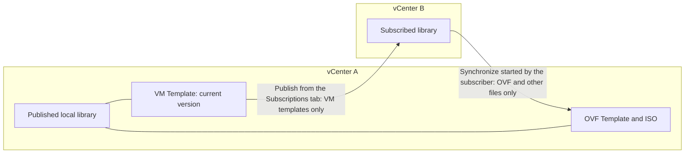
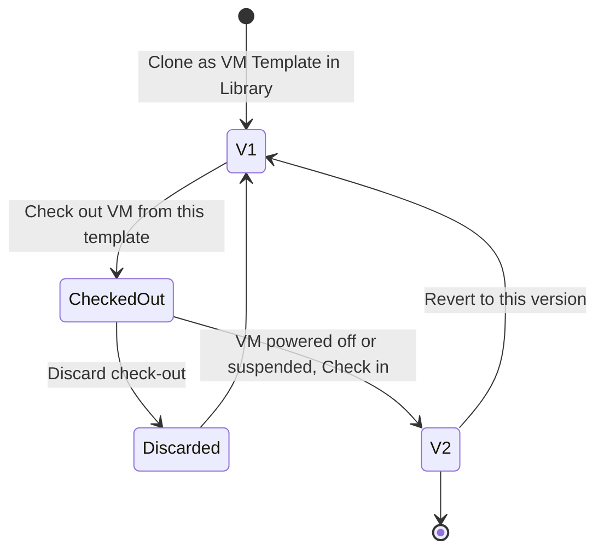

:::analogy
**The data center pain.** You have three vCenters and each has its own "Windows Server template", with different patches. Someone deploys from the old one, and the new server goes into production without the latest security updates. A content library fixes this: one place to keep templates, with versions, from which you distribute them. The topic is on the exam: the VVF (VMware vSphere Foundation, 2V0-16.25) exam guide has it under objective 2.2.6, and the older VCP-DCV (VMware Certified Professional - Data Center Virtualization) under 4.8, 4.9 and 4.10. [S02] [S47]

**The analogy: the city library and its branches.**

- **The template** is the printing plate for new books: you do not read it, you use it to make copies.
- **The local library** is the central library, where the originals are kept. If you **publish** it, branches can subscribe to it.
- **The subscribed library** is the branch: it takes no donations directly, only copies sent from the centre, either all at once or only when someone asks.
- **Check-out and check-in** are like borrowing a book for proofreading: while you have it, others read the previous edition; when you bring it back, a new edition appears.
:::

:::architecture
### 1. Templates in the inventory

A template is a copy of a VM (VM, Virtual Machine) that you do not power on and from which you create new VMs. Templates are **read-only**: to change one, you convert it to a VM, make the change and convert it back; if you want to keep the original, you clone the template to a new template. [S268] [S269]

When cloning you choose the disk format: *Same as source*, *Thick Provision Lazy Zeroed*, *Thick Provision Eager Zeroed* (needed by clustering features such as FT, Fault Tolerance) or *Thin Provision*. The template name sets the file names on the datastore; a later rename does not change the files. [S268] [S269]

### 2. What a content library is

A content library is a container for **VM and vApp templates** and for **other files** (CD/DVD ISO images, text files). You create and manage it from a single vCenter, and its content can be distributed to other vCenters over HTTP(S) (Hypertext Transfer Protocol, Secure). [S257]

| Item type | What it holds | Notes |
|---|---|---|
| **OVF Template** | OVF (Open Virtualization Format): .ovf, .vmdk, .mf, as one item | vApps become OVF on upload [S257] |
| **VM Template** (VMTX) | A template in the native vSphere format | Since 7.0 U1, only in local libraries, not on NFS (Network File System) or SMB (Server Message Block) storage [S257] [S264] |
| **Other** | ISOs, text files and others | Shown in the Other Types tab [S257] |

| Library type | What you can do |
|---|---|
| **Local** | Import, clone and edit items; you can **publish** it, with an optional password, and you get the subscription URL (Uniform Resource Locator, web address) from Edit Settings [S257] [S261] |
| **Subscribed** | You import nothing; you only synchronize the content of the published library [S257] [S263] |

**OVF security policy** (since 7.0 U3) is optional and enforces strict validation of OVF items. [S257] On some versions, applying it to an existing library fails, and the fix is to apply it when creating the library or through the API (Application Programming Interface; KB, Knowledge Base article, 406860). [S272]

### 3. How you put content in the library

- **Import Item:** from a URL (only .ovf or .ova) or from a local file. vCenter checks the manifest and certificate and warns you, for example, about an expired certificate. The result is an OVF Template item. [S262]
- **Clone as Template in Library:** from a VM you choose the **OVF Template** or **VM Template** type. A VM Template item also creates an identical template in the vCenter inventory. [S262]
- **Clone Item:** you copy an item to another library in the same vCenter. A subscribed library can be a source but not a destination. [S258] [S262]

Only **OVF Template** items can be updated, exported or cloned; only items in local libraries can be edited. [S258] [S264] The OVA (Open Virtual Appliance) format is the same content as OVF, in a single file.

### 4. Publishing and subscribing

The vSphere 8 documentation is clear about who moves what: [S259]

- **Publishing** (from the local library) sends **only VM templates**. OVFs and the other files do not go out that way.
- **Synchronization** started by the subscribed library brings **only OVF templates** and the other files. VM templates arrive only when the publisher publishes them.
- Distributing VM templates needs vCenters in **ELM (Enhanced Linked Mode)** or Hybrid Linked Mode. [S257] [S271]
- In VCF (VMware Cloud Foundation) 9, the new grouping of vCenters uses **vCenter Linking**, not ELM [S142] [S143]; how this applies to VM templates you check in the 9.0 documentation (`⚠ to verify`).

**When creating a subscription** you choose between: [S259]

- linking to an existing subscribed library (no automatic synchronization);
- a new subscribed library (automatic synchronization starts);
- *Download library content only when needed*: only the metadata is downloaded first.

Subscriptions cannot be edited: you delete them and create them again. Deleting a subscription deletes neither the subscribed library nor the content already synchronized. [S259]

**Download options in the subscribed library:** [S263]

| Option | What happens |
|---|---|
| Download all contents immediately | Metadata and full content; items deleted at the source stay on storage until you delete them |
| Download only when needed | Metadata only; you sync each item when you need it; the *Stored Content Locally* column shows Yes after syncing |

Transfer is faster host to host when both vCenters are in the same SSO (Single Sign-On) domain and the libraries sit on datastores, or datastore to datastore with VAAI (vSphere APIs for Array Integration). Automatic synchronization needs a lot of space, because full copies are downloaded. [S263]

### 5. Check-out, check-in and versions

The feature exists since vSphere 7.0, for VM templates: [S264]

- **Check out** creates a VM from the template; the VM shows a blue circle in the inventory and you cannot convert it to a template or move it to another vCenter.
- While it is checked out, nobody else can check it out, but everyone can deploy from the **latest version**.
- **Check in** needs the VM powered off or suspended and creates a **new version**. You can also discard it, with no new version.
- The vertical timeline shows the versions; you can **revert** to an older version or delete a version.
- Renaming or deleting the template in the inventory is reflected in the library and vice versa.
- The subscribed library shows only the latest version, without the timeline. [S263]

**Why VM templates and not only OVF?** William Lam lists: push replication managed from the publishing vCenter; vSphere permissions per template; you can choose what each subscriber sees; fewer duplicated libraries; check-in and check-out. The price: ELM or Hybrid Linked Mode. [S265]

Deploying from VM templates in a content library is done only from the vSphere Client (or through the API). [S260]

### 6. Customization specifications

When you deploy from a template, the new VM would have the same name and configuration as the original. A **customization specification** applies new settings to the guest operating system (name, network, domain, licence). [S266]

- Specifications are XML (Extensible Markup Language) files kept in the **vCenter database**. Administrator and domain passwords are encrypted with a certificate unique to that vCenter: if you reinstall vCenter, you must enter them again. [S266]
- **Requirements:** current VMware Tools, the operating system on the disk at SCSI (Small Computer System Interface) 0:0, Perl in Linux and support listed in the VMware Compatibility Guide. [S267]
- **Linux with scripts:** VMware Tools 10.1.0 or newer, and the `enable-custom-scripts` option is off by default. **cloud-init:** VMware Tools 11.3.0+ and cloud-init 21.1+. [S266]
- **Windows:** uses Sysprep; since 8.0 U2 you can also set an OU (Organizational Unit). [S266]

| | Inventory template | OVF Template in a library | VM Template in a library |
|---|---|---|---|
| Format | Native vSphere | OVF | Native vSphere (VMTX) |
| Versions, check-out/in | No | No | Yes [S264] |
| Update, export, clone item | Not applicable | Yes [S258] | No [S264] |
| Distribution across vCenters | No | Sync started by the subscriber | Publishing, with ELM or Hybrid Linked Mode [S259] |

`[IMAGE SEARCH / PROMPT]` "vSphere content library publisher subscriber diagram" and "vSphere VM template check out check in timeline".
:::

:::exam-alert
### Must memorize

| What | Value / rule | Source |
|---|---|---|
| VM Template in a library | Since 7.0 U1; local libraries only | Docs [S257] [S264] |
| Storage for VM templates | Not NFS or SMB | Docs [S264] |
| Import from URL | Only .ovf or .ova | Docs [S262] |
| Publishing sends | Only VM templates | Docs [S259] |
| Subscriber sync brings | Only OVF and other files | Docs [S259] |
| VM templates across vCenters | ELM or Hybrid Linked Mode | Docs, KB 414494 [S257] [S271] |
| Update, export, clone item | Only OVF templates | Docs [S258] [S264] |
| Check-in | VM powered off or suspended; new version | Docs [S264] |
| OVF security policy | Since 7.0 U3, optional | Docs [S257] |
| Linux cloud-init | VMware Tools 11.3.0+, cloud-init 21.1+ | Docs [S266] |
| Publish threads | 24 by default | KB 408721 [S274] |

### 3 exam traps

1. **"You can import an OVA directly into a subscribed library."** False. A subscribed library only synchronizes; you import into the publishing local library. [S257]
2. **"Publish sends the whole library, OVFs included, to subscribers."** False. Publishing sends only VM templates; the subscriber pulls OVFs by synchronizing. [S259]
3. **"A VM template in a content library can be exported to your computer like any item."** False. Export, update and clone item work only for OVF templates. [S264] [S258]
:::

:::trenches
### Mistake 1: VM templates that never reach the subscriber

Two vCenters in separate SSO domains, without ELM. The OVFs synchronize, but the VM templates never appear in the subscribed library. [S271]
**Fix (KB 414494):** distributing VM templates needs trust between the vCenters, that is ELM; once they are in the same domain, you create the subscription again from the publishing library (*Actions → New Subscription*). If you cannot use ELM, use OVF templates for that subscriber. [S271] [S259]

### Mistake 2: the old datastore being retired

While replacing storage, someone moved the template files with the datastore browser, outside vCenter. Check-out and deploy fail saying a file does not exist. [S270]
**Fix:** KB 429830 says to put the files back in their original location. Going forward, a VM template stays on the datastore where it was created, not on the library's datastore, and *Migrate Content Library* does not move it. You move it properly with check-out, Storage vMotion and check-in, that is a new version (KB 400125, vCenter 9.0). [S270] [S273]
:::

:::interview
**Junior/Mid question: "What is the difference between an OVF template and a VM template in a content library?"**

*Ideal answer:* An OVF template is a standard package (.ovf, .vmdk, .mf) that you can import, export, update and have the subscriber sync. A VM template is the native vSphere format, available since 7.0 U1, with check-out, check-in and versions, distributed by publishing and only between vCenters in ELM or Hybrid Linked Mode. [S257] [S258] [S259] [S264] A good candidate adds that VM templates get vSphere permissions per template. [S265]

**Troubleshooting scenario: "The team published the whole library, and the tasks have been at 0% for an hour, with no error. What do you do?"**

*The answer a Team Lead expects:*
1. **Check how many publish operations are running:** there are 24 threads by default, and anything beyond that waits in the queue (KB 408721). [S274]
2. **The KB fix:** snapshot vCenter, back up `/etc/vmware-content-library/vdc.properties`, add `cls.activity.threadPool.size=60`, then `service-control --restart vmware-content-library`. The value 60 is tuned to the volume. [S274]
3. **Check the subscription:** for VM templates the vCenters must be in ELM or Hybrid Linked Mode. [S271]
4. **If "Cannot find library item in storage backing" appears,** the database has an item without files; this is fixed only with Broadcom support (KB 429744). [S275]
:::

:::lab
**Scenario.** You create a published local library, put a VM template and an OVF template in it, check out and check in to get version 2, then revert. You create a subscribed library in the same vCenter, with on-demand download, and deploy with a customization specification.

**What you need.** The lab vCenter, a VMFS (Virtual Machine File System) datastore for the library and a small powered-off Linux VM with VMware Tools and Perl. A single vCenter is enough: publishing and subscribing in the same vCenter is a supported scenario. [S259]

The steps below can be ticked, and progress is saved in the browser. Exact menu names may differ slightly between versions 8 and 9 (`⚠ to verify`).

**Failure test and validation.** At step 3, while the template is checked out, a new deploy must start from version 1. At step 5, the OVF item in the subscribed library must show *Stored Content Locally = No* until you sync it. At step 6, the new VM must have the name from the customization specification, not the template's.
:::

:::quiz
Five original questions in the style of the VCP (VMware Certified Professional) exams. You get the explanation for each option right after you answer.
:::

:::references
- VCP-VVF Administrator 2V0-16.25 exam guide, objective 2.2.6 [S02]
- VCP-DCV 2V0-21.23 exam guide (Legacy certification), objectives 4.8, 4.9, 4.10 [S47]
- vSphere 8 docs: content libraries [S257], items [S258], publishing and subscribing [S259], synchronization [S263]
- vSphere 8 docs: importing and cloning into a library [S262], check-out and check-in [S264]
- vSphere 8 docs: inventory templates [S268] [S269], customization [S266] [S267]
- William Lam: benefits of VM templates in a content library [S265]
- KB 414494, KB 429830, KB 400125, KB 408721 [S271] [S270] [S273] [S274]
:::
