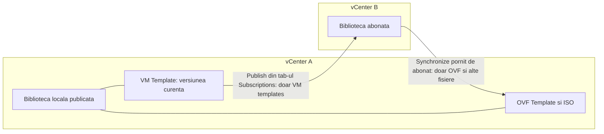
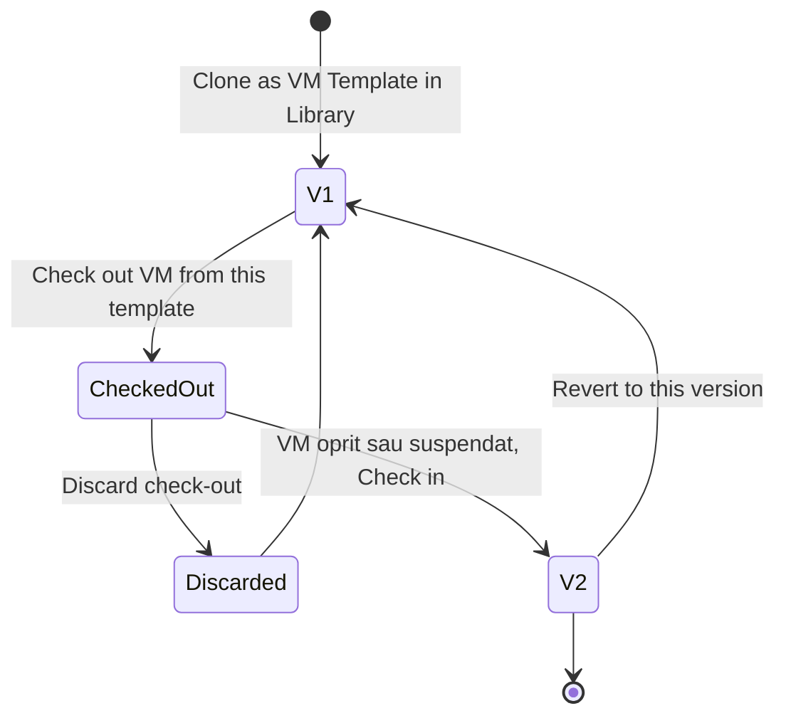

:::analogy
**Durerea din data center.** Ai trei vCenter-e și fiecare are „template-ul Windows Server” lui, cu patch-uri diferite. Cineva face deploy din cel vechi, iar serverul nou pleacă în producție fără ultimele actualizări de securitate. Content library rezolvă asta: un singur loc unde ții template-urile, cu versiuni, și de unde le distribui. Subiectul e la examen: exam guide-ul VVF (VMware vSphere Foundation, 2V0-16.25) îl are la obiectivul 2.2.6, iar vechiul VCP-DCV (VMware Certified Professional - Data Center Virtualization) la 4.8, 4.9 și 4.10. [S02] [S47]

**Analogia: biblioteca orașului și filialele ei.**

- **Template-ul** e matrița după care tipărești cărți noi: nu o citești, o folosești ca să faci copii.
- **Biblioteca locală** e biblioteca centrală, unde stau originalele. Dacă o **publici**, filialele se pot abona la ea.
- **Biblioteca abonată** e filiala: nu primește donații direct, doar copii trimise de la centru, fie toate odată, fie doar când le cere cineva.
- **Check-out și check-in** sunt ca împrumutul unei cărți pentru corectură: cât timp e la tine, alții citesc ediția anterioară; când o aduci înapoi, apare o ediție nouă.
:::

:::architecture
### 1. Template-uri în inventar

Un template e o copie de VM (VM, Virtual Machine) pe care nu o pornești și din care faci VM-uri noi. Template-urile sunt **read-only**: ca să schimbi unul, îl convertești în VM, faci modificarea și îl convertești înapoi; dacă vrei să păstrezi originalul, clonezi template-ul într-un template nou. [S268] [S269]

La clonare alegi formatul discului: *Same as source*, *Thick Provision Lazy Zeroed*, *Thick Provision Eager Zeroed* (necesar pentru funcții de clustering precum FT, Fault Tolerance) sau *Thin Provision*. Numele template-ului dă numele fișierelor pe datastore; o redenumire ulterioară nu schimbă fișierele. [S268] [S269]

### 2. Ce este o content library

O content library e un container pentru **template-uri de VM și de vApp** și pentru **alte fișiere** (imagini ISO de CD/DVD, fișiere text). O creezi și o administrezi dintr-un singur vCenter, iar conținutul se poate distribui altor vCenter-e prin HTTP(S) (Hypertext Transfer Protocol, Secure). [S257]

| Tip de articol | Ce conține | Observații |
|---|---|---|
| **OVF Template** | OVF (Open Virtualization Format): .ovf, .vmdk, .mf, ca un singur articol | vApp-urile devin OVF la încărcare [S257] |
| **VM Template** (VMTX) | Template în formatul nativ vSphere | De la 7.0 U1, doar în biblioteci locale, nu pe storage NFS (Network File System) sau SMB (Server Message Block) [S257] [S264] |
| **Other** | ISO-uri, fișiere text și altele | Apar în tab-ul Other Types [S257] |

| Tip de bibliotecă | Ce poți face |
|---|---|
| **Local** | Imporți, clonezi și editezi articole; o poți **publica**, cu parolă opțională, iar URL-ul (Uniform Resource Locator, adresa web) de abonare îl iei din Edit Settings [S257] [S261] |
| **Subscribed** | Nu imporți nimic; doar sincronizezi conținutul bibliotecii publicate [S257] [S263] |

**OVF security policy** (de la 7.0 U3) e opțională și impune o validare strictă a articolelor OVF. [S257] Pe unele versiuni, aplicarea ei pe o bibliotecă existentă dă eroare, iar soluția e s-o aplici la crearea bibliotecii sau prin API (Application Programming Interface; KB, Knowledge Base article, 406860). [S272]

### 3. Cum pui conținut în bibliotecă

- **Import Item:** dintr-un URL (doar .ovf sau .ova) sau dintr-un fișier local. vCenter verifică manifestul și certificatul și te avertizează, de exemplu, la un certificat expirat. Rezultatul e un articol OVF Template. [S262]
- **Clone as Template in Library:** dintr-un VM alegi tipul **OVF Template** sau **VM Template**. Un articol VM Template creează și un template identic în inventarul vCenter. [S262]
- **Clone Item:** copiezi un articol în altă bibliotecă din același vCenter. O bibliotecă abonată poate fi sursă, dar nu destinație. [S258] [S262]

Doar articolele **OVF Template** se pot actualiza (update), exporta sau clona; doar articolele din biblioteci locale se pot edita. [S258] [S264] Formatul OVA (Open Virtual Appliance) e același conținut ca OVF, într-un singur fișier.

### 4. Publicare și abonare

Documentația vSphere 8 spune clar cine mișcă ce: [S259]

- **Publicarea** (din biblioteca locală) trimite **doar VM templates**. OVF-urile și celelalte fișiere nu pleacă așa.
- **Sincronizarea** pornită de biblioteca abonată aduce **doar OVF templates** și celelalte fișiere. VM templates ajung doar când le publică cel care publică.
- Distribuirea VM templates cere vCenter-e în **ELM (Enhanced Linked Mode)** sau Hybrid Linked Mode. [S257] [S271]
- În VCF (VMware Cloud Foundation) 9, gruparea nouă a vCenter-elor se face cu **vCenter Linking**, nu cu ELM [S142] [S143]; cum se aplică asta la VM templates verifici în documentația 9.0 (`⚠ de verificat`).

**La crearea unei abonări** alegi între: [S259]

- legarea de o bibliotecă abonată existentă (fără sincronizare automată);
- o bibliotecă abonată nouă (sincronizarea automată pornește);
- *Download library content only when needed*: se descarcă întâi doar metadatele.

Abonările nu se editează: le ștergi și le creezi din nou. Ștergerea unei abonări nu șterge biblioteca abonată și nici conținutul deja sincronizat. [S259]

**Opțiuni de descărcare în biblioteca abonată:** [S263]

| Opțiune | Ce se întâmplă |
|---|---|
| Download all contents immediately | Metadate și conținut complet; articolele șterse la sursă rămân pe storage până le ștergi tu |
| Download only when needed | Doar metadate; sincronizezi fiecare articol când ai nevoie de el; coloana *Stored Content Locally* arată Yes după sincronizare |

Transferul e mai rapid de la host la host când ambele vCenter-e sunt în același domeniu SSO (Single Sign-On) și bibliotecile stau pe datastore-uri, sau de la datastore la datastore cu VAAI (vSphere APIs for Array Integration). Sincronizarea automată cere mult spațiu, pentru că se descarcă copii complete. [S263]

### 5. Check-out, check-in și versiuni

Funcția există de la vSphere 7.0, pentru VM templates: [S264]

- **Check out** creează un VM din template; VM-ul are un cerc albastru în inventar și nu îl poți converti în template sau muta în alt vCenter.
- Cât timp e în check-out, nimeni altcineva nu îl poate scoate, dar toată lumea poate face deploy din **ultima versiune**.
- **Check in** cere VM-ul oprit sau suspendat și creează o **versiune nouă**. Poți și renunța (*discard*), fără versiune nouă.
- Timeline-ul vertical arată versiunile; poți face **revert** la o versiune mai veche sau poți șterge o versiune.
- Redenumirea sau ștergerea template-ului din inventar se reflectă în bibliotecă și invers.
- Biblioteca abonată arată doar ultima versiune, fără timeline. [S263]

**De ce VM templates și nu doar OVF?** William Lam enumeră: replicare „push”, gestionată din vCenter-ul care publică; permisiuni vSphere pe fiecare template; poți alege ce vede fiecare abonat; mai puține biblioteci duplicate; check-in și check-out. Prețul: ELM sau Hybrid Linked Mode. [S265]

Deploy-ul din VM templates aflate în content library se face doar din vSphere Client (sau prin API). [S260]

### 6. Customization specifications

Când faci deploy din template, VM-ul nou ar avea același nume și aceeași configurație ca originalul. O **customization specification** aplică setări noi sistemului de operare (nume, rețea, domeniu, licență). [S266]

- Specificațiile sunt fișiere XML (Extensible Markup Language), păstrate în **baza de date vCenter**. Parolele de administrator și de domeniu sunt criptate cu un certificat unic pentru acel vCenter: dacă reinstalezi vCenter, trebuie să le introduci din nou. [S266]
- **Cerințe:** VMware Tools la zi, sistemul de operare pe discul de pe SCSI (Small Computer System Interface) 0:0, Perl în Linux și suport listat în VMware Compatibility Guide. [S267]
- **Linux cu scripturi:** VMware Tools 10.1.0 sau mai nou, iar opțiunea `enable-custom-scripts` e dezactivată implicit. **cloud-init:** VMware Tools 11.3.0+ și cloud-init 21.1+. [S266]
- **Windows:** folosește Sysprep; de la 8.0 U2 poți indica și un OU (Organizational Unit). [S266]

| | Template în inventar | OVF Template în bibliotecă | VM Template în bibliotecă |
|---|---|---|---|
| Format | Nativ vSphere | OVF | Nativ vSphere (VMTX) |
| Versiuni, check-out/in | Nu | Nu | Da [S264] |
| Update, export, clone item | Nu se aplică | Da [S258] | Nu [S264] |
| Distribuire între vCenter-e | Nu | Sincronizare pornită de abonat | Publicare, cu ELM sau Hybrid Linked Mode [S259] |

`[IMAGE SEARCH / PROMPT]` „vSphere content library publisher subscriber diagram” și „vSphere VM template check out check in timeline”.
:::

:::exam-alert
### De memorat

| Ce | Valoare / regulă | Sursă |
|---|---|---|
| VM Template în bibliotecă | De la 7.0 U1; doar biblioteci locale | Docs [S257] [S264] |
| Storage pentru VM templates | Nu NFS sau SMB | Docs [S264] |
| Import din URL | Doar .ovf sau .ova | Docs [S262] |
| Publicarea trimite | Doar VM templates | Docs [S259] |
| Sincronizarea abonatului aduce | Doar OVF și alte fișiere | Docs [S259] |
| VM templates între vCenter-e | ELM sau Hybrid Linked Mode | Docs, KB 414494 [S257] [S271] |
| Update, export, clone item | Doar OVF templates | Docs [S258] [S264] |
| Check-in | VM oprit sau suspendat; versiune nouă | Docs [S264] |
| OVF security policy | De la 7.0 U3, opțională | Docs [S257] |
| Linux cloud-init | VMware Tools 11.3.0+, cloud-init 21.1+ | Docs [S266] |
| Thread-uri de publicare | 24 implicit | KB 408721 [S274] |

### 3 capcane de examen

1. **„Poți importa un OVA direct într-o bibliotecă abonată.”** Fals. O bibliotecă abonată doar se sincronizează; importul se face în biblioteca locală care publică. [S257]
2. **„Publish trimite toată biblioteca, inclusiv OVF-urile, la abonați.”** Fals. Publicarea trimite doar VM templates; OVF-urile le trage abonatul prin sincronizare. [S259]
3. **„Un VM template din content library se poate exporta pe calculator ca orice articol.”** Fals. Export, update și clone item merg doar pentru OVF templates. [S264] [S258]
:::

:::trenches
### Greșeala 1: VM templates care nu ajung la abonat

Două vCenter-e în domenii SSO separate, fără ELM. OVF-urile se sincronizează, dar VM templates nu apar niciodată în biblioteca abonată. [S271]
**Remediere (KB 414494):** distribuirea VM templates cere încredere între vCenter-e, adică ELM; după ce le pui în același domeniu, creezi din nou abonarea din biblioteca care publică (*Actions → New Subscription*). Dacă nu poți face ELM, folosești OVF templates pentru acel abonat. [S271] [S259]

### Greșeala 2: datastore-ul vechi scos din uz

La înlocuirea storage-ului, cineva a mutat fișierele template-urilor cu datastore browser-ul, în afara vCenter. Check-out-ul și deploy-ul dau eroare că un fișier nu există. [S270]
**Remediere:** KB 429830 spune să pui fișierele înapoi în locația inițială. Pe viitor, un VM template rămâne pe datastore-ul unde a fost creat, nu pe cel al bibliotecii, iar *Migrate Content Library* nu îl mută. Îl muți corect cu check-out, Storage vMotion și check-in, adică o versiune nouă (KB 400125, vCenter 9.0). [S270] [S273]
:::

:::interview
**Întrebare Junior/Mid: „Care e diferența dintre un OVF template și un VM template într-o content library?”**

*Răspunsul ideal:* OVF template e un pachet standard (.ovf, .vmdk, .mf) pe care îl poți importa, exporta, actualiza și sincroniza de la abonat. VM template e formatul nativ vSphere, disponibil de la 7.0 U1, cu check-out, check-in și versiuni, distribuit prin publicare și doar între vCenter-e în ELM sau Hybrid Linked Mode. [S257] [S258] [S259] [S264] Un candidat bun adaugă că VM templates primesc permisiuni vSphere pe fiecare template. [S265]

**Scenariu de troubleshooting: „Echipa a publicat toată biblioteca, iar task-urile stau la 0% de o oră, fără eroare. Ce faci?”**

*Răspunsul pe care îl așteaptă un Team Lead:*
1. **Verifici câte operații de publicare rulează:** implicit sunt 24 de thread-uri, iar ce trece peste stă la coadă (KB 408721). [S274]
2. **Remedierea din KB:** snapshot la vCenter, backup la `/etc/vmware-content-library/vdc.properties`, adaugi `cls.activity.threadPool.size=60`, apoi `service-control --restart vmware-content-library`. Valoarea 60 se ajustează după volum. [S274]
3. **Verifici abonarea:** pentru VM templates vCenter-ele trebuie să fie în ELM sau Hybrid Linked Mode. [S271]
4. **Dacă apare „Cannot find library item in storage backing”,** baza de date are un articol fără fișiere; asta se repară doar cu suportul Broadcom (KB 429744). [S275]
:::

:::lab
**Scenariu.** Creezi o bibliotecă locală publicată, pui în ea un VM template și un OVF template, faci check-out și check-in ca să obții versiunea 2, apoi revert. Creezi o bibliotecă abonată în același vCenter, cu descărcare la cerere, și faci deploy cu o customization specification.

**Ce ai nevoie.** vCenter-ul din lab, un datastore VMFS (Virtual Machine File System) pentru bibliotecă și un VM Linux mic, oprit, cu VMware Tools și Perl. Un singur vCenter e suficient: publicarea și abonarea în același vCenter e un scenariu suportat. [S259]

Pașii de mai jos sunt bifabili, iar progresul se salvează în browser. Numele exacte ale meniurilor pot diferi puțin între versiunile 8 și 9 (`⚠ de verificat`).

**Test de avarie și validare.** La pasul 3, cât timp template-ul e în check-out, un deploy nou trebuie să pornească din versiunea 1. La pasul 5, articolul OVF din biblioteca abonată trebuie să arate *Stored Content Locally = No* până îl sincronizezi. La pasul 6, VM-ul nou trebuie să aibă numele din customization specification, nu pe cel al template-ului.
:::

:::quiz
Cinci întrebări originale, în stilul examenelor VCP (VMware Certified Professional). Primești explicația pentru fiecare variantă imediat după ce răspunzi.
:::

:::references
- Exam guide VCP-VVF Administrator 2V0-16.25, obiectivul 2.2.6 [S02]
- Exam guide VCP-DCV 2V0-21.23 (certificare Legacy), obiectivele 4.8, 4.9, 4.10 [S47]
- Documentația vSphere 8: content libraries [S257], articole [S258], publicare și abonare [S259], sincronizare [S263]
- Documentația vSphere 8: import și clonare în bibliotecă [S262], check-out și check-in [S264]
- Documentația vSphere 8: template-uri în inventar [S268] [S269], customization [S266] [S267]
- William Lam: beneficiile VM templates în content library [S265]
- KB 414494, KB 429830, KB 400125, KB 408721 [S271] [S270] [S273] [S274]
:::
