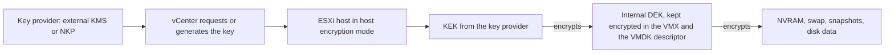
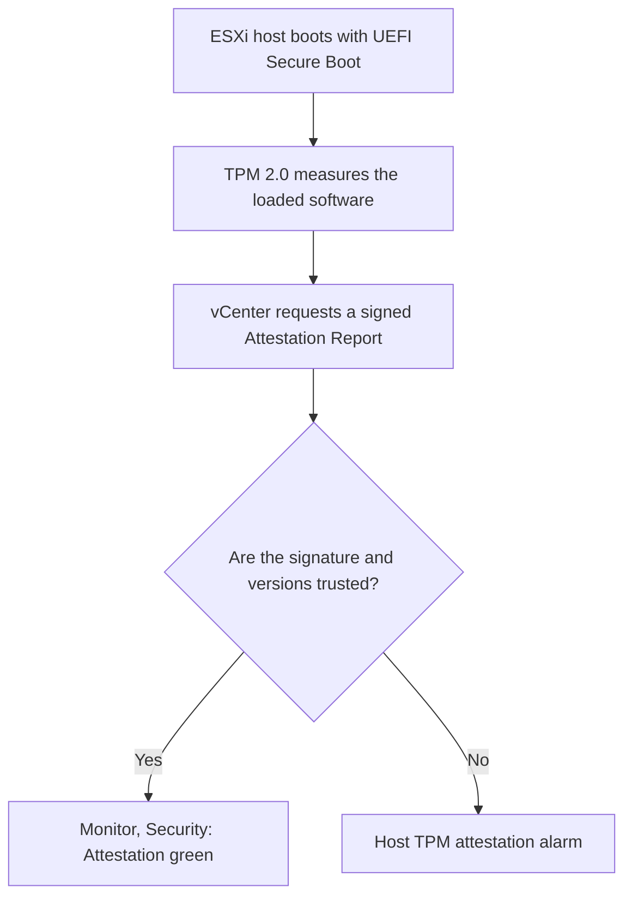

:::analogy
**The data center pain.** A failed disk from an array is sent back to the vendor. The files of the payroll VM (VM, Virtual Machine) sat on it, in cleartext. Another time, after you restore a Windows 11 VM from backup, it refuses to start: "The virtual machine must be encrypted". Both are about VM security: encryption, keys and vTPM (virtual Trusted Platform Module). On the exam: the VVF (VMware vSphere Foundation, 2V0-16.25) exam guide has objective 2.2.7, and the older VCP-DCV (VMware Certified Professional - Data Center Virtualization) has 1.8, 1.9, 4.17.2 and 7.12. [S02] [S47] [S286]

**The analogy: the bank vault.**

- **The key provider** is the bank's key room. It can be an outside security firm (**Standard**, with a key server), an outside firm plus an auditor who checks every counter (**Trusted**) or the bank's own room (**Native**).
- **KEK** (Key Encryption Key) is the key room's key, and **DEK** (Data Encryption Key) is the key of each safe-deposit box. The box key sits next to the box, but in an envelope sealed with the big key.
- **vTPM** is a small personal safe in each office, where Windows keeps its secrets.
- **Secure Boot** is the guard at the door who lets in only people with a signed badge.
:::

:::architecture
### 1. Key providers: where the keys come from

| | Standard key provider | Trusted key provider | vSphere Native Key Provider |
|---|---|---|---|
| Key server | Yes, external, through KMIP (Key Management Interoperability Protocol) | Yes, plus vSphere Trust Authority | No |
| Who requests the keys | vCenter, the only one with credentials; it pushes them to hosts | Attested hosts, directly | The hosts, from the key received from vCenter |
| Specifics | vCenter keeps only the key IDs | Separate Trust Authority cluster, TrustedAdmins group | Hosts can create keys even without vCenter |

Sources: [S276] [S277].

- You can have several key providers; the first one added becomes the **default**, and the default can be changed. [S276]
- A KMS (Key Management Server) from any KMIP-compatible vendor can be used, because vCenter is the KMIP client. [S276]

**Native Key Provider (NKP)**, in short: [S277] [S278]

- It exists since **7.0 U2**, and vCenter and all hosts must be 7.0 U2 or newer.
- vCenter generates a **Key Derivation Key** and pushes it to the hosts in the **cluster** (it does not work on standalone hosts). [S282]
- **It must be backed up before use:** until then vCenter shows an alarm. The backup is a .p12 file, optionally password protected, and it gives access to the keys, so you keep it safe.
- TPM (Trusted Platform Module) 2.0 on the host is optional but recommended; TPM 1.2 is not supported. The default option *Use key provider only with TPM protected ESXi hosts* excludes hosts without a TPM.
- NKP offers no KMIP and no HSM (Hardware Security Module); non-VMware products that need these require an external key server.
- If vCenter goes down, encrypted VMs keep running, because each host has a copy of the key.

### 2. How a VM is encrypted

- **Host encryption mode** must be on for the host; turning it on installs a host key, usually happens automatically and is hard to undo. On a host in this mode, core dumps of hostd and of encrypted VMs are encrypted. [S279]
- **The DEK** is kept encrypted in the VMX file (for the VM's files) and in the VMDK descriptor (for disks); the KEK ID sits in the descriptor. [S281]
- **Encrypted:** NVRAM, swap (VSWP), snapshots (VMSN) and disk data, which never reach storage or the network in cleartext. **Not encrypted:** log files and most of the VMX and VMSD configuration. [S281]
- You encrypt a VM by applying the **VM Encryption Policy** storage policy (or a policy that includes encryption). [S283]
- Encrypting an existing VM needs at least **twice the space** it uses. [S279]
- Most encryption operations need the **VM powered off**; cloning and *shallow recrypt* also work with the VM on. *Deep recrypt* is not allowed on a VM with snapshots. [S282]
- An encrypted VM **always uses encrypted vMotion**. [S201]
- If the key of the VM or of a disk is missing, the VM enters a **locked state** and operations are blocked. [S283]

**What does not work or is limited with encrypted VMs:** [S282] [S283]

| Feature | Situation |
|---|---|
| RDM (Raw Device Mapping) | Not supported; vVols are supported |
| Multi-writer disks (Windows clusters, Oracle RAC) | Encrypted disks are not supported; home files can be encrypted |
| Content library | Export as OVF (Open Virtualization Format) Template not supported; VM Template is supported |
| OVF export, OVF Tool | Not supported |
| Serial or parallel port output | Not supported |
| ESXi Dump Collector | Not supported |
| VADP (vSphere Storage APIs - Data Protection) backup | SAN (Storage Area Network) transport not supported; Hot-Add and NBD-SSL (encrypted network transport) supported, if the vendor supports them |
| FT (Fault Tolerance) | Supported since 7.0 U2 [S250] |

**Licensing (vSphere 7 and 8):** VM Encryption needs **Enterprise Plus**; with Standard you get the error "License not available to perform the operation". vTPM with NKP is included in all editions. In VVF/VCF (VMware Cloud Foundation) 9 you check the editions (`⚠ to verify`). [S292] [S277] [S278]

### 3. Who is allowed: the Cryptographic Operations privileges

There are **14 Cryptographic Operations privileges**, for example *Encrypt*, *Decrypt*, *Encrypt new*, *Migrate*, *Recrypt*, *Manage KMS*, *Manage keys* and *Register host*. [S280] The **No cryptography administrator** system role has almost everything Administrator has, but without the cryptographic privileges; you give it to administrators who must not touch the keys. You can clone a role to allow, for example, encryption without decryption. [S279] vCenter writes to the Event Console who did each cryptographic operation, when and with which key ID. [S276]

### 4. vTPM

A **vTPM** is a software representation of a TPM 2.0 chip, seen by the VM as a virtual device. Windows 11 requires it, and BitLocker can rely on it. [S284] [S286]

| Requirement | Value | Source |
|---|---|---|
| Firmware | EFI | [S284] |
| Virtual hardware | 14 or newer | [S284] |
| Key provider | Configured in vCenter (for example NKP) | [S284] |
| vCenter | 6.7+ for Windows, 7.0 U2+ for Linux | [S284] |
| Physical TPM on the host | **Not** needed for vTPM; only for host attestation | [S284] |

- Adding a vTPM encrypts the VM's **home files**, including `.nvram`, where the vTPM keeps its data. **Disks are not encrypted** automatically. [S284]
- The backup must include `.nvram`, and the keys must be available at restore time; otherwise the VM cannot be restored. [S284]
- Since 8.0, when cloning you can choose *Replace*, which gives the clone a new, blank vTPM with its own secrets. [S284]
- If the *Trusted Platform Module* option is missing from *Add New Device*, check the virtual hardware, the EFI firmware, the key provider and whether the VM is powered off (KB, Knowledge Base article, 413610). [S285]

### 5. UEFI (Unified Extensible Firmware Interface) Secure Boot in the VM and VBS (Virtualization-Based Security)

**Secure Boot in the VM** lets only signed components start: bootloader, kernel and drivers. The default configuration contains Microsoft certificates (for Windows and for signed Linux bootloaders) and a VMware certificate (for ESXi running in a VM). [S287]

- Requirements: **EFI** firmware, **virtual hardware 13+**, an operating system that supports UEFI Secure Boot, VMware Tools 10.1+ and the VM powered off. [S287] [S288]
- On Linux, remove VMware Host-Guest Filesystem from VMware Tools first. [S287]
- **Careful:** switching from BIOS (Basic Input/Output System) to EFI without converting the boot disk from MBR (Master Boot Record) to GPT (GUID Partition Table) leaves the VM unable to boot. [S288]

**VBS** is a Windows isolation feature. In vSphere: [S289]

| | Intel | AMD |
|---|---|---|
| vSphere | 6.7+ | 7.0 U2+ |
| Virtual hardware | 14+ | 19+ |
| Windows | Windows 10, Windows Server 2016+ | Windows 10 1809, Windows Server 2019+ |

A VM with VBS does not support FT, PCI (Peripheral Component Interconnect) passthrough or hot add of CPU (Central Processing Unit) or memory. The documentation recommends UEFI from the start, because a later switch from BIOS requires reinstalling the operating system. [S289]

### 6. The hosts: Secure Boot and TPM 2.0 attestation

- Requirements: vCenter and ESXi 6.7+, a **TPM 2.0** chip enabled in UEFI, **UEFI Secure Boot** on; in the BIOS, the TPM uses the SHA-256 algorithm and the TIS/FIFO interface, not CRB (two interface modes of the chip). [S290]
- The status is shown on the data center under *Monitor → Security*. If you added a TPM to a host already managed, disconnect and reconnect it. [S290]
- The "Host TPM attestation" alarm usually appears when Secure Boot is off on the host. Check with `secureBoot.py -s`, compatibility with `secureBoot.py -c`, and if the hardware does not support Secure Boot, reset the alarm to green (KB 369525). [S291]

`[IMAGE SEARCH / PROMPT]` "vSphere VM encryption KEK DEK key provider diagram" and "vSphere Native Key Provider vTPM architecture".
:::

:::exam-alert
### Must memorize

| What | Value / rule | Source |
|---|---|---|
| Native Key Provider | Since 7.0 U2; no key server; only hosts in a cluster | Docs [S277] [S282] |
| NKP before use | Backup required (.p12) | Docs, Q&A [S277] [S278] |
| Standard key provider | KMIP server; vCenter keeps only the IDs | Docs [S276] |
| Encrypting an existing VM | At least twice the space | Docs [S279] |
| Not encrypted | Logs, most of VMX/VMSD | Docs [S281] |
| vTPM | EFI, hardware 14+, key provider; no physical TPM | Docs [S284] |
| vTPM encrypts | Home files and .nvram, not the disks | Docs [S284] |
| Secure Boot in the VM | EFI, hardware 13+, VMware Tools 10.1+ | Docs [S287] |
| VBS | Intel: hardware 14+; AMD: hardware 19+ | Docs [S289] |
| Host attestation | TPM 2.0, UEFI Secure Boot, SHA-256 | Docs [S290] |
| VM Encryption (vSphere 7/8) | Enterprise Plus | KB 413118 [S292] |

### 3 exam traps

1. **"To add a vTPM, the host must have a TPM 2.0 chip."** False. vTPM is software; the physical TPM is needed only for host attestation. You do need a key provider. [S284]
2. **"Adding a vTPM encrypts the VM's disks."** False. The home files and `.nvram` are encrypted; you encrypt the disks separately. [S284]
3. **"Native Key Provider needs an external KMS."** False. NKP needs no key server, but it must be backed up before use. [S277]
:::

:::trenches
### Mistake 1: NKP is active, but VMs fail on some hosts

In a mixed cluster, only some hosts have TPM 2.0. NKP was created with the default option *Use key provider only with TPM protected ESXi hosts*, and operations on VMs on the hosts without TPM fail. [S278]
**Fix:** in mixed clusters you untick the option, so all hosts can use NKP. Also check that NKP has a backup; without one, vCenter shows an alarm and you cannot use it. [S278] [S277]

### Mistake 2: the restored Windows 11 that no longer boots

A Windows 11 VM was restored or migrated without the vTPM's cryptographic binding. The host says "The virtual machine must be encrypted", and vCenter "Virtual TPM initialization failed". [S286]
**Fix (KB 377302):** check UEFI with Secure Boot, add an NKP, back it up and make it the default, remove the old TPM and add a new one. You need the BitLocker recovery key if the disk uses BitLocker. Bypassing the vTPM requirement is not supported. Going forward, the backup includes `.nvram`, and the keys stay available. [S286] [S284]
:::

:::interview
**Junior/Mid question: "What do you need to put a vTPM on a new Windows 11 VM?"**

*Ideal answer:* A key provider in vCenter, simplest NKP, backed up; the VM with EFI firmware and virtual hardware 14 or newer; then *Add New Device → Trusted Platform Module* with the VM powered off. [S284] [S277] [S285] You do not need a physical TPM on the host. [S284] A good candidate adds that the vTPM encrypts the home files, so the backup must include `.nvram` and the keys. [S284]

**Troubleshooting scenario: "The Trusted Platform Module option does not appear under Add New Device. What do you check?"**

*The answer a Team Lead expects:*
1. **Virtual hardware:** below version 14 the option is missing; run *Compatibility → Upgrade VM Compatibility* with the VM off. [S285] [S284]
2. **Firmware:** it must be EFI, not BIOS (*VM Options → Boot Options*). [S285]
3. **Key provider:** is one configured under *Security → Key Providers*? [S285]
4. **VM state:** the change is made with the VM powered off. [S285]
5. **Licence:** for disk encryption on vSphere 8 Standard you get "License not available"; vTPM with NKP works in all editions. [S292] [S278]
:::

:::lab
**Scenario.** You set up a Native Key Provider and back it up, create a VM with EFI and Secure Boot, add a vTPM to it, encrypt a disk with VM Encryption Policy, test a role without cryptographic privileges and check host attestation.

**What you need.** The lab vCenter and cluster (7.0 U2 or newer), an ISO of an operating system that supports UEFI Secure Boot and a test user from lesson 2.2.

The steps below can be ticked, and progress is saved in the browser. Exact menu names may differ slightly between versions 8 and 9 (`⚠ to verify`).

**Home lab only / not supported.** In a nested lab the hosts have no physical TPM, so you untick *Use key provider only with TPM protected ESXi hosts* and accept the attestation alarm. Disk encryption may need a licence that includes it (`⚠ to verify` for the lab licence). [S278] [S291] [S292]

**Failure test and validation.** At step 5, the user with the role without cryptographic privileges must not be able to decrypt the VM. At step 4, after encryption, encrypted vMotion can no longer be turned off for that VM. [S201]
:::

:::quiz
Five original questions in the style of the VCP (VMware Certified Professional) exams. You get the explanation for each option right after you answer.
:::

:::references
- VCP-VVF Administrator 2V0-16.25 exam guide, objective 2.2.7 [S02]
- VCP-DCV 2V0-21.23 exam guide (Legacy certification), objectives 1.8, 1.9, 4.17.2, 7.12 [S47]
- vSphere 8 Security docs: key providers [S276], Native Key Provider [S277] and the NKP Q&A [S278]
- vSphere 8 docs: encryption components [S279], privileges [S280], interoperability [S282] and caveats [S283]
- VM Encryption programming guide: KEK, DEK and what is encrypted [S281]
- vSphere 8 docs: vTPM [S284], Secure Boot [S287], VBS [S289], host attestation [S290]
- KB 413610, KB 377302, KB 369525, KB 413118 [S285] [S286] [S291] [S292]
:::
