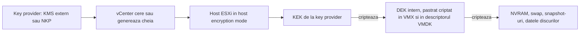
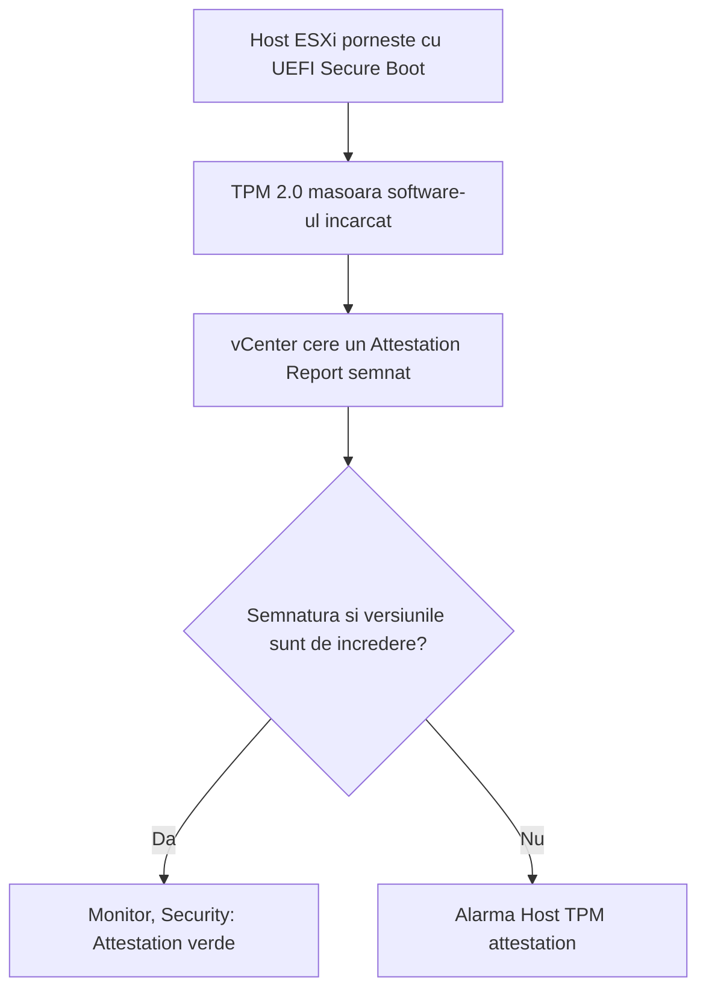

:::analogy
**Durerea din data center.** Un disc defect dintr-un array e trimis înapoi la furnizor. Pe el stăteau fișierele VM-ului (VM, Virtual Machine) de salarizare, în clar. Altă dată, după ce ai restaurat din backup un VM cu Windows 11, acesta refuză să pornească: „The virtual machine must be encrypted”. Ambele țin de securitatea VM-urilor: criptare, chei și vTPM (virtual Trusted Platform Module). La examen: exam guide-ul VVF (VMware vSphere Foundation, 2V0-16.25) are obiectivul 2.2.7, iar vechiul VCP-DCV (VMware Certified Professional - Data Center Virtualization) 1.8, 1.9, 4.17.2 și 7.12. [S02] [S47] [S286]

**Analogia: seiful băncii.**

- **Key provider-ul** e camera cu chei a băncii. Poate fi o firmă externă de pază (**Standard**, cu un server de chei), o firmă externă plus un auditor care verifică fiecare ghișeu (**Trusted**) sau o cameră proprie a băncii (**Native**).
- **KEK** (Key Encryption Key) e cheia de la camera cu chei, iar **DEK** (Data Encryption Key) e cheia fiecărei cutii de valori. Cheia cutiei stă lângă cutie, dar într-un plic sigilat cu cheia mare.
- **vTPM** e un mic seif personal în fiecare birou, unde Windows își ține secretele.
- **Secure Boot** e paznicul de la intrare care lasă să intre doar oameni cu legitimație semnată.
:::

:::architecture
### 1. Key providers: de unde vin cheile

| | Standard key provider | Trusted key provider | vSphere Native Key Provider |
|---|---|---|---|
| Server de chei | Da, extern, prin KMIP (Key Management Interoperability Protocol) | Da, plus vSphere Trust Authority | Nu |
| Cine cere cheile | vCenter, singurul cu credențiale; le trimite hosturilor | Hosturile atestate, direct | Hosturile, din cheia primită de la vCenter |
| Particularități | vCenter păstrează doar ID-urile cheilor | Cluster Trust Authority separat, grupul TrustedAdmins | Hosturile pot crea chei chiar fără vCenter |

Surse: [S276] [S277].

- Poți avea mai mulți key provideri; primul adăugat devine **default**, iar default-ul se poate schimba. [S276]
- Un KMS (Key Management Server) de la orice producător compatibil KMIP poate fi folosit, pentru că vCenter e clientul KMIP. [S276]

**Native Key Provider (NKP)**, pe scurt: [S277] [S278]

- Există de la **7.0 U2**, iar vCenter și hosturile trebuie să fie toate 7.0 U2 sau mai noi.
- vCenter generează o **Key Derivation Key** și o trimite hosturilor din **cluster** (nu merge pe hosturi standalone). [S282]
- **Trebuie salvat înainte de folosire:** până atunci vCenter arată o alarmă. Backup-ul e un fișier .p12, cu parolă opțională, și dă acces la chei, deci îl păstrezi în siguranță.
- TPM (Trusted Platform Module) 2.0 pe host e opțional, dar recomandat; TPM 1.2 nu e suportat. Opțiunea implicită *Use key provider only with TPM protected ESXi hosts* exclude hosturile fără TPM.
- NKP nu oferă KMIP și nici HSM (Hardware Security Module); produsele non-VMware care cer asta au nevoie de un server de chei extern.
- Dacă vCenter cade, VM-urile criptate merg în continuare, pentru că fiecare host are o copie a cheii.

### 2. Cum se criptează un VM

- **Host encryption mode** trebuie să fie activ pe host; activarea instalează o cheie de host, se face de obicei automat și e greu de inversat. Pe un host în acest mod, core dump-urile hostd și ale VM-urilor criptate sunt criptate. [S279]
- **DEK-ul** e păstrat criptat în fișierul VMX (pentru fișierele VM-ului) și în descriptorul VMDK (pentru discuri); ID-ul KEK stă în descriptor. [S281]
- **Criptate:** NVRAM, swap (VSWP), snapshot-uri (VMSN) și datele discurilor, care nu ajung niciodată în clar pe storage sau în rețea. **Necriptate:** fișierele de log și cea mai mare parte din configurația VMX și VMSD. [S281]
- Criptezi un VM aplicând storage policy-ul **VM Encryption Policy** (sau o politică ce include criptare). [S283]
- Criptarea unui VM existent cere cel puțin **dublul spațiului** pe care îl folosește. [S279]
- Majoritatea operațiilor de criptare cer **VM-ul oprit**; clonarea și *shallow recrypt* merg și cu VM-ul pornit. *Deep recrypt* nu e permis pe un VM cu snapshot-uri. [S282]
- Un VM criptat folosește **mereu encrypted vMotion**. [S201]
- Dacă lipsește cheia VM-ului sau a unui disc, VM-ul intră în **locked state** și operațiile sunt blocate. [S283]

**Ce nu merge sau e limitat cu VM-uri criptate:** [S282] [S283]

| Funcție | Situație |
|---|---|
| RDM (Raw Device Mapping) | Nesuportat; vVols sunt suportate |
| Discuri multi-writer (clustere Windows, Oracle RAC) | Discurile criptate nu sunt suportate; fișierele home pot fi criptate |
| Content library | Export ca OVF (Open Virtualization Format) Template nesuportat; VM Template e suportat |
| Export OVF, OVF Tool | Nesuportat |
| Ieșire pe port serial sau paralel | Nesuportată |
| ESXi Dump Collector | Nesuportat |
| Backup VADP (vSphere Storage APIs - Data Protection) | Transportul SAN (Storage Area Network) nesuportat; Hot-Add și NBD-SSL (transport prin rețea, criptat) suportate, dacă le suportă furnizorul |
| FT (Fault Tolerance) | Suportat de la 7.0 U2 [S250] |

**Licențiere (vSphere 7 și 8):** VM Encryption cere **Enterprise Plus**; cu Standard primești eroarea „License not available to perform the operation”. vTPM cu NKP e inclus în toate edițiile. În VVF/VCF (VMware Cloud Foundation) 9 verifici edițiile (`⚠ de verificat`). [S292] [S277] [S278]

### 3. Cine are voie: privilegiile Cryptographic Operations

Există **14 privilegii** Cryptographic Operations, de exemplu *Encrypt*, *Decrypt*, *Encrypt new*, *Migrate*, *Recrypt*, *Manage KMS*, *Manage keys* și *Register host*. [S280] Rolul de sistem **No cryptography administrator** are aproape tot ce are Administrator, dar fără privilegiile criptografice; îl dai administratorilor care nu trebuie să atingă cheile. Poți clona un rol ca să permiți, de exemplu, criptarea fără decriptare. [S279] vCenter scrie în Event Console cine a făcut fiecare operație criptografică, când și cu ce ID de cheie. [S276]

### 4. vTPM

Un **vTPM** e o reprezentare software a unui cip TPM 2.0, văzută de VM ca un dispozitiv virtual. Windows 11 îl cere, iar BitLocker se poate baza pe el. [S284] [S286]

| Cerință | Valoare | Sursă |
|---|---|---|
| Firmware | EFI | [S284] |
| Hardware virtual | 14 sau mai nou | [S284] |
| Key provider | Configurat în vCenter (de exemplu NKP) | [S284] |
| vCenter | 6.7+ pentru Windows, 7.0 U2+ pentru Linux | [S284] |
| TPM fizic pe host | **Nu** e necesar pentru vTPM; doar pentru atestarea hostului | [S284] |

- Adăugarea unui vTPM criptează **fișierele home** ale VM-ului, inclusiv `.nvram`, unde vTPM-ul își ține datele. **Discurile nu sunt criptate** automat. [S284]
- Backup-ul trebuie să includă `.nvram`, iar cheile trebuie să fie disponibile la restaurare; altfel VM-ul nu poate fi restaurat. [S284]
- De la 8.0, la clonare poți alege *Replace*, care dă clonei un vTPM nou, gol, cu propriile secrete. [S284]
- Dacă opțiunea *Trusted Platform Module* lipsește din *Add New Device*, verifici hardware-ul virtual, firmware-ul EFI, key provider-ul și dacă VM-ul e oprit (KB, Knowledge Base article, 413610). [S285]

### 5. UEFI (Unified Extensible Firmware Interface) Secure Boot în VM și VBS (Virtualization-Based Security)

**Secure Boot în VM** lasă să pornească doar componente semnate: bootloader, kernel și drivere. Configurația implicită conține certificate Microsoft (pentru Windows și pentru bootloadere Linux semnate) și un certificat VMware (pentru ESXi rulat într-un VM). [S287]

- Cerințe: firmware **EFI**, **hardware virtual 13+**, sistem de operare care suportă UEFI Secure Boot, VMware Tools 10.1+ și VM-ul oprit. [S287] [S288]
- La Linux, scoți VMware Host-Guest Filesystem din VMware Tools înainte. [S287]
- **Atenție:** trecerea de la BIOS (Basic Input/Output System) la EFI fără conversia discului de boot din MBR (Master Boot Record) în GPT (GUID Partition Table) face VM-ul să nu mai pornească. [S288]

**VBS** e o funcție Windows de izolare. În vSphere: [S289]

| | Intel | AMD |
|---|---|---|
| vSphere | 6.7+ | 7.0 U2+ |
| Hardware virtual | 14+ | 19+ |
| Windows | Windows 10, Windows Server 2016+ | Windows 10 1809, Windows Server 2019+ |

Un VM cu VBS nu suportă FT, PCI (Peripheral Component Interconnect) passthrough și hot add de CPU (Central Processing Unit) sau memorie. Documentația recomandă UEFI de la început, pentru că trecerea ulterioară din BIOS cere reinstalarea sistemului de operare. [S289]

### 6. Hosturile: Secure Boot și atestare TPM 2.0

- Cerințe: vCenter și ESXi 6.7+, cip **TPM 2.0** activat în UEFI, **UEFI Secure Boot** activ; în BIOS, TPM pe algoritmul SHA-256 și pe interfața TIS/FIFO, nu CRB (două moduri de interfață ale cipului). [S290]
- Starea se vede pe data center, la *Monitor → Security*. Dacă ai adăugat un TPM unui host deja gestionat, îl deconectezi și îl reconectezi. [S290]
- Alarma „Host TPM attestation” apare de obicei când Secure Boot e dezactivat pe host. Verifici cu `secureBoot.py -s`, compatibilitatea cu `secureBoot.py -c`, iar dacă hardware-ul nu suportă Secure Boot, resetezi alarma pe verde (KB 369525). [S291]

`[IMAGE SEARCH / PROMPT]` „vSphere VM encryption KEK DEK key provider diagram” și „vSphere Native Key Provider vTPM architecture”.
:::

:::exam-alert
### De memorat

| Ce | Valoare / regulă | Sursă |
|---|---|---|
| Native Key Provider | De la 7.0 U2; fără server de chei; doar hosturi în cluster | Docs [S277] [S282] |
| NKP înainte de folosire | Backup obligatoriu (.p12) | Docs, Q&A [S277] [S278] |
| Standard key provider | Server KMIP; vCenter păstrează doar ID-urile | Docs [S276] |
| Criptarea unui VM existent | Cel puțin dublul spațiului | Docs [S279] |
| Necriptate | Log-uri, cea mai mare parte din VMX/VMSD | Docs [S281] |
| vTPM | EFI, hardware 14+, key provider; fără TPM fizic | Docs [S284] |
| vTPM criptează | Fișierele home și .nvram, nu discurile | Docs [S284] |
| Secure Boot în VM | EFI, hardware 13+, VMware Tools 10.1+ | Docs [S287] |
| VBS | Intel: hardware 14+; AMD: hardware 19+ | Docs [S289] |
| Atestare host | TPM 2.0, UEFI Secure Boot, SHA-256 | Docs [S290] |
| VM Encryption (vSphere 7/8) | Enterprise Plus | KB 413118 [S292] |

### 3 capcane de examen

1. **„Ca să adaugi un vTPM, hostul trebuie să aibă un cip TPM 2.0.”** Fals. vTPM e software; TPM-ul fizic e necesar doar pentru atestarea hostului. Ai nevoie, în schimb, de un key provider. [S284]
2. **„Adăugarea unui vTPM criptează discurile VM-ului.”** Fals. Se criptează fișierele home și `.nvram`; discurile le criptezi separat. [S284]
3. **„Native Key Provider cere un server KMS extern.”** Fals. NKP nu are nevoie de server de chei, dar trebuie salvat înainte de folosire. [S277]
:::

:::trenches
### Greșeala 1: NKP activ, dar VM-urile nu pornesc pe unele hosturi

Într-un cluster mixt, doar o parte din hosturi au TPM 2.0. NKP a fost creat cu opțiunea implicită *Use key provider only with TPM protected ESXi hosts*, iar operațiile pe VM-urile de pe hosturile fără TPM eșuează. [S278]
**Remediere:** în clustere mixte debifezi opțiunea, ca toate hosturile să poată folosi NKP. Verifici și că NKP are backup; fără backup, vCenter arată alarmă și nu îl poți folosi. [S278] [S277]

### Greșeala 2: Windows 11 restaurat care nu mai pornește

Un VM Windows 11 a fost restaurat sau migrat fără legătura criptografică a vTPM-ului. Hostul spune „The virtual machine must be encrypted”, iar vCenter „Virtual TPM initialization failed”. [S286]
**Remediere (KB 377302):** verifici UEFI cu Secure Boot, adaugi un NKP, îl salvezi și îl faci default, scoți vechiul TPM și adaugi unul nou. Ai nevoie de cheia de recuperare BitLocker dacă discul e criptat cu BitLocker. Ocolirea cerinței de vTPM nu e suportată. Pe viitor, backup-ul include `.nvram`, iar cheile rămân disponibile. [S286] [S284]
:::

:::interview
**Întrebare Junior/Mid: „Ce îți trebuie ca să pui un vTPM pe un VM nou cu Windows 11?”**

*Răspunsul ideal:* Un key provider în vCenter, cel mai simplu NKP, salvat cu backup; VM-ul cu firmware EFI și hardware virtual 14 sau mai nou; apoi *Add New Device → Trusted Platform Module* cu VM-ul oprit. [S284] [S277] [S285] Nu ai nevoie de TPM fizic pe host. [S284] Un candidat bun adaugă că vTPM criptează fișierele home, deci backup-ul trebuie să includă `.nvram` și cheile. [S284]

**Scenariu de troubleshooting: „Opțiunea Trusted Platform Module nu apare la Add New Device. Ce verifici?”**

*Răspunsul pe care îl așteaptă un Team Lead:*
1. **Hardware-ul virtual:** sub versiunea 14 opțiunea lipsește; faci *Compatibility → Upgrade VM Compatibility* cu VM-ul oprit. [S285] [S284]
2. **Firmware-ul:** trebuie EFI, nu BIOS (*VM Options → Boot Options*). [S285]
3. **Key provider-ul:** există unul configurat la *Security → Key Providers*? [S285]
4. **Starea VM-ului:** modificarea se face cu VM-ul oprit. [S285]
5. **Licența:** pentru criptarea discurilor pe vSphere 8 Standard primești „License not available”; vTPM cu NKP merge în toate edițiile. [S292] [S278]
:::

:::lab
**Scenariu.** Configurezi un Native Key Provider și îl salvezi, creezi un VM cu EFI și Secure Boot, îi adaugi un vTPM, criptezi un disc cu VM Encryption Policy, testezi un rol fără privilegii criptografice și verifici atestarea hosturilor.

**Ce ai nevoie.** vCenter-ul și clusterul din lab (7.0 U2 sau mai nou), un ISO cu un sistem de operare care suportă UEFI Secure Boot și un utilizator de test din lecția 2.2.

Pașii de mai jos sunt bifabili, iar progresul se salvează în browser. Numele exacte ale meniurilor pot diferi puțin între versiunile 8 și 9 (`⚠ de verificat`).

**Home lab only / not supported.** Într-un lab nested, hosturile nu au TPM fizic, așa că debifezi *Use key provider only with TPM protected ESXi hosts* și accepți alarma de atestare. Criptarea discurilor poate cere o licență care o include (`⚠ de verificat` pentru licența de lab). [S278] [S291] [S292]

**Test de avarie și validare.** La pasul 5, utilizatorul cu rolul fără privilegii criptografice nu trebuie să poată decripta VM-ul. La pasul 4, după criptare, encrypted vMotion nu mai poate fi dezactivat pentru acel VM. [S201]
:::

:::quiz
Cinci întrebări originale, în stilul examenelor VCP (VMware Certified Professional). Primești explicația pentru fiecare variantă imediat după ce răspunzi.
:::

:::references
- Exam guide VCP-VVF Administrator 2V0-16.25, obiectivul 2.2.7 [S02]
- Exam guide VCP-DCV 2V0-21.23 (certificare Legacy), obiectivele 1.8, 1.9, 4.17.2, 7.12 [S47]
- Documentația vSphere 8 Security: key providers [S276], Native Key Provider [S277] și Q&A-ul NKP [S278]
- Documentația vSphere 8: componentele criptării [S279], privilegii [S280], interoperabilitate [S282] și limitări [S283]
- Ghidul de programare VM Encryption: KEK, DEK și ce se criptează [S281]
- Documentația vSphere 8: vTPM [S284], Secure Boot [S287], VBS [S289], atestarea hosturilor [S290]
- KB 413610, KB 377302, KB 369525, KB 413118 [S285] [S286] [S291] [S292]
:::
