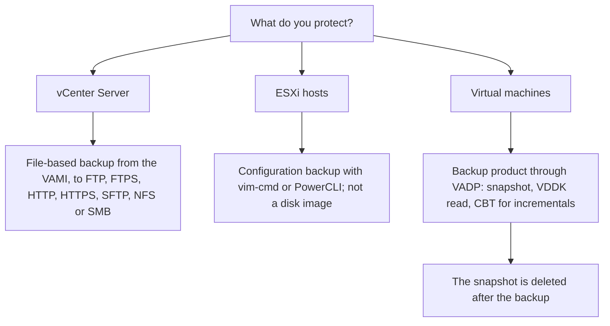
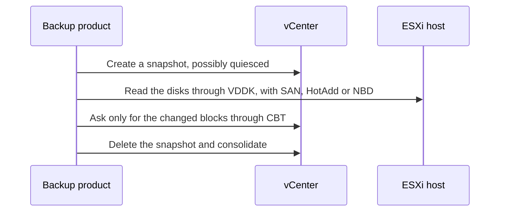

:::analogy
**The data center pain.** A vCenter upgrade fails halfway, and the appliance's last backup is three months old. Another time, an administrator "backs up" by leaving snapshots on VMs for weeks, until the datastore fills up and dozens of VMs (VM, Virtual Machine) stop. Both scenarios are on the exam: the VVF (VMware vSphere Foundation, 2V0-16.25) exam guide has objective 2.2.5, and the older VCP-DCV (VMware Certified Professional - Data Center Virtualization) objective 4.11. [S02] [S47] [S297]

**The analogy: the house papers.**

- **The vCenter backup** is the folder with the house papers: plans, contracts, keys. The house (the VMs) exists without it, but without the folder you no longer know what belongs to whom.
- **The ESXi configuration backup** is the boiler's settings sheet: you do not photograph the whole boiler, you note the settings so you can configure a new one.
- **The VM backup** is a copy of the furniture and belongings, kept in another city.
- **A snapshot** is a bookmark: it shows where you stopped, but if the book burns, the bookmark does not help.
:::

:::architecture
### 1. Three things to protect, each differently

Before tools, you set two targets: **RPO (Recovery Point Objective)**, how much data you can afford to lose, and **RTO (Recovery Time Objective)**, how long recovery may take. They decide how often you back up and how fast you must be able to restore.

### 2. vCenter: file-based backup

File-based backup is the **recommended method** for the appliance (KB, Knowledge Base article, 318731). [S139] You run it from the VAMI (vCenter Server Appliance Management Interface), on port 5480, as you saw in lesson 2.1. [S138]

- **Targets:** FTP (File Transfer Protocol), FTPS (FTP over TLS, Transport Layer Security), HTTP (Hypertext Transfer Protocol), HTTPS (secure HTTP), SFTP (SSH File Transfer Protocol), NFS (Network File System) or SMB (Server Message Block). FTP and HTTP are not secure, and HTTP and HTTPS need WebDAV (Web Distributed Authoring and Versioning) on the server. [S137] [S293]
- **Encryption:** you can set a backup encryption password. [S138]
- **Scheduling:** you set the location, recurrence and retention; you can have **only one schedule** at a time. *Backup Now* uses the schedule's location and user name. [S293]
- The backup server must have enough space. [S293]

**Restore** is done from the GUI installer, in **two stages**: [S294]

1. **Stage 1** deploys a new appliance from the OVA (Open Virtual Appliance), which stays running but empty.
2. **Stage 2** copies the data from the backup location to the new appliance.

Conditions: the old vCenter must be **powered off** (and in a vCenter HA cluster, that is vCenter High Availability, the active, passive and witness nodes), a static IP (Internet Protocol) needs forward and reverse DNS (Domain Name System) records, and the target host is not in lockdown, in maintenance mode or in a Fully Automated DRS (Distributed Resource Scheduler) cluster. [S294]

**After the restore:** [S137]

- VM settings, resource pools and cluster membership go back to the backup state;
- the Distributed Switch configuration, Content Library, storage policies, vSAN and vSphere HA may be out of sync; export the Distributed Switch configuration first;
- vCenter HA is reconfigured, and patches applied after the backup are applied again.

**Known retention issues:**

| KB | Situation | What you do |
|---|---|---|
| 428785 | vCenter 9.0.1 and 9.0.2: scheduled backups fail with *Retain Last X Backups*; manual ones work | Upgrade to 9.1 or the workaround in the KB [S295] |
| 419664 | On FTP more backups remain than the retention allows, because of non-ASCII names | Remove the problem names or change the folder; cleanup runs daily at midnight [S296] |

### 3. ESXi hosts: the configuration, not the image

Image-level or bare-metal backup of the ESXi hypervisor is **not supported**: ESXi runs mostly from memory, has two boot banks that can be copied inconsistently, and since 7.0 U2 the configuration can be encrypted with the host's TPM (Trusted Platform Module). ESXi is reinstalled and then gets its configuration back. [S300]

| Step | ESXi Shell | PowerCLI |
|---|---|---|
| Backup | `vim-cmd hostsvc/firmware/sync_config`, then `vim-cmd hostsvc/firmware/backup_config` | `Get-VMHostFirmware -VMHost <host> -BackupConfiguration -DestinationPath <dir>` |
| Restore | maintenance mode, reboot, the file at `/tmp/configBundle.tgz`, then `vim-cmd hostsvc/firmware/restore_config 0` | `Set-VMHostFirmware -VMHost <host> -Restore -SourcePath <file> ...` |

Sources: [S299]. Rules: **the same build** (`vmware -vl`) and **the same host UUID**; with a TPM-encrypted configuration you need the same TPM. The VM inventory is not included: you register the VMs again from the datastore. [S299]

### 4. VMs: VADP, VDDK and CBT (Changed Block Tracking)

Backup products use **VADP (vSphere Storage APIs - Data Protection)**: they take a snapshot, read the disks through VDDK (Virtual Disk Development Kit), then delete the snapshot. [S300] [S297]

**VDDK transport modes:** [S298]

| Mode | Where the proxy runs | Notes |
|---|---|---|
| SAN (Storage Area Network) | Only on a physical proxy with access to the LUN (Logical Unit Number) | Bypasses the ESXi host; does not write to snapshots; does not work on vVols |
| HotAdd | Only on a virtual proxy | Attaches the VM's disk to the proxy; the proxy must see the datastore |
| NBD / NBDSSL | Anywhere, over the network | NBDSSL is the encrypted variant, used when the others are not available |

For encrypted VMs, SAN transport is not supported; HotAdd and NBD-SSL work if the product supports them. [S282] For VMs with a vTPM (virtual Trusted Platform Module), the backup includes `.nvram`, and the keys must exist at restore time. [S284]

**CBT** keeps track of changed blocks, so the incremental backup copies only what changed: [S304]

- it is **off by default**; it needs virtual hardware 7+;
- each disk has a `-ctk.vmdk` file;
- it is not supported on physical-mode RDM (Raw Device Mapping) or independent disks;
- enabling it on a VM that already has snapshots can return wrong data.

### 5. Snapshots are not backups

A snapshot keeps the state of the disks (through delta files), the settings and, optionally, the memory. The `.vmsd` file is the snapshot database, and `.vmsn` keeps the configuration and, for memory snapshots, the running state. On VMFS6, all snapshots use the sesparse format. [S305]

| Type | What it captures | Requirements |
|---|---|---|
| With memory (default) | The VM's running state | VM powered on; no VMware Tools needed; takes longer |
| Quiesced | Disk consistent at the file system level | VM powered on, VMware Tools, memory deselected |
| Neither memory nor quiesce | *Crash-consistent* disk | — |

Sources: [S303] [S305]. Memory and quiesce are mutually exclusive. **Independent** disks are left out of snapshots. [S303] [S305]

**Best practices (KB 318825):** [S297]

- do not use snapshots as backups;
- at most **32** snapshots in a chain, 2–3 recommended;
- do not keep a snapshot longer than **72 hours**: the delta file keeps growing;
- do not cancel a deletion or consolidation in progress;
- do not grow a disk while snapshots exist.

### 6. What changes in VCF 9

In VCF (VMware Cloud Foundation) 9.0, backups are configured from **VCF Operations**: at fleet level (*Fleet Management → Lifecycle → Settings*), for management nodes, VCF Automation and VCF Identity Broker, and separately for each VCF instance. [S301] In 9.0 and 9.1, the NSX backup retention set in SDDC Manager is not applied, so the SFTP server can fill up; cleanup is up to you (KB 442696). [S302]

| | vCenter | ESXi host | VM |
|---|---|---|---|
| Supported method | File-based backup from the VAMI | Configuration backup | VADP-based product |
| Not supported or not recommended | — | Image or bare-metal [S300] | Snapshots as backups [S297] |
| Restore | Two-stage installer [S294] | Reinstall plus `restore_config` [S299] | From the backup product |

`[IMAGE SEARCH / PROMPT]` "vCenter VAMI backup schedule screen" and "VADP backup proxy HotAdd NBD SAN transport diagram".
:::

:::exam-alert
### Must memorize

| What | Value / rule | Source |
|---|---|---|
| Recommended method for vCenter | File-based backup | KB 318731 [S139] |
| Backup protocols | FTP, FTPS, HTTP, HTTPS, SFTP, NFS, SMB | Docs [S137] [S293] |
| Backup schedules | Only one at a time | Docs [S293] |
| vCenter restore | 2 stages: new appliance, then data copy | Docs [S294] |
| Before restoring | Power off the old vCenter | Docs [S294] |
| ESXi image backup | Not supported | KB 445744 [S300] |
| ESXi configuration restore | Same build and same UUID | KB 313510 [S299] |
| CBT | Off by default; hardware 7+ | KB 320557 [S304] |
| Snapshots | Max 32 in a chain; 2–3 recommended; max 72 h | KB 318825 [S297] |
| Quiesced snapshot | VMware Tools, VM on, no memory | Docs [S303] |
| VCF 9 | Backups configured from VCF Operations | VMware blog [S301] |

### 3 exam traps

1. **"A vCenter is restored over the existing appliance, from the VAMI."** False. The installer deploys a **new** appliance (stage 1) and then copies the data (stage 2); the old one must be powered off. [S294]
2. **"A snapshot kept for a week is a good safety copy."** False. The snapshot depends on the base disk, and the delta keeps growing; KB 318825 says 72 hours at most. [S297]
3. **"You can take a snapshot that is both quiesced and with memory."** False. Quiesce and memory are mutually exclusive; quiesce needs memory deselected and VMware Tools. [S303] [S305]
:::

:::trenches
### Mistake 1: scheduled backups that "work" but do not exist

After upgrading to vCenter 9.0.1, scheduled backups with *Retain Last 7 Backups* fail every night. Manual backups work, so nobody notices until the first restore. [S295]
**Fix (KB 428785):** upgrade to VCF 9.1 or, until then, the KB workaround (snapshot vCenter, the KB scripts, `service-control --restart applmgmt`). The general lesson: check regularly in the VAMI that the scheduled backup actually succeeded, and run a restore test in an isolated environment. [S295] [S294]

### Mistake 2: a reinstalled host whose configuration will not load

After a motherboard replacement, someone tries `restore_config` with the old bundle on an ESXi of a different build. The restore fails, and the host now has a new TPM. [S299]
**Fix (KB 313510):** install exactly the build from the backup (`vmware -vl`), check the UUID (`esxcfg-info -u`) and, if it was TPM-encrypted, accept that you need the old TPM; otherwise reconfigure the host from scratch or with Host Profiles, if the UUID does not matter. [S299] [S300]
:::

:::interview
**Junior/Mid question: "How do you protect a vSphere environment, and why are snapshots not enough?"**

*Ideal answer:* vCenter with a scheduled file-based backup from the VAMI, on a secure protocol (SFTP, FTPS or HTTPS) and with an encryption password [S139] [S137]; the host configuration with `vim-cmd hostsvc/firmware/backup_config` [S299]; the VMs with a VADP-based product, with CBT for incrementals. [S300] [S304] Snapshots depend on the base disk, keep growing and are not kept beyond 72 hours. [S297] A good candidate mentions RPO and RTO and the regular restore test.

**Troubleshooting scenario: "vCenter no longer starts after a failed upgrade. You have a backup from last night. The steps?"**

*The answer a Team Lead expects:*
1. **Power off the old appliance**, so you do not have two vCenters with the same name and IP. [S294]
2. **Check DNS**, forward and reverse, for the vCenter static IP. [S294]
3. **Stage 1:** from the installer, *Restore*, deploy to a host that is not in lockdown, in maintenance mode or in a Fully Automated DRS cluster. [S294]
4. **Stage 2:** give the backup location and credentials; the restore copies the data. [S294]
5. **After:** check the Distributed Switch, Content Library, storage policies and HA, reconfigure vCenter HA and reapply the patches from after the backup. [S137]
:::

:::lab
**Scenario.** You schedule the vCenter backup to an SFTP or SMB server, take a manual backup, save an ESXi host's configuration, compare snapshot types, check CBT on a VM and, optionally, test a vCenter restore on an isolated network.

**What you need.** The lab vCenter, a file server (for example a Linux VM with SFTP or an SMB share), temporary SSH on one host and a small powered-on Linux VM with VMware Tools.

The steps below can be ticked, and progress is saved in the browser. Exact menu names may differ slightly between versions 8 and 9 (`⚠ to verify`).

**Home lab only / not supported.** The vCenter restore in step 6 is done only with the old vCenter powered off and, ideally, on an isolated network, so you do not have two appliances with the same identity. [S294]

**Failure test and validation.** At step 2, the manual backup must show as *Complete* in the VAMI. At step 4, the quiesced snapshot must show *Quiesce guest file system: Yes* and have no memory. At step 6, after the restore, the inventory must show the state at the time of the backup.
:::

:::quiz
Five original questions in the style of the VCP (VMware Certified Professional) exams. You get the explanation for each option right after you answer.
:::

:::references
- VCP-VVF Administrator 2V0-16.25 exam guide, objective 2.2.5 [S02]
- VCP-DCV 2V0-21.23 exam guide (Legacy certification), objective 4.11 [S47]
- vSphere 8 docs: file-based backup considerations [S137], scheduling [S293] and restore [S294]
- KB 318731 and KB 375278: backup options and manual backup from the VAMI [S139] [S138]
- KB 313510 and KB 445744: ESXi configuration and why you do not image it [S299] [S300]
- VDDK guide: transport modes [S298]; KB 320557: CBT [S304]
- KB 318825 and KB 342618: snapshots [S297] [S305]; the snapshot documentation [S303]
- VMware blog about VCF 9 and KB 442696 [S301] [S302]
:::
