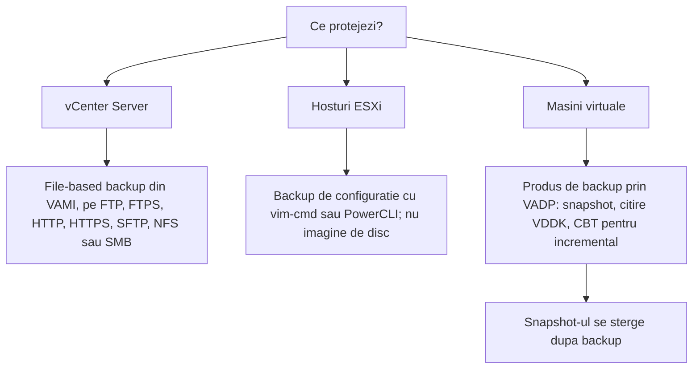
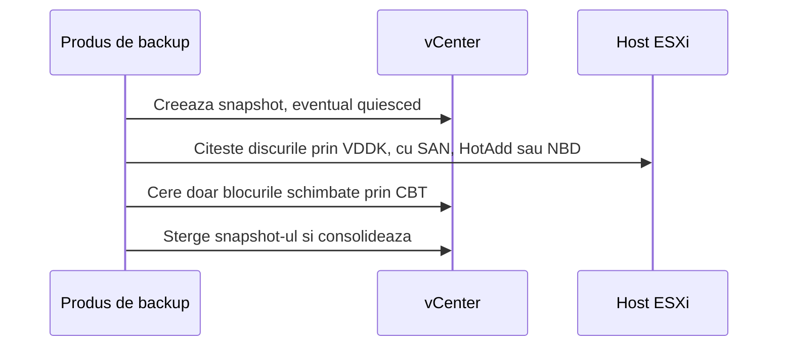

:::analogy
**Durerea din data center.** Un upgrade de vCenter eșuează la jumătate, iar ultimul backup al appliance-ului e de acum trei luni. Altă dată, un administrator „face backup” lăsând snapshot-uri pe VM-uri săptămâni la rând, până când datastore-ul se umple și zeci de VM-uri (VM, Virtual Machine) se opresc. Ambele scenarii sunt la examen: exam guide-ul VVF (VMware vSphere Foundation, 2V0-16.25) are obiectivul 2.2.5, iar vechiul VCP-DCV (VMware Certified Professional - Data Center Virtualization) obiectivul 4.11. [S02] [S47] [S297]

**Analogia: actele casei.**

- **Backup-ul vCenter** e dosarul cu actele casei: planuri, contracte, chei. Casa (VM-urile) există și fără el, dar fără dosar nu mai știi ce e al cui.
- **Backup-ul configurației ESXi** e fișa tehnică a centralei: nu o fotografiezi pe toată, notezi doar setările, ca să o poți reconfigura pe una nouă.
- **Backup-ul VM-urilor** e copia mobilei și a lucrurilor din casă, ținută în alt oraș.
- **Snapshot-ul** e un semn de carte: îți arată unde ai rămas, dar dacă arde cartea, semnul nu te ajută.
:::

:::architecture
### 1. Trei lucruri de protejat, fiecare altfel

Înainte de unelte, stabilești două ținte: **RPO (Recovery Point Objective)**, câte date îți permiți să pierzi, și **RTO (Recovery Time Objective)**, cât poate dura revenirea. Ele decid cât de des faci backup și cât de repede trebuie să poți restaura.

### 2. vCenter: backup-ul bazat pe fișiere

Backup-ul bazat pe fișiere e **metoda recomandată** pentru appliance (KB, Knowledge Base article, 318731). [S139] Îl faci din VAMI (vCenter Server Appliance Management Interface), la portul 5480, cum ai văzut în lecția 2.1. [S138]

- **Ținte:** FTP (File Transfer Protocol), FTPS (FTP peste TLS, Transport Layer Security), HTTP (Hypertext Transfer Protocol), HTTPS (HTTP securizat), SFTP (SSH File Transfer Protocol), NFS (Network File System) sau SMB (Server Message Block). FTP și HTTP nu sunt sigure, iar HTTP și HTTPS cer WebDAV (Web Distributed Authoring and Versioning) pe server. [S137] [S293]
- **Criptare:** poți pune o parolă de criptare a backup-ului. [S138]
- **Programare:** setezi locația, recurența și retenția; poți avea **o singură programare** odată. *Backup Now* folosește locația și utilizatorul din programare. [S293]
- Serverul de backup trebuie să aibă destul spațiu. [S293]

**Restaurarea** se face din installer-ul grafic, în **două etape**: [S294]

1. **Etapa 1** instalează un appliance nou din OVA (Open Virtual Appliance), care rămâne pornit, dar gol.
2. **Etapa 2** copiază datele din locația de backup în appliance-ul nou.

Condiții: vCenter-ul vechi trebuie **oprit** (iar într-un cluster vCenter HA, adică vCenter High Availability, nodurile active, passive și witness), un IP (Internet Protocol) static are nevoie de înregistrări DNS (Domain Name System) directe și inverse, iar hostul țintă nu e în lockdown, în maintenance mode sau într-un cluster DRS (Distributed Resource Scheduler) Fully Automated. [S294]

**După restaurare:** [S137]

- setările VM-urilor, resource pool-urile și componența clusterelor revin la starea din backup;
- configurația Distributed Switch, Content Library, politicile de stocare, vSAN și vSphere HA pot ieși din sincronizare; exporți configurația Distributed Switch înainte;
- vCenter HA se reconfigurează, iar patch-urile aplicate după backup se aplică din nou.

**Probleme cunoscute de retenție:**

| KB | Situație | Ce faci |
|---|---|---|
| 428785 | vCenter 9.0.1 și 9.0.2: backup-urile programate eșuează cu *Retain Last X Backups*; cele manuale merg | Upgrade la 9.1 sau workaround-ul din KB [S295] |
| 419664 | Pe FTP rămân mai multe backup-uri decât retenția, din cauza unor nume non-ASCII | Ștergi numele cu probleme sau schimbi directorul; curățarea rulează zilnic la miezul nopții [S296] |

### 3. Hosturile ESXi: configurația, nu imaginea

Backup-ul de tip imagine sau bare-metal al hypervisorului ESXi **nu e suportat**: ESXi rulează mai ales din memorie, are două boot bank-uri care pot fi copiate inconsecvent, iar de la 7.0 U2 configurația poate fi criptată cu TPM-ul (Trusted Platform Module) hostului. ESXi se reinstalează și apoi primește configurația înapoi. [S300]

| Pas | ESXi Shell | PowerCLI |
|---|---|---|
| Backup | `vim-cmd hostsvc/firmware/sync_config`, apoi `vim-cmd hostsvc/firmware/backup_config` | `Get-VMHostFirmware -VMHost <host> -BackupConfiguration -DestinationPath <dir>` |
| Restore | maintenance mode, reboot, fișierul în `/tmp/configBundle.tgz`, apoi `vim-cmd hostsvc/firmware/restore_config 0` | `Set-VMHostFirmware -VMHost <host> -Restore -SourcePath <fișier> ...` |

Surse: [S299]. Reguli: **același build** (`vmware -vl`) și **același UUID** de host; la configurație criptată cu TPM ai nevoie de același TPM. Inventarul VM-urilor nu e inclus: le înregistrezi din nou din datastore. [S299]

### 4. VM-urile: VADP, VDDK și CBT (Changed Block Tracking)

Produsele de backup folosesc **VADP (vSphere Storage APIs - Data Protection)**: fac un snapshot, citesc discurile prin VDDK (Virtual Disk Development Kit), apoi șterg snapshot-ul. [S300] [S297]

**Moduri de transport VDDK:** [S298]

| Mod | Unde rulează proxy-ul | Observații |
|---|---|---|
| SAN (Storage Area Network) | Doar pe un proxy fizic cu acces la LUN (Logical Unit Number) | Ocolește hostul ESXi; nu scrie în snapshot-uri; nu merge pe vVols |
| HotAdd | Doar pe un proxy virtual | Atașează discul VM-ului la proxy; proxy-ul trebuie să vadă datastore-ul |
| NBD / NBDSSL | Oriunde, prin rețea | NBDSSL e varianta criptată, folosită când celelalte nu sunt disponibile |

La VM-uri criptate, transportul SAN nu e suportat; HotAdd și NBD-SSL merg dacă le suportă produsul. [S282] La VM-uri cu vTPM (virtual Trusted Platform Module), backup-ul include `.nvram`, iar cheile trebuie să existe la restaurare. [S284]

**CBT** ține evidența blocurilor schimbate, ca backup-ul incremental să copieze doar ce s-a modificat: [S304]

- e **dezactivat implicit**; cere hardware virtual 7+;
- fiecare disc are un fișier `-ctk.vmdk`;
- nu e suportat pe RDM (Raw Device Mapping) în modul fizic și pe discuri independente;
- activarea lui pe un VM care are deja snapshot-uri poate da date greșite.

### 5. Snapshot-urile nu sunt backup

Un snapshot păstrează starea discurilor (prin fișiere delta), setările și, opțional, memoria. Fișierul `.vmsd` e baza de date a snapshot-urilor, iar `.vmsn` păstrează configurația și, la snapshot-urile cu memorie, starea pornită. Pe VMFS6, toate snapshot-urile folosesc formatul sesparse. [S305]

| Tip | Ce prinde | Cerințe |
|---|---|---|
| Cu memorie (implicit) | Starea pornită a VM-ului | VM pornit; nu cere VMware Tools; durează mai mult |
| Quiesced | Disc consistent la nivel de sistem de fișiere | VM pornit, VMware Tools, memoria debifată |
| Fără memorie și fără quiesce | Disc *crash-consistent* | — |

Surse: [S303] [S305]. Memoria și quiesce se exclud reciproc. Discurile **independente** nu intră în snapshot-uri. [S303] [S305]

**Bune practici (KB 318825):** [S297]

- nu folosești snapshot-urile ca backup;
- maximum **32** de snapshot-uri într-un lanț, recomandat 2–3;
- nu ții un snapshot mai mult de **72 de ore**: fișierul delta crește continuu;
- nu anulezi o ștergere sau o consolidare în curs;
- nu mărești un disc cât timp există snapshot-uri.

### 6. Ce se schimbă în VCF 9

În VCF (VMware Cloud Foundation) 9.0, backup-urile se configurează din **VCF Operations**: la nivel de flotă (*Fleet Management → Lifecycle → Settings*), pentru management nodes, VCF Automation și VCF Identity Broker, și separat pentru fiecare instanță VCF. [S301] În 9.0 și 9.1, retenția backup-urilor NSX setată în SDDC Manager nu e aplicată, deci serverul SFTP se poate umple; curățarea rămâne la tine (KB 442696). [S302]

| | vCenter | Host ESXi | VM |
|---|---|---|---|
| Metodă suportată | File-based backup din VAMI | Backup de configurație | Produs bazat pe VADP |
| Nesuportat sau nerecomandat | — | Imagine sau bare-metal [S300] | Snapshot-uri ca backup [S297] |
| Restaurare | Installer în două etape [S294] | Reinstalare plus `restore_config` [S299] | Din produsul de backup |

`[IMAGE SEARCH / PROMPT]` „vCenter VAMI backup schedule screen” și „VADP backup proxy HotAdd NBD SAN transport diagram”.
:::

:::exam-alert
### De memorat

| Ce | Valoare / regulă | Sursă |
|---|---|---|
| Metoda recomandată pentru vCenter | File-based backup | KB 318731 [S139] |
| Protocoale de backup | FTP, FTPS, HTTP, HTTPS, SFTP, NFS, SMB | Docs [S137] [S293] |
| Programări de backup | Una singură odată | Docs [S293] |
| Restaurarea vCenter | 2 etape: appliance nou, apoi copierea datelor | Docs [S294] |
| Înainte de restaurare | Oprești vCenter-ul vechi | Docs [S294] |
| Backup imagine ESXi | Nesuportat | KB 445744 [S300] |
| Restore configurație ESXi | Același build și același UUID | KB 313510 [S299] |
| CBT | Dezactivat implicit; hardware 7+ | KB 320557 [S304] |
| Snapshot-uri | Max 32 în lanț; 2–3 recomandat; max 72 h | KB 318825 [S297] |
| Quiesced snapshot | VMware Tools, VM pornit, fără memorie | Docs [S303] |
| VCF 9 | Backup-uri configurate din VCF Operations | Blog VMware [S301] |

### 3 capcane de examen

1. **„Restaurarea unui vCenter se face peste appliance-ul existent, din VAMI.”** Fals. Installer-ul instalează un appliance **nou** (etapa 1) și apoi copiază datele (etapa 2); cel vechi trebuie oprit. [S294]
2. **„Un snapshot ținut o săptămână e o copie de siguranță bună.”** Fals. Snapshot-ul depinde de discul de bază, iar delta crește continuu; KB 318825 spune maximum 72 de ore. [S297]
3. **„Poți face un snapshot quiesced și cu memorie în același timp.”** Fals. Quiesce și memoria se exclud reciproc; quiesce cere memoria debifată și VMware Tools. [S303] [S305]
:::

:::trenches
### Greșeala 1: backup-urile programate care „merg”, dar nu există

După upgrade la vCenter 9.0.1, backup-urile programate cu *Retain Last 7 Backups* eșuează în fiecare noapte. Backup-urile manuale merg, deci nimeni nu observă până la prima restaurare. [S295]
**Remediere (KB 428785):** upgrade la VCF 9.1 sau, până atunci, workaround-ul din KB (snapshot la vCenter, scripturile din KB, `service-control --restart applmgmt`). Lecția generală: verifici periodic în VAMI că backup-ul programat chiar a reușit și faci un test de restaurare într-un mediu izolat. [S295] [S294]

### Greșeala 2: host reinstalat, configurație care nu se încarcă

După înlocuirea plăcii de bază, cineva încearcă `restore_config` cu bundle-ul vechi pe un ESXi de alt build. Restaurarea eșuează, iar hostul are acum TPM nou. [S299]
**Remediere (KB 313510):** instalezi exact build-ul din backup (`vmware -vl`), verifici UUID-ul (`esxcfg-info -u`) și, dacă a fost criptată cu TPM, accepți că ai nevoie de TPM-ul vechi; altfel reconfigurezi hostul de la zero sau cu Host Profiles, dacă nu contează UUID-ul. [S299] [S300]
:::

:::interview
**Întrebare Junior/Mid: „Cum protejezi un mediu vSphere și de ce nu ajung snapshot-urile?”**

*Răspunsul ideal:* vCenter cu file-based backup programat din VAMI, pe un protocol sigur (SFTP, FTPS sau HTTPS) și cu parolă de criptare [S139] [S137]; configurația hosturilor cu `vim-cmd hostsvc/firmware/backup_config` [S299]; VM-urile cu un produs bazat pe VADP, cu CBT pentru incremental. [S300] [S304] Snapshot-urile depind de discul de bază, cresc continuu și nu se țin peste 72 de ore. [S297] Un candidat bun pomenește RPO și RTO și testul periodic de restaurare.

**Scenariu de troubleshooting: „vCenter nu mai pornește după un upgrade eșuat. Ai un backup de aseară. Pașii?”**

*Răspunsul pe care îl așteaptă un Team Lead:*
1. **Oprești appliance-ul vechi**, ca să nu ai două vCenter-e cu același nume și IP. [S294]
2. **Verifici DNS-ul** direct și invers pentru IP-ul static al vCenter. [S294]
3. **Etapa 1:** din installer, *Restore*, deploy pe un host care nu e în lockdown, în maintenance mode sau într-un cluster DRS Fully Automated. [S294]
4. **Etapa 2:** indici locația și credențialele backup-ului; restaurarea copiază datele. [S294]
5. **După:** verifici Distributed Switch, Content Library, politicile de stocare și HA, reconfigurezi vCenter HA și reaplici patch-urile de după backup. [S137]
:::

:::lab
**Scenariu.** Programezi backup-ul vCenter pe un server SFTP sau SMB, faci un backup manual, salvezi configurația unui host ESXi, compari tipurile de snapshot, verifici CBT pe un VM și, opțional, testezi restaurarea vCenter într-o rețea izolată.

**Ce ai nevoie.** vCenter-ul din lab, un server de fișiere (de exemplu un VM Linux cu SFTP sau o partajare SMB), SSH temporar pe un host și un VM Linux mic, pornit, cu VMware Tools.

Pașii de mai jos sunt bifabili, iar progresul se salvează în browser. Numele exacte ale meniurilor pot diferi puțin între versiunile 8 și 9 (`⚠ de verificat`).

**Home lab only / not supported.** Restaurarea vCenter la pasul 6 se face doar cu vCenter-ul vechi oprit și, ideal, într-o rețea izolată, ca să nu ai două appliance-uri cu aceeași identitate. [S294]

**Test de avarie și validare.** La pasul 2, backup-ul manual trebuie să apară ca *Complete* în VAMI. La pasul 4, snapshot-ul quiesced trebuie să arate *Quiesce guest file system: Yes* și să nu aibă memorie. La pasul 6, după restaurare, inventarul trebuie să arate starea de la momentul backup-ului.
:::

:::quiz
Cinci întrebări originale, în stilul examenelor VCP (VMware Certified Professional). Primești explicația pentru fiecare variantă imediat după ce răspunzi.
:::

:::references
- Exam guide VCP-VVF Administrator 2V0-16.25, obiectivul 2.2.5 [S02]
- Exam guide VCP-DCV 2V0-21.23 (certificare Legacy), obiectivul 4.11 [S47]
- Documentația vSphere 8: considerațiile backup-ului bazat pe fișiere [S137], programarea [S293] și restaurarea [S294]
- KB 318731 și KB 375278: opțiuni de backup și backup manual din VAMI [S139] [S138]
- KB 313510 și KB 445744: configurația ESXi și de ce nu se face imagine [S299] [S300]
- Ghidul VDDK: moduri de transport [S298]; KB 320557: CBT [S304]
- KB 318825 și KB 342618: snapshot-uri [S297] [S305]; documentația despre snapshot-uri [S303]
- Blogul VMware despre VCF 9 și KB 442696 [S301] [S302]
:::
