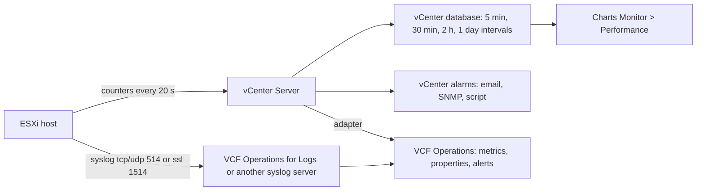
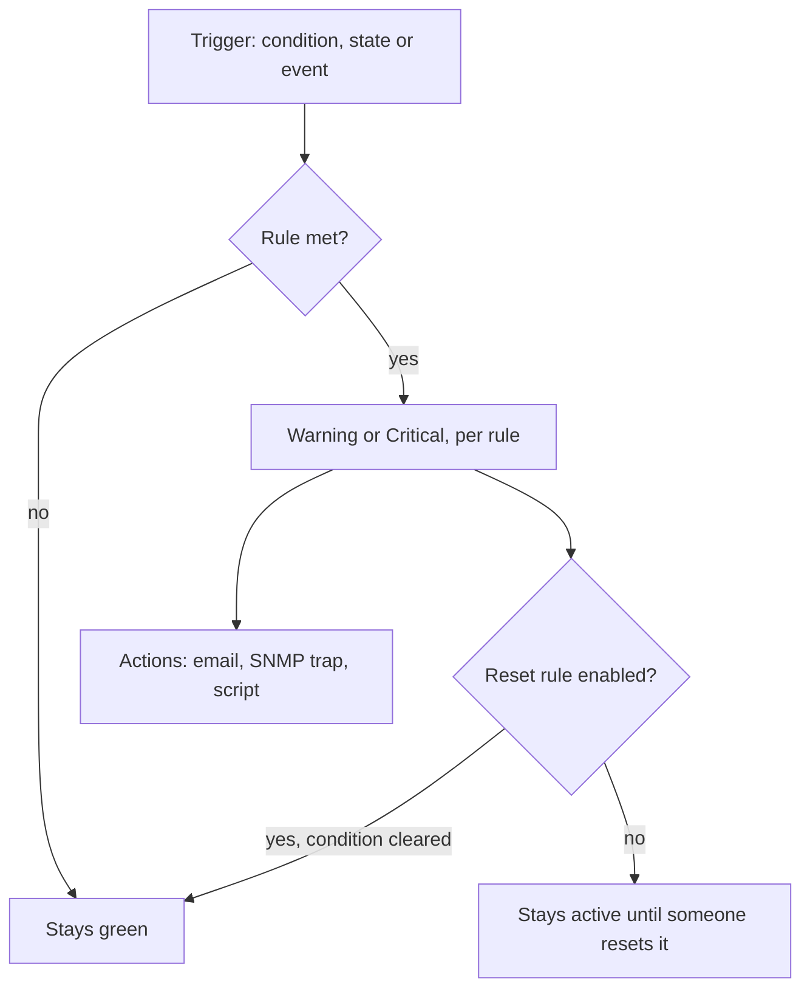

:::analogy
**The data center pain.** On Monday morning, users say "the application is slow". Nobody knows since when, because statistics were kept for one day only, the CPU (Central Processing Unit) alarm emailed nobody, and the ESXi host logs rotated away. For the exam, the VVF (VMware vSphere Foundation, 2V0-16.25) exam guide has objective 4.3 on VCF Operations (VCF, VMware Cloud Foundation) and VCF Operations for Logs, and the older VCP-DCV (VMware Certified Professional - Data Center Virtualization) has objectives 5.2, 5.10, 7.10 and 7.11 on charts and alarms. [S02] [S47]

**The analogy: a car dashboard.**

- **Statistics and charts** are the odometer and fuel history: they show what happened, but only as long as you keep them.
- **Alarms** are the red warning lights: they turn on when a limit is crossed. If nobody looks at the dashboard (no action), they do not help.
- **esxtop** is the mechanic listening to the engine live, with the hood open.
- **Syslog** is the black box: it keeps the events somewhere else, so you still have them after the crash.
- **VCF Operations** is the service center that analyzes the whole fleet and also tells you what to fix.
:::

:::architecture
### 1. Who produces the data and where it goes

There are three families of data. **Metrics** are numbers over time (CPU, latency). **Properties** are configuration attributes (for example the hardware version of a VM, Virtual Machine). **Logs** are text events. Objective 4.3 asks you to tell them apart. [S02]

### 2. vCenter statistics: levels and intervals

The host measures counters, and vCenter stores them in its database, aggregated per interval. How many counters it stores is decided by the **statistics level**: [S306]

| Level | What it adds |
|---|---|
| 1 | Least detailed: aggregate CPU, memory and network usage |
| 2 | An additional set of statistics |
| 3 | Per-instance statistics, for example CPU per physical processor |
| 4 | Everything; minimum and maximum rollups exist only here |

Default intervals: [S307]

| Interval | Saved for | Default level |
|---|---|---|
| 5 minutes | 1 day | 1 |
| 30 minutes | 1 week | 1 |
| 2 hours | 1 month | 1 |
| 1 day | 1 year | 1 |

**Real-time** data are 20-second samples kept for 60 minutes. [S312] [S92] You change the intervals on vCenter > **Configure > Settings > General > Edit**, with the *Performance.ModifyIntervals* privilege; the dialog also estimates the database size. [S307]

**Careful.** Levels 3 and 4 kept for long periods are discouraged: the `vpxd` service can grow in memory until it crashes. If you need a level 3 counter for a while, KB (Knowledge Base article) 390265 suggests exporting real-time data with PowerCLI (`Get-Stat -Realtime`, then `Export-Csv`) outside vCenter. The SQLite part of that KB is stated as unsupported. [S312] [S306]

### 3. Performance charts

You find them on the object, **Monitor > Performance**. There are two kinds: [S310]

- **Overview**: several data sets in one panel, with the parent object and its children.
- **Advanced**: configurable (counters, interval), with PNG, JPEG or CSV (Comma-Separated Values) export.

Charts exist for datacenters, clusters, hosts, resource pools, vApps and VMs; datastores only have Overview, and network objects have no charts. [S310]

**CPU ready**, the time a vCPU (virtual CPU) is ready to run but waits for a physical CPU, appears in charts as a **summation in milliseconds** per interval, added across all of the VM's vCPUs. To compare, you turn it into a percentage: [S92]

`%RDY = ready ms × 100 / interval length in ms`

Example from KB 387750: 500 ms in real time (20 000 ms interval) is 2.5%; for a VM with 4 vCPUs you divide by 4 again and get 0.625% per vCPU. The KB says plainly that %RDY alone does not prove a problem. [S92]

### 4. vCenter alarms

An **alarm** is a rule attached to an inventory object. It has three trigger types: **condition** (for example CPU above a threshold), **state** (for example host disconnected) and **event** (for example "VM created"). [S308]

Rules to remember: [S308] [S309]

- Each rule is **either** Warning **or** Critical; for both you create separate rules.
- In the vSphere Client you can combine conditions with **AND** only; there is no **OR**, so you create separate definitions.
- A **reset rule** returns the alarm to green and can have its own actions.
- **Actions**: email, SNMP (Simple Network Management Protocol) trap and *Run script*. The script must be executable, and from vCenter 8.0 its owner needs *vpxuser* privileges.
- **Predefined alarms have no actions.** They light up in the interface but notify nobody until you add actions. [S309]
- An alarm defined on a **cluster** or **folder** applies to all objects of the target type inside it. You edit it only where it was defined; on an individual object you can only disable it, and its state turns gray. [S309]

Definitions live on the object, **Configure > More > Alarm Definitions**; triggered alarms in **Monitor > Triggered Alarms**. [S308] Acknowledging an alarm, to show you are handling it, exists in the vSphere Client, but it is not described in the pages read (`⚠ to verify`).

**Email needs SMTP (Simple Mail Transfer Protocol).** You set *Mail server* and *Mail sender* on vCenter > **Configure > Settings > General > Edit**, with the *Global.Settings* privilege. [S314] There is no global recipient for all alarms: you set it in each alarm or use a PowerCLI script, and Broadcom recommends a distribution list. [S315]

### 5. esxtop: what you see live on the host

You start `esxtop` from the host command line. Main keys: `c` CPU, `m` memory, `n` network, `d` disk adapters, `u` disk devices. [S316] [S317]

| Counter | KB 308290 threshold | What it suggests |
|---|---|---|
| %RDY | ≥10 (5–10 caution) | The VM waits for physical CPU |
| %CSTP | >3 | VM with too many vCPUs |
| %MLMTD | ≥1 | A CPU limit holds the VM back |
| MCTLSZ, SWCUR | ≥1 MB | Ballooning or swapping: overcommitted memory |
| DAVG / KAVG / GAVG | ≥25 / ≥3 / ≥25 ms | Latency at the device / in the VMkernel / seen by the VM |
| %DRPTX, %DRPRX | ≥1 | Dropped network packets |

The thresholds are guidance: KB 344099 says disk latencies should not stay **sustained** above 10 ms and that every array behaves differently. [S316] [S317] The vSphere 9.0 performance best practices guide remains the reference for settings. [S40]

### 6. Syslog on ESXi

Local ESXi logs rotate, so you send them to a central server. The key setting is **`Syslog.global.logHost`**, a comma-separated list such as `tcp://server:514`, `udp://server:514` or `ssl://server:1514`. [S311]

| Step | Command (KB 318939) |
|---|---|
| View the settings | `esxcli system syslog config get` |
| Set the server | `esxcli system syslog config set --loghost='tcp://<IP>:514'` |
| Apply | `esxcli system syslog reload` |
| Open the firewall | `esxcli network firewall ruleset set --ruleset-id=syslog --enabled=true` and `esxcli network firewall refresh` |
| Send a test message | `esxcli system syslog mark --message "Syslog Test Message"` |

In the vSphere Client you change the same setting in Advanced System Settings, and syslogd reloads by itself; for many hosts you use Host Profiles. From ESXi 8.0 Update 2b, non-standard ports get dynamic firewall rules. [S311]

### 7. VCF Operations

**VCF Operations** (formerly Aria Operations) collects metrics, properties and logs from vCenter, ESXi, vSAN and NSX, and turns them into dashboards, reports, capacity and **alerts**. [S02] [S322]

**Cluster components.** [S324] [S325]

- **Primary node**: first to start, last to stop.
- **Replica node**: appears when you enable HA (High Availability); the cluster tolerates one node failure, and the object count is halved because every object is replicated.
- **Data nodes**: add processing capacity.
- **Continuous Availability**: nodes are stretched across two equal fault domains, plus a **witness node** in a third site; it survives the loss of one fault domain.
- **Cloud proxy**: collects data from adapters, close to the source.
- Five node sizes (Extra Small, Small, Medium, Large, Extra Large); in a multi-node cluster all nodes have the same size.

**Alerts: symptoms first, then an alert definition.** A **symptom** is a condition on a metric, property or event, for example "CPU above 80%". An **alert definition** combines symptoms with: the object type, *impact*, *criticality*, recommendations (what to do) and the **policy** in which it is active. [S318] [S322]

- **Wait cycle**: how many collection cycles the symptom must be true before the alert appears. You raise it so short spikes do not bother you.
- **Cancel cycle**: how many cycles until the alert clears after the symptom is gone. [S318]
- Notifications (email and others) go through **notification rules**, which pick which alerts, to whom and for what scope. [S322]

The menu path differs between versions: KB 414844 says *Operations > Configurations > Alert Definitions*, and KB 441532 *Operate > Administration > Configurations > Alert Definitions* (`⚠ to verify` in your version). [S318] [S320]

### 8. VCF Operations for Logs

**VCF Operations for Logs** is the log solution in VCF 9, built on Aria Operations for Logs and integrated into the VCF Operations interface: Explore Logs, saved queries, dashboards and log alerts. [S321]

- **Production cluster**: at least 3 nodes, at most one primary and 17 workers; you send logs to the **VIP** (Virtual IP: the shared IP, Internet Protocol, address of the cluster), not to a single node. [S324] [S319]
- **Single node**: only for a lab or small volumes. [S321] [S323]
- **Ingestion ports**: syslog 514 UDP (User Datagram Protocol) and 514 TCP (Transmission Control Protocol), 1514 TCP with SSL (Secure Sockets Layer); the ingestion API (Application Programming Interface) on 9000 and 9543 with SSL. [S321] The fleet management agent also lists 6514 for SSL over TCP. [S319] The API ports come from a blog (`⚠ to verify` in the official documentation).
- **Activation**: with a VCF license, from fleet management in VCF Operations; with a VVF license, by deploying the appliance in vSphere. [S321]
- **Log collection from vCenter and ESXi** is turned on from VCF Operations, under *Infrastructure Operations > Configurations > Log Collection*, targeting the VIP or FQDN (Fully Qualified Domain Name). [S319]
- **Content packs** still work in 9.0, but Broadcom recommends moving to **management packs**. [S321]

**The 9.1 difference.** The log part becomes *Log Management 9.1*, installed side by side, not upgraded in place. Custom alerts, dashboards and queries are not migrated automatically: you export them as a content pack and convert it to a management pack. [S320]

### 9. Which tool to pick

| Question | Tool |
|---|---|
| "What is happening on the host right now?" | esxtop |
| "What did the VM's CPU look like yesterday?" | vCenter charts (5-minute interval) |
| "I want email when a datastore passes 80%" | vCenter alarm with an email action |
| "I want fleet-wide analysis with recommendations" | VCF Operations |
| "What did the host write before it failed?" | Syslog in VCF Operations for Logs |

`[IMAGE SEARCH / PROMPT]` "vSphere Client advanced performance chart CPU ready" and "VCF Operations alert definition symptom wait cycle".
:::

:::exam-alert
### Memorize

| What | Value / rule | Source |
|---|---|---|
| Statistics levels | 1–4; default 1; min/max only at 4 | Docs [S306] [S307] |
| Default intervals | 5 min/1 day, 30 min/1 week, 2 h/1 month, 1 day/1 year | Docs [S307] |
| Real-time | Every 20 s, kept 60 min | KB 390265 [S312] |
| CPU ready | %RDY = ms × 100 / interval ms | KB 387750 [S92] |
| Alarms | Warning or Critical; AND only; reset rule to green | Docs [S308] |
| Predefined alarms | No actions | Docs [S309] |
| ESXi syslog | `Syslog.global.logHost`; 514 tcp/udp, 1514 ssl; `reload` | KB 318939 [S311] |
| VCF Operations HA | Tolerates one node failure | KB 397782 [S324] |
| Logs cluster | At least 3 nodes; primary + 17 workers | KB 397782 [S324] |

### 3 exam traps

1. **"I set statistics level 4 on every interval so I have everything; that is best practice."** False. Levels 3–4 kept for long load `vpxd` and the database; export real-time data temporarily instead. [S312]
2. **"Predefined alarms already email me."** False. They have no actions and also need SMTP configured in vCenter. [S309] [S314]
3. **"To avoid alerts on 2-minute spikes, I lower the wait cycle."** False. You **raise** it: the alert appears only after several cycles in a row. [S318] [S322]
:::

:::trenches
### Mistake 1: the silent "VM created" alarm

The team wants an email for every new VM. The alarm on the "VM created" event sends nothing, even though other alarms do. [S313]
**Fix (KB 417754):** the *Send email notifications* action was not enabled in the definition, and the "VM created" event does **not** fire for clones. You enable the action, set the recipients and add the clone event if you also want to catch clones (`⚠ to verify` the exact clone event name). [S313] [S308]

### Mistake 2: syslog that stopped quietly

After a network outage, the central server no longer receives logs from one host, although the setting is correct. [S311]
**Fix (KB 318939):** `/var/log/vmsyslogd.err` shows "failed to write log"; the host sends nothing again until you run `esxcli system syslog reload`. You also check the `syslog` firewall ruleset and connectivity with `nc -z <server> 514`, then send a test message with `esxcli system syslog mark`. To catch it next time, you create an alert on missing logs in VCF Operations for Logs (`⚠ to verify` the alert name). [S311]
:::

:::interview
**Junior/Mid question: "What is the difference between a vCenter alarm and a VCF Operations alert?"**

*Ideal answer:* a vCenter alarm is a rule on an inventory object, with a condition, state or event trigger, Warning or Critical severity, and email, SNMP or script actions. [S308] A VCF Operations alert is built from symptoms on metrics, properties or events, with wait and cancel cycles, impact, criticality, recommendations and a policy, and notifications go through notification rules. [S318] [S322] A good candidate says VCF Operations sees the whole fleet and gives recommendations, while vCenter alarms stay useful for simple, local reactions.

**Troubleshooting scenario: "A VM with 8 vCPUs is slow every day at 10:00. How do you investigate?"**

*The answer a Team Lead expects:*
1. **The VM's Advanced chart** for the last day: CPU ready and co-stop. Turn ready into a percentage with the 300 000 ms interval and divide by 8 vCPUs. [S92] [S310]
2. **At 10:00, live, `esxtop`** on the host: %RDY, %CSTP (above 3 means too many vCPUs) and %MLMTD (a limit). [S316]
3. **Memory**: MCTLSZ and SWCUR above 1 MB show overcommitment. [S316]
4. **Disk**: high DAVG points to the array, high KAVG to queuing in the VMkernel. [S316] [S317]
5. **Correlate with the host logs** in VCF Operations for Logs and, if it repeats, create an alert with a wait cycle above 1. [S319] [S318]
:::

:::lab
**Scenario.** You check the statistics intervals, read CPU ready on an Advanced chart, create your own alarm with email, send a host's syslog to a central server, look at `esxtop` and, if you have VCF Operations in the lab, create an alert definition.

**What you need.** The lab vCenter, a small Linux VM, a test SMTP server (or one on your network), a syslog server (VCF Operations for Logs or a Linux VM with rsyslog), temporary SSH (Secure Shell) on one host.

The steps below can be checked off, and progress is saved in the browser. Exact menu names may differ slightly between versions 8 and 9 (`⚠ to verify`).

**Home lab only / not supported.** Raising the statistics level to 3 or 4 in step 1 is only for a short test; set it back to 1 at the end. [S312]

**Failure test and validation.** In step 3 you load the VM's CPU (for example with `stress` or a shell loop) and the alarm must turn Warning and send an email. In step 4 the test message must appear on the syslog server. Then stop the syslog server, start it again and confirm that logs come back only after `esxcli system syslog reload`. [S311]
:::

:::quiz
Five original questions in the style of VCP (VMware Certified Professional) exams. You get the explanation for every option right after you answer.
:::

:::references
- VCP-VVF Administrator 2V0-16.25 exam guide, objective 4.3 [S02]
- VCP-DCV 2V0-21.23 exam guide (Legacy certification), objectives 5.2, 5.10, 7.10, 7.11 [S47]
- vSphere 8 documentation: statistics levels [S306], intervals [S307], charts [S310], alarms [S308] [S309]
- KB 387750 and KB 390265: CPU ready and real-time data [S92] [S312]
- KB 417754, KB 376894, KB 434289: alarms and email [S313] [S314] [S315]
- KB 308290 and KB 344099: esxtop [S316] [S317]; vSphere 9.0 performance best practices [S40]
- KB 318939: syslog on ESXi [S311]
- KB 414844, KB 397782, KB 341964: VCF Operations [S318] [S324] [S325]
- KB 431771, KB 441532 and the ntpro.nl blog: VCF Operations for Logs [S319] [S320] [S321]
:::
