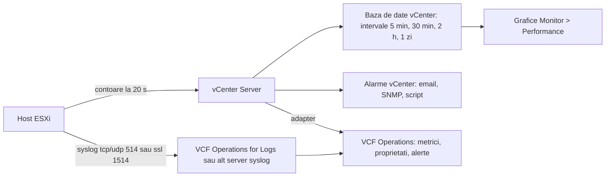
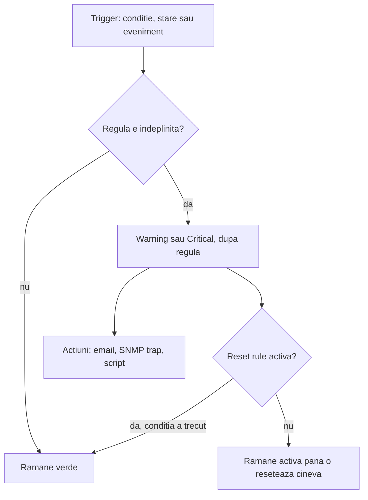

:::analogy
**Durerea din data center.** Luni dimineață, utilizatorii spun că „merge greu aplicația”. Nimeni nu știe de când, pentru că statisticile au fost păstrate doar o zi, alarma de CPU (Central Processing Unit) nu trimitea mail nimănui, iar logurile hosturilor ESXi s-au rotit și au dispărut. Pentru examen, exam guide-ul VVF (VMware vSphere Foundation, 2V0-16.25) are obiectivul 4.3 despre VCF Operations (VCF, VMware Cloud Foundation) și VCF Operations for Logs, iar vechiul VCP-DCV (VMware Certified Professional - Data Center Virtualization) are obiectivele 5.2, 5.10, 7.10 și 7.11 despre grafice și alarme. [S02] [S47]

**Analogia: tabloul de bord al mașinii.**

- **Statisticile și graficele** sunt kilometrajul și istoricul consumului: îți arată ce s-a întâmplat, dar doar cât timp le păstrezi.
- **Alarmele** sunt martorii roșii de pe bord: se aprind când trece o limită. Dacă nu se uită nimeni la bord (nicio acțiune), nu ajută.
- **esxtop** e mecanicul care ascultă motorul în timp real, cu capota deschisă.
- **Syslog-ul** e cutia neagră: păstrează evenimentele în altă parte, ca să le ai și după accident.
- **VCF Operations** e service-ul care îți analizează toate mașinile din flotă și îți spune și ce să repari.
:::

:::architecture
### 1. Cine produce datele și unde ajung

Avem trei familii de date. **Metricile** sunt numere în timp (CPU, latență). **Proprietățile** sunt atribute de configurație (de exemplu versiunea de hardware a unui VM, Virtual Machine). **Logurile** sunt evenimente text. Obiectivul 4.3 îți cere să le deosebești. [S02]

### 2. Statisticile vCenter: niveluri și intervale

Hostul măsoară contoarele, iar vCenter le salvează în baza lui de date, agregate pe intervale. Câte contoare salvează decide **statistics level** (nivelul de statistici): [S306]

| Nivel | Ce adaugă |
|---|---|
| 1 | Cel mai puțin detaliat: utilizarea agregată de CPU, memorie, rețea |
| 2 | Încă un set de statistici |
| 3 | Statistici per instanță, de exemplu CPU per procesor fizic |
| 4 | Tot; valorile minime și maxime (rollup min/max) există doar aici |

Intervalele implicite: [S307]

| Interval | Păstrat | Nivel implicit |
|---|---|---|
| 5 minute | 1 zi | 1 |
| 30 minute | 1 săptămână | 1 |
| 2 ore | 1 lună | 1 |
| 1 zi | 1 an | 1 |

Datele **real-time** sunt eșantioane la 20 de secunde, păstrate 60 de minute. [S312] [S92] Le schimbi din vCenter > **Configure > Settings > General > Edit**, cu privilegiul *Performance.ModifyIntervals*; dialogul estimează și mărimea bazei de date. [S307]

**Atenție.** Nivelurile 3 și 4 ținute mult timp sunt descurajate: serviciul `vpxd` poate crește în memorie până cade. Dacă ai nevoie de un contor de nivel 3 doar o perioadă, KB-ul (Knowledge Base article) 390265 propune să exporți datele real-time cu PowerCLI (`Get-Stat -Realtime`, apoi `Export-Csv`) în afara vCenter. Partea cu baza SQLite din acel KB e declarat nesuportată. [S312] [S306]

### 3. Graficele de performanță

Le găsești pe obiect, **Monitor > Performance**. Există două feluri: [S310]

- **Overview**: mai multe seturi de date într-un panou, cu obiectul părinte și copiii lui.
- **Advanced**: configurabile (contoare, interval), cu export PNG, JPEG sau CSV (Comma-Separated Values).

Graficele există pentru datacenter, cluster, host, resource pool, vApp și VM; datastore-urile au doar Overview, iar obiectele de rețea nu au grafice. [S310]

**CPU ready**, timpul în care un vCPU (virtual CPU) e gata să ruleze, dar așteaptă un CPU fizic, apare în grafice ca **sumă în milisecunde** pe interval, adunată pe toate vCPU-urile VM-ului. Ca să compari, îl transformi în procent: [S92]

`%RDY = ready ms × 100 / durata intervalului în ms`

Exemplu din KB 387750: 500 ms în real-time (interval 20 000 ms) înseamnă 2,5%; la un VM cu 4 vCPU împarți încă o dată la 4 și obții 0,625% per vCPU. KB-ul spune clar că %RDY singur nu dovedește o problemă. [S92]

### 4. Alarmele vCenter

O **alarmă** e o regulă atașată unui obiect din inventar. Are trei tipuri de declanșatoare (triggers): **condiție** (de exemplu CPU peste prag), **stare** (de exemplu host deconectat) și **eveniment** (de exemplu „VM creat”). [S308]

Reguli de reținut: [S308] [S309]

- Fiecare regulă e **fie** Warning, **fie** Critical; pentru amândouă faci reguli separate.
- În vSphere Client poți combina condiții doar cu **AND**; **OR** nu există, deci faci definiții separate.
- **Reset rule** readuce alarma la verde și poate avea și ea acțiuni.
- **Acțiunile**: email, SNMP (Simple Network Management Protocol) trap și *Run script*. Scriptul trebuie să fie executabil, iar din vCenter 8.0 proprietarul lui are nevoie de privilegii *vpxuser*.
- **Alarmele predefinite nu au acțiuni.** Se aprind în interfață, dar nu anunță pe nimeni până nu le adaugi tu. [S309]
- O alarmă definită pe un **cluster** sau un **folder** se aplică tuturor obiectelor de tipul vizat din interiorul lui. O editezi doar acolo unde a fost definită; pe un obiect individual o poți doar dezactiva, iar starea lui devine gri. [S309]

Definițiile le găsești pe obiect, **Configure > More > Alarm Definitions**; cele declanșate în **Monitor > Triggered Alarms**. [S308] Recunoașterea unei alarme (*Acknowledge*), ca să arăți că te ocupi de ea, există în vSphere Client, dar nu apare descrisă în paginile citite (`⚠ de verificat`).

**Emailul are nevoie de SMTP (Simple Mail Transfer Protocol).** Setezi *Mail server* și *Mail sender* pe vCenter > **Configure > Settings > General > Edit**, cu privilegiul *Global.Settings*. [S314] Nu există un destinatar global pentru toate alarmele: îl pui în fiecare alarmă sau folosești un script PowerCLI, iar Broadcom recomandă o listă de distribuție. [S315]

### 5. esxtop: ce vezi în timp real pe host

Pornești `esxtop` din linia de comandă a hostului. Tastele principale: `c` CPU, `m` memorie, `n` rețea, `d` adaptoare de disc, `u` dispozitive de disc. [S316] [S317]

| Contor | Pragul din KB 308290 | Ce sugerează |
|---|---|---|
| %RDY | ≥10 (5–10 atenție) | VM-ul așteaptă CPU fizic |
| %CSTP | >3 | VM cu prea multe vCPU |
| %MLMTD | ≥1 | Un limit de CPU frânează VM-ul |
| MCTLSZ, SWCUR | ≥1 MB | Ballooning sau swap: memorie supraalocată |
| DAVG / KAVG / GAVG | ≥25 / ≥3 / ≥25 ms | Latență la dispozitiv / în VMkernel / văzută de VM |
| %DRPTX, %DRPRX | ≥1 | Pachete pierdute pe rețea |

Pragurile sunt orientative: KB 344099 spune că latențele de disc nu ar trebui să stea **susținut** peste 10 ms și că fiecare array se comportă altfel. [S316] [S317] Ghidul de performanță vSphere 9.0 rămâne referința pentru setări. [S40]

### 6. Syslog pe ESXi

Logurile locale ale ESXi se rotesc, deci le trimiți pe un server central. Setarea cheie e **`Syslog.global.logHost`**, o listă separată prin virgulă de forma `tcp://server:514`, `udp://server:514` sau `ssl://server:1514`. [S311]

| Pas | Comandă (KB 318939) |
|---|---|
| Vezi setările | `esxcli system syslog config get` |
| Setezi serverul | `esxcli system syslog config set --loghost='tcp://<IP>:514'` |
| Aplici | `esxcli system syslog reload` |
| Deschizi firewall-ul | `esxcli network firewall ruleset set --ruleset-id=syslog --enabled=true` și `esxcli network firewall refresh` |
| Trimiți un mesaj de test | `esxcli system syslog mark --message "Syslog Test Message"` |

Din vSphere Client modifici aceeași setare în Advanced System Settings, iar syslogd se reîncarcă singur; pentru multe hosturi folosești Host Profiles. Din ESXi 8.0 Update 2b, porturile nestandard primesc reguli de firewall dinamice. [S311]

### 7. VCF Operations

**VCF Operations** (fostul Aria Operations) colectează metrici, proprietăți și loguri din vCenter, ESXi, vSAN și NSX, și le transformă în dashboard-uri, rapoarte, capacitate și **alerte**. [S02] [S322]

**Componentele clusterului.** [S324] [S325]

- **Primary node**: primul pornit și ultimul oprit.
- **Replica node**: apare când activezi HA (High Availability); clusterul suportă căderea unui singur nod, iar numărul de obiecte se înjumătățește pentru că fiecare obiect e replicat.
- **Data nodes**: adaugă capacitate de procesare.
- **Continuous Availability**: nodurile se întind pe două fault domains egale, plus un **witness node** pe un al treilea site; supraviețuiește căderii unui fault domain.
- **Cloud proxy**: colectează datele de la adaptere, aproape de sursă.
- Cinci mărimi de nod (Extra Small, Small, Medium, Large, Extra Large); într-un cluster cu mai multe noduri, toate au aceeași mărime.

**Alertele: simptome, apoi alert definition.** Un **simptom** e o condiție pe o metrică, proprietate sau eveniment, de exemplu „CPU peste 80%”. O **alert definition** combină simptome cu: tipul de obiect, *impact*, *criticality*, recomandări (ce să faci) și **policy**-ul în care e activă. [S318] [S322]

- **Wait cycle**: câte cicluri de colectare trebuie să fie adevărat simptomul până apare alerta. Îl crești ca să nu te deranjeze vârfurile scurte.
- **Cancel cycle**: câte cicluri până dispare alerta după ce simptomul a trecut. [S318]
- Notificările (email și altele) se trimit prin **notification rules**, care aleg ce alerte, cui și în ce scop. [S322]

Calea de meniu diferă între versiuni: KB 414844 scrie *Operations > Configurations > Alert Definitions*, iar KB 441532 *Operate > Administration > Configurations > Alert Definitions* (`⚠ de verificat` în versiunea ta). [S318] [S320]

### 8. VCF Operations for Logs

**VCF Operations for Logs** e soluția de loguri din VCF 9, construită pe Aria Operations for Logs și integrată în interfața VCF Operations: Explore Logs, interogări salvate, dashboard-uri și alerte pe loguri. [S321]

- **Cluster de producție**: minimum 3 noduri, maximum un primary și 17 workers; trimiți logurile către **VIP** (Virtual IP: adresa IP, Internet Protocol, comună a clusterului), nu către un nod. [S324] [S319]
- **Un singur nod**: doar pentru lab sau volume mici. [S321] [S323]
- **Porturi de ingestie**: syslog 514 UDP (User Datagram Protocol) și 514 TCP (Transmission Control Protocol), 1514 TCP cu SSL (Secure Sockets Layer); API-ul (Application Programming Interface) de ingestie 9000 și 9543 cu SSL. [S321] Agentul de fleet management mai listează și 6514 pentru SSL peste TCP. [S319] Porturile API vin dintr-un blog (`⚠ de verificat` în documentația oficială).
- **Activarea**: cu licență VCF, din fleet management în VCF Operations; cu licență VVF, prin deploy-ul appliance-ului în vSphere. [S321]
- **Colectarea logurilor de la vCenter și ESXi** o pornești din VCF Operations, la *Infrastructure Operations > Configurations > Log Collection*, cu ținta pe VIP sau FQDN (Fully Qualified Domain Name). [S319]
- **Content packs** încă merg în 9.0, dar Broadcom recomandă trecerea la **management packs**. [S321]

**Diferența 9.1.** Partea de loguri devine *Log Management 9.1*, instalat alături (side-by-side), nu prin upgrade pe loc. Alertele, dashboard-urile și interogările personalizate nu se migrează singure: le exporți ca content pack și le convertești în management pack. [S320]

### 9. Ce unealtă alegi

| Întrebare | Unealta |
|---|---|
| „Ce se întâmplă chiar acum pe host?” | esxtop |
| „Cum a arătat CPU-ul VM-ului ieri?” | Grafice vCenter (interval 5 minute) |
| „Vreau mail când un datastore trece de 80%” | Alarmă vCenter cu acțiune email |
| „Vreau analiză pe toată flota, cu recomandări” | VCF Operations |
| „Ce a scris hostul înainte să cadă?” | Syslog în VCF Operations for Logs |

`[IMAGE SEARCH / PROMPT]` „vSphere Client advanced performance chart CPU ready” și „VCF Operations alert definition symptom wait cycle”.
:::

:::exam-alert
### De memorat

| Ce | Valoare / regulă | Sursă |
|---|---|---|
| Niveluri de statistici | 1–4; implicit 1; min/max doar la 4 | Docs [S306] [S307] |
| Intervale implicite | 5 min/1 zi, 30 min/1 săpt., 2 h/1 lună, 1 zi/1 an | Docs [S307] |
| Real-time | La 20 s, păstrat 60 min | KB 390265 [S312] |
| CPU ready | %RDY = ms × 100 / interval ms | KB 387750 [S92] |
| Alarme | Warning sau Critical; doar AND; reset rule la verde | Docs [S308] |
| Alarme predefinite | Fără acțiuni | Docs [S309] |
| Syslog ESXi | `Syslog.global.logHost`; 514 tcp/udp, 1514 ssl; `reload` | KB 318939 [S311] |
| VCF Operations HA | Suportă căderea unui nod | KB 397782 [S324] |
| Logs cluster | Minimum 3 noduri; primary + 17 workers | KB 397782 [S324] |

### 3 capcane de examen

1. **„Am pus nivelul 4 de statistici pe toate intervalele ca să am totul, e cea mai bună practică.”** Fals. Nivelurile 3–4 ținute mult încarcă `vpxd` și baza de date; exporți temporar datele real-time. [S312]
2. **„Alarmele predefinite îmi trimit deja mail.”** Fals. Nu au acțiuni și au nevoie și de SMTP configurat în vCenter. [S309] [S314]
3. **„Ca să nu primesc alerte la vârfuri de 2 minute, scad wait cycle-ul.”** Fals. Îl **crești**: alerta apare doar după mai multe cicluri la rând. [S318] [S322]
:::

:::trenches
### Greșeala 1: alarma de „VM creat” care tace

Echipa vrea mail la fiecare VM nou. Alarma pe evenimentul „VM created” nu trimite nimic, deși alte alarme trimit. [S313]
**Remediere (KB 417754):** acțiunea *Send email notifications* nu fusese bifată în definiție, iar evenimentul „VM created” **nu** se declanșează la clonare. Activezi acțiunea, pui destinatarii și adaugi evenimentul pentru clone dacă vrei să le prinzi și pe ele (`⚠ de verificat` numele exact al evenimentului de clonare). [S313] [S308]

### Greșeala 2: syslog care s-a oprit fără zgomot

După o întrerupere de rețea, serverul central nu mai primește loguri de la un host, deși setarea e corectă. [S311]
**Remediere (KB 318939):** în `/var/log/vmsyslogd.err` apare „failed to write log”; hostul nu mai retrimite nimic până nu rulezi `esxcli system syslog reload`. Verifici și ruleset-ul `syslog` din firewall și conectivitatea cu `nc -z <server> 514`, apoi trimiți un mesaj de test cu `esxcli system syslog mark`. Ca să prinzi problema data viitoare, faci o alertă pe lipsa logurilor în VCF Operations for Logs (`⚠ de verificat` numele alertei). [S311]
:::

:::interview
**Întrebare Junior/Mid: „Care e diferența dintre o alarmă vCenter și o alertă VCF Operations?”**

*Răspunsul ideal:* alarma vCenter e o regulă pe un obiect din inventar, cu trigger de condiție, stare sau eveniment, severitate Warning sau Critical și acțiuni email, SNMP sau script. [S308] Alerta VCF Operations e construită din simptome pe metrici, proprietăți sau evenimente, cu wait și cancel cycles, impact, criticality, recomandări și o policy, iar notificările merg prin notification rules. [S318] [S322] Un candidat bun spune că VCF Operations vede toată flota și dă recomandări, iar alarmele vCenter rămân utile pentru reacții simple, locale.

**Scenariu de troubleshooting: „Un VM cu 8 vCPU e lent în fiecare zi la 10:00. Cum cauți?”**

*Răspunsul pe care îl așteaptă un Team Lead:*
1. **Graficul Advanced al VM-ului** pe ultima zi: CPU ready și co-stop. Transformi ready în procent cu intervalul de 300 000 ms și împarți la 8 vCPU. [S92] [S310]
2. **La 10:00, în timp real, `esxtop`** pe host: %RDY, %CSTP (dacă e peste 3, are prea multe vCPU) și %MLMTD (un limit). [S316]
3. **Memoria**: MCTLSZ și SWCUR peste 1 MB arată supraalocare. [S316]
4. **Discul**: DAVG mare înseamnă array-ul, KAVG mare înseamnă coadă în VMkernel. [S316] [S317]
5. **Corelezi cu logurile** hostului în VCF Operations for Logs și, dacă se repetă, faci o alertă cu wait cycle peste 1. [S319] [S318]
:::

:::lab
**Scenariu.** Verifici intervalele de statistici, citești CPU ready pe un grafic Advanced, faci o alarmă proprie cu email, trimiți syslog-ul unui host pe un server central, te uiți în `esxtop` și, dacă ai VCF Operations în lab, faci o alert definition.

**Ce ai nevoie.** vCenter-ul din lab, un VM Linux mic, un server SMTP de test (sau unul din rețeaua ta), un server syslog (VCF Operations for Logs sau un VM Linux cu rsyslog), SSH (Secure Shell) temporar pe un host.

Pașii de mai jos sunt bifabili, iar progresul se salvează în browser. Numele exacte ale meniurilor pot diferi puțin între versiunile 8 și 9 (`⚠ de verificat`).

**Home lab only / not supported.** Nivelul de statistici ridicat la 3 sau 4 de la pasul 1 e doar pentru test scurt; îl readuci la 1 la final. [S312]

**Test de avarie și validare.** La pasul 3 încarci CPU-ul VM-ului (de exemplu cu `stress` sau o buclă în shell) și alarma trebuie să devină Warning și să trimită mail. La pasul 4, mesajul de test trebuie să apară pe serverul syslog. Oprești apoi serverul syslog, îl repornești și confirmi că logurile revin doar după `esxcli system syslog reload`. [S311]
:::

:::quiz
Cinci întrebări originale, în stilul examenelor VCP (VMware Certified Professional). Primești explicația pentru fiecare variantă imediat după ce răspunzi.
:::

:::references
- Exam guide VCP-VVF Administrator 2V0-16.25, obiectivul 4.3 [S02]
- Exam guide VCP-DCV 2V0-21.23 (certificare Legacy), obiectivele 5.2, 5.10, 7.10, 7.11 [S47]
- Documentația vSphere 8: niveluri de statistici [S306], intervale [S307], grafice [S310], alarme [S308] [S309]
- KB 387750 și KB 390265: CPU ready și datele real-time [S92] [S312]
- KB 417754, KB 376894, KB 434289: alarme și email [S313] [S314] [S315]
- KB 308290 și KB 344099: esxtop [S316] [S317]; ghidul de performanță vSphere 9.0 [S40]
- KB 318939: syslog pe ESXi [S311]
- KB 414844, KB 397782, KB 341964: VCF Operations [S318] [S324] [S325]
- KB 431771, KB 441532 și blogul ntpro.nl: VCF Operations for Logs [S319] [S320] [S321]
:::
