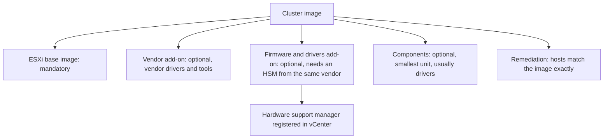
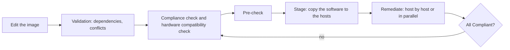

:::analogy
**The data center pain.** You have 16 ESXi hosts bought in three batches. Some have a different network card driver, others a different controller firmware, and someone "quickly" installed a VIB (vSphere Installation Bundle) on a single host. At the first upgrade, half the cluster refuses to move to the new version. For the exam, the VVF (VMware vSphere Foundation, 2V0-16.25) exam guide asks you to manage the VVF lifecycle, and the older VCP-DCV (VMware Certified Professional - Data Center Virtualization) has objectives 1.6, 4.14, 5.9 and 7.9 on vLCM (vSphere Lifecycle Manager). [S02] [S47]

**The analogy: a franchise recipe.**

- **The vLCM image** is the official recipe of a restaurant chain: which ingredients, which version, how much.
- **The ESXi base image** is the base dough, mandatory everywhere.
- **The vendor add-on and components** are local ingredients approved by the hardware vendor.
- **The compliance check** is the inspector who visits each restaurant and compares the kitchen with the recipe.
- **Remediation** is the team that brings each restaurant exactly to the recipe, one by one, so you never close the whole chain at once.
:::

:::architecture
### 1. What vLCM does and does not do

vLCM keeps **ESXi hosts** current (software and, with the vendor's help, firmware), plus **VMware Tools** and **VM hardware** for VMs (VM, Virtual Machine). vCenter Server is updated separately. [S326] [S334] [S335] [S256]

### 2. Baselines and images: what changed in vSphere 9

| | Baselines (formerly VUM, vSphere Update Manager) | Images |
|---|---|---|
| Model | A list of patches to apply | Desired state, declarative |
| Firmware | No | Yes, through the firmware and drivers add-on [S328] |
| ESX 9.x hosts | Can no longer be patched [S329] | The only option [S256] |
| New clusters | Can no longer be created [S329] | Default [S329] |

Rules: [S326] [S327] [S329] [S256]

- Switching a cluster from baselines to images is **one-way**. You cannot go back; you can only move the hosts to a baseline cluster.
- In 9.0 there are no more rollup bulletins, and ISO import and ISO-based upgrades through VUM are blocked.
- 8.x hosts can still be patched with baselines to any 8.x, but an ESX 8 baseline cluster must be **converted to an image before** the upgrade to ESX 9.
- vCenter 9.0 manages ESX 8.0 and later. The direct 8.0 → 9.0 upgrade is supported; 7.0 → 9.0 is not.

### 3. What an image is made of

- **ESXi base image**: ESXi plus the drivers needed to boot the server; it is the **only mandatory element**. [S326]
- **Vendor add-on**: a bundle of components from the server vendor (drivers, patches, tools). [S326]
- **Firmware and drivers add-on**: firmware for a specific server type, plus matching drivers. It does not come from the VMware depot but through an **HSM (hardware support manager)**, a vendor extension registered in vCenter, for example Dell OMIVV, HPE OneView, Lenovo XClarity Integrator or Cisco Intersight. The HSM must come from the same vendor as the hosts, or remediation fails. [S328]
- **Components**: the smallest unit in an image, usually third-party drivers or adapters. [S326]

After remediation, hosts match the image **exactly**, with no deviation. [S326]

**New in 9.0.** A cluster can have up to **4 additional images** besides the base one, for mixed hardware: the ESX version is the same, but the vendor add-on, firmware and components differ, and each image can have its own HSM. Hosts are assigned manually or automatically based on BIOS (Basic Input/Output System) data. vSphere HA (High Availability) and the NSX components are now part of the base image. [S256]

### 4. The depot and the download token

vLCM takes its software from a **depot**. Broadcom moved to authenticated downloads: URLs are unique per customer and carry a **token**, and since March 31, 2025 only someone with the *Product Administrator* role in the Broadcom portal can generate it. The new server is `dl.broadcom.com` (allow it in the firewall). The old `vmware.com` sources download nothing until they are replaced. [S331] [S329] Without internet access you import ZIP packages (offline bundles) manually. [S327]

### 5. The workflow

Saving the image automatically triggers validation, the compliance check and the hardware compatibility check. Unsaved edits are kept as a **draft**. [S327] Pre-check, stage and remediation can run on a cluster, and in 9.0 also at vCenter, datacenter or folder level. [S256]

**Compliance states:** [S339]

| State | Meaning | What you do |
|---|---|---|
| **Compliant** | The host matches the image | Nothing |
| **Non-compliant** | It differs: older version, different firmware, extra component or VIB | Remediate |
| **Incompatible** | The image cannot be applied: host newer than the image, not enough RAM (Random Access Memory), unsupported hardware | Change the image or the hardware |
| **Unknown** | No check has run yet (new host or edited image) | Run a compliance check |

The compliance check also shows the impact: whether the host will need a reboot or maintenance mode. [S339]

**Remediation.** If one host fails during cluster remediation, the remediation stops. [S328] In 9.0 you can remediate the whole cluster, one host or selected batches of hosts. [S256]

### 6. Remediation settings

| Setting | What it does | Source |
|---|---|---|
| **Quick Boot** | Restarts ESXi without firmware initialization, faster | [S333] [S337] |
| **Health checks after remediation** | Allowed or not | [S333] |
| **Parallel remediation** | Several hosts at once, with an optional maximum; **only** hosts already in maintenance mode | [S333] [S332] |
| **Unsupported hardware warnings** | Can be ignored | [S333] |

**Quick Boot** needs a supported platform and drivers. You check with `/usr/lib/vmware/loadesx/bin/loadESXCheckCompat.py` on the host. From ESXi 8.0 U1 it does not work with Intel TXT enabled, and it is not supported on servers with a DPU (Data Processing Unit). If the pre-check fails, the host does a normal reboot. [S337]

**Live Patch (9.0)** covers vmkernel, user space, vmx and the NSX components, without maintenance mode. Some services, such as `hostd`, may restart, so the host briefly disconnects from vCenter; VMs are not affected. Hosts with a TPM (Trusted Platform Module) or DPU are not compatible, and the vSAN witness does a full reboot. [S256]

### 7. Hardware compatibility

vLCM checks hardware against the **VCG (VMware Compatibility Guide)**, with certified servers and devices, and, for vSAN, against the **vSAN HCL (Hardware Compatibility List)**, with certified controllers, firmware and disks. [S338]

- On vSAN clusters with an image, the check runs automatically every 24 hours (default), when you save the image, at pre-check, at remediation and when you add or remove a host. [S336]
- Compatibility issues are **warnings**: they do not block remediation and remediation does not fix them, unless you explicitly set blocking. [S336] [S338]

### 8. Exporting the image

| Format | What it is for | Source |
|---|---|---|
| **ISO** | Clean installs, kickstart; cannot be used by image clusters | [S327] |
| **ZIP** (offline bundle) | Puts the components into a depot | [S327] |
| **JSON** | Metadata only; reuse the image on another cluster | [S327] |

On the same vCenter the JSON is enough. On another vCenter you first import the ZIP into the depot, then the JSON. Importing installs nothing; installation happens at remediation. [S327]

### 9. VMs: VMware Tools first, then VM hardware

On the cluster, the **Updates** tab has **VMware Tools** and **VM Hardware** sections. [S334] [S335]

1. **VMware Tools first.** On Windows, a hardware upgrade done before Tools can lose network settings. [S335]
2. **Then VM hardware**, with *Upgrade to Match Host*. You can schedule the upgrade (for example at the next guest operating system restart) and request rollback snapshots. [S335]
3. You do **not** upgrade VM hardware if you do not need new features, and **never** on the vCenter appliance. [S335]

### 10. vCenter and the update order in VCF 9 (VMware Cloud Foundation)

**vCenter 9.0** is best updated with **RDU (Reduced Downtime Update)**: a new appliance is prepared in parallel, on an automatically configured temporary link-local address, then the switchover happens manually, automatically or on a schedule. In-place updates from the VAMI (vCenter Server Appliance Management Interface) still work, but with long downtime. [S256]

**The VCF 9.0 order** for major and minor releases (KB, Knowledge Base article, 390634, excerpt): SDDC Manager → NSX → vCenter → vSAN witness → ESXi → VMware Tools → VM hardware → vSAN on-disk format and VMFS (Virtual Machine File System). Patches can be applied in any order. [S340]

`[IMAGE SEARCH / PROMPT]` "vSphere Lifecycle Manager edit image vendor addon firmware" and "vLCM image compliance non-compliant remediate".
:::

:::exam-alert
### Memorize

| What | Value / rule | Source |
|---|---|---|
| Mandatory image element | Only the ESXi base image | Docs [S326] |
| Baselines → images | One-way | Docs [S326] [S327] |
| vSphere 9 | No baselines for 9.x hosts | KB 379388 [S329] |
| Direct upgrade | 8.0 → 9.0 yes; 7.0 → 9.0 no | VMware blog [S256] |
| Firmware | Firmware and drivers add-on + HSM from the same vendor | Docs [S328] |
| States | Compliant, Non-compliant, Incompatible, Unknown | Docs [S339] |
| Parallel remediation | Only hosts already in maintenance mode | Docs [S333]; KB 446635 [S332] |
| Export | ISO, ZIP, JSON; import JSON only | Docs [S327] |
| Additional images (9.0) | Up to 4 per cluster | VMware blog [S256] |
| VMs | Tools first, then hardware | KB 315390 [S335] |

### 3 exam traps

1. **"I export the image as an ISO and import it on another image cluster."** False. The ISO is for clean installs; for another cluster you use JSON (plus ZIP for another vCenter), and import accepts only JSON. [S327]
2. **"An Incompatible host is fixed with Remediate."** False. Remediation fixes **Non-compliant** hosts; Incompatible means the image cannot be applied, for example the host is newer than the image. [S339]
3. **"I tick parallel remediation and vLCM puts the hosts in maintenance mode by itself."** False. With parallel remediation, only hosts **already** in maintenance mode are remediated. [S333] [S332]
:::

:::trenches
### Mistake 1: the image that "would downgrade" a driver

The hosts were installed with the vendor's custom ISO, with a network driver newer than the one in the image. The compliance check fails and the *Remediate* button is grayed out. [S330]
**Fix (KB 320562):** pick a vendor add-on with higher component versions, or import the offline bundle with the driver at the same or a newer version and add it under *Add Components*. Only if the driver is not used by any adapter do you remove it manually, with the host in maintenance mode. The general lesson: build the cluster image **before** installing new hosts, not after. [S330]

### Mistake 2: the depot that no longer sees new versions

After the move to authenticated downloads, the depot tab shows no new update, and synchronization "succeeds" without content. [S331] [S329]
**Fix (KB 390098):** someone with the *Product Administrator* role generates a download token in the Broadcom portal, then you replace the old `vmware.com` URLs in vLCM with the new ones on `dl.broadcom.com` and open the firewall to that server. For the exact vCenter steps the KB points to KB 390121 (`⚠ to verify`, that KB was not consulted here). [S331]
:::

:::interview
**Junior/Mid question: "What is a vLCM image and why is it better than baselines?"**

*Ideal answer:* an image describes the desired state of the hosts: a mandatory ESXi base image, plus an optional vendor add-on, firmware and drivers add-on and components. [S326] vLCM compares every host with the image and brings it exactly to it, firmware included, through the vendor's HSM. [S328] Baselines only apply patches and do not do firmware; in vSphere 9 they can no longer manage 9.x hosts, so clusters must be converted before the upgrade. [S329] [S256]

**Troubleshooting scenario: "You must take a 6-host vSAN cluster from ESX 8 with baselines to ESX 9. The steps?"**

*The answer a Team Lead expects:*
1. **Check the order**: vCenter to 9.0 first (in VCF: SDDC Manager, NSX, then vCenter), then the hosts. [S340] [S256]
2. **Check the depot** with token URLs, and the hardware in the VCG and vSAN HCL. [S331] [S338]
3. **Convert the cluster to an image** (one-way), with the vendor add-on and, if you have an HSM, the vendor's firmware add-on. [S326] [S328]
4. **Compliance check, pre-check, stage**, then remediate host by host; check Quick Boot with the compatibility script. [S339] [S337]
5. **At the end** VMware Tools, then VM hardware only where needed, then the vSAN on-disk format. [S335] [S340]
:::

:::lab
**Scenario.** You look at the depot, build or review a cluster image, run a compliance check, export the image to JSON, check Quick Boot on a host and update VMware Tools and VM hardware on a test VM.

**What you need.** The lab vCenter and a cluster with at least two hosts, depot access (online with a token or a ZIP offline bundle), temporary SSH (Secure Shell) on one host, a test VM with VMware Tools.

The steps below can be checked off, and progress is saved in the browser. Exact menu names may differ slightly between versions 8 and 9 (`⚠ to verify`).

**Home lab only / not supported.** Nested hosts or consumer servers are not in the VCG; hardware compatibility warnings are normal in a lab and you never ignore them in production. Run the actual remediation only if you have a new version to apply. [S338]

**Failure test and validation.** In step 3, after you add a component to the image and save, the hosts must show **Non-compliant** until remediation. In step 6, the VM must show VMware Tools up to date before the hardware upgrade.
:::

:::quiz
Five original questions in the style of VCP (VMware Certified Professional) exams. You get the explanation for every option right after you answer.
:::

:::references
- VCP-VVF Administrator 2V0-16.25 exam guide, objective 4.2 (VVF lifecycle) [S02]
- VCP-DCV 2V0-21.23 exam guide (Legacy certification), objectives 1.6, 4.14, 5.9, 7.9 [S47]
- vSphere 8 Lifecycle Manager documentation: image elements [S326], working with images [S327], firmware [S328], compliance states [S339], remediation [S333], hardware compatibility [S336] [S338]
- KB 379388: images and the removal of baselines in 9.0 [S329]
- KB 320562 and KB 390098: component downgrades and token downloads [S330] [S331]
- KB 446635 and KB 312153: parallel remediation and Quick Boot [S332] [S337]
- KB 392913 and KB 315390: VMware Tools and VM hardware [S334] [S335]
- VMware blog on vSphere in VCF 9.0 and KB 390634, the update order [S256] [S340]
:::
