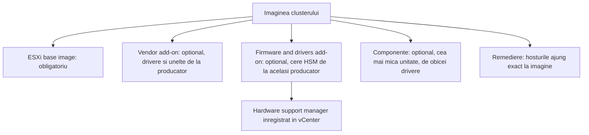
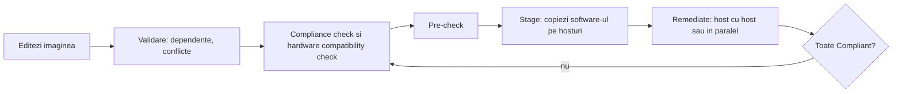

:::analogy
**Durerea din data center.** Ai 16 hosturi ESXi cumpărate în trei etape. Unele au alt driver de placă de rețea, altele alt firmware de controller, iar cineva a instalat „rapid” un VIB (vSphere Installation Bundle) pe un singur host. La primul upgrade, jumătate din cluster refuză să treacă la noua versiune. Pentru examen, exam guide-ul VVF (VMware vSphere Foundation, 2V0-16.25) cere să gestionezi lifecycle-ul VVF, iar vechiul VCP-DCV (VMware Certified Professional - Data Center Virtualization) are obiectivele 1.6, 4.14, 5.9 și 7.9 despre vLCM (vSphere Lifecycle Manager). [S02] [S47]

**Analogia: rețeta de franciză.**

- **Imaginea vLCM** e rețeta oficială a lanțului de restaurante: ce ingrediente, ce versiune, în ce cantitate.
- **Base image-ul ESXi** e aluatul de bază, obligatoriu peste tot.
- **Vendor add-on-ul și componentele** sunt ingredientele locale aprobate de producătorul de hardware.
- **Compliance check-ul** e inspectorul care trece prin fiecare restaurant și compară bucătăria cu rețeta.
- **Remedierea** e echipa care vine și aduce restaurantul exact la rețetă, unul câte unul, ca să nu închizi tot lanțul deodată.
:::

:::architecture
### 1. Ce face vLCM și ce nu

vLCM ține la zi **hosturile ESXi** (software și, cu ajutorul producătorului, firmware), plus **VMware Tools** și **VM hardware** pentru VM-uri (VM, Virtual Machine). vCenter Server se actualizează separat. [S326] [S334] [S335] [S256]

### 2. Baselines și imagini: ce s-a schimbat în vSphere 9

| | Baselines (fostul VUM, vSphere Update Manager) | Imagini |
|---|---|---|
| Model | Listă de patch-uri de aplicat | Starea dorită, declarativă |
| Firmware | Nu | Da, prin firmware and drivers add-on [S328] |
| Hosturi ESX 9.x | Nu mai pot fi patch-uite [S329] | Singura variantă [S256] |
| Clustere noi | Nu se mai pot crea [S329] | Implicit [S329] |

Reguli: [S326] [S327] [S329] [S256]

- Trecerea unui cluster de la baselines la imagini e **într-un singur sens**. Nu te mai întorci; poți doar muta hosturile într-un cluster cu baselines.
- În 9.0 nu mai există rollup bulletins, iar importul de ISO și upgrade-urile din ISO prin VUM sunt blocate.
- Hosturile 8.x se pot patch-ui încă cu baselines până la orice 8.x, dar un cluster ESX 8 cu baselines trebuie **convertit la imagine înainte** de upgrade-ul la ESX 9.
- vCenter 9.0 gestionează ESX 8.0 și mai nou. Upgrade-ul direct 8.0 → 9.0 e suportat; 7.0 → 9.0 nu.

### 3. Din ce e făcută o imagine

- **ESXi base image**: ESXi plus driverele necesare pornirii serverului; e **singurul element obligatoriu**. [S326]
- **Vendor add-on**: pachet de componente de la producătorul serverului (drivere, patch-uri, unelte). [S326]
- **Firmware and drivers add-on**: firmware pentru un anumit tip de server, plus driverele potrivite. Nu vine din depot-ul VMware, ci prin **HSM (hardware support manager)**, o extensie a producătorului înregistrată în vCenter, de exemplu Dell OMIVV, HPE OneView, Lenovo XClarity Integrator sau Cisco Intersight. HSM-ul trebuie să fie de la același producător ca hosturile, altfel remedierea eșuează. [S328]
- **Componente**: cea mai mică unitate dintr-o imagine, de obicei drivere sau adaptoare de la terți. [S326]

După remediere, hosturile corespund imaginii **exact**, fără abateri. [S326]

**Noutăți 9.0.** Un cluster poate avea până la **4 imagini suplimentare** pe lângă cea de bază, pentru hardware amestecat: versiunea ESX e aceeași, dar vendor add-on-ul, firmware-ul și componentele diferă, iar fiecare imagine poate avea HSM-ul ei. Hosturile se asociază manual sau automat după datele din BIOS (Basic Input/Output System). vSphere HA (High Availability) și componentele NSX fac acum parte din base image. [S256]

### 4. Depot-ul și token-ul de download

vLCM își ia software-ul dintr-un **depot**. Broadcom a trecut la download-uri autentificate: URL-urile sunt unice per client și conțin un **token**, iar din 31 martie 2025 token-ul îl generează doar cineva cu rolul *Product Administrator* în portalul Broadcom, iar serverul nou e `dl.broadcom.com` (îl permiți în firewall). Sursele vechi `vmware.com` nu mai descarcă nimic până nu sunt înlocuite. [S331] [S329] Dacă nu ai internet, imporți manual pachete ZIP (offline bundles). [S327]

### 5. Fluxul de lucru

Salvarea imaginii pornește automat validarea, compliance check-ul și verificarea de compatibilitate hardware. Editările nesalvate rămân ca **draft**. [S327] Pașii pre-check, stage și remediere se pot rula pe cluster, iar în 9.0 și la nivel de vCenter, datacenter sau folder. [S256]

**Stările de compliance:** [S339]

| Stare | Ce înseamnă | Ce faci |
|---|---|---|
| **Compliant** | Hostul corespunde imaginii | Nimic |
| **Non-compliant** | Diferă: versiune mai veche, firmware diferit, componentă sau VIB în plus | Remediere |
| **Incompatible** | Imaginea nu se poate aplica: host mai nou decât imaginea, RAM (Random Access Memory) insuficient, hardware nesuportat | Schimbi imaginea sau hardware-ul |
| **Unknown** | Încă nu s-a rulat check-ul (host nou sau imagine editată) | Rulezi compliance check |

Compliance check-ul îți arată și impactul: dacă hostul va cere reboot sau maintenance mode. [S339]

**Remedierea.** Dacă un host eșuează în timpul remedierii clusterului, remedierea se oprește. [S328] În 9.0 poți remedia tot clusterul, un singur host sau grupuri alese de hosturi. [S256]

### 6. Setările de remediere

| Setare | Ce face | Sursă |
|---|---|---|
| **Quick Boot** | Repornește ESXi fără inițializarea firmware-ului, mai repede | [S333] [S337] |
| **Health checks după remediere** | Permise sau nu | [S333] |
| **Parallel remediation** | Mai multe hosturi deodată, cu un maxim opțional; **doar** hosturile deja în maintenance mode | [S333] [S332] |
| **Avertismente de hardware nesuportat** | Pot fi ignorate | [S333] |

**Quick Boot** cere platformă și drivere suportate. Verifici cu `/usr/lib/vmware/loadesx/bin/loadESXCheckCompat.py` pe host. Din ESXi 8.0 U1 nu merge cu Intel TXT activ și nu e suportat pe servere cu DPU (Data Processing Unit). Dacă pre-check-ul pică, hostul face un reboot normal. [S337]

**Live Patch (9.0)** acoperă vmkernel, user space, vmx și componentele NSX, fără maintenance mode. Unele servicii, ca `hostd`, pot reporni, deci hostul se deconectează scurt de la vCenter; VM-urile nu sunt afectate. Hosturile cu TPM (Trusted Platform Module) sau DPU nu sunt compatibile, iar witness-ul vSAN face reboot complet. [S256]

### 7. Compatibilitatea hardware

vLCM verifică hardware-ul față de **VCG (VMware Compatibility Guide)**, cu servere și dispozitive certificate, și, pentru vSAN, față de **vSAN HCL (Hardware Compatibility List)**, cu controllere, firmware și discuri certificate. [S338]

- Pe clusterele vSAN cu imagine, verificarea rulează automat la fiecare 24 de ore (implicit), la salvarea imaginii, la pre-check, la remediere și la adăugarea sau scoaterea unui host. [S336]
- Problemele de compatibilitate sunt **avertismente**: nu blochează remedierea și nici nu se rezolvă prin ea, decât dacă setezi explicit blocarea. [S336] [S338]

### 8. Exportul imaginii

| Format | La ce folosește | Sursă |
|---|---|---|
| **ISO** | Instalări curate, kickstart; nu se poate folosi de clusterele cu imagine | [S327] |
| **ZIP** (offline bundle) | Pune componentele într-un depot | [S327] |
| **JSON** | Doar metadate; refolosești imaginea pe alt cluster | [S327] |

Pe același vCenter îți ajunge JSON-ul. Pe alt vCenter imporți întâi ZIP-ul în depot, apoi JSON-ul. Importul nu instalează nimic; instalarea se face la remediere. [S327]

### 9. VM-urile: VMware Tools, apoi VM hardware

Pe cluster, tab-ul **Updates** are secțiunile **VMware Tools** și **VM Hardware**. [S334] [S335]

1. **Întâi VMware Tools.** Pe Windows, upgrade-ul de hardware făcut înaintea Tools poate pierde setările de rețea. [S335]
2. **Apoi VM hardware**, cu *Upgrade to Match Host*. Poți programa upgrade-ul (de exemplu la următorul restart al sistemului de operare) și poți cere snapshot-uri de rollback. [S335]
3. **Nu** upgradezi hardware-ul VM-ului dacă nu ai nevoie de funcții noi, și **niciodată** pe appliance-ul vCenter. [S335]

### 10. vCenter și ordinea de update în VCF 9 (VMware Cloud Foundation)

**vCenter 9.0** se actualizează recomandat cu **RDU (Reduced Downtime Update)**: se pregătește un appliance nou în paralel, pe o adresă temporară link-local configurată automat, apoi comutarea se face manual, automat sau programat. Update-urile pe loc din VAMI (vCenter Server Appliance Management Interface) încă merg, dar cu downtime mare. [S256]

**Ordinea în VCF 9.0** pentru versiuni majore și minore (articolul KB, Knowledge Base article, 390634, extras): SDDC Manager → NSX → vCenter → witness-ul vSAN → ESXi → VMware Tools → VM hardware → formatul de disc vSAN și VMFS (Virtual Machine File System). Patch-urile se pot aplica în orice ordine. [S340]

`[IMAGE SEARCH / PROMPT]` „vSphere Lifecycle Manager edit image vendor addon firmware” și „vLCM image compliance non-compliant remediate”.
:::

:::exam-alert
### De memorat

| Ce | Valoare / regulă | Sursă |
|---|---|---|
| Element obligatoriu în imagine | Doar ESXi base image | Docs [S326] |
| Baselines → imagini | Într-un singur sens | Docs [S326] [S327] |
| vSphere 9 | Fără baselines pentru hosturi 9.x | KB 379388 [S329] |
| Upgrade direct | 8.0 → 9.0 da; 7.0 → 9.0 nu | Blog VMware [S256] |
| Firmware | Firmware and drivers add-on + HSM de la același producător | Docs [S328] |
| Stări | Compliant, Non-compliant, Incompatible, Unknown | Docs [S339] |
| Parallel remediation | Doar hosturile deja în maintenance mode | Docs [S333]; KB 446635 [S332] |
| Export | ISO, ZIP, JSON; import doar JSON | Docs [S327] |
| Imagini suplimentare (9.0) | Până la 4 pe cluster | Blog VMware [S256] |
| VM-uri | Întâi Tools, apoi hardware | KB 315390 [S335] |

### 3 capcane de examen

1. **„Exportez imaginea ca ISO și o import pe alt cluster cu imagine.”** Fals. ISO-ul e pentru instalări curate; pentru alt cluster folosești JSON (plus ZIP dacă e alt vCenter), iar importul acceptă doar JSON. [S327]
2. **„Un host Incompatible se rezolvă cu Remediate.”** Fals. Remedierea repară hosturile **Non-compliant**; Incompatible înseamnă că imaginea nu se poate aplica, de exemplu hostul e mai nou decât imaginea. [S339]
3. **„Bifez parallel remediation și vLCM pune singur hosturile în maintenance mode.”** Fals. Cu parallel remediation, sunt remediate doar hosturile **deja** în maintenance mode. [S333] [S332]
:::

:::trenches
### Greșeala 1: imaginea care „ar downgrada” un driver

Hosturile au fost instalate cu ISO-ul custom al producătorului, cu un driver de rețea mai nou decât cel din imagine. Compliance check-ul dă eroare, iar butonul *Remediate* e gri. [S330]
**Remediere (KB 320562):** alegi un vendor add-on cu versiuni mai mari ale componentelor sau imporți offline bundle-ul cu driverul la aceeași versiune ori mai nouă și îl adaugi la *Add Components*. Doar dacă driverul nu e folosit de niciun adaptor îl scoți manual, cu hostul în maintenance mode. Lecția generală: imaginea clusterului se construiește **înainte** de a instala hosturi noi, nu după. [S330]

### Greșeala 2: depot-ul care nu mai vede versiuni noi

După trecerea la download-uri autentificate, tab-ul de depot nu mai arată niciun update nou, iar sincronizarea „reușește” fără conținut. [S331] [S329]
**Remediere (KB 390098):** cineva cu rolul *Product Administrator* generează un token de download în portalul Broadcom, apoi înlocuiești URL-urile vechi `vmware.com` din vLCM cu cele noi, pe `dl.broadcom.com`, și deschizi firewall-ul către acest server. Pentru pașii exacți în vCenter, KB-ul te trimite la KB 390121 (`⚠ de verificat`, KB-ul acela nu a fost consultat aici). [S331]
:::

:::interview
**Întrebare Junior/Mid: „Ce e o imagine vLCM și de ce e mai bună decât baselines?”**

*Răspunsul ideal:* o imagine descrie starea dorită a hosturilor: base image ESXi obligatoriu, plus opțional vendor add-on, firmware and drivers add-on și componente. [S326] vLCM compară fiecare host cu imaginea și îl aduce exact la ea, inclusiv firmware-ul, prin HSM-ul producătorului. [S328] Baselines doar aplică patch-uri și nu fac firmware; în vSphere 9 nu mai pot gestiona hosturi 9.x, deci clusterele trebuie convertite înainte de upgrade. [S329] [S256]

**Scenariu de troubleshooting: „Trebuie să duci un cluster vSAN de 6 hosturi ESX 8 cu baselines la ESX 9. Pașii?”**

*Răspunsul pe care îl așteaptă un Team Lead:*
1. **Verifici ordinea**: vCenter întâi la 9.0 (în VCF: SDDC Manager, NSX, apoi vCenter), apoi hosturile. [S340] [S256]
2. **Verifici depot-ul** cu URL-urile cu token și hardware-ul în VCG și vSAN HCL. [S331] [S338]
3. **Convertești clusterul la imagine** (într-un singur sens), cu vendor add-on-ul și, dacă ai HSM, firmware add-on-ul producătorului. [S326] [S328]
4. **Compliance check, pre-check, stage**, apoi remediere host cu host; verifici Quick Boot cu scriptul de compatibilitate. [S339] [S337]
5. **La final** VMware Tools, apoi VM hardware doar unde ai nevoie, apoi formatul de disc vSAN. [S335] [S340]
:::

:::lab
**Scenariu.** Te uiți la depot, construiești sau verifici imaginea unui cluster, rulezi compliance check, exporți imaginea în JSON, verifici Quick Boot pe un host și actualizezi VMware Tools și VM hardware pe un VM de test.

**Ce ai nevoie.** vCenter-ul și un cluster din lab cu cel puțin două hosturi, acces la depot (online cu token sau un offline bundle ZIP), SSH (Secure Shell) temporar pe un host, un VM de test cu VMware Tools.

Pașii de mai jos sunt bifabili, iar progresul se salvează în browser. Numele exacte ale meniurilor pot diferi puțin între versiunile 8 și 9 (`⚠ de verificat`).

**Home lab only / not supported.** Hosturile nested sau serverele de consum nu sunt în VCG; avertismentele de compatibilitate hardware sunt normale în lab și nu le ignori niciodată în producție. Remedierea efectivă o faci doar dacă ai o versiune nouă de aplicat. [S338]

**Test de avarie și validare.** La pasul 3, după ce adaugi o componentă în imagine și salvezi, hosturile trebuie să apară **Non-compliant** până la remediere. La pasul 6, VM-ul trebuie să arate VMware Tools la zi înainte de upgrade-ul de hardware.
:::

:::quiz
Cinci întrebări originale, în stilul examenelor VCP (VMware Certified Professional). Primești explicația pentru fiecare variantă imediat după ce răspunzi.
:::

:::references
- Exam guide VCP-VVF Administrator 2V0-16.25, obiectivul 4.2 (lifecycle VVF) [S02]
- Exam guide VCP-DCV 2V0-21.23 (certificare Legacy), obiectivele 1.6, 4.14, 5.9, 7.9 [S47]
- Documentația vSphere 8 Lifecycle Manager: elementele imaginii [S326], lucrul cu imagini [S327], firmware [S328], stări de compliance [S339], remediere [S333], compatibilitate hardware [S336] [S338]
- KB 379388: imagini și dispariția baselines în 9.0 [S329]
- KB 320562 și KB 390098: downgrade de componente și download cu token [S330] [S331]
- KB 446635 și KB 312153: parallel remediation și Quick Boot [S332] [S337]
- KB 392913 și KB 315390: VMware Tools și VM hardware [S334] [S335]
- Blogul VMware despre vSphere în VCF 9.0 și KB 390634, ordinea de update [S256] [S340]
:::
