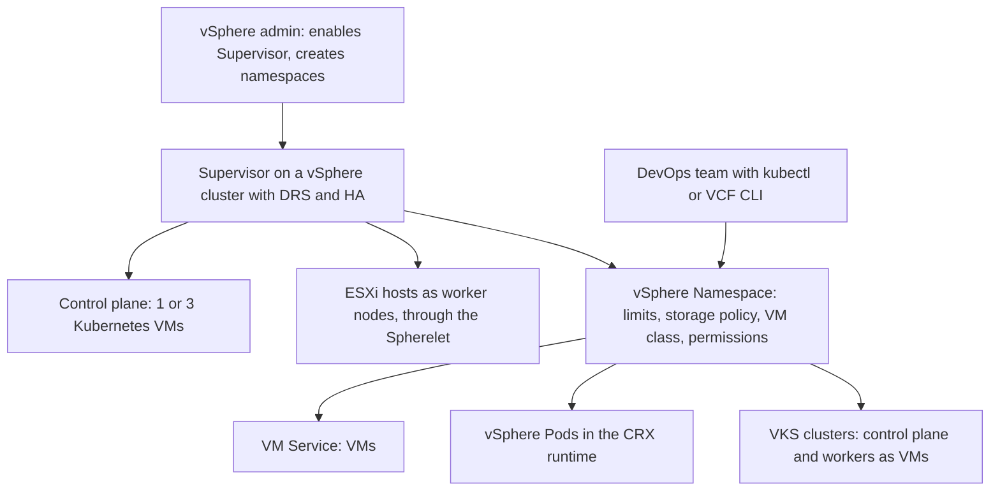
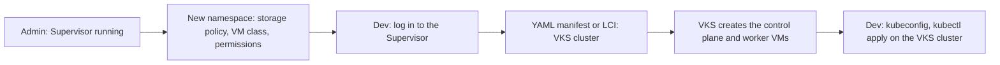

:::analogy
**The data center pain.** The development team wants Kubernetes clusters "now", not after a week of tickets. Without a shared platform, everyone builds their own VMs (VM, Virtual Machine) with Kubernetes, with no backup, no limits and nobody knowing who consumes what. For the exam, the VVF (VMware vSphere Foundation, 2V0-16.25) exam guide has objective 2.5 on VKS (vSphere Kubernetes Service), plus 4.1 and 4.4 on configuring the Supervisor and its services, and the older VCP-DCV (VMware Certified Professional - Data Center Virtualization) has objectives 1.13 and 4.20 on "vSphere with Tanzu". [S02] [S47]

**The analogy: an office complex with a front desk.**

- **The Supervisor** is the building with a front desk: the same desk gives you a simple office (VM), a quick booth (vSphere Pod) or a whole floor with your own rules (VKS cluster).
- **A vSphere Namespace** is a company's lease: how many offices, how much power, how much archive space and who has a key.
- **VM classes** are the standard office sizes you can rent.
- **Supervisor Services** are the building's extra services: cleaning, security, cafeteria, added when you need them.
- **The vSphere administrator** is the building manager; development teams are tenants who serve themselves, within the lease.
:::

:::architecture
### 1. The names changed, the idea stayed

What the older DCV exam guide calls **vSphere with Tanzu** and **TKG (Tanzu Kubernetes Grid) cluster**, the vSphere 8 documentation calls the **vSphere IaaS control plane**, and in 9.0 it is the **vSphere Supervisor** and **VKS**. [S47] [S341] [S347] [S345] On the exam you may meet any of these names.

### 2. What the Supervisor is

The **Supervisor** is a vSphere cluster with the built-in Kubernetes control plane enabled. Through one Kubernetes API (Application Programming Interface) you run: [S341] [S345] [S344]

- **VMs**, through the **VM Service**, from VM classes and images provided by the administrator;
- **vSphere Pods**: very small VMs that run Linux containers directly on ESXi;
- **full Kubernetes clusters**, through **VKS**.

**Components:** [S341] [S352] [S348]

| Component | What it does |
|---|---|
| **Control plane VMs** | The Supervisor's Kubernetes control plane; in the 9.0 API the count is **1 or 3** (default 3) |
| **Spherelet** | The kubelet equivalent, running natively on each ESXi host |
| **CRX (Container Runtime Executive)** | The isolated Linux environment, like a small VM, where a vSphere Pod's containers run |
| **ESXi hosts** | The Supervisor's worker nodes |

The cluster needs **DRS (Distributed Resource Scheduler)** and **HA (High Availability)** enabled, with DRS Fully or Partially Automated. [S348] A single control plane VM means fewer resources but no redundancy: if its host fails, the control plane goes down too. [S352] [S354]

### 3. Zones and deployment models

- When you enable the Supervisor on a cluster, a **vSphere Zone** is created automatically. [S346]
- **One zone**: a single cluster holds both the control plane and the workloads. [S346] [S354]
- **Three zones**: three clusters, one per zone, for cluster-level availability; zones can be in different sites if latency between them is at most 100 ms. [S347] [S354]
- In 9.0 you can start with a minimal configuration and add the load balancer, control plane scaling and workload networking later. [S351]

### 4. Networking and load balancers in 9.0

| Workload network | Load balancer | License |
|---|---|---|
| **VDS** (vSphere Distributed Switch) | **FLB (Foundation Load Balancer)** or Avi | FLB included with VVF and VCF (VMware Cloud Foundation) |
| **NSX segments** | NSX load balancer or Avi | NSX LB included with VCF |
| **NSX VPC (Virtual Private Cloud)** | Avi (`⚠ to verify`: the blog contradicts itself about NSX LB) | Avi needs an Enterprise license |

Source: the VMware blog from July 2026. [S342] **VDS + HAProxy** is still supported in 9.0 but is deprecated and will be removed; for new deployments Broadcom recommends FLB, NSX LB or Avi. [S343]

**Network rules to remember** (from the vSphere 8 requirements, `⚠ to verify` that they stay the same in 9.0): [S347] [S348]

- The management network and the workload network are on **different subnets**.
- The control plane needs a block of **5 consecutive static IP (Internet Protocol) addresses**.
- Each Supervisor has a unique private **/16** range for Kubernetes services, written in CIDR (Classless Inter-Domain Routing) notation.
- You need DNS (Domain Name System) and NTP (Network Time Protocol); MTU (Maximum Transmission Unit) of at least 1500.

### 5. vSphere Namespace: each team's lease

A **namespace** is the unit of resource and network isolation. On it you set: [S344] [S353] [S341]

- **limits** for CPU (Central Processing Unit), memory and storage;
- **storage policies** (VM storage policies), from which Kubernetes gets storage for disks; the exact mapping to storage classes is `⚠ to verify` in the 9.0 documentation;
- **VM classes**, meaning the allowed sizes for VMs and nodes;
- **permissions** for SSO (Single Sign-On) users and groups.

**Namespace permissions** (KB, Knowledge Base article, 424897): [S349]

| Role | In the Supervisor context | In the namespace's VKS clusters |
|---|---|---|
| **Can View** | Read-only in the namespace | No access |
| **Can Edit** | Create, edit and delete VKS clusters | `cluster-admin` in every cluster |
| **Owner** | Like Can Edit, plus create new namespaces through self-service | `cluster-admin` |

Neither Can Edit nor Owner changes namespace settings in the vSphere Client; those stay with the vSphere administrator. [S349] For self-service, the administrator first creates a **namespace template**. [S341] [S349]

### 6. Supervisor Services

- **VKS** and the **VM Service** are included. [S344]
- Other services are added in the vSphere Client under **Supervisor Management > Services > Add**: you upload the service's YAML (YAML Ain't Markup Language) file, register it in vCenter, then install it on a Supervisor. [S353] [S354]
- Example: **LCI (Local Consumption Interface)**, a free graphical interface from the Broadcom portal used to create VKS clusters and VMs in a namespace. [S353]
- In 9.0, the Supervisor and its services are updated **independently** of vCenter. [S351] [S345] [S344]

### 7. VKS: Kubernetes clusters on demand

**VKS** is the Kubernetes runtime built into VCF. Each VKS cluster lives in a namespace, has control plane and worker nodes as VMs, and uses the namespace's VM classes and storage policies. [S345] [S341] [S353]

- VKS releases are asynchronous, aligned with upstream Kubernetes, and support **N-2** Kubernetes versions (the current one and the two before it). [S345]
- You create clusters from LCI or by applying a YAML manifest with kubectl or the VCF CLI (Command-Line Interface). [S353]

**Access with kubectl** (KB 435399): [S350]

- Supervisor: `kubectl vsphere login --server <control plane address> --vsphere-username <SSO user>`.
- VKS cluster: add `--tanzu-kubernetes-cluster-namespace <namespace>` and `--tanzu-kubernetes-cluster-name <cluster>`.
- List contexts with `kubectl config get-contexts` and switch with `kubectl config use-context <name>`.
- Permission changes apply only at the **next login**.
- In VCF 9, the **VCF CLI** replaces `kubectl vsphere login`.

### 8. VM, vSphere Pod or VKS cluster?

| Need | Choice |
|---|---|
| A classic application with a full operating system | VM through the VM Service |
| A simple, strongly isolated container directly on ESXi | vSphere Pod |
| A team that wants its own Kubernetes, with its own version and add-ons | VKS cluster |

`[IMAGE SEARCH / PROMPT]` "vSphere Supervisor architecture control plane VMs Spherelet vSphere Pod" and "vSphere Namespace storage policy VM class permissions".
:::

:::exam-alert
### Memorize

| What | Value / rule | Source |
|---|---|---|
| Control plane VMs | 1 or 3; default 3 | 9.0 API [S352] |
| Cluster requirements | DRS (Fully/Partially Automated) and HA | Docs [S348] |
| Control plane IPs | Block of 5 consecutive static IPs | Docs [S347] [S348] |
| Zones | 1 or 3; ≤100 ms between sites | Docs [S346] [S347] |
| VDS load balancer in 9.0 | FLB (included) or Avi | VMware blog [S342] |
| HAProxy | Supported in 9.0, deprecated | KB 420255 [S343] |
| Can View | No access in VKS clusters | KB 424897 [S349] |
| Can Edit / Owner | `cluster-admin` in VKS clusters | KB 424897 [S349] |
| VKS | N-2 Kubernetes versions; independent upgrade | vSphere 9 FAQ [S345] |

### 3 exam traps

1. **"A user with Can View on the namespace can list pods in the VKS cluster."** False. Can View is read-only in the Supervisor context and has no access inside VKS clusters. [S349]
2. **"I granted the permission in the vSphere Client, so the new context appears in kubectl immediately."** False. New permissions apply at the next `kubectl vsphere login`. [S350]
3. **"For a new VDS-based Supervisor in 9.0, HAProxy is the recommended choice."** False. It is still supported but deprecated; the recommendation is FLB, NSX LB or Avi. [S343] [S342]
:::

:::trenches
### Mistake 1: a Supervisor with overlapping networks

At enablement, the administrator puts the management network and the workload network on the same subnet and gives the control plane addresses that are not consecutive. Enablement gets stuck. [S347] [S348]
**Fix:** separate the management and workload subnets, reserve a block of 5 consecutive static IPs for the control plane and pick a unique private /16 for Kubernetes services that does not overlap existing networks. Check DNS and NTP before retrying. (`⚠ to verify` the exact 9.0 error message.) [S347] [S348]

### Mistake 2: the developer who "cannot see" the cluster

A developer gets Can Edit on the namespace, but `kubectl` says *Forbidden*, and the VKS cluster context is missing. [S350] [S349]
**Fix (KB 435399):** the developer runs `kubectl vsphere login` again, this time with `--tanzu-kubernetes-cluster-namespace` and `--tanzu-kubernetes-cluster-name`, checks with `kubectl config get-contexts` that the IP in the CLUSTER column is the right endpoint, and uses `-n <namespace>` instead of `-A`. Avoid a cluster with the same name as its namespace. [S350]
:::

:::interview
**Junior/Mid question: "What is a vSphere Namespace and what do you control through it?"**

*Ideal answer:* it is the isolation unit on the Supervisor, where teams create their own VMs, vSphere Pods and VKS clusters. [S344] [S341] The vSphere administrator sets the CPU, memory and storage limits, the storage policies, VM classes and permissions (Can View, Can Edit, Owner) for SSO users and groups. [S353] [S349] A good candidate says the team serves itself, but only within the namespace limits.

**Troubleshooting scenario: "Your manager wants Kubernetes for two teams on VVF 9.0, with VDS networking. How do you proceed?"**

*The answer a Team Lead expects:*
1. **Check the cluster**: DRS and HA on, a VDS with separate port groups for management and workload. [S348]
2. **Pick the load balancer**: FLB, included with VVF, or Avi if you have a license; not HAProxy for a new deployment. [S342] [S343]
3. **Enable the Supervisor** with the block of 5 consecutive IPs and a unique private /16 for services; 3 control plane VMs for production. [S347] [S352]
4. **Create one namespace per team**, with limits, a storage policy, VM classes and Can Edit for the team's group. [S353] [S349]
5. **Give access**: developers use `kubectl vsphere login` (or the VCF CLI in VCF 9) and create VKS clusters. [S350]
:::

:::lab
**Scenario.** You enable (or review) a Supervisor, create a namespace with limits, a storage policy and a VM class, grant permissions to an SSO user, install LCI as a Supervisor Service, create a small VKS cluster and connect to it with kubectl.

**What you need.** A lab cluster with DRS and HA, a VDS with port groups for management and workload, a block of 5 consecutive static IPs for the control plane, a load balancer (FLB in 9.0), a test user in vsphere.local and a workstation with kubectl.

The steps below can be checked off, and progress is saved in the browser. Exact menu names may differ slightly between versions 8 and 9 (`⚠ to verify`).

**Home lab only / not supported.** A single control plane VM or a Supervisor on a small cluster is acceptable only in a lab: there is no redundancy, and a host failure stops the control plane. [S352] [S354]

**Failure test and validation.** In step 3, the Can View user must be able to read in the namespace but get *Forbidden* in the VKS cluster. After you grant Can Edit, the context appears only after a new login. [S349] [S350]
:::

:::quiz
Five original questions in the style of VCP (VMware Certified Professional) exams. You get the explanation for every option right after you answer.
:::

:::references
- VCP-VVF Administrator 2V0-16.25 exam guide, objectives 2.5, 4.1 and 4.4 [S02]
- VCP-DCV 2V0-21.23 exam guide (Legacy certification), objectives 1.13 and 4.20 [S47]
- vSphere with Tanzu terminology [S341]; the 9.0 control plane API [S352]
- Supervisor network and zone requirements in vSphere 8 [S346] [S347] [S348]
- The VMware blog on load balancers and KB 420255 on HAProxy [S342] [S343]
- KB 424897 and KB 435399: namespace permissions and kubectl contexts [S349] [S350]
- The vSphere 9 FAQ and VMware blogs on modern apps in VCF 9.0 [S345] [S344] [S351]
- William Lam: VKS with LCI in a lab [S353]
:::
