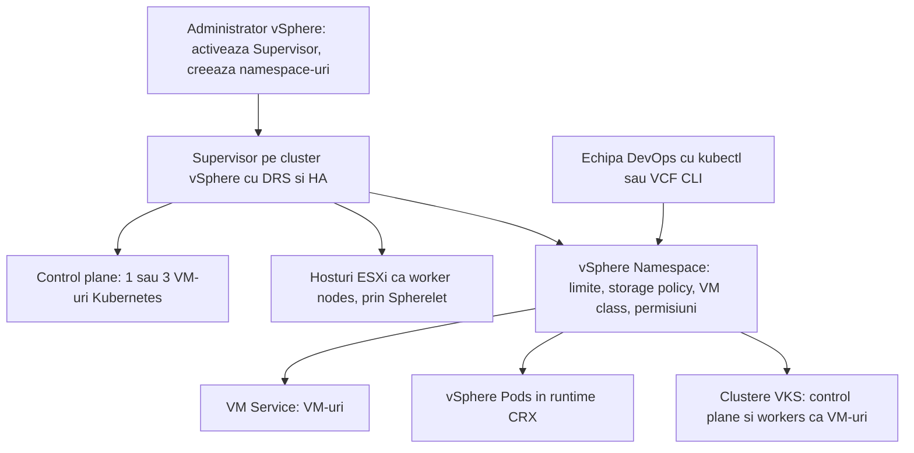
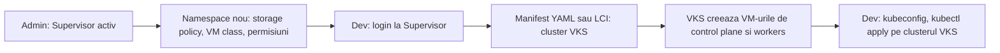

:::analogy
**Durerea din data center.** Echipa de dezvoltare vrea clustere Kubernetes „acum”, nu peste o săptămână de tichete. Fără o platformă comună, fiecare își construiește singur VM-uri (VM, Virtual Machine) cu Kubernetes, fără backup, fără limite și fără să știe cineva cine ce consumă. Pentru examen, exam guide-ul VVF (VMware vSphere Foundation, 2V0-16.25) are obiectivul 2.5 despre VKS (vSphere Kubernetes Service), plus 4.1 și 4.4 despre configurarea Supervisor-ului și serviciile lui, iar vechiul VCP-DCV (VMware Certified Professional - Data Center Virtualization) are obiectivele 1.13 și 4.20 despre „vSphere with Tanzu”. [S02] [S47]

**Analogia: complexul de birouri cu recepție.**

- **Supervisor-ul** e clădirea cu recepție: aceeași recepție îți dă un birou simplu (VM), o boxă rapidă (vSphere Pod) sau un etaj întreg cu regulile tale (cluster VKS).
- **vSphere Namespace** e contractul de închiriere al unei firme: câte birouri, câtă putere, câtă arhivă și cine are cheie.
- **VM classes** sunt mărimile standard de birou pe care le poți închiria.
- **Supervisor Services** sunt serviciile extra ale clădirii: curățenie, pază, cantină, pe care le adaugi când ai nevoie.
- **Administratorul vSphere** e administratorul clădirii; echipele de dezvoltare sunt chiriașii care se servesc singuri, în limitele contractului.
:::

:::architecture
### 1. Numele s-au schimbat, ideea a rămas

Ce vechiul exam guide DCV numește **vSphere with Tanzu** și **TKG (Tanzu Kubernetes Grid) cluster**, documentația vSphere 8 numește **vSphere IaaS control plane**, iar în 9.0 se numește **vSphere Supervisor** și **VKS**. [S47] [S341] [S347] [S345] La examen poți întâlni oricare nume.

### 2. Ce e Supervisor-ul

**Supervisor-ul** e un cluster vSphere pe care ai activat planul de control Kubernetes integrat. Printr-un singur API (Application Programming Interface) Kubernetes rulezi: [S341] [S345] [S344]

- **VM-uri**, prin **VM Service**, din VM classes și imagini oferite de administrator;
- **vSphere Pods**: VM-uri foarte mici care rulează containere Linux direct pe ESXi;
- **clustere Kubernetes complete**, prin **VKS**.

**Componentele:** [S341] [S352] [S348]

| Componentă | Ce face |
|---|---|
| **Control plane VMs** | Planul de control Kubernetes al Supervisor-ului; în API-ul 9.0 numărul e **1 sau 3** (implicit 3) |
| **Spherelet** | Echivalentul kubelet-ului, rulat nativ pe fiecare host ESXi |
| **CRX (Container Runtime Executive)** | Mediul Linux izolat, ca un mic VM, în care rulează containerele unui vSphere Pod |
| **Hosturile ESXi** | Worker nodes ale Supervisor-ului |

Clusterul are nevoie de **DRS (Distributed Resource Scheduler)** și **HA (High Availability)** activate, cu DRS pe Fully sau Partially Automated. [S348] Un singur control plane VM înseamnă mai puține resurse, dar fără redundanță: dacă hostul lui cade, cade și planul de control. [S352] [S354]

### 3. Zone și modele de deployment

- Când activezi Supervisor-ul pe un cluster, se creează automat o **vSphere Zone**. [S346]
- **O zonă**: un singur cluster ține și control plane-ul, și workload-urile. [S346] [S354]
- **Trei zone**: trei clustere, câte unul pe zonă, pentru disponibilitate la nivel de cluster; zonele pot fi pe site-uri diferite dacă latența dintre ele e de cel mult 100 ms. [S347] [S354]
- În 9.0 poți porni cu o configurație minimă și adăuga mai târziu load balancer-ul, scalarea control plane-ului și rețeaua de workload. [S351]

### 4. Rețeaua și load balancer-ul în 9.0

| Rețea de workload | Load balancer | Licență |
|---|---|---|
| **VDS** (vSphere Distributed Switch) | **FLB (Foundation Load Balancer)** sau Avi | FLB inclus în VVF și VCF (VMware Cloud Foundation) |
| **Segmente NSX** | NSX load balancer sau Avi | NSX LB inclus în VCF |
| **NSX VPC (Virtual Private Cloud)** | Avi (`⚠ de verificat`: blogul se contrazice și despre NSX LB) | Avi cere licență Enterprise |

Sursă: blogul VMware din iulie 2026. [S342] **VDS + HAProxy** încă e suportat în 9.0, dar e depreciat și va dispărea; pentru deployment-uri noi Broadcom recomandă FLB, NSX LB sau Avi. [S343]

**Reguli de rețea de reținut** (din cerințele vSphere 8, `⚠ de verificat` că rămân identice în 9.0): [S347] [S348]

- Rețeaua de management și rețeaua de workload sunt pe **subrețele diferite**.
- Control plane-ul are nevoie de un bloc de **5 adrese IP (Internet Protocol) statice consecutive**.
- Fiecare Supervisor are un interval privat **/16** unic pentru serviciile Kubernetes, scris în notație CIDR (Classless Inter-Domain Routing).
- Ai nevoie de DNS (Domain Name System) și NTP (Network Time Protocol); MTU (Maximum Transmission Unit) de cel puțin 1500.

### 5. vSphere Namespace: contractul fiecărei echipe

Un **namespace** e unitatea de izolare de resurse și rețea. Pe el setezi: [S344] [S353] [S341]

- **limite** de CPU (Central Processing Unit), memorie și stocare;
- **politici de stocare** (VM storage policies), din care Kubernetes primește stocarea pentru discuri; maparea exactă la storage classes `⚠ de verificat` în documentația 9.0;
- **VM classes**, adică mărimile permise pentru VM-uri și noduri;
- **permisiuni** pentru utilizatori și grupuri din SSO (Single Sign-On).

**Permisiunile pe namespace** (articolul KB, Knowledge Base article, 424897): [S349]

| Rol | În contextul Supervisor | În clusterele VKS din namespace |
|---|---|---|
| **Can View** | Doar citire în namespace | Niciun acces |
| **Can Edit** | Creează, modifică și șterge clustere VKS | `cluster-admin` în fiecare cluster |
| **Owner** | Ca Can Edit, plus creează namespace-uri noi prin self-service | `cluster-admin` |

Nici Can Edit, nici Owner nu schimbă setările namespace-ului din vSphere Client; acelea rămân la administratorul vSphere. [S349] Pentru self-service, administratorul face întâi un **template de namespace**. [S341] [S349]

### 6. Supervisor Services

- **VKS** și **VM Service** sunt incluse. [S344]
- Celelalte servicii se adaugă din vSphere Client, la **Supervisor Management > Services > Add**: încarci fișierul YAML (YAML Ain't Markup Language) al serviciului, îl înregistrezi în vCenter, apoi îl instalezi pe un Supervisor. [S353] [S354]
- Exemplu: **LCI (Local Consumption Interface)**, o interfață grafică gratuită din portalul Broadcom prin care creezi clustere VKS și VM-uri dintr-un namespace. [S353]
- În 9.0, Supervisor-ul și serviciile lui se actualizează **independent** de vCenter. [S351] [S345] [S344]

### 7. VKS: clustere Kubernetes la cerere

**VKS** e runtime-ul Kubernetes integrat în VCF. Fiecare cluster VKS stă într-un namespace, are noduri de control plane și workers ca VM-uri și folosește VM classes și politicile de stocare ale namespace-ului. [S345] [S341] [S353]

- Versiunile VKS apar asincron, aliniate la Kubernetes upstream, și suportă **N-2** versiuni de Kubernetes (versiunea curentă și două anterioare). [S345]
- Le creezi din LCI sau aplicând un manifest YAML cu kubectl ori VCF CLI (Command-Line Interface). [S353]

**Accesul cu kubectl** (KB 435399): [S350]

- Supervisor: `kubectl vsphere login --server <adresa control plane> --vsphere-username <utilizator SSO>`.
- Cluster VKS: adaugi `--tanzu-kubernetes-cluster-namespace <namespace>` și `--tanzu-kubernetes-cluster-name <cluster>`.
- Vezi contextele cu `kubectl config get-contexts` și schimbi cu `kubectl config use-context <nume>`.
- Schimbările de permisiuni se aplică abia la **următorul login**.
- În VCF 9, **VCF CLI** înlocuiește `kubectl vsphere login`.

### 8. VM, vSphere Pod sau cluster VKS?

| Nevoie | Alegerea |
|---|---|
| O aplicație clasică, cu sistem de operare complet | VM prin VM Service |
| Un container simplu, izolat puternic, direct pe ESXi | vSphere Pod |
| O echipă care vrea propriul Kubernetes, cu versiune și add-on-uri proprii | Cluster VKS |

`[IMAGE SEARCH / PROMPT]` „vSphere Supervisor architecture control plane VMs Spherelet vSphere Pod” și „vSphere Namespace storage policy VM class permissions”.
:::

:::exam-alert
### De memorat

| Ce | Valoare / regulă | Sursă |
|---|---|---|
| Control plane VMs | 1 sau 3; implicit 3 | API 9.0 [S352] |
| Cerințe cluster | DRS (Fully/Partially Automated) și HA | Docs [S348] |
| IP-uri control plane | Bloc de 5 IP-uri statice consecutive | Docs [S347] [S348] |
| Zone | 1 sau 3; ≤100 ms între site-uri | Docs [S346] [S347] |
| Load balancer VDS în 9.0 | FLB (inclus) sau Avi | Blog VMware [S342] |
| HAProxy | Suportat în 9.0, depreciat | KB 420255 [S343] |
| Can View | Fără acces în clusterele VKS | KB 424897 [S349] |
| Can Edit / Owner | `cluster-admin` în clusterele VKS | KB 424897 [S349] |
| VKS | N-2 versiuni Kubernetes; upgrade independent | FAQ vSphere 9 [S345] |

### 3 capcane de examen

1. **„Un utilizator cu Can View pe namespace poate lista pod-urile din clusterul VKS.”** Fals. Can View e doar citire în contextul Supervisor și nu are acces în clusterele VKS. [S349]
2. **„Am dat permisiunea în vSphere Client, deci contextul nou apare imediat în kubectl.”** Fals. Permisiunile noi se aplică la următorul `kubectl vsphere login`. [S350]
3. **„Pentru un Supervisor nou pe VDS în 9.0, HAProxy e alegerea recomandată.”** Fals. E încă suportat, dar depreciat; recomandarea e FLB, NSX LB sau Avi. [S343] [S342]
:::

:::trenches
### Greșeala 1: Supervisor cu rețelele suprapuse

La activare, administratorul pune rețeaua de management și rețeaua de workload pe aceeași subrețea și dă control plane-ului adrese care nu sunt consecutive. Activarea se blochează. [S347] [S348]
**Remediere:** separi subrețelele de management și workload, rezervi un bloc de 5 IP-uri statice consecutive pentru control plane și alegi un /16 privat unic pentru serviciile Kubernetes, care nu se suprapune cu rețelele existente. Verifici DNS și NTP înainte de a reîncerca. (`⚠ de verificat` mesajul exact de eroare în 9.0.) [S347] [S348]

### Greșeala 2: dezvoltatorul care „nu vede” clusterul

Un dezvoltator primește Can Edit pe namespace, dar `kubectl` îi spune *Forbidden*, iar contextul clusterului VKS lipsește. [S350] [S349]
**Remediere (KB 435399):** dezvoltatorul face din nou `kubectl vsphere login`, de data asta cu `--tanzu-kubernetes-cluster-namespace` și `--tanzu-kubernetes-cluster-name`, verifică cu `kubectl config get-contexts` că IP-ul din coloana CLUSTER e endpoint-ul corect și folosește `-n <namespace>` în loc de `-A`. Evitați un cluster cu același nume ca namespace-ul lui. [S350]
:::

:::interview
**Întrebare Junior/Mid: „Ce e un vSphere Namespace și ce controlezi prin el?”**

*Răspunsul ideal:* e unitatea de izolare de pe Supervisor, unde echipele își creează singure VM-uri, vSphere Pods și clustere VKS. [S344] [S341] Administratorul vSphere setează limitele de CPU, memorie și stocare, politicile de stocare, VM classes și permisiunile (Can View, Can Edit, Owner) pentru utilizatori și grupuri SSO. [S353] [S349] Un candidat bun spune că echipa se servește singură, dar doar în limitele namespace-ului.

**Scenariu de troubleshooting: „Șeful vrea Kubernetes pentru două echipe pe VVF 9.0, cu rețea VDS. Cum procedezi?”**

*Răspunsul pe care îl așteaptă un Team Lead:*
1. **Verifici clusterul**: DRS și HA active, VDS cu port groups separate pentru management și workload. [S348]
2. **Alegi load balancer-ul**: FLB, inclus în VVF, sau Avi dacă ai licență; nu HAProxy pentru un deployment nou. [S342] [S343]
3. **Activezi Supervisor-ul** cu blocul de 5 IP-uri consecutive și un /16 privat unic pentru servicii; 3 control plane VMs pentru producție. [S347] [S352]
4. **Creezi câte un namespace pe echipă**, cu limite, politică de stocare, VM classes și Can Edit pentru grupul echipei. [S353] [S349]
5. **Dai acces**: dezvoltatorii folosesc `kubectl vsphere login` (sau VCF CLI în VCF 9) și creează clustere VKS. [S350]
:::

:::lab
**Scenariu.** Activezi (sau verifici) un Supervisor, creezi un namespace cu limite, politică de stocare și VM class, dai permisiuni unui utilizator SSO, instalezi LCI ca Supervisor Service, creezi un cluster VKS mic și te conectezi la el cu kubectl.

**Ce ai nevoie.** Un cluster din lab cu DRS și HA, un VDS cu port groups pentru management și workload, un bloc de 5 IP-uri statice consecutive pentru control plane, un load balancer (FLB în 9.0), un utilizator de test în vsphere.local și o stație cu kubectl.

Pașii de mai jos sunt bifabili, iar progresul se salvează în browser. Numele exacte ale meniurilor pot diferi puțin între versiunile 8 și 9 (`⚠ de verificat`).

**Home lab only / not supported.** Un singur control plane VM sau un Supervisor pe un cluster mic e acceptabil doar pentru lab: fără redundanță, căderea hostului oprește planul de control. [S352] [S354]

**Test de avarie și validare.** La pasul 3, utilizatorul cu Can View trebuie să poată citi în namespace, dar să primească *Forbidden* în clusterul VKS. După ce îi dai Can Edit, contextul apare abia după un nou login. [S349] [S350]
:::

:::quiz
Cinci întrebări originale, în stilul examenelor VCP (VMware Certified Professional). Primești explicația pentru fiecare variantă imediat după ce răspunzi.
:::

:::references
- Exam guide VCP-VVF Administrator 2V0-16.25, obiectivele 2.5, 4.1 și 4.4 [S02]
- Exam guide VCP-DCV 2V0-21.23 (certificare Legacy), obiectivele 1.13 și 4.20 [S47]
- Terminologia vSphere with Tanzu [S341]; API-ul 9.0 pentru control plane [S352]
- Cerințele de rețea și zone ale Supervisor-ului în vSphere 8 [S346] [S347] [S348]
- Blogul VMware despre load balancer-e și KB 420255 despre HAProxy [S342] [S343]
- KB 424897 și KB 435399: permisiuni pe namespace și contexte kubectl [S349] [S350]
- FAQ vSphere 9 și blogurile VMware despre aplicații moderne în VCF 9.0 [S345] [S344] [S351]
- William Lam: VKS cu LCI în lab [S353]
:::
