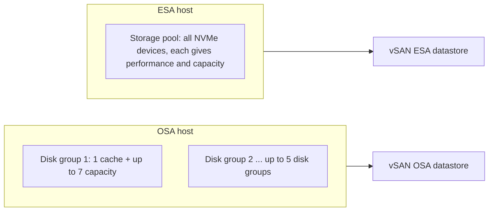
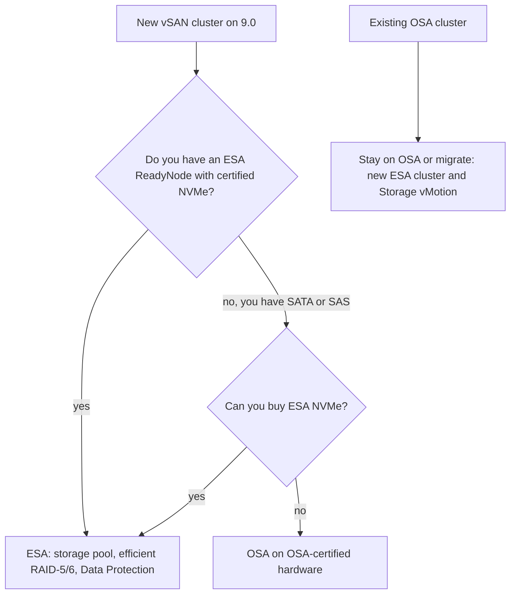

:::analogy
**The data center pain.** A company has three servers with almost empty local disks and an old, expensive storage array that must be replaced. One colleague suggests vSAN, another asks "but which architecture, OSA (Original Storage Architecture) or ESA (Express Storage Architecture)?", and a third has already bought SATA disks for ESA. For the exam, the VVF (VMware vSphere Foundation, 2V0-16.25) and VCF (VMware Cloud Foundation, 2V0-17.25) exam guides ask you to describe when to choose ESA and when OSA, and the older VCP-DCV (VMware Certified Professional - Data Center Virtualization) has objectives 1.3.5 and 1.7 on vSAN concepts. [S02] [S03] [S47]

**The analogy: a library split into sections.**

- **vSAN** is the city library made of the shelves of every neighborhood: readers see one catalog, but the books sit in several buildings.
- **OSA** is the old library: each section has a front desk (cache) and shelves behind it (capacity). If the front desk closes, the whole section becomes unreachable.
- **ESA** is the new library: every shelf receives and stores on its own, and if one shelf breaks, the others keep working.
- **Copies of a book** in different neighborhoods are the components of a vSAN object, placed according to the storage policy.
:::

:::architecture
### 1. What vSAN is

**vSAN** pools the local disks of ESXi hosts into one datastore shared by the whole cluster. Compute and storage live on the same servers, which is **HCI (Hyper-Converged Infrastructure)**. [S361]

- A single-site cluster needs **at least 3 hosts** with local storage. A **2-node cluster** also uses a **witness appliance**. [S361]
- vSAN traffic goes through a **VMkernel adapter** (usually just one), and vSphere HA (High Availability) uses the vSAN network for its own communication. [S361]

### 2. How vSAN stores a VM: objects and components

A VM (VM, Virtual Machine) on vSAN is a set of **objects**: [S361]

| Object | What it holds |
|---|---|
| **VM home namespace** | The .vmx file and the logs; thin, 255 GB by default |
| **VMDK** | Each virtual disk |
| **VM swap** | Exists only while the VM is powered on |
| **Snapshot delta** and **snapshot memory** | Snapshots (in ESA the deltas are no longer separate objects) |

Each object is made of **components** placed on different hosts according to the storage policy. Example: FTT (Failures To Tolerate) = 1 with RAID-1 (Redundant Array of Independent Disks) means **two replicas plus a witness component**, which votes for quorum. In ESA, witness components are rarely needed, except in 2-node and stretched clusters. [S361] Policies are covered in lesson 3.3.

### 3. The two architectures

**OSA** groups disks into **disk groups**: one cache device plus capacity devices, at most 5 disk groups per host, with up to 7 capacity devices each. [S355] [S356] It can be hybrid (flash cache, magnetic capacity disks) or all-flash. [S355] A disk failure in a disk group can make several disks unreachable at once. [S361]

**ESA** puts all of the host's NVMe (Non-Volatile Memory Express) devices into a **storage pool**. Each device provides both performance and capacity, so there is no dedicated cache, and one device failing does not affect the others. [S355] [S356] [S358]

**How ESA writes.** It uses a **log-structured file system**: small writes first go into a **performance leg** (a log mirrored across hosts according to FTT), then move to the **capacity leg** as full stripes. That gives RAID-5/6 without the classic write penalty. [S357] [S356]

### 4. The comparison that matters on the exam

| | OSA | ESA |
|---|---|---|
| Layout | Disk groups: cache + capacity [S355] | Storage pool, no dedicated cache [S355] |
| Devices | SATA, SAS, NVMe certified for OSA [S356] | ESA-certified NVMe only; no SAS/SATA, no RAID or HBA (Host Bus Adapter) controllers [S361] [S356] |
| Hardware | ReadyNode or build-your-own with certified devices [S356] | ESA ReadyNode [S356] [S360] |
| Network | 10GbE for all-flash [S355] | 25GbE recommended; 10GbE allowed on the smallest ReadyNode profile [S24] |
| RAID-5/6 | You choose between performance (RAID-1) and capacity (RAID-5/6) [S356] | RAID-5/6 at RAID-1 performance; RAID-5 from 3 hosts (2+1 or 4+1), RAID-6 from 6 [S356] [S357] |
| Compression | Per datastore, roughly 2:1 [S357] | Per VM, on by default, up to 8:1 on 4 KiB blocks, before the network [S357] [S356] |
| Deduplication | Within one disk group [S364] | Global across the cluster in VCF 9.0, under limited release [S364] [S362] |
| Encryption | May decrypt and re-encrypt between cache and capacity [S356] | Once, on the VM's host [S356] |
| Snapshots | Redo-log (vsanSparse) [S356] | Native, no delta chains [S356] [S357] |
| vSAN Data Protection | No [S363] | Yes [S363] |

ESA hardware requirements have come down over time: the November 2025 VMware blog describes smaller ReadyNode profiles, for ESA from 8.0 to the latest release. [S24] For exact numbers you check the current ReadyNode guide, not old documentation pages.

### 5. No in-place conversion

- **OSA → ESA**: there is no in-place upgrade. Either you build a new ESA cluster and move the VMs with Storage vMotion, or you empty hosts, delete the disk groups and partitions and reuse them in ESA. Data left on the wiped disks is lost. [S359] [S360]
- **ESA → OSA**: equally destructive; you back up, disable vSAN, clean the disks and reconfigure. [S358]
- A "rolling" migration, a few hosts at a time, reduces the temporary free space needed. In VCF 9.1, an OSA cluster can mount an ESA datastore and the reverse. [S360]

### 6. HCI or storage cluster

- **HCI cluster**: the same hosts run VMs and provide storage. [S361]
- **vSAN storage cluster**: an ESA cluster that only provides storage to other compute clusters, through datastore sharing. It needs 25 Gbps between its nodes, while compute clusters can connect at 10 Gbps. [S361]
- Compute-only hosts can mount a vSAN datastore without contributing storage, but the guide does not generally recommend it, because it unbalances the cluster. [S361]

### 7. TiB licensing

The rules come from KB (Knowledge Base article) 313548 and the vSAN 9.0 blog:

| Edition | Included vSAN | Source |
|---|---|---|
| VCF | 1 TiB per core | KB 313548 [S157]; blog [S362] |
| VVF | 0.25 TiB per core, rounded up | KB 313548 [S157] |

You count the **raw** capacity contributed by the hosts, not the free capacity shown in the interface. Beyond what is included you buy add-on capacity. [S157] Example from the KB: 96 VVF cores give 24 TiB. [S157]

### 8. What about vVols?

DCV objective 1.3.5 also mentions **vVols (Virtual Volumes)**: datastores where the external array manages each VM's disks directly. [S47] In VCF and VVF 9.0, vVols are **deprecated** and will be disabled in a future 9.x release. [S192] [S362]

### 9. When to choose which

`[IMAGE SEARCH / PROMPT]` "vSAN OSA disk group cache capacity vs ESA storage pool diagram" and "vSAN object components witness RAID-1".
:::

:::exam-alert
### Memorize

| What | Value / rule | Source |
|---|---|---|
| Minimum hosts, one site | 3 (2 nodes with a witness appliance) | Design guide [S361] |
| OSA disk groups | Max 5 per host; 1 cache + up to 7 capacity | Docs [S355] |
| ESA devices | Certified NVMe only; no SAS/SATA | Design guide [S361] |
| RAID-5 in ESA | From 3 hosts | Blog [S356]; doc [S357] |
| RAID-6 in ESA | From 6 hosts | Doc [S357] |
| ESA compression | Per VM, on by default | Doc [S357] |
| OSA ↔ ESA | No in-place conversion | KB 432894 [S359]; KB 387380 [S358] |
| vSAN Data Protection | ESA only | KB 433469 [S363] |
| Included TiB | VCF 1 per core; VVF 0.25 per core | KB 313548 [S157] |

### 3 exam traps

1. **"I can build an ESA cluster with certified SATA SSD (Solid-State Drive) disks."** False. ESA needs ESA-certified NVMe devices; SAS and SATA are not supported. [S361] [S356]
2. **"I upgrade the OSA cluster to ESA from the vSphere Client without moving the VMs."** False. There is no in-place conversion; you build a new cluster and use Storage vMotion, or empty and reuse the hosts. [S359] [S360]
3. **"In ESA I put RAID-1 on important VMs, because RAID-5 is always slower."** False. ESA gives RAID-5/6 at RAID-1 performance thanks to the log-structured file system. [S356] [S357]
:::

:::trenches
### Mistake 1: one cache disk that takes a whole section offline

In an OSA cluster with a single disk group per host, a host's cache device fails. All capacity disks in the group become unreachable, and vSAN rebuilds far more data than the team expected. [S361] [S355]
**Fix:** on OSA you use several disk groups per host to spread the risk, at the cost of more cache devices and more memory. [S355] On a new cluster you choose ESA, where one device failing does not affect the others. [S355] [S356]

### Mistake 2: "we reuse the hosts, it is just a setting"

The team removes a host from the OSA cluster with *No Data Migration*, deletes the disk groups and adds it to the ESA cluster, believing the VMs have replicas elsewhere. Some objects had FTT=0. [S359]
**Fix (KB 432894):** before reusing a host, move every VM off it and check that no object depends only on its disks; deleting disk groups and partitions permanently loses the remaining data. To be safe, prefer migrating to a new ESA cluster with Storage vMotion. [S359] [S360]
:::

:::interview
**Junior/Mid question: "What is the difference between vSAN OSA and ESA?"**

*Ideal answer:* OSA organizes disks into disk groups, with a cache device and capacity devices, and accepts SATA, SAS or NVMe. [S355] [S356] ESA uses a storage pool of certified NVMe only, with no dedicated cache, and a log-structured file system that gives RAID-5/6 at RAID-1 performance, per-VM compression and native snapshots. [S356] [S357] A good candidate mentions that there is no in-place conversion and that vSAN Data Protection works only on ESA. [S359] [S363]

**Troubleshooting scenario: "A customer has a 4-host OSA cluster and wants ESA without application downtime. What do you propose?"**

*The answer a Team Lead expects:*
1. **Check the hardware** in the ESA ReadyNode guide: they may only need new NVMe devices. [S360] [S24]
2. **Plan a migration, not a conversion**: either a new ESA cluster and Storage vMotion, or a rolling migration a few hosts at a time. [S359] [S360]
3. **Check free space** and policies, so no object depends only on the hosts you empty. [S359]
4. **Move the VMs** with vMotion and Storage vMotion, without stopping the applications. [S360]
5. **At the end** check TiB licensing (VCF or VVF) for the new raw capacity. [S157]
:::

:::lab
**Scenario.** You look at an existing vSAN cluster in the lab: which architecture it uses, how the disks look (disk groups or storage pool), which objects and components a VM has, which network vSAN uses and how much raw capacity you have to license.

**What you need.** The lab vSAN cluster (OSA or ESA) and a small VM on the vSAN datastore.

The steps below can be checked off, and progress is saved in the browser. Exact menu names may differ slightly between versions 8 and 9 (`⚠ to verify`).

**Home lab only / not supported.** vSAN ESA on nested hosts or uncertified disks works in a lab but is not supported in production; ESA needs a ReadyNode and certified NVMe. [S356] [S360]

**Failure test and validation.** In step 3 you must see, for the disk of a VM with FTT=1 and RAID-1, two components on different hosts and (on OSA) a witness component. In step 5, the raw capacity summed across hosts must be larger than the free capacity in Capacity Overview. [S361] [S157]
:::

:::quiz
Five original questions in the style of VCP (VMware Certified Professional) exams. You get the explanation for every option right after you answer.
:::

:::references
- VCP-VVF 2V0-16.25 and VCP-VCF 2V0-17.25 exam guides, objective 2.3 [S02] [S03]
- VCP-DCV 2V0-21.23 exam guide (Legacy certification), objectives 1.3.5 and 1.7 [S47]
- vSAN 8 planning: hosts, disk groups, storage pools [S355]
- The VMware blog comparing OSA with ESA [S356]; the ESA technical document [S357]
- vSAN Design Guide: objects, components, HCI and storage clusters [S361]
- KB 432894 and KB 387380: no in-place conversion [S359] [S358]; the blog on migrating to ESA [S360]
- KB 433469: vSAN Data Protection on ESA only [S363]
- KB 313548: TiB per core [S157]; the vSAN 9.0 blogs [S362] [S364]
- The VMware blog on lower ESA requirements [S24]; KB 401070 on vVols [S192]
:::
