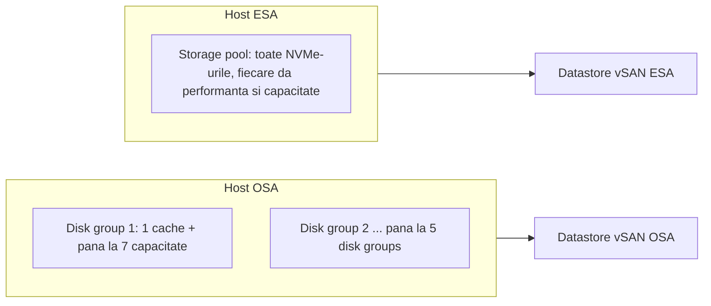
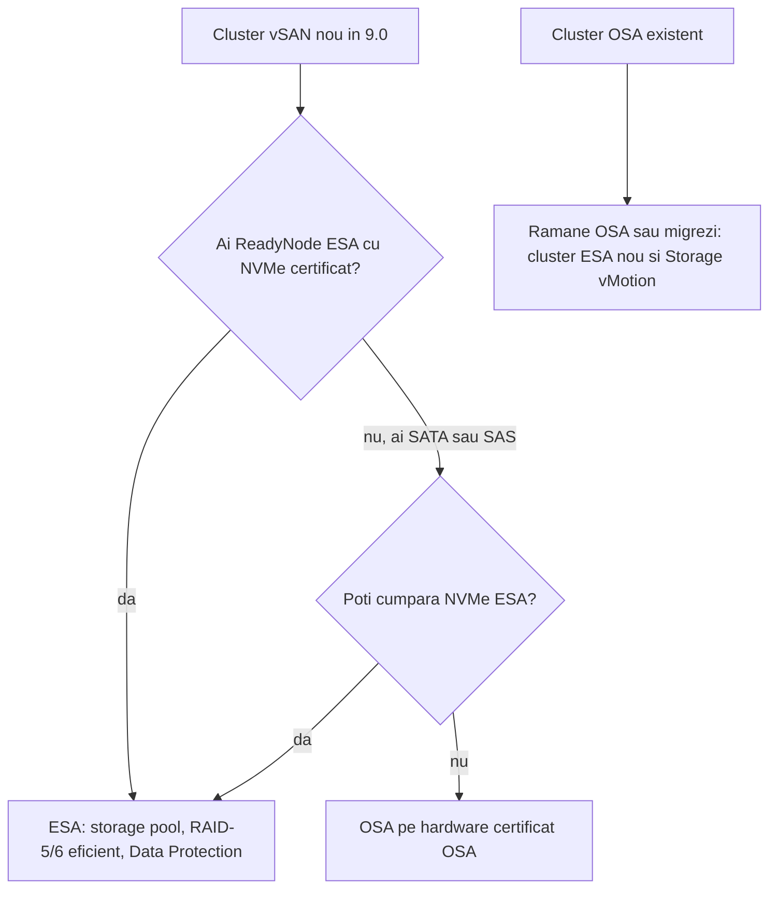

:::analogy
**Durerea din data center.** O firmă are trei servere cu discuri locale aproape goale și un array de stocare vechi, scump, care trebuie înlocuit. Un coleg propune vSAN, altul spune „dar ce arhitectură, OSA (Original Storage Architecture) sau ESA (Express Storage Architecture)?”, iar un al treilea a cumpărat deja discuri SATA pentru ESA. Pentru examen, exam guide-urile VVF (VMware vSphere Foundation, 2V0-16.25) și VCF (VMware Cloud Foundation, 2V0-17.25) cer să descrii când alegi ESA și când OSA, iar vechiul VCP-DCV (VMware Certified Professional - Data Center Virtualization) are obiectivele 1.3.5 și 1.7 despre conceptele vSAN. [S02] [S03] [S47]

**Analogia: biblioteca împărțită pe raioane.**

- **vSAN** e biblioteca orașului formată din rafturile tuturor cartierelor: cititorul vede un singur catalog, dar cărțile stau în mai multe clădiri.
- **OSA** e biblioteca veche: fiecare raion are un birou de primire (cache) și rafturi în spate (capacitate). Dacă biroul de primire se închide, tot raionul devine inaccesibil.
- **ESA** e biblioteca nouă: fiecare raft primește și depozitează singur, iar dacă un raft se strică, celelalte merg mai departe.
- **Copiile unei cărți** în cartiere diferite sunt componentele unui obiect vSAN, plasate după politica de stocare.
:::

:::architecture
### 1. Ce e vSAN

**vSAN** adună discurile locale ale hosturilor ESXi într-un singur datastore partajat de tot clusterul. Calculul și stocarea stau pe aceleași servere, adică **HCI (Hyper-Converged Infrastructure)**. [S361]

- Un cluster pe un singur site are nevoie de **minimum 3 hosturi** cu stocare locală. Un **cluster cu 2 noduri** folosește în plus un **witness appliance**. [S361]
- Traficul vSAN merge printr-un **VMkernel adapter** (de obicei unul singur), iar vSphere HA (High Availability) folosește rețeaua vSAN pentru comunicarea lui. [S361]

### 2. Cum stochează vSAN un VM: obiecte și componente

Un VM (VM, Virtual Machine) pe vSAN e un set de **obiecte**: [S361]

| Obiect | Ce conține |
|---|---|
| **VM home namespace** | Fișierul .vmx și logurile; thin, implicit 255 GB |
| **VMDK** | Fiecare disc virtual |
| **VM swap** | Există doar cât VM-ul e pornit |
| **Snapshot delta** și **snapshot memory** | Snapshot-urile (în ESA nu mai sunt obiecte separate pentru delta) |

Fiecare obiect e format din **componente** puse pe hosturi diferite, după politica de stocare. Exemplu: FTT (Failures To Tolerate) = 1 cu RAID-1 (Redundant Array of Independent Disks) înseamnă **două replici plus o componentă witness**, care votează pentru quorum. În ESA, componentele witness sunt rareori necesare, în afară de clusterele cu 2 noduri și stretched. [S361] Politicile le detaliem în lecția 3.3.

### 3. Cele două arhitecturi

**OSA** grupează discurile în **disk groups**: un dispozitiv de cache plus dispozitive de capacitate, maximum 5 disk groups pe host, cu până la 7 dispozitive de capacitate fiecare. [S355] [S356] Poate fi hibrid (cache flash, capacitate pe discuri magnetice) sau all-flash. [S355] Căderea unui disc dintr-un disk group poate face inaccesibile mai multe discuri deodată. [S361]

**ESA** pune toate dispozitivele NVMe (Non-Volatile Memory Express) ale hostului într-un **storage pool**. Fiecare dispozitiv dă și performanță, și capacitate, deci nu mai există cache dedicat, iar căderea unui dispozitiv nu le afectează pe celelalte. [S355] [S356] [S358]

**Cum scrie ESA.** Folosește un **log-structured file system**: scrierile mici intră întâi într-un **performance leg** (un log oglindit pe hosturi, după FTT), apoi sunt mutate în **capacity leg** ca stripe-uri complete. Așa obții RAID-5/6 fără penalizarea clasică de scriere. [S357] [S356]

### 4. Comparația care contează la examen

| | OSA | ESA |
|---|---|---|
| Organizare | Disk groups: cache + capacitate [S355] | Storage pool, fără cache dedicat [S355] |
| Dispozitive | SATA, SAS, NVMe certificate pentru OSA [S356] | Doar NVMe certificate ESA; fără SAS/SATA, fără controllere RAID sau HBA (Host Bus Adapter) [S361] [S356] |
| Hardware | ReadyNode sau build-your-own cu dispozitive certificate [S356] | ReadyNode ESA [S356] [S360] |
| Rețea | 10GbE pentru all-flash [S355] | 25GbE recomandat; 10GbE permis pe cel mai mic profil ReadyNode [S24] |
| RAID-5/6 | Alegi între performanță (RAID-1) și capacitate (RAID-5/6) [S356] | RAID-5/6 cu performanța RAID-1; RAID-5 de la 3 hosturi (2+1 sau 4+1), RAID-6 de la 6 [S356] [S357] |
| Compresie | Per datastore, aproximativ 2:1 [S357] | Per VM, activă implicit, până la 8:1 pe blocuri de 4 KiB, înainte de rețea [S357] [S356] |
| Deduplicare | În interiorul unui disk group [S364] | Globală pe cluster în VCF 9.0, în limited release [S364] [S362] |
| Criptare | Poate decripta și recripta între cache și capacitate [S356] | O singură dată, pe hostul VM-ului [S356] |
| Snapshot-uri | Redo-log (vsanSparse) [S356] | Native, fără lanțuri delta [S356] [S357] |
| vSAN Data Protection | Nu [S363] | Da [S363] |

Cerințele de hardware ESA au scăzut în timp: blogul VMware din noiembrie 2025 descrie profiluri ReadyNode mai mici, pentru ESA de la 8.0 până la ultima versiune. [S24] Pentru cifrele exacte te uiți în ghidul ReadyNode curent, nu în pagini vechi de documentație.

### 5. Nu se convertește pe loc

- **OSA → ESA**: nu există upgrade pe loc. Fie construiești un cluster ESA nou și muți VM-urile cu Storage vMotion, fie golești hosturi, ștergi disk groups și partițiile și le refolosești în ESA. Datele rămase pe discurile șterse se pierd. [S359] [S360]
- **ESA → OSA**: la fel, distructiv; faci backup, dezactivezi vSAN, cureți discurile și reconfigurezi. [S358]
- Migrarea „rolling”, câteva hosturi pe rând, reduce spațiul liber temporar necesar. În VCF 9.1, un cluster OSA poate monta un datastore ESA și invers. [S360]

### 6. HCI sau storage cluster

- **Cluster HCI**: aceleași hosturi rulează VM-uri și dau stocare. [S361]
- **vSAN storage cluster**: un cluster ESA care doar oferă stocare altor clustere de calcul, prin datastore sharing. Are nevoie de 25 Gbps între noduri, iar clusterele de calcul se pot lega și la 10 Gbps. [S361]
- Hosturile compute-only pot monta un datastore vSAN fără să dea stocare, dar ghidul nu le recomandă în general, pentru că dezechilibrează clusterul. [S361]

### 7. Licențierea în TiB

Regulile vin din articolul KB (Knowledge Base article) 313548 și din blogul vSAN 9.0:

| Ediție | vSAN inclus | Sursă |
|---|---|---|
| VCF | 1 TiB per core | KB 313548 [S157]; blog [S362] |
| VVF | 0,25 TiB per core, rotunjit în sus | KB 313548 [S157] |

Numeri capacitatea **brută** dată de hosturi, nu capacitatea liberă din interfață. Peste ce e inclus cumperi capacitate add-on. [S157] Exemplu din KB: 96 de core-uri VVF dau 24 TiB. [S157]

### 8. Și vVols?

Obiectivul DCV 1.3.5 pomenește și **vVols (Virtual Volumes)**: datastore-uri în care array-ul extern gestionează direct discurile fiecărui VM. [S47] În VCF și VVF 9.0, vVols sunt **depreciate** și vor fi dezactivate într-o versiune 9.x viitoare. [S192] [S362]

### 9. Când alegi una sau alta

`[IMAGE SEARCH / PROMPT]` „vSAN OSA disk group cache capacity vs ESA storage pool diagram” și „vSAN object components witness RAID-1”.
:::

:::exam-alert
### De memorat

| Ce | Valoare / regulă | Sursă |
|---|---|---|
| Hosturi minime, un site | 3 (2 noduri cu witness appliance) | Design guide [S361] |
| Disk groups OSA | Max 5 pe host; 1 cache + până la 7 capacitate | Docs [S355] |
| Dispozitive ESA | Doar NVMe certificate; fără SAS/SATA | Design guide [S361] |
| RAID-5 în ESA | De la 3 hosturi | Blog [S356]; doc [S357] |
| RAID-6 în ESA | De la 6 hosturi | Doc [S357] |
| Compresie ESA | Per VM, activă implicit | Doc [S357] |
| OSA ↔ ESA | Fără conversie pe loc | KB 432894 [S359]; KB 387380 [S358] |
| vSAN Data Protection | Doar ESA | KB 433469 [S363] |
| TiB incluși | VCF 1 per core; VVF 0,25 per core | KB 313548 [S157] |

### 3 capcane de examen

1. **„Pot face un cluster ESA cu discuri SATA SSD (Solid-State Drive) certificate.”** Fals. ESA cere dispozitive NVMe certificate ESA; SAS și SATA nu sunt suportate. [S361] [S356]
2. **„Upgradez clusterul OSA la ESA din vSphere Client, fără să mut VM-urile.”** Fals. Nu există conversie pe loc; faci cluster nou și Storage vMotion sau golești și refolosești hosturile. [S359] [S360]
3. **„În ESA pun RAID-1 pe VM-urile importante, pentru că RAID-5 e mereu mai lent.”** Fals. ESA dă RAID-5/6 cu performanța RAID-1 datorită log-structured file system-ului. [S356] [S357]
:::

:::trenches
### Greșeala 1: un disc de cache care scoate din joc un raion întreg

Într-un cluster OSA cu un singur disk group pe host, cade dispozitivul de cache al unui host. Toate discurile de capacitate din grup devin inaccesibile, iar vSAN reconstruiește mult mai multe date decât se aștepta echipa. [S361] [S355]
**Remediere:** pe OSA folosești mai multe disk groups pe host, ca să împarți riscul, cu prețul a mai multe dispozitive de cache și mai multă memorie. [S355] Pe un cluster nou alegi ESA, unde căderea unui dispozitiv nu le afectează pe celelalte. [S355] [S356]

### Greșeala 2: „refolosim hosturile, că e doar o setare”

Echipa scoate un host din clusterul OSA cu *No Data Migration*, șterge disk groups și îl pune în clusterul ESA, crezând că VM-urile au replici în altă parte. Unele obiecte aveau FTT=0. [S359]
**Remediere (KB 432894):** înainte de a refolosi un host, muți toate VM-urile de pe el și verifici că niciun obiect nu depinde doar de discurile lui; ștergerea disk groups și a partițiilor pierde definitiv datele rămase. Pentru siguranță, preferi migrarea pe un cluster ESA nou cu Storage vMotion. [S359] [S360]
:::

:::interview
**Întrebare Junior/Mid: „Care e diferența dintre vSAN OSA și ESA?”**

*Răspunsul ideal:* OSA organizează discurile în disk groups, cu un dispozitiv de cache și dispozitive de capacitate, și acceptă SATA, SAS sau NVMe. [S355] [S356] ESA folosește un storage pool doar din NVMe certificate, fără cache dedicat, cu un log-structured file system care dă RAID-5/6 la performanța RAID-1, compresie per VM și snapshot-uri native. [S356] [S357] Un candidat bun pomenește că nu există conversie pe loc și că vSAN Data Protection merge doar pe ESA. [S359] [S363]

**Scenariu de troubleshooting: „Un client are un cluster OSA de 4 hosturi și vrea ESA fără downtime pentru aplicații. Ce propui?”**

*Răspunsul pe care îl așteaptă un Team Lead:*
1. **Verifici hardware-ul** în ghidul ReadyNode ESA: probabil îți trebuie doar dispozitive NVMe noi. [S360] [S24]
2. **Planifici migrarea**, nu conversia: fie cluster ESA nou și Storage vMotion, fie migrare rolling cu câteva hosturi pe rând. [S359] [S360]
3. **Verifici spațiul liber** și politicile, ca niciun obiect să nu depindă doar de hosturile pe care le golești. [S359]
4. **Mută VM-urile** cu vMotion și Storage vMotion, fără oprirea aplicațiilor. [S360]
5. **La final** verifici licențierea în TiB (VCF sau VVF) pentru capacitatea brută nouă. [S157]
:::

:::lab
**Scenariu.** Te uiți la un cluster vSAN existent în lab: ce arhitectură are, cum arată discurile (disk groups sau storage pool), ce obiecte și componente are un VM, ce rețea folosește vSAN și câtă capacitate brută ai de licențiat.

**Ce ai nevoie.** Clusterul vSAN din lab (OSA sau ESA) și un VM mic pe datastore-ul vSAN.

Pașii de mai jos sunt bifabili, iar progresul se salvează în browser. Numele exacte ale meniurilor pot diferi puțin între versiunile 8 și 9 (`⚠ de verificat`).

**Home lab only / not supported.** Un vSAN ESA pe hosturi nested sau pe discuri necertificate merge în lab, dar nu e suportat în producție; ESA cere ReadyNode și NVMe certificate. [S356] [S360]

**Test de avarie și validare.** La pasul 3 trebuie să vezi, pentru discul VM-ului cu FTT=1 și RAID-1, două componente pe hosturi diferite și (pe OSA) o componentă witness. La pasul 5, capacitatea brută adunată pe hosturi trebuie să fie mai mare decât capacitatea liberă din Capacity Overview. [S361] [S157]
:::

:::quiz
Cinci întrebări originale, în stilul examenelor VCP (VMware Certified Professional). Primești explicația pentru fiecare variantă imediat după ce răspunzi.
:::

:::references
- Exam guide-urile VCP-VVF 2V0-16.25 și VCP-VCF 2V0-17.25, obiectivul 2.3 [S02] [S03]
- Exam guide VCP-DCV 2V0-21.23 (certificare Legacy), obiectivele 1.3.5 și 1.7 [S47]
- Planificarea vSAN 8: hosturi, disk groups, storage pools [S355]
- Blogul VMware care compară OSA cu ESA [S356]; documentul tehnic ESA [S357]
- vSAN Design Guide: obiecte, componente, HCI și storage clusters [S361]
- KB 432894 și KB 387380: fără conversie pe loc [S359] [S358]; blogul despre migrarea la ESA [S360]
- KB 433469: vSAN Data Protection doar pe ESA [S363]
- KB 313548: TiB per core [S157]; blogurile vSAN 9.0 [S362] [S364]
- Blogul VMware despre cerințele ESA mai mici [S24]; KB 401070 despre vVols [S192]
:::
