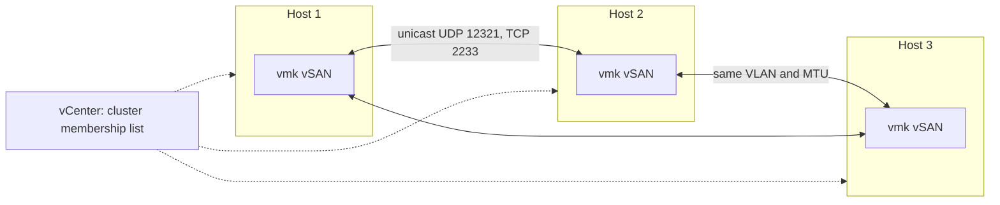
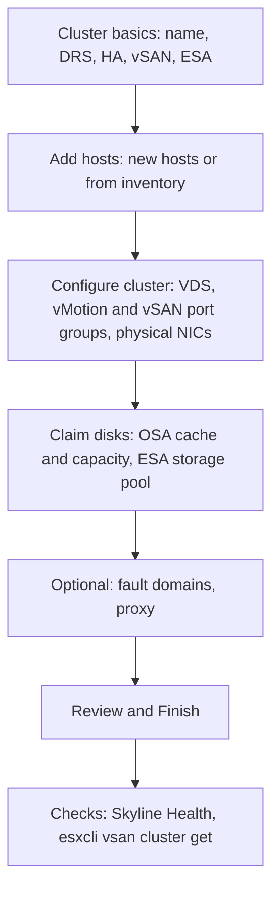

:::analogy
**The data center pain.** An administrator enables vSAN on a cluster where HA (High Availability) is on, puts the vSAN VMkernel on the wrong VLAN (Virtual Local Area Network) on one host, and leaves MTU (Maximum Transmission Unit) 9000 on the hosts but 1500 on one switch. The cluster splits into pieces, and the VMs (VM, Virtual Machine) on the isolated host no longer start. For the exam, the VVF (VMware vSphere Foundation, 2V0-16.25) and VCF (VMware Cloud Foundation, 2V0-17.25) exam guides ask you to describe the deployment of a vSAN cluster. [S02] [S03] [S370]

**The analogy: building an apartment block.**

- **The vSAN network** is the plumbing: you install it before tenants move in, and it must use the same pipe size (MTU) everywhere.
- **HA** is the building manager: you take them out while you change the plumbing, then bring them back, because they communicate through it.
- **Quickstart** is the builder's checklist: foundation, floors, utilities, handover.
- **Fault domains** are the stairwells: you do not keep every copy of the keys in the same stairwell.
:::

:::architecture
### 1. Before anything: the requirements

Many of the rules below come from Broadcom KB (Knowledge Base article) articles:

| Requirement | Why | Source |
|---|---|---|
| Hardware on the compatibility guide; disks and HBA (Host Bus Adapter) controllers on the vSAN list | Otherwise it is not supported | KB 327002 [S372] |
| Hosts with no existing vSAN or networking configuration | Quickstart configures them from scratch | Docs [S365] |
| The vSAN VMkernel network configured **first** | With vSAN on, HA communicates over the vSAN network | KB 327002 [S372]; KB 415675 [S373] |
| vSphere HA **off** while you enable or disable vSAN | An explicit requirement; turn it back on afterwards | KB 327002 [S372] |
| At least 3 hosts on one site (or 2 nodes with a witness) | Quorum and replicas | Design guide [S361] |

Enabling vSAN creates the vSAN datastore and registers the **vSAN storage provider**, which reports the datastore's capabilities to vCenter. [S372]

### 2. The vSAN network

- Every host has a **VMkernel adapter** with the vSAN service. [S369] [S361]
- Since vSAN 6.6, communication is **unicast** (IP, Internet Protocol, over UDP, User Datagram Protocol), so physical switches do not need multicast; vCenter supplies the membership list. The unicast port is **UDP 12321**. [S367]
- Between the nodes and the witness, **TCP (Transmission Control Protocol) 2233** and **UDP 12321** must be open. [S370]
- **Bandwidth:** OSA (Original Storage Architecture) hybrid at least 1 GbE dedicated (10 GbE recommended), OSA all-flash 10 GbE, ESA (Express Storage Architecture) 25 GbE. [S368]
- **Jumbo frames** are optional; if you use them, enable them on every host and along the whole network path. [S368]
- Do not put several vSAN VMkernel adapters on the same subnet; teaming gives redundancy, not load balancing, and NIOC (Network I/O Control) on a VDS (vSphere Distributed Switch) guarantees bandwidth when you share NICs. [S368]

### 3. Quickstart, step by step

Quickstart is the wizard under **Cluster → Configure → vSAN → Quickstart**. [S365] [S371]

1. **Cluster basics.** You pick the services: DRS (Distributed Resource Scheduler), vSphere HA, vSAN and, if you want, ESA. [S365]
2. **Add hosts.** You add new hosts (with credentials and certificate thumbprint verification) or hosts from the inventory. If vCenter runs on one of the hosts, that host cannot enter maintenance mode during the add, and the other VMs on it must be powered off. [S365] [S371]
3. **Configure cluster.** Distributed switches, port groups for vMotion and vSAN, physical NIC (Network Interface Card) assignment, IP addresses and advanced options (DRS, HA, vSAN, EVC, Enhanced vMotion Compatibility). For ESA you also choose the type: HCI (Hyper-Converged Infrastructure, compute and storage) or storage only; vSphere 8 called it vSAN Max, the 9.0 documents talk about storage clusters. [S365] [S361]
4. **Claim disks.** OSA: you pick one cache device and one or more capacity devices. ESA: you pick the flash devices for the storage pool. [S365]
5. **Optional:** fault domains for hosts that can fail together, and proxy settings. [S365]

**The Quickstart trap:** if you later change the networking Quickstart configured outside of it, you can no longer use Quickstart to add hosts. [S365]

### 4. Stretched and 2-node

Quickstart also has a variant for a **stretched cluster** or a **2-node cluster**: you define fault domains for the preferred and secondary sites and choose a **witness host** outside the cluster. The witness must be empty and has a single VMkernel adapter for vSAN traffic; several 2-node clusters can share the same witness. Distributed switches must use network resource control version 3. [S366] The details come in lesson 3.5.

### 5. Adding a host

From the **Add hosts** card in Quickstart: add the host, verify the certificate thumbprint, then from **Configure hosts** apply the same networking and claim the disks. [S371]

### 6. The first checks

| Command | What you check | Source |
|---|---|---|
| `esxcli vsan network list` | Which VMkernel vSAN uses on the host | KB 326954 [S369] |
| `esxcli vsan cluster get` | That every host is a member; *Sub-Cluster Member Count* of 1 means an isolated host | KB 326954 [S369]; KB 391883 [S370] |
| `esxcli vsan cluster unicastagent list` | That all other members and the witness appear | KB 326954 [S369] |
| `vmkping -I vmkX -d -s 8972` | MTU 9000 without fragmentation (for MTU 1500 use 1472) | KB 326954 [S369]; KB 391883 [S370] |

### 7. Disabling vSAN

If you disable vSAN, **every VM on the vSAN datastore becomes inaccessible**, so you move them first. You turn HA off, unmount the datastore, then turn vSAN off; for stretched or 2-node, you remove the witness first. [S372]

`[IMAGE SEARCH / PROMPT]` "vSAN cluster Quickstart cards cluster basics add hosts configure cluster" and "vSAN VMkernel adapter unicast network diagram".
:::

:::exam-alert
### Memorize

| What | Value / rule | Source |
|---|---|---|
| HA when enabling vSAN | Off, then back on | KB 327002 [S372] |
| Order | vSAN network before HA | KB 415675 [S373] |
| Communication | Unicast, UDP 12321 | Docs [S367] |
| Ports to open | TCP 2233, UDP 12321 | KB 391883 [S370] |
| ESA bandwidth | 25 GbE | Docs [S368] |
| OSA all-flash bandwidth | 10 GbE | Docs [S368] |
| Quickstart | Hosts with no vSAN or networking configuration | Docs [S365] |
| MTU 9000 test | `vmkping -d -s 8972` | KB 326954 [S369] |

### 3 exam traps

1. **"I leave HA on while enabling vSAN, so the VMs stay protected."** False. HA must be off when you enable or disable vSAN and turned back on afterwards. [S372]
2. **"vSAN 8 needs multicast on the switches."** False. Since vSAN 6.6 communication is unicast. [S367]
3. **"I test MTU 9000 with `vmkping -s 9000`."** False. Headers take space: you test with `-s 8972` and `-d` (do not fragment). [S369] [S370]
:::

:::trenches
### Mistake 1: the cluster split after a switch upgrade

After a switch upgrade, Skyline Health shows *vSAN cluster partition*, and on one host `esxcli vsan cluster get` returns *Sub-Cluster Member Count* 1. The VMs on it no longer start. [S370]
**Fix (KB 391883):** check that the switch ports carry the same 802.1Q VLAN for every node and the witness, that TCP 2233 and UDP 12321 are open along the whole path, and that the MTU matches. Test with `vmkping -I vmkX -d -s 8972` until you get 0% loss. [S370] [S369]

### Mistake 2: HA that no longer configures

After vSAN is enabled, HA fails with *vSphere HA is missing network configuration information*. It works only if vSAN is disabled. [S373]
**Fix (KB 415675):** with vSAN on, HA agents communicate over the vSAN network, not management. Configure the vSAN VMkernel on every host and only then enable HA. [S373] [S372]
:::

:::interview
**Junior/Mid question: "What do you check before enabling vSAN on a new cluster?"**

*Ideal answer:* the hardware and controllers on the vSAN compatibility list, the vSAN VMkernel network on every host (same VLAN, same MTU, ports 2233 and 12321 open), HA off during enablement and hosts with no old configuration if you use Quickstart. [S372] [S370] [S365] A good candidate says HA is turned back on afterwards and then communicates over the vSAN network. [S373]

**Troubleshooting scenario: "You added a new host, but it does not join the vSAN cluster. The steps?"**

*The answer a Team Lead expects:*
1. **`esxcli vsan network list`** on the new host: does it have a VMkernel with vSAN? [S369]
2. **`esxcli vsan cluster get`**: if *Sub-Cluster Member Count* is 1, the host is isolated. [S370]
3. **`esxcli vsan cluster unicastagent list`**: do the other members appear? [S369]
4. **`vmkping -I vmkX -d -s 8972`** (or 1472) to the others: are MTU and VLAN correct? [S369] [S370]
5. **The ports** TCP 2233 and UDP 12321 open on switches and firewalls; if the network was changed outside Quickstart, add the host manually. [S370] [S365]
:::

:::lab
**Scenario.** You prepare the vSAN network, test it, create or review the vSAN cluster with Quickstart, claim the disks and run the basic command-line checks.

**What you need.** At least 3 ESXi hosts in the lab, each with free disks (or an existing vSAN cluster you only review), a VDS and temporary SSH (Secure Shell) on one host.

The steps below can be checked off, and progress is saved in the browser. Exact menu names may differ slightly between versions 8 and 9 (`⚠ to verify`).

**Home lab only / not supported.** vSAN on nested hosts, with virtual disks marked as flash or NVMe (Non-Volatile Memory Express), is for a lab only; it is not on the compatibility list. If your cluster already holds data, do not disable vSAN. [S372]

**Failure test and validation.** In step 2, `vmkping -d -s 8972` must work between every host if you use MTU 9000; if a switch is at 1500, you see it fail. In step 5, `esxcli vsan cluster get` must show every member.
:::

:::quiz
Five original questions in the style of VCP (VMware Certified Professional) exams. You get the explanation for every option right after you answer.
:::

:::references
- VCP-VVF 2V0-16.25 and VCP-VCF 2V0-17.25 exam guides, objective 2.3 [S02] [S03]
- vSAN 8 documentation: Quickstart [S365], Quickstart for stretched and 2-node [S366]
- The vSAN network: unicast [S367] and network design [S368]
- KB 326954 and KB 391883: network troubleshooting and partitions [S369] [S370]
- KB 327002 and KB 415675: enabling vSAN and HA [S372] [S373]
- KB 400637: adding a host with Quickstart [S371]
- Host planning and the vSAN Design Guide [S355] [S361]; the OSA and ESA comparison [S356]
:::
