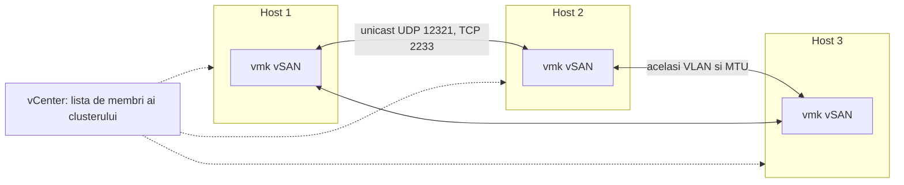
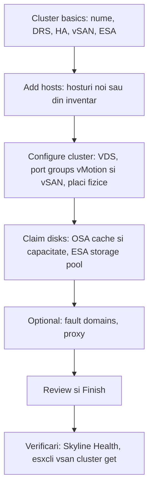

:::analogy
**Durerea din data center.** Un administrator activează vSAN pe un cluster în care HA (High Availability) e pornit, pune VMkernel-ul vSAN pe un VLAN (Virtual Local Area Network) greșit pe un singur host și lasă MTU (Maximum Transmission Unit) 9000 pe hosturi, dar 1500 pe un switch. Clusterul se rupe în bucăți, iar VM-urile (VM, Virtual Machine) de pe hostul izolat nu mai pornesc. Pentru examen, exam guide-urile VVF (VMware vSphere Foundation, 2V0-16.25) și VCF (VMware Cloud Foundation, 2V0-17.25) cer să descrii deployment-ul unui cluster vSAN. [S02] [S03] [S370]

**Analogia: construcția unui bloc de locuințe.**

- **Rețeaua vSAN** e instalația de apă: o pui înainte să muți locatarii, și trebuie să aibă aceeași țeavă (MTU) peste tot.
- **HA** e administratorul blocului: îl scoți din clădire cât schimbi instalația, apoi îl aduci înapoi, pentru că el comunică prin ea.
- **Quickstart** e lista de verificare a constructorului: fundație, etaje, instalații, recepție.
- **Fault domains** sunt scările blocului: nu pui toate copiile cheilor în aceeași scară.
:::

:::architecture
### 1. Înainte de orice: cerințele

Multe reguli de mai jos vin din articole KB (Knowledge Base article) Broadcom:

| Cerință | De ce | Sursă |
|---|---|---|
| Hardware pe lista de compatibilitate; discuri și controllere HBA (Host Bus Adapter) pe lista vSAN | Altfel nu e suportat | KB 327002 [S372] |
| Hosturi fără configurație vSAN sau de rețea existentă | Quickstart le configurează de la zero | Docs [S365] |
| Rețeaua VMkernel vSAN configurată **înainte** | Cu vSAN pornit, HA comunică prin rețeaua vSAN | KB 327002 [S372]; KB 415675 [S373] |
| vSphere HA **oprit** cât activezi sau dezactivezi vSAN | Cerință explicită; îl repornești după | KB 327002 [S372] |
| Minimum 3 hosturi pe un site (sau 2 noduri cu witness) | Quorum și replici | Design guide [S361] |

Activarea vSAN creează datastore-ul vSAN și înregistrează **vSAN storage provider-ul**, care raportează vCenter-ului capabilitățile datastore-ului. [S372]

### 2. Rețeaua vSAN

- Pe fiecare host ai un **VMkernel adapter** cu serviciul vSAN. [S369] [S361]
- De la vSAN 6.6, comunicarea e **unicast** (IP, Internet Protocol, peste UDP, User Datagram Protocol), deci switch-urile fizice nu au nevoie de multicast; vCenter dă lista de membri. Portul unicast e **UDP 12321**. [S367]
- Între noduri și witness trebuie deschise **TCP (Transmission Control Protocol) 2233** și **UDP 12321**. [S370]
- **Lățimea de bandă:** OSA (Original Storage Architecture) hibrid cel puțin 1 GbE dedicat (10 GbE recomandat), OSA all-flash 10 GbE, ESA (Express Storage Architecture) 25 GbE. [S368]
- **Jumbo frames** sunt opționale; dacă le folosești, le activezi pe toate hosturile și pe tot drumul din rețea. [S368]
- Nu pui mai multe VMkernel adaptere vSAN în aceeași subrețea; teaming-ul îți dă redundanță, nu echilibrare, iar NIOC (Network I/O Control) pe un VDS (vSphere Distributed Switch) garantează lățimea de bandă când împarți plăcile. [S368]

### 3. Quickstart, pas cu pas

Quickstart e asistentul din **Cluster → Configure → vSAN → Quickstart**. [S365] [S371]

1. **Cluster basics.** Alegi serviciile: DRS (Distributed Resource Scheduler), vSphere HA, vSAN și, dacă vrei, ESA. [S365]
2. **Add hosts.** Adaugi hosturi noi (cu credențiale și verificarea amprentei certificatului) sau din inventar. Dacă vCenter rulează pe unul dintre hosturi, acela nu poate intra în maintenance mode în timpul adăugării, iar celelalte VM-uri de pe el trebuie oprite. [S365] [S371]
3. **Configure cluster.** Distributed switches, port groups pentru vMotion și vSAN, alocarea plăcilor fizice, adresele IP și opțiunile avansate (DRS, HA, vSAN, EVC, Enhanced vMotion Compatibility). Pentru ESA alegi și tipul: HCI (Hyper-Converged Infrastructure, calcul și stocare) sau doar stocare; vSphere 8 îl numea vSAN Max, documentele 9.0 vorbesc despre storage clusters. [S365] [S361]
4. **Claim disks.** OSA: alegi un dispozitiv de cache și unul sau mai multe de capacitate. ESA: alegi dispozitivele flash pentru storage pool. [S365]
5. **Opțional:** fault domains pentru hosturi care pot cădea împreună și setări de proxy. [S365]

**Capcana Quickstart:** dacă schimbi mai târziu rețeaua configurată de Quickstart în afara lui, nu mai poți folosi Quickstart ca să adaugi hosturi. [S365]

### 4. Stretched și 2 noduri

Quickstart are și varianta pentru **stretched cluster** sau **cluster cu 2 noduri**: definești fault domains pentru site-ul preferat și cel secundar și alegi un **witness host** în afara clusterului. Witness-ul trebuie să fie gol și are un singur VMkernel adapter pentru traficul vSAN; mai multe clustere cu 2 noduri pot împărți același witness. Distributed switches trebuie să folosească network resource control versiunea 3. [S366] Detaliile vin în lecția 3.5.

### 5. Adăugarea unui host

Din cardul **Add hosts** al Quickstart: adaugi hostul, verifici amprenta certificatului, apoi din **Configure hosts** aplici aceeași rețea și revendici discurile. [S371]

### 6. Primele verificări

| Comandă | Ce verifici | Sursă |
|---|---|---|
| `esxcli vsan network list` | Ce VMkernel folosește vSAN pe host | KB 326954 [S369] |
| `esxcli vsan cluster get` | Că toate hosturile sunt membri; *Sub-Cluster Member Count* de 1 înseamnă host izolat | KB 326954 [S369]; KB 391883 [S370] |
| `esxcli vsan cluster unicastagent list` | Că apar toți ceilalți membri și witness-ul | KB 326954 [S369] |
| `vmkping -I vmkX -d -s 8972` | MTU 9000 fără fragmentare (pentru MTU 1500 folosești 1472) | KB 326954 [S369]; KB 391883 [S370] |

### 7. Dezactivarea vSAN

Dacă dezactivezi vSAN, **toate VM-urile de pe datastore-ul vSAN devin inaccesibile**, deci le muți înainte. Oprești HA, demontezi datastore-ul, apoi oprești vSAN; la stretched sau 2 noduri, întâi scoți witness-ul. [S372]

`[IMAGE SEARCH / PROMPT]` „vSAN cluster Quickstart cards cluster basics add hosts configure cluster” și „vSAN VMkernel adapter unicast network diagram”.
:::

:::exam-alert
### De memorat

| Ce | Valoare / regulă | Sursă |
|---|---|---|
| HA la activarea vSAN | Oprit, apoi repornit | KB 327002 [S372] |
| Ordinea | Rețeaua vSAN înaintea HA | KB 415675 [S373] |
| Comunicare | Unicast, UDP 12321 | Docs [S367] |
| Porturi de deschis | TCP 2233, UDP 12321 | KB 391883 [S370] |
| Bandă ESA | 25 GbE | Docs [S368] |
| Bandă OSA all-flash | 10 GbE | Docs [S368] |
| Quickstart | Hosturi fără configurație vSAN sau de rețea | Docs [S365] |
| Test MTU 9000 | `vmkping -d -s 8972` | KB 326954 [S369] |

### 3 capcane de examen

1. **„Las HA pornit cât activez vSAN, ca să rămână protejate VM-urile.”** Fals. HA trebuie oprit când activezi sau dezactivezi vSAN și repornit după. [S372]
2. **„Pentru vSAN 8 trebuie multicast pe switch-uri.”** Fals. De la vSAN 6.6 comunicarea e unicast. [S367]
3. **„Testez MTU 9000 cu `vmkping -s 9000`.”** Fals. Antetele ocupă spațiu: testezi cu `-s 8972` și `-d` (fără fragmentare). [S369] [S370]
:::

:::trenches
### Greșeala 1: clusterul rupt după un upgrade de switch

După upgrade-ul unui switch, Skyline Health arată *vSAN cluster partition*, iar pe un host `esxcli vsan cluster get` dă *Sub-Cluster Member Count* 1. VM-urile de pe el nu mai pornesc. [S370]
**Remediere (KB 391883):** verifici că porturile switch-ului au același VLAN 802.1Q pentru toate nodurile și witness-ul, că TCP 2233 și UDP 12321 sunt deschise pe tot drumul și că MTU-ul e același. Testezi cu `vmkping -I vmkX -d -s 8972` până ai 0% pierderi. [S370] [S369]

### Greșeala 2: HA care nu se mai configurează

După activarea vSAN, HA dă eroarea *vSphere HA is missing network configuration information*. Merge doar dacă dezactivezi vSAN. [S373]
**Remediere (KB 415675):** cu vSAN pornit, agenții HA comunică prin rețeaua vSAN, nu prin management. Configurezi VMkernel-ul vSAN pe toate hosturile și abia apoi activezi HA. [S373] [S372]
:::

:::interview
**Întrebare Junior/Mid: „Ce verifici înainte să activezi vSAN pe un cluster nou?”**

*Răspunsul ideal:* hardware-ul și controllerele pe lista de compatibilitate vSAN, rețeaua VMkernel vSAN pe fiecare host (același VLAN, același MTU, porturile 2233 și 12321 deschise), HA oprit pe durata activării și hosturi fără configurație veche dacă folosești Quickstart. [S372] [S370] [S365] Un candidat bun spune că HA se repornește după și că apoi comunică prin rețeaua vSAN. [S373]

**Scenariu de troubleshooting: „Ai adăugat un host nou, dar nu intră în clusterul vSAN. Pașii?”**

*Răspunsul pe care îl așteaptă un Team Lead:*
1. **`esxcli vsan network list`** pe hostul nou: are un VMkernel cu vSAN? [S369]
2. **`esxcli vsan cluster get`**: dacă *Sub-Cluster Member Count* e 1, hostul e izolat. [S370]
3. **`esxcli vsan cluster unicastagent list`**: apar ceilalți membri? [S369]
4. **`vmkping -I vmkX -d -s 8972`** (sau 1472) către ceilalți: MTU și VLAN corecte? [S369] [S370]
5. **Porturile** TCP 2233 și UDP 12321 deschise pe switch-uri și firewall-uri; dacă rețeaua a fost schimbată în afara Quickstart, adaugi hostul manual. [S370] [S365]
:::

:::lab
**Scenariu.** Pregătești rețeaua vSAN, o testezi, creezi sau verifici clusterul vSAN cu Quickstart, revendici discurile și faci verificările de bază din linia de comandă.

**Ce ai nevoie.** Cel puțin 3 hosturi ESXi în lab, fiecare cu discuri libere (sau un cluster vSAN existent pe care doar îl verifici), un VDS și SSH (Secure Shell) temporar pe un host.

Pașii de mai jos sunt bifabili, iar progresul se salvează în browser. Numele exacte ale meniurilor pot diferi puțin între versiunile 8 și 9 (`⚠ de verificat`).

**Home lab only / not supported.** vSAN pe hosturi nested, cu discuri virtuale marcate ca flash sau NVMe (Non-Volatile Memory Express), e doar pentru lab; nu e pe lista de compatibilitate. Dacă clusterul tău are deja date, nu dezactiva vSAN. [S372]

**Test de avarie și validare.** La pasul 2, `vmkping -d -s 8972` trebuie să meargă între toate hosturile dacă folosești MTU 9000; dacă un switch are 1500, vezi cum pică. La pasul 5, `esxcli vsan cluster get` trebuie să arate toți membrii.
:::

:::quiz
Cinci întrebări originale, în stilul examenelor VCP (VMware Certified Professional). Primești explicația pentru fiecare variantă imediat după ce răspunzi.
:::

:::references
- Exam guide-urile VCP-VVF 2V0-16.25 și VCP-VCF 2V0-17.25, obiectivul 2.3 [S02] [S03]
- Documentația vSAN 8: Quickstart [S365], Quickstart pentru stretched și 2 noduri [S366]
- Rețeaua vSAN: unicast [S367] și designul rețelei [S368]
- KB 326954 și KB 391883: troubleshooting de rețea și partiții [S369] [S370]
- KB 327002 și KB 415675: activarea vSAN și HA [S372] [S373]
- KB 400637: adăugarea unui host cu Quickstart [S371]
- Planificarea hosturilor și vSAN Design Guide [S355] [S361]; comparația OSA și ESA [S356]
:::
